# Handbuch

Dieses Handbuch erklärt, wie du TrackTab benutzt — ohne technische Details. Es richtet sich an alle, die ihre Musikbibliothek prüfen, aufräumen und pflegen wollen.

Andere Dokumente:

- **[readme.md](readme.md)** — kurzer Einstieg mit Screenshots.
- **[quickstart.md](quickstart.md)** — die ersten Schritte in fünf Punkten.
- **[installation.md](installation.md)** — Einrichtung: fertige App, eigener Build oder Terminal.
- **[Technische Funktionen](technische_funktionen.md)** — Detailwissen für Weiterentwicklung: Analyse-Algorithmen, Formeln, Systemarchitektur.
- **[changelog.md](changelog.md)** — was sich von Version zu Version geändert hat.

---

## Inhaltsverzeichnis

- [Betriebsarten](#betriebsarten)
  - [1. Fertige App (Installation über eine .dmg-Datei)](#1-fertige-app-installation-über-eine-dmg-datei)
  - [2. Eigener App-Build](#2-eigener-app-build)
  - [3. Nutzung über das Terminal](#3-nutzung-über-das-terminal)
- [Als eigene App installieren](#als-eigene-app-installieren)
- [Die Web-Oberfläche](#die-web-oberfläche)
  - [Ansichten: Bearbeiten, Player und DJ](#ansichten-bearbeiten-player-und-dj)
- [Einstellungen](#einstellungen)
- [Ist die Bitrate korrekt?](#ist-die-bitrate-korrekt)
- [Bitrate korrigieren](#bitrate-korrigieren)
- [Lautheit der Tracks](#lautheit-der-tracks)
- [Unterstützte Dateiformate](#unterstützte-dateiformate)
- [Bibliothek scannen](#bibliothek-scannen)
- [Rekordbox abgleichen](#rekordbox-abgleichen)
- [Music.app abgleichen](#musicapp-abgleichen)
- [Der Mediaplayer](#der-mediaplayer)
- [Die Seitenleiste](#die-seitenleiste)
- [Playlisten und Ordner](#playlisten-und-ordner)
- [Playlisten "Merken"](#playlisten-merken)
- [Smart Playlists](#smart-playlists)
- [Playlist-Generator](#playlist-generator)
- [Fremde Playlisten](#fremde-playlisten)
- [DJ-Ansicht](#dj-ansicht)
- [Suchen und filtern](#suchen-und-filtern)
- [Spalten anpassen](#spalten-anpassen)
- [Die Buttonleiste](#die-buttonleiste)
- [Anhören mit Wellenform](#anhören-mit-wellenform)
- [Tags bearbeiten](#tags-bearbeiten)
- [Auffälligkeiten (Metadaten-Probleme)](#auffälligkeiten-metadaten-probleme)
- [Konverter (MP3, AIFF)](#konverter)
- [Einzelprüfung von neuen Dateien (nicht in der Mediathek)](#einzelprüfung-von-neuen-dateien-nicht-in-der-mediathek)
- [Dateien automatisch umbenennen](#dateien-automatisch-umbenennen)
- [Statistik](#statistik)
- [Genre, Album, Künstler + Korrekturvorschläge](#genre-album-künstler--korrekturvorschläge)
- [Tracks ausblenden](#tracks-ausblenden)
- [Gelöschte und verschobene Dateien](#gelöschte-und-verschobene-dateien)
- [Verwaiste Ordner](#verwaiste-ordner)
- [Backup](#backup)
- [Grenzen](#grenzen)

---

## Betriebsarten

Es gibt drei Wege, TrackTab zu benutzen. Die fertige App (Installation über eine .dmg-Datei) nutzt den Datenordner `~/Library/Application Support/TrackTab/`. Ein eigener App-Build legt automatisch einen eigenen, getrennten Datenordner (`TrackTab-Build`) an und läuft auch auf einem anderen Port — egal ob du ihn direkt aus `dist/` öffnest oder über die von `build_app.sh` angelegte Verknüpfung in Programme startest. So kannst du beide Versionen gleichzeitig offen haben (z. B. eine feste Version für deine echte Bibliothek und eine zum Testen neuer Änderungen), ohne dass sie sich Daten oder Port teilen. Der Terminal-Betrieb direkt aus dem Quellcode legt seine Datenbank und Einstellungen dagegen im Projektordner selbst ab — er läuft also ebenfalls mit einem eigenen, getrennten Stand.

### 1. Fertige App (Installation über eine .dmg-Datei)

Der einfachste Weg, ganz ohne Terminal — .dmg öffnen, App in den Programme-Ordner ziehen, einmalig per Rechtsklick öffnen. Voraussetzung: Mac mit Apple-Silicon-Prozessor. Schritt-für-Schritt-Anleitung: [installation.md](installation.md#1-installation-via-dmg-datei-macos).

### 2. Eigener App-Build

Du baust dir aus dem Quellcode eine eigene, doppelklickbare App — danach brauchst du kein Terminal mehr, auch nicht zum Starten oder Beenden. Schritt-für-Schritt-Anleitung: [installation.md](installation.md#2-eigener-app-build-kompilierung-aus-dem-quellcode).

### 3. Nutzung über das Terminal

Du startest TrackTab direkt per Befehl im Terminal. Das ist der schnellste Weg für den Einstieg und eignet sich auch, wenn du einzelne Schritte (nur scannen, nur den Report neu erzeugen, …) gezielt einzeln ausführen willst. Voraussetzungen und alle Befehle: [installation.md](installation.md#3-ausführung--betrieb-über-das-terminal).

---

## Als eigene App installieren

Egal auf welchem der drei Wege du TrackTab startest: Die Oberfläche öffnet sich zunächst als normaler Tab in deinem Browser. Du kannst sie zusätzlich als eigenständige App installieren — sie läuft dann in einem eigenen Fenster ohne Adressleiste und Tabs, mit eigenem Symbol im Dock, genau wie eine normal installierte App.

- **Chrome / Edge:** Klicke auf das Installieren-Symbol in der Adressleiste (rechts neben der URL) und bestätige.
- **Safari (macOS Sonoma oder neuer):** Menü *Ablage → Zum Dock hinzufügen…*.

Die Installation ist ein einmaliger Schritt. Danach öffnest du TrackTab künftig über das neue Dock-Symbol statt über den Browser.

> [!important]
> Auch die installierte App braucht weiterhin den laufenden lokalen Server im Hintergrund (siehe [Betriebsarten](#betriebsarten)) — läuft er nicht, zeigt die PWA das TrackTab-Symbol mit einem Knopf **Starten**. Der startet die App direkt aus diesem Fenster heraus (nur wenn TrackTab als gebaute App installiert ist, nicht im Terminal-Betrieb); die Seite lädt sich danach automatisch neu, sobald der Server bereit ist. Auch nach einem bewussten **Beenden** über den gleichnamigen Knopf in der Oberfläche landest du auf genau diesem Bildschirm, sobald der Server tatsächlich gestoppt hat.

---

## Die Web-Oberfläche

Egal ob per Terminal (`serve`) oder über die gebaute App gestartet: Im Hintergrund läuft ein kleiner Server, ausschließlich auf deinem eigenen Rechner (`127.0.0.1`) — nichts davon ist über das Internet erreichbar. Das ist nötig, damit Ausblendungen gespeichert und Musikdateien zum Anhören ausgeliefert werden können; eine reine HTML-Datei kann das nicht.

### Ansichten: Bearbeiten, Player und DJ

Es gibt drei Ansichten: Player, DJ und Bearbeiten. Spalten-Reihenfolge, ausgeblendete Spalten und Spaltenbreite werden für jede Ansicht getrennt gespeichert — Änderungen in der Player-Ansicht wirken sich nicht auf die Bearbeiten-Ansicht aus und umgekehrt. Die Wiedergabe selbst läuft dagegen ansichtsübergreifend: ein Wechsel zwischen Bearbeiten und Player unterbricht weder laufende Musik noch die Warteschlange.

Oben rechts wechselst du zwischen den Ansichten:

- **Bearbeiten** — die volle Oberfläche mit allen Listen, Filtern und Zeilen-Aktionen (Standard).

  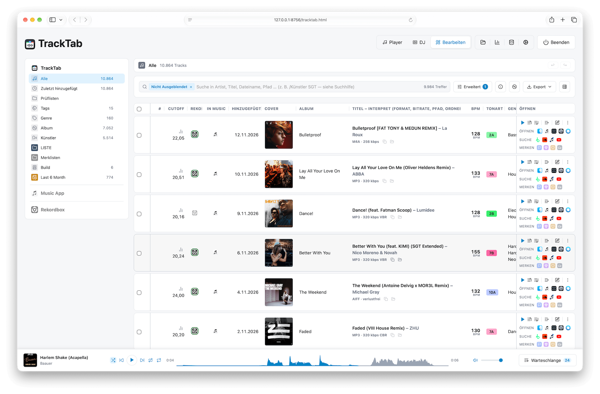

  *Die Bearbeiten-Ansicht.*

- **Player** — eine stark reduzierte Ansicht zum reinen Anhören: Bibliotheksverwaltung, Einzelprüfung und Export-Buttons sind ausgeblendet. Die Seitenleiste mit dem Listen-Baum bleibt vollständig sichtbar und bedienbar, und die gewählte Liste bleibt beim Umschalten stehen. In jeder Zeile bleiben nur Abspielen, Zur Warteschlange hinzufügen, „Musik öffnen" und Merken sichtbar. 


> [!tip] 
> Während ein Scan läuft, lässt sich nicht zur Player-Ansicht wechseln.

  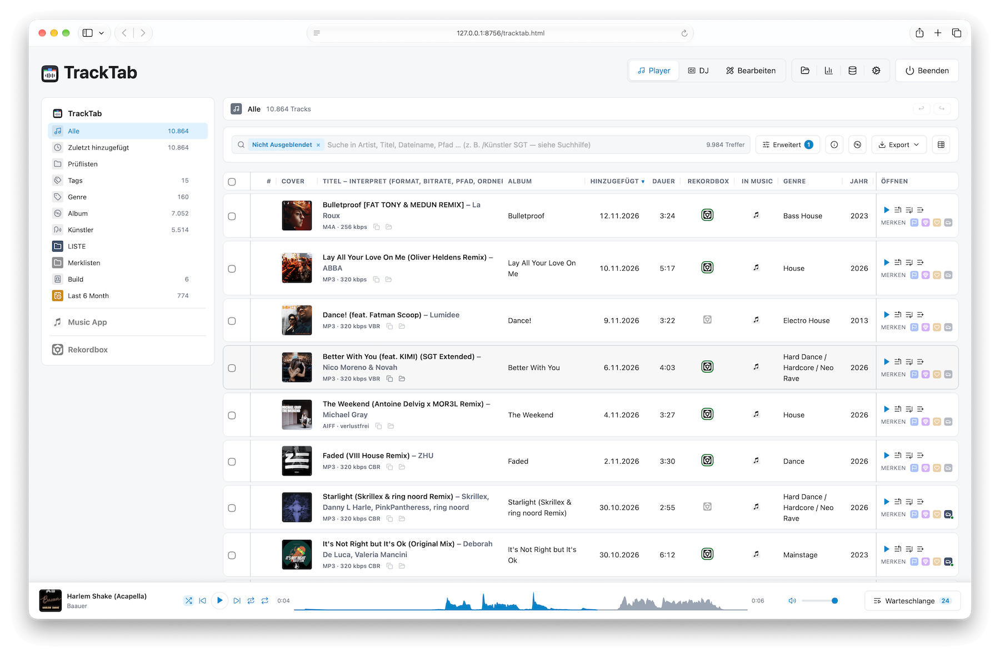

  *Die reduzierte Player-Ansicht.*

- **DJ** — zeigt TrackTabs eigene Listen und die Listen aus Music.app und Rekordbox, inklusive Ziehen auf deren Playlisten und Entfernen über die Leiste. Titel dort, die TrackTab nicht kennt, sind wie in Bearbeiten mit „nicht in TrackTab“ bzw. „keine lokale Datei“ markiert und lassen sich nicht aufklappen oder bearbeiten. Ein aufgeklappter Track öffnet den Editor für Cues, Loops, Beatgrid und Phrasen, siehe [DJ-Ansicht](#dj-ansicht). Auch hierhin lässt sich während eines Scans nicht wechseln. Das Abgleich-Menü (Datenbank-Symbol oben rechts) steht auch hier zur Verfügung. Dateien öffnest du wie in Bearbeiten über das Ordner-Symbol oder per Drag & Drop, die [Einzelprüfung](#einzelprüfung-von-neuen-dateien-nicht-in-der-mediathek) steht dann mit allen Funktionen über der Liste.

## Einstellungen

Unter dem Zahnrad-Symbol passt du Bibliothekspfade, Analyse-Empfindlichkeit, Klassengrenzen, externe Programme (Audio-Editor, DAW, Mixed In Key, Music App, Rekordbox) und weitere Optionen an. Links wählst du die Seite, das Suchfeld darüber findet jede Einstellung nach Name oder Hilfetext. Ein Punkt in der Navigation markiert Seiten mit noch nicht gespeicherten Änderungen. Was von der Vorgabe abweicht, steht als „geändert“ direkt am Feld. Kurze Erklärungen zu einem Feld zeigt das **?** hinter seinem Namen (mit der Maus darüberfahren oder anklicken), längere stehen direkt unter dem Feld. Die meisten Gruppen lassen sich über **Zurücksetzen** oben rechts einzeln auf die Vorgabe zurücksetzen.

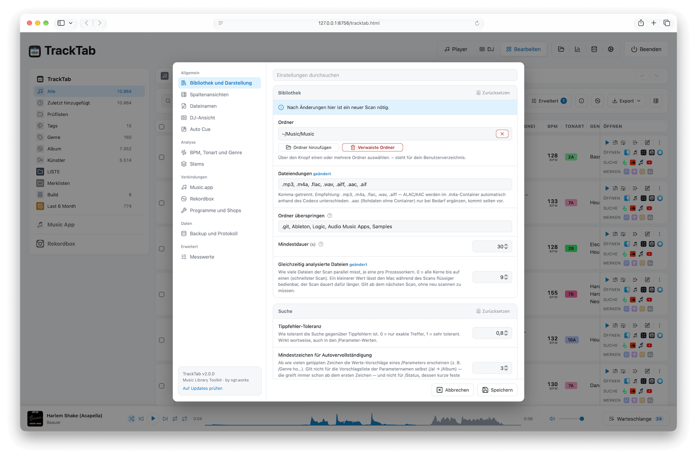

*Der Einstellungen-Dialog.*

Die Seiten im Überblick:

| Seite | Was sich dort einstellen lässt |
|---|---|
| **Bibliothek und Darstellung** | **Bibliothek:** Musikordner, Dateiendungen, ausgeschlossene Ordner, Mindestdauer, wie viele Dateien der Scan gleichzeitig misst (kleiner = Mac bleibt beim Scan flüssiger, Scan dauert länger). **Darstellung:** Sprache, Farbschema, Schriftgröße, Designfarbe. **Suche:** Tippfehler-Toleranz, Mindestzeichen für Autovervollständigung, Standard-Suchfilter (siehe [Suchen und filtern](#suchen-und-filtern)) |
| **Spaltenansichten** | Standard-Spaltenansicht für Listen ohne eigene Zuordnung (siehe [Spalten anpassen](#spalten-anpassen)) |
| **Dateinamen** | Namensmuster fürs automatische Umbenennen (siehe [Dateien automatisch umbenennen](#dateien-automatisch-umbenennen)) |
| **BPM, Tonart und Genre** | Eine gemeinsame Seite für beide Analysen: welche Teile gemessen werden (BPM, Tonart, Genre-Vorschläge, Stimmung & Energie), Automatik für Einzelprüfungen (je Analyse), ein gemeinsames Längenlimit und – in den Abschnitten Tonart-Feld, BPM-Feld, Kommentar-Feld und Genre & Stimmung – was in welches Feld geschrieben wird. Im Abschnitt Tonart-Feld steht auch die Schreibweise der Tonart (Camelot, Open Key, Notennamen), siehe [Tonart](#tonart) und [Genre, Stimmung und Energie](#genre-stimmung-und-energie) |
| **Stems** | Trennmodell laden oder entfernen, Titel-Zusatz und Genre der neuen Dateien, Längenlimit (siehe [Stems erzeugen](#stems-erzeugen-acapella--instrumental)) |
| **Music.app** | Music App auswählen, Cover aus Music.app übernehmen |
| **Rekordbox** | Rekordbox-App, Qualitätsprüfung beim Import mit Mindest-Cutoff, Stimmungen und eigene Tags als „My Tag“ übertragen (siehe [Genre, Stimmung und Energie](#genre-stimmung-und-energie)), Stems in Rekordbox übernehmen, Rekordbox-Backup-Ordner öffnen. Ohne ausgewählte Rekordbox-Installation sind alle außer der Programmwahl ausgegraut |
| **Programme und Shops** | **Externe Programme:** Audio-Editor, DAW, Mixed In Key. **Shops:** welche Plattformen als Such-Icons in der Buttonleiste erscheinen (siehe [Die Buttonleiste](#die-buttonleiste)) |
| **Backup und Protokoll** | Datenbank-Backup erstellen und wiederherstellen, Backup-Ordner und Ordner des Änderungsprotokolls öffnen |
| **Messwerte** | **Analyse:** Cutoff- und Klassengrenzen je Format. **Lautheit:** LUFS-Referenzbereich, True-Peak-Warnschwelle (siehe [Ist die Bitrate korrekt?](#ist-die-bitrate-korrekt)) |

> [!tip]
> Ist auf der Seite „Music.app" die Music App ausgewählt, sollten in Music.app selbst (Einstellungen → Dateien) diese beiden Optionen aktiviert sein: „Medienordner automatisch verwalten" und „Beim Hinzufügen zur Mediathek Dateien in den Medienordner kopieren". Nur so legt Music.app importierte Dateien zuverlässig in seinem eigenen Medienordner ab, und TrackTab kann Pfadänderungen durch Music.app (Umbenennen, Umsortieren) automatisch nachvollziehen.
>
> 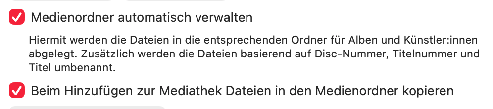

Unter den Button „Abbrechen“/„Speichern“ steht klein die laufende Versionsnummer sowie ein Link „Auf Updates prüfen“ — ein Klick vergleicht sie mit der neuesten auf GitHub veröffentlichten Version und meldet per Popup, ob eine neue Version verfügbar ist oder die Anwendung bereits aktuell ist.

---

## Ist die Bitrate korrekt?

Jede Datei bekommt ein **Verdikt**:

| Verdikt | Bedeutung |
|---|---|
| **Korrekt** | Unauffällig — die Qualität passt zur angegebenen Bitrate. |
| **VERDÄCHTIG** | Etwas stimmt nicht ganz — könnte ein Transcode sein, könnte aber auch ein bandbegrenztes Master oder ein alter Rip sein. Anhören lohnt sich. |
| **FAKE** | Sehr wahrscheinlich hochgerechnet — die Datei behauptet eine höhere Qualität, als sie tatsächlich hat. |
| **UNKLAR** | Zu kurz, zu leise oder aus einem anderen Grund nicht sicher beurteilbar. |

Dahinter steckt eine spektrale Analyse: Bei komprimierten Formaten (MP3, AAC) hinterlässt eine geringere Bitrate eine erkennbare Grenze in den hohen Frequenzen. Wurde eine Datei aus einer niedrigeren Bitrate hochgerechnet, bleibt diese Grenze auch nach dem Neukodieren sichtbar — auch wenn die Datei jetzt als 320 kbps deklariert ist. 

Bei verlustfreien Formaten (ALAC, FLAC, WAV, AIFF) gibt es keine deklarierte Bitrate zum Vergleich; hier zählt allein, ob überhaupt eine solche Grenze vorhanden ist — denn in einer wirklich verlustfreien Datei sollte keine sein.

TrackTab prüft die Grenze außerdem Stück für Stück über die Laufzeit. Daraus entstehen zwei Hinweise in der Begründung, die das Verdikt selbst nicht ändern:

- **„Vermutlich aus mehreren Quellen zusammengesetzt"** — die Grenze springt zwischen Stellen, die zu verschiedenen Bitraten passen. Typisch für Edits, Mashups und Bootlegs, in denen Material unterschiedlicher Qualität steckt.
- **„Vermutlich aus einer ~320 kbps Quelle exportiert"** — eine verlustfreie Datei (z. B. AIFF) zeigt durchgehend die Grenze einer 320er-MP3. Klanglich meist unproblematisch, die Datei ist aber nicht wirklich verlustfrei entstanden.


## Bitrate korrigieren

Für Tracks mit dem Verdikt **VERDÄCHTIG** oder **FAKE** bietet TrackTab an, die Datei direkt auf eine niedrigere, ehrliche Bitrate neu zu kodieren — verfügbar bei verlustbehafteten Formaten (MP3, AAC), nicht bei verlustfreien Formaten.

Der Button „Bitrate korrigieren" erscheint an drei Stellen:

- **Als Symbol in der Zeile** eines betroffenen Tracks (Haupttabelle wie Einzelprüfung).
- **Als Sammelaktion** über der Auswahl mehrerer Zeilen in der Haupttabelle — jeder Track wird dabei auf seine eigene gemessene Bitrate korrigiert.
- **In den Einzelprüfungen als Sammelaktion**, dort aber nur aktiv, wenn genau ein betroffener Track ausgewählt ist.

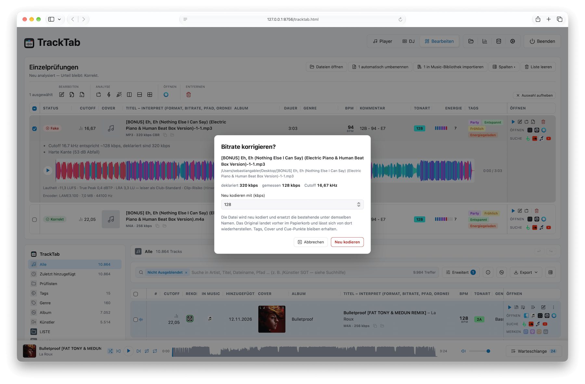

*Der Dialog „Bitrate korrigieren".*

Im sich öffnenden Dialog steht die gemessene Bitrate bereits als Vorschlag im Feld, lässt sich aber frei auf einen Wert zwischen 32 und 320 kbps ändern. Ein Klick auf „Neu kodieren" kodiert die Datei mit dieser Bitrate neu und ersetzt die bestehende Datei unter demselben Namen; das Original wandert vorher in den Papierkorb und lässt sich von dort wiederherstellen. Tags, Cover und Cue-Punkte (z. B. von Serato oder Rekordbox) bleiben dabei erhalten.

## Lautheit der Tracks

Zusätzlich misst TrackTab die **Lautheit** jeder Datei (nach dem in der Musikindustrie üblichen LUFS-Standard). Dafür gibt es kein Gut/Schlecht-Urteil, da die "richtige" Lautheit vom Musikgenre und Erscheinungsjahr abhängt — nur eine Warnung, wenn eine Datei technisch übersteuert ist (Clipping-Gefahr).

Die Schwellwerte können in den Einstellungen individuell angepasst werden. Nach anpassung der Schwellwerte muss die Bibliothek erneut gescannt werden.

Die genauen Schwellwerte, Formeln und die Kalibrierung dahinter stehen in den [Technischen Funktionen](technische_funktionen.md).

---

## Unterstützte Dateiformate

TrackTab liest, analysiert und taggt: **MP3, M4A/MP4 (AAC & ALAC), AAC, FLAC, WAV, AIFF/AIFC, ALAC, OGG/OGA, Opus, WMA**.

Für Bitraten-Analyse, Tags, Umbenennen, Konverter und Music.app-/Rekordbox-Abgleich spielt das Dateiformat keine Rolle — diese Funktionen laufen serverseitig über `ffmpeg`/`ffprobe`/`mutagen` und sind vom Browser unabhängig.

**Ausnahme ist das Anhören im eingebauten Player** (Wellenform, Warteschlange): Die Audiodatei wird dafür unverändert an den Browser gestreamt und dort per `<audio>`-Element abgespielt — welche Formate dabei tatsächlich zu hören sind, entscheidet ausschließlich die Decoder-Unterstützung des verwendeten Browsers, nicht TrackTab:

| Format | Safari | Chrome / Edge | Firefox |
| :--- | :---: | :---: | :---: |
| MP3 | ✅ | ✅ | ✅ |
| AAC / M4A | ✅ | ✅ | ✅ |
| ALAC (`.m4a`) | ✅ | ❌ | ❌ |
| WAV | ✅ | ✅ | ✅ |
| FLAC | ✅ | ✅ | ✅ |
| AIFF/AIFC | ✅ | ❌ | ❌ |
| OGG/Opus | teils¹ | ✅ | ✅ |
| WMA | ❌ | ❌ | ❌ |

¹ Ogg Vorbis wird von Safari nicht unterstützt, Opus erst in neueren Versionen.

Für die verlässlichste Wiedergabe aller unterstützten Formate empfiehlt sich daher **Safari** — insbesondere bei AIFF- oder ALAC-lastigen Bibliotheken. In Chrome/Firefox lassen sich solche Tracks zwar analysieren und bearbeiten, aber nicht im Player anhören (stummer/fehlerhafter Abspielversuch).

---

## Bibliothek scannen

**Wo ist der Button?** Oben rechts neben „Einstellungen" sitzt eine kompakte Icon-Leiste mit drei Symbolen: **Statistik**, **Quellen** (Datenbank-Symbol) und **Datei öffnen**. „Quellen" öffnet ein Menü mit „Bibliothek scannen", „Rekordbox abgleichen" und „Music.app abgleichen" (die beiden letzten nur, wenn die jeweilige App in den Einstellungen gewählt ist). Ein roter Punkt am Symbol zeigt, dass eine Quelle Handlungsbedarf hat — im geöffneten Menü steht dann am betroffenen Eintrag eine Markierung (aktuell: für Rekordbox vorgemerkte Änderungen). Läuft ein Scan oder Abgleich, erscheint der Fortschritt unter dem Titel „TrackTab".

**Scannen.** TrackTab durchsucht deine konfigurierten Musikordner und analysiert jede noch nicht bekannte oder seither geänderte Datei. Der Button „Bibliothek scannen" öffnet dafür die Scan-Optionen:

   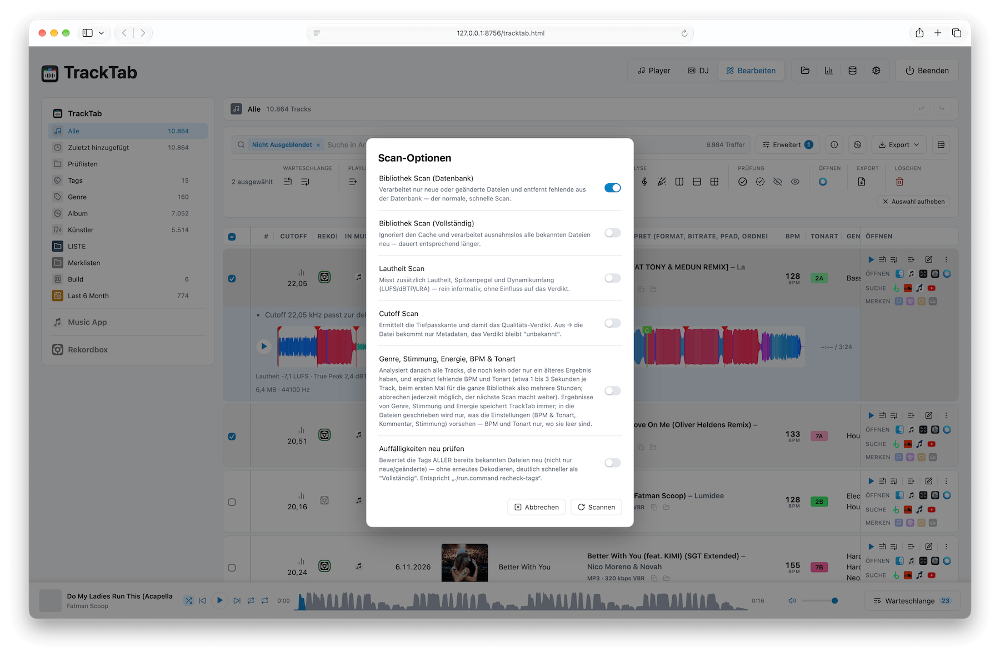

   *Der Scan-Optionen-Dialog.*

   - **Bibliothek Scan (Datenbank)** — der normale, schnelle Scan: verarbeitet nur neue oder geänderte Dateien und entfernt fehlende aus der Datenbank.
   - **Bibliothek Scan (Vollständig)** — ignoriert den Cache und verarbeitet ausnahmslos alle bekannten Dateien neu. Legt den Cache damit komplett neu an, dauert entsprechend länger und ist normalerweise nur nach Parameter-Änderungen an der Analyse nötig.
   - **Lautheit Scan** (standardmäßig aus) — misst zusätzlich Lautheit, Spitzenpegel und Dynamikumfang (LUFS/dBTP/LRA), rein informativ und ohne Einfluss auf das Verdikt.
   - **Cutoff Scan** (standardmäßig aus) — ermittelt die Tiefpasskante und damit das Qualitäts-Verdikt. Abgeschaltet bekommt eine Datei nur Metadaten, das Verdikt bleibt „unbekannt".
   - Was ein früherer Scan bei abgeschaltetem Cutoff oder Lautheit ausgelassen hat, holt der nächste Scan mit eingeschaltetem Schalter für genau diese Tracks nach, auch wenn sich die Datei nicht geändert hat. Eine Lautheitsmessung, die fehlgeschlagen war, wird dabei erneut versucht. Vorhandene Messwerte gehen nie verloren, auch wenn ein Schalter aus ist.
   - **Genre, Stimmung, Energie, BPM & Tonart** — analysiert danach alle Tracks ohne Ergebnis und ergänzt fehlende BPM und Tonart (nur leere Felder). In die Dateien wird nur nach den Einstellungen geschrieben (siehe [Genre, Stimmung und Energie](#genre-stimmung-und-energie)).
   - **Auffälligkeiten neu prüfen** — bewertet die Tags ALLER bereits bekannten Dateien neu (nicht nur neue/geänderte), ohne die Datei erneut zu dekodieren — deutlich schneller als „Vollständig". Sinnvoll nach einem TrackTab-Update, wenn sich die Erkennung selbst verbessert hat (siehe [Auffälligkeiten (Metadaten-Probleme)](#auffälligkeiten-metadaten-probleme)).

## Rekordbox abgleichen

   **„Rekordbox abgleichen"** prüft, welche Tracks bereits in Rekordbox' Sammlung liegen, und sucht wahlweise nach Rekordbox-Einträgen, deren Datei fehlt, unter den eigenen Bibliothekspfaden wieder (mit Vorschau vor dem Schreiben).
   Genre-, Interpret- und Album-Änderungen aus dem **Zusammenführen** werden nicht sofort nach Rekordbox geschrieben, sondern vorgemerkt; die Zahl steht als Zähler am Knopf. Im Abgleich-Dialog überträgt die Option **„Vorgemerkte Tags übertragen"** alle gesammelt in einem Durchlauf (Rekordbox muss dafür geschlossen sein; es entsteht nur ein Backup der Rekordbox-Datenbank).

   > [!tip] 
>Damit dieser Button angezeigt wird, muss in den Einstellungen "Rekordbox" als Programm ausgewählt sein. Bis dahin sind auch die übrigen Rekordbox-Einstellungen (Playlist, Qualitätsprüfung, My Tag, Stems) ausgegraut; sie werden frei, sobald du oben ein Rekordbox auswählst.

## Music.app abgleichen
  
 **„Music.app abgleichen"** macht denselben Abgleich für die Music.app-Bibliothek. Beide Buttons erscheinen nur, wenn das jeweilige Programm in den Einstellungen ausgewählt ist.

 > [!tip] 
> Damit dieser Button angezeigt wird, muss in den Einstellungen "Music.app" als Programm ausgewählt sein.

## Der Mediaplayer

Am unteren Bildschirmrand sitzt ein fest angedockter Player — er ist in beiden Ansichten immer sichtbar, auch ohne laufende Wiedergabe. Er zeigt Cover, Titel und Interpret des aktuellen Tracks sowie:

- **Wiedergabe/Pause, Vorheriger/Nächster Titel** — auch über die Leertaste bzw. die Pfeiltasten ←/→ steuerbar. Ein langer Titel läuft beim Hovern in Ruhe durch, wenn er abgeschnitten ist.
- **Zufallswiedergabe** — spielt die Warteschlange in zufälliger statt fester Reihenfolge. Läuft gerade noch nichts, startet ein Klick darauf sofort einen zufälligen Track aus der aktuell gefilterten Ansicht. Die automatisch gefüllte Warteschlange nimmt von mehreren Fassungen desselben Liedes (gleicher Interpret, gleicher Titelkern, z. B. „Replay“ und „Replay (Remix)“) jeweils nur eine auf; weitere Fassungen rücken nur nach, wenn sonst nicht genug Titel übrig bleiben. Von Hand eingereihte Titel bleiben unberührt.
- **Titel wiederholen** — der aktuelle Track startet nach seinem Ende erneut, statt zum nächsten zu springen.
- **Liste wiederholen** — nach dem letzten Track der Warteschlange geht es wieder von vorn los.

**Neu laden während der Wiedergabe:** Drückst du Cmd+R oder F5, während ein Track läuft, fragt TrackTab erst nach, damit die Wiedergabe nicht versehentlich abbricht. Beim Reload-Knopf des Browsers und beim Schließen des Tabs erscheint stattdessen der Hinweis des Browsers.

In der **Player-Ansicht** startet ein Klick auf eine Zeile oder deren Abspielen-Button sofort eine komplett neue Warteschlange aus den nächsten (bis zu 25) Tracks der aktuell angezeigten Liste, beginnend bei dieser Zeile — spätere Änderungen an Suche/Filter wirken sich nicht mehr auf eine schon laufende Warteschlange aus. 

In der **Bearbeiten-Ansicht** klappt ein Zeilenklick dagegen nur die Wellenform auf (siehe „Anhören mit Wellenform" weiter unten), ohne die Wiedergabe zu starten — das erledigt dort erst ein Klick auf den Abspielen-Button im Wellenform-Bereich oder auf das ▶-Symbol in der Öffnen-Spalte. Ab dann läuft derselbe Mediaplayer wie in der Player-Ansicht, inklusive automatischer Warteschlange.

Jede Zeile hat in beiden Ansichten drei Buttons hintereinander:

- **Abspielen** (▶) — startet wie oben beschrieben eine komplett neue Warteschlange (in der Bearbeiten-Ansicht klappt dabei zusätzlich die Wellenform auf).
- **Als nächstes abspielen** — reiht den Track direkt hinter dem gerade laufenden ein, er ist damit garantiert der nächste, ohne die laufende Wiedergabe zu unterbrechen.
- **Zur Warteschlange hinzufügen** (Linien-Plus-Symbol, dasselbe wie am Warteschlange-Button) — hängt den Track ans Ende der Warteschlange an.

Du kannst Tracks auch aus der Tabelle auf den Knopf **Warteschlange** unten rechts ziehen, sie landen dann hinten in der Warteschlange (bei einer Mehrfachauswahl die ganze Auswahl). Beide Hinzufügen-Buttons lassen sich beliebig oft auf denselben Track klicken — jeder Klick reiht ihn erneut ein, auch wenn er schon läuft oder gerade erst gespielt wurde. Eine so von Hand ergänzte Warteschlange ist nicht mehr auf 25 Titel begrenzt. Sind mehrere Zeilen per Checkbox ausgewählt, erscheint in der Sammelleiste derselbe „Hinzufügen"-Button für alle Ausgewählten auf einmal, daneben deine Merklisten.

Der Button „Warteschlange" öffnet ein Popup mit zwei Reitern:

- **Warteschlange** — der aktuelle Track (hervorgehoben) und alles, was als Nächstes kommt. Tracks lassen sich hier per Drag & Drop neu anordnen, über das ✕ entfernen oder per Klick direkt anspielen.

  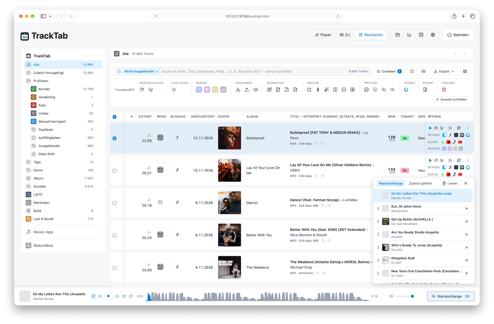

  *Das Warteschlange-Popup.*
- **Zuletzt gehört** — dein Hörverlauf, neuester Eintrag zuerst; die letzten 200 Titel werden behalten, ältere fallen hinten heraus. Ein Klick auf einen Eintrag spielt ihn erneut; der bisher laufende Track wandert dafür zurück an den Anfang der Warteschlange, statt verloren zu gehen. Einzelne Einträge lassen sich hier nicht entfernen, nur komplett über „Leeren".

„Leeren" oben im Popup leert Warteschlange und Verlauf komplett. Beides übersteht ein Neuladen der Seite (an der pausierten Stelle, ohne von selbst loszuspielen) — die **Vorheriger-Titel**-Taste (auch über die Pfeiltaste ←) greift dabei genau auf diesen Verlauf zurück.

Rechts neben dem Fortschrittsbalken sitzt ein Lautstärkeregler mit eigenem Stummschalten-Button — beide sind gekoppelt (Stummschalten zieht den Regler auf 0 und zurück, der Regler ganz nach links schaltet ebenfalls stumm) und werden über einen Neuladen hinweg gemerkt.

## Die Seitenleiste

Links steht der Listen-Baum. Er ist in der Breite verstellbar — fasse die Kante zwischen Leiste und Tabelle und zieh sie. Die Breite bleibt gespeichert. Der Baum ist in beiden Ansichten (Bearbeiten und Player) gleich, und die gewählte Liste bleibt beim Umschalten stehen.

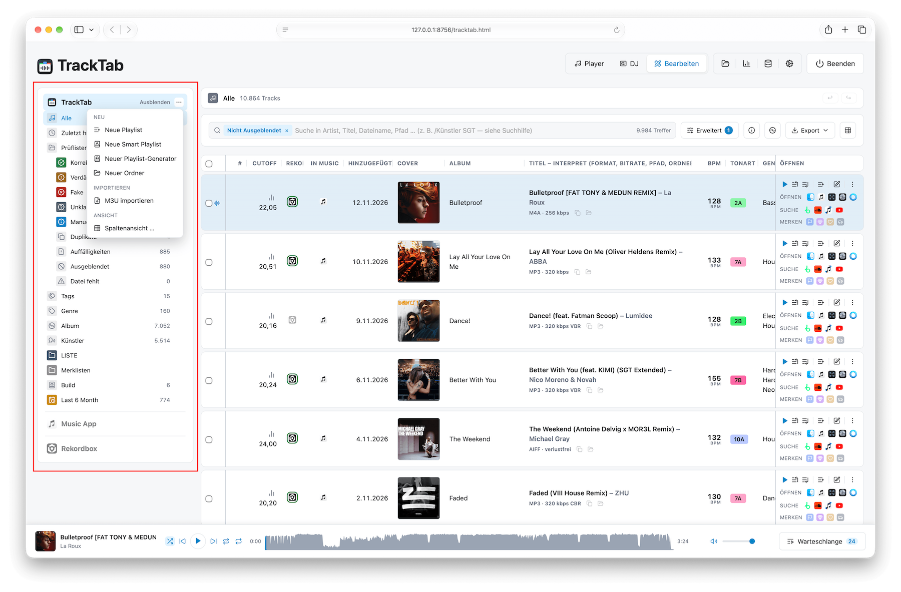

*Die drei Wurzeläste des Listen-Baums: TrackTab, Music App, Rekordbox.*

Es gibt drei Bereiche:

**📁 TrackTab** — deine eigene Datenbank. Ganz oben die festen Listen: 
**Alle**, **Ausgeblendet**, **Datei fehlt**, **Genre**, **Album**, **Künstler**, **Duplikate** und deine **Merklisten**. Darunter der feste Ordner **Prüflisten** mit je einer Liste pro Status, jede mit einem Punkt in ihrer Statusfarbe: ● Korrekt (grün), ● Verdächtig (orange), ● Fake (rot), ● Unklar (grau), ● Manuell korrigiert (blau) — dieselben Farben wie die Status-Abzeichen in der Tabelle. Ebenfalls im Ordner „Prüflisten": **Duplikate** und **Auffälligkeiten** (Metadaten-Probleme statt Audioqualität, siehe [Auffälligkeiten (Metadaten-Probleme)](#auffälligkeiten-metadaten-probleme) weiter unten).

 Diese Listen bringt TrackTab selbst mit und lassen sich nicht umbenennen, ändern oder löschen. **Verschieben lassen sie sich aber**: die Reihenfolge im Baum gehört dir. Darunter stehen die Playlisten, Ordner und Smart Playlists, die du selbst anlegst.

**🎵 Music App** und **🎛 Rekordbox** — die Playlisten dieser beiden Programme. Die Listen werden erst geladen, wenn du den Ast aufklappst. Normale Playlisten und Ordner bearbeitest du direkt hier, über „…“ am Eintrag:
- Am Ast selbst und an einem Ordner: **Neue Playlist**, **Neuer Ordner**.
- An jeder Playlist und jedem Ordner: **Umbenennen**, **Löschen** (mit Rückfrage; ein Ordner geht samt allen Playlisten darin, die Tracks bleiben in der Sammlung bzw. Mediathek).
- An einer Rekordbox-Playlist zusätzlich **Mit TrackTab abgleichen …** (siehe unten).
- Tracks hinzufügen per Drag & Drop auf die Playlist, entfernen über die Leiste für ausgewählte Tracks.
- Playlisten und Ordner verschieben per Drag & Drop im Baum: in einen Ordner hinein (Mitte des Ordners) oder davor/dahinter (oberer/unterer Rand eines Eintrags), auf den Ast selbst = oberste Ebene. Nur innerhalb desselben Programms. Music.app sortiert Playlisten selbst alphabetisch, dort zählt nur der Ordner; zurück auf die oberste Ebene lässt Music.app sich nicht fernsteuern, das geht nur in Music selbst.
- Während eine Änderung läuft, ist der Ast ausgegraut und gesperrt, die betroffene Playlist pulsiert leicht. Der Baum bleibt dabei aufgeklappt.

Smart Playlists tragen ein Schloss: Ihr Inhalt wird im jeweiligen Programm berechnet, TrackTab zeigt sie nur an. In Rekordbox muss das Programm für jede Änderung geschlossen sein (vorher entsteht automatisch ein Backup). Music.app kann per Fernsteuerung nicht umsortieren, die Reihenfolge änderst du dort nur in Rekordbox-Playlisten. Steht ein Track mehrfach in einer Music-Playlist, nimmt „Entfernen“ alle seine Einträge heraus. 

Jeder Ast erscheint nur, wenn das jeweilige Programm in den Einstellungen ausgewählt ist — ohne das bleibt der Ast ganz weg. Die beiden Äste selbst lassen sich wie deine eigenen Listen im Baum verschieben, TrackTab steht dabei aber immer an erster Stelle. 

> [!tip] 
> Sollte eine Fehlermeldung auftreten oder sich Daten in den verbundenen Tools geändert haben, können die Daten jederzeit neu geladen werden. Klicken Sie dazu auf die „…“ und wählen Sie „Neu laden“ aus.


Die Liste **Duplikate** zeigt Tracks, die es doppelt gibt — entweder als exakte Kopie oder als derselbe Song in unterschiedlicher Qualität (z. B. einmal als MP3, einmal als FLAC).

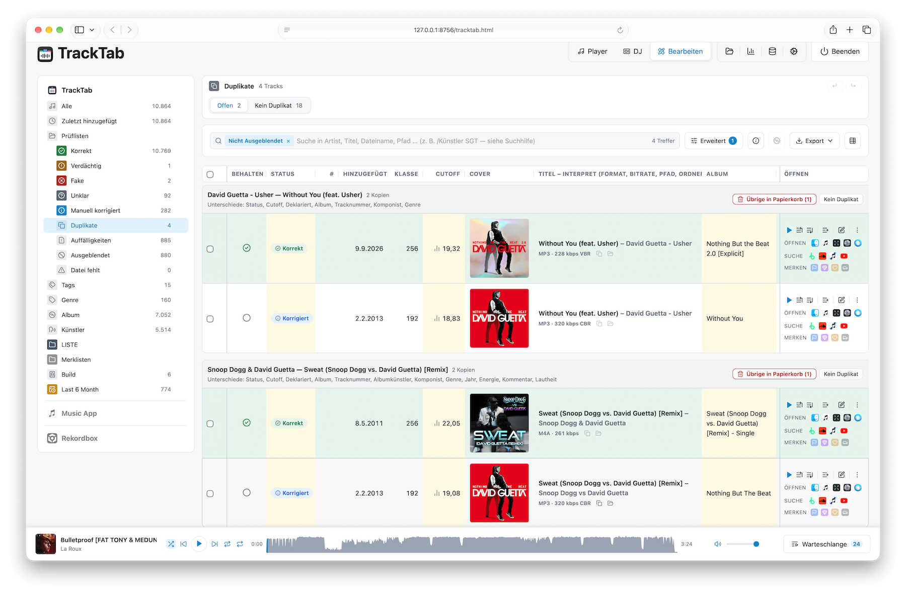

*Die Duplikate-Liste.*

## Playlisten und Ordner

Über die Buttons im Kopf der Seitenleiste legst du an:

- **+** eine Playlist
- **⚙** eine Smart Playlist (siehe unten)
- **📁** einen Ordner

Beim Anlegen wählst du Name, Symbol und Farbe. Ordner dürfen Ordner enthalten.

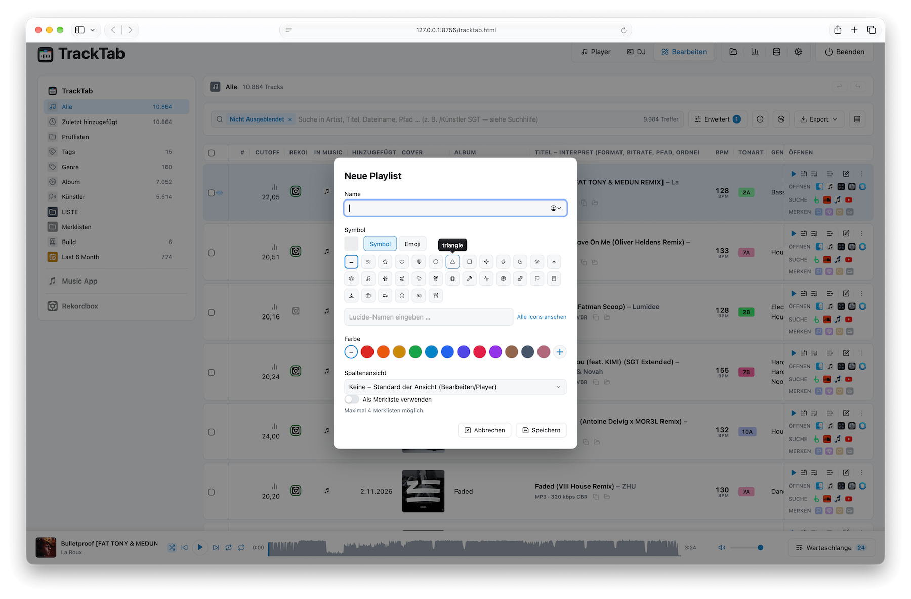

*Eine neue Playlist anlegen.*

**Tracks hineinlegen** geht auf drei Wegen: Zeilen aus der Tabelle in die Playlist ziehen (ist die gezogene Zeile Teil deiner Auswahl, wandert die ganze Auswahl mit), über „Zur Playlist hinzufügen …" im Zeilenmenü, oder über denselben Button in der Sammelleiste, wenn mehrere Zeilen ausgewählt sind.

**Reihenfolge der Tracks:** Innerhalb einer Playlist ziehst du Zeilen an ihren Platz. Das geht auch, während eine Spaltensortierung aktiv ist — beim Ablegen schaltet die Ansicht auf deine Reihenfolge zurück, damit du das Ergebnis siehst. Klickst du danach wieder auf einen Spaltenkopf, sortiert die Ansicht wie überall sonst; die selbst gelegte Reihenfolge bleibt gespeichert und kommt zurück, sobald du die Liste erneut öffnest.

**Reihenfolge im Baum:** Alles unter TrackTab lässt sich ziehen und neu anordnen — die festen Ansichten oben, der Ordner „Prüflisten" und die Listen darin ebenso wie deine eigenen. Ziehst du auf die obere oder untere Hälfte eines Eintrags, landet der gezogene davor bzw. dahinter; auf die Mitte eines Ordners, landet er darin.

**Rückgängig:** Über der Tabelle steht der Kopf der geöffneten Playlist mit ↩ und ↪. Sie nehmen Hinzufügen, Entfernen und Umsortieren zurück und wieder vor — auch per Cmd+Z und Cmd+Shift+Z. Der Verlauf gilt für die laufende Sitzung; nach einem Scan oder einem Neuladen beginnt er von vorn.

Über das **⋯**-Menü an jeder Liste, in drei durch Linien getrennte Gruppen: was die Liste selbst betrifft (Bearbeiten mit Name, Symbol und Farbe; bei Smart Playlists Regeln bearbeiten; Duplizieren) — was mit ihrem Inhalt geschieht (Zur Warteschlange, Playlist exportieren) — und Löschen. Löschen entfernt nur die Liste — die Tracks selbst bleiben unangetastet. Bei einem Ordner verschwindet auch sein Inhalt, die Rückfrage sagt es dazu.

## Playlisten "Merken"

Bis zu vier eigene Playlisten lassen sich als Merkliste markieren — zum Beispiel „Neu kaufen", „Im Warenkorb" oder „Zeigen". Das geschieht im Bearbeiten-Dialog der Playlist (Rechtsklick → „Bearbeiten"): dort steht eine Checkbox „Als Merkliste verwenden", zusätzlich zum ohnehin vorhandenen Namen, Icon und Farbe der Playlist. Jede Zeile trägt dann ein farbiges Icon-Quadrat je markierter Playlist; ein Klick fügt den Track hinzu, ein erneuter Klick entfernt ihn wieder. Ein Track kann gleichzeitig in mehreren Merklisten stehen. Anders als beim Ausblenden bleiben gemerkte Tracks überall sichtbar, auch im Export — Merken ist eine reine Kennzeichnung, kein Filter. 

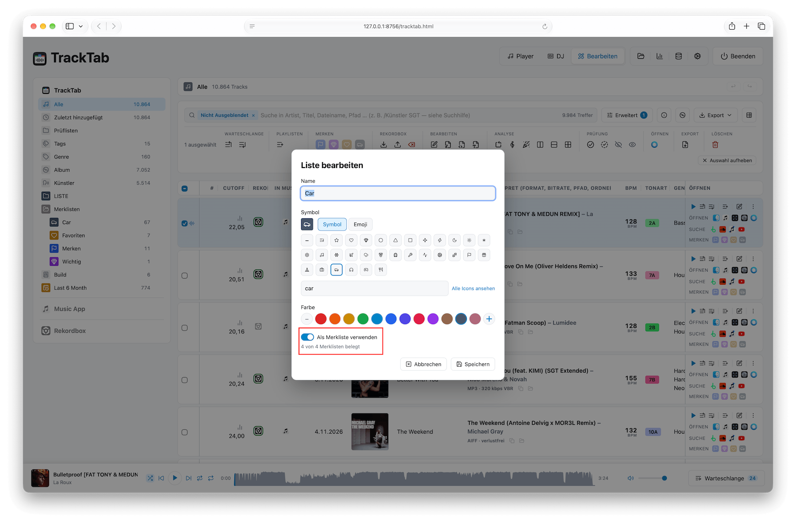
*Bis zu vier eigene Playlisten lassen sich als Merkliste markieren.*

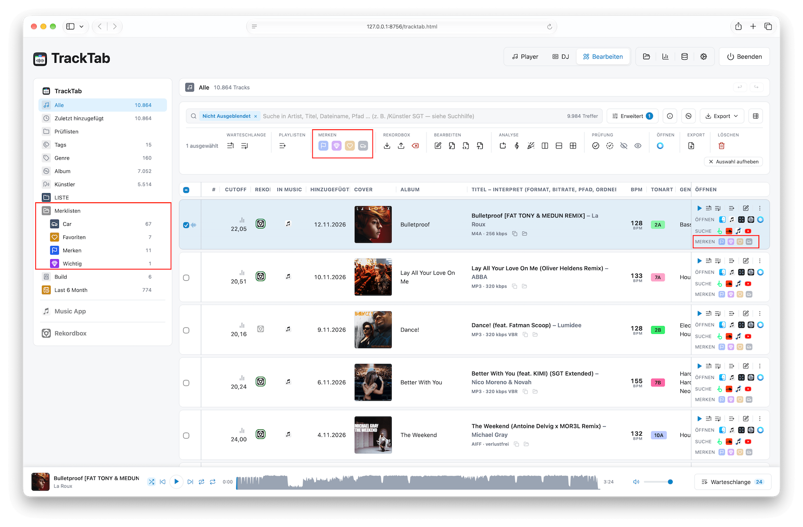
*Die Merklisten werden pro Track angezeigt und in der Mehrfachauswahl*

## Smart Playlists

Eine Smart Playlist hat keinen festen Inhalt, sondern Regeln. Im Regel-Editor legst du fest, ob **allen** oder **beliebigen** Regeln entsprochen werden muss, und baust die Zeilen mit **+** und **−** auf. Das Wertfeld richtet sich nach dem gewählten Feld: bei „Status" bekommst du die Verdikte zur Auswahl, bei „BPM" ein Zahlenfeld, bei „Tonart" die 24 Tonarten in deiner gewählten Schreibweise (die Regel bleibt auch nach einem Wechsel der Schreibweise gültig), bei „Energie" die Stufen 1–10 (ist, ist nicht, mindestens, höchstens — verglichen wird die gerundete Stufe aus der Energie-Spalte), bei „Tags" alle Stimmungen und eigenen Tags, die in deiner Bibliothek vorkommen (hat / hat nicht), bei „In Music.app" ja/nein, bei „Playlist" alle deiner Listen im Baum (ist in / ist nicht in). Damit baust du z. B. „Genre ist House und Playlist ist nicht in Set Freitag". Auch Merklisten, andere Smart Playlists und Ordner (= alles in den Listen darunter) lassen sich wählen. Die Feldliste ist alphabetisch sortiert.

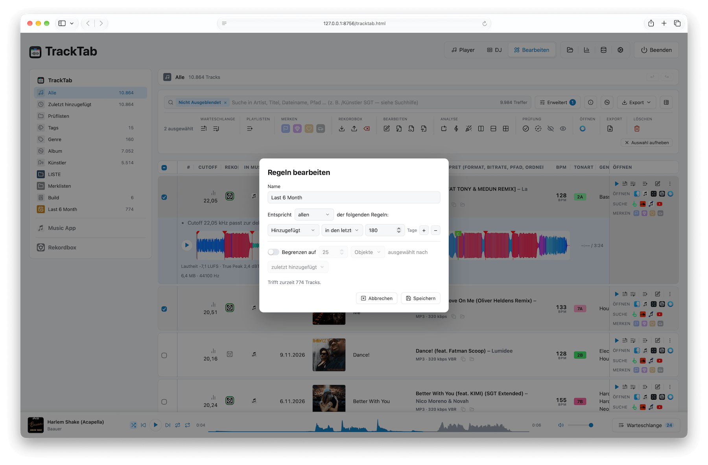

*Regeln einer Smart Playlist bearbeiten.*

In der Fußzeile schaltest du „Begrenzen auf“ ein und begrenzt die Liste auf eine Anzahl Objekte, eine Spielzeit oder eine Speichergröße — ausgewählt nach zuletzt hinzugefügt oder Zufall. Unter dem Dialog steht laufend, wie viele Tracks die Regeln gerade treffen.

Berechnet wird beim Start des Programms und jedes Mal, wenn du die Liste im Baum anklickst — nicht dauernd im Hintergrund.

## Playlist-Generator

Der Playlist-Generator baut dir ein Set entlang einer **Energiekurve**. Du legst ihn über das Kurven-Symbol oben im Listenbaum an (neben „Neue Smart Playlist“). Er erscheint dann wie eine Playlist im Baum. Jeder Generator merkt sich seine Einstellungen und Tracks, du kannst also mehrere anlegen, zum Beispiel „Warm-up Freitag“ und „Peak“.

Wählst du einen Generator aus, siehst du statt der Tabelle:

- **Einstellungen** (einklappbar):
  - **Liederpool:** aus welchen Tracks der Generator wählt. Du schreibst ihn wie eine Suche in der Suchleiste, z. B. `/Genre House /BPM 120-128 /Add 30d` (siehe [Suchen und filtern](#suchen-und-filtern)). Über **Erweitert** klappst du dieselben Parameter als Eingabefelder auf. Ausgeblendete Tracks bleiben standardmäßig draußen (`/No /Ausgeblendet`, unter **Ausgeblendet** steht „nein“) — mit „egal“ zählen sie mit, mit „ja“ wählt der Generator nur aus ihnen. Darunter steht, wie viele Tracks gerade im Pool sind.
  - **Quelle:** ganze Bibliothek oder eine deiner eigenen Playlisten. Die festen Prüflisten (Korrekt, Fake …) stehen hier bewusst nicht, dafür gibt es `/Status` im Liederpool.
  - **Übergänge** und **Stimmung** (siehe unten).
- **Übergänge:** Regeln zum jeweils vorigen Track.
  - **BPM** (Auswahlfeld): ±0, ±3 oder beliebig. Bei **Tempo** zählt mit „½ · 2ד halbes oder doppeltes Tempo als passend (z. B. 87 ↔ 174 BPM), „Aus“ schaltet das ab.
  - **Tonart** auf dem Camelot-Rad:
    - **Streng:** gleiche Tonart, ein Schritt weiter oder der Wechsel A↔B.
    - **Locker:** erlaubt zusätzlich zwei Schritte und den Diagonalschritt.
    - Beispiel ab 8A: **Streng** erlaubt 8A, 7A, 9A und 8B. **Locker** erlaubt zusätzlich 6A, 10A, 7B und 9B. Die Erklärung steht auch als Tooltip an den Knöpfen.
- **Stimmung:** Drehregler für Stimmungen wie Düster, Deep, Groovy, Melodisch, Euphorisch und Aggressiv. Weitere fügst du über **+ Regler** unter den Reglern hinzu; ein Regler verschwindet über das × darunter.
  - Senkrecht ziehen stellt ein: nach oben „mehr“, nach unten „weniger“ bzw. „meiden“. Doppelklick setzt zurück.
  - **Tendenz** gewichtet die Regler nur.
  - **Muss passen** nimmt ausschließlich Tracks, bei denen jede aufgedrehte Stimmung erkannt wurde (und keine zugedrehte).
  - **Kohäsion** hält aufeinanderfolgende Tracks stilistisch beieinander: Je weiter aufgedreht, desto ähnlicher muss der Stil (die erkannten Discogs-Stile) dem des vorigen Tracks sein. Zugedreht spielt der Stil keine Rolle.
- **Verlauf** (eigenes Panel zusammen mit der Energiekurve): eine Vorlage (Ausgewogen, Warm-up, Energy Build, Peak Time, Welle, Cool-down) oder eine deiner **eigenen Kurven**, dazu die Zahl der **Slots**. Die Slotzahl stellst du mit **−** und **+** oder per Eingabe ein. Rechts steht, wie viele Slots belegt sind. Mit dem Speichern-Symbol legst du die aktuelle Kurve unter einem Namen ab. Sie steht dann in jedem Generator unter „Eigene Kurven“ zur Wahl und passt sich dort an die Slotzahl an. Gleicher Name überschreibt, der Papierkorb daneben löscht eine gewählte eigene Kurve.
- **Energiekurve:** Jeder Punkt ist ein Slot, links steht die Skala E1–E10, unten die Slotnummer. Ein Klick in die Spalte eines Slots setzt seine Soll-Energie genau auf die angeklickte Stufe — so legst du z. B. Slot 1 auf E2, Slot 2 auf E4 und Slot 3 auf E6 und lässt danach **Füllen** laufen. Hältst du die Maustaste gedrückt und ziehst über mehrere Slots, zeichnest du die Kurve in einem Zug. Die Vorlage heißt dann „Eigene Kurve“. Die hellblauen Punkte zeigen die tatsächliche Energie der eingesetzten Tracks.
- **Slots:** die Tracks in ihrer Reihenfolge.
  - Jeder belegte Slot zeigt die Waveform des Tracks, farbig wie unter ⚙ Einstellungen → Wellenform eingestellt, mit den Hot Cues und Memory Cues wie in Bearbeiten und Player (deine Bearbeitungen aus der DJ-Ansicht vor Rekordbox) und darunter einer schmalen Leiste mit den Phrasen von TrackTab in ihren festen Farben. Ein Klick hinein springt an diese Stelle; läuft der Slot gerade, siehst du dort den Fortschritt.
  - Ein Klick spielt ab, die folgenden Slots kommen in die Warteschlange. Durch Ziehen sortierst du um. Ein Slot lässt sich auch auf eine andere Playlist im Baum ziehen.
  - Das **Schloss** sperrt einen Track: Er bleibt beim Neu-Würfeln stehen.
  - Je Slot kannst du **neu belegen**, aus **Alternativen** wählen, den Track herausnehmen oder den Slot löschen.
  - Verletzt ein Übergang deine Regeln (etwa nach Umsortieren), steht dazwischen ein roter Hinweis wie „−34 BPM · Tonart-Clash“.

Oben füllt **Füllen** nur die leeren Slots, **Neu würfeln** belegt alle nicht gesperrten Slots neu, und **Leeren** räumt sie. Über **Playlist Export** exportierst du das Set (M3U8). **Als Playlist speichern** legt eine normale Playlist mit der aktuellen Belegung an; sie ändert sich danach nicht mehr mit dem Generator. Im Menü „…“ am Baumeintrag stehen außerdem Warteschlange und Duplizieren.

Der Generator nutzt nur Tracks mit einer Genre-/Stimmungsanalyse, denn er braucht ihre Energie und Stimmung. Oben steht, wie viele Tracks schon analysiert sind. Fehlen noch viele, startest du über „Bibliothek scannen“ einen Scan mit der Option „Genre, Stimmung & Energie“ (siehe [Genre, Stimmung und Energie](#genre-stimmung-und-energie)). Lässt sich ein Slot mit deinen Regeln nicht füllen, lockert der Generator für diesen einen Slot erst die Tonart-, dann die BPM-Regel und markiert den Übergang.

## Fremde Playlisten

Klappst du **Music App** oder **Rekordbox** auf, liest TrackTab deren Playlisten-Baum. Ein Klick auf eine Liste zeigt ihre Tracks in genau der Reihenfolge, die dort gilt.

Tracks, zu denen TrackTab keine Datei hat, stehen trotzdem an ihrer Stelle in der Liste — gedämpft und mit einem Hinweis: **keine lokale Datei** (ein Apple-Music-Track aus der Cloud) oder **nicht in TrackTab** (eine Datei außerhalb der gescannten Ordner). So bleibt die Reihenfolge nachvollziehbar, statt dass Lücken entstehen. Diese Zeilen zählen nirgends mit und lassen sich nicht abspielen oder bearbeiten. Führt Music einen eigenen Track nur noch als Cloud-Eintrag (das passiert etwa, wenn du ihn am iPhone zu einer Playlist hinzufügst), erkennt TrackTab ihn trotzdem an Titel, Interpret und Dateigröße wieder und zeigt ihn als normalen Track.

**Tracks per Drag & Drop in eine Rekordbox-Playlist ziehen:** Zieh einen oder mehrere Tracks aus der Tabelle auf eine normale Rekordbox-Playlist im Baum. Voraussetzung ist, dass **Rekordbox geschlossen ist**, weil TrackTab direkt in Rekordbox' Datenbank schreibt (vorher entsteht automatisch ein Backup). TrackTab prüft das mehrfach: Läuft Rekordbox, werden die Rekordbox-Playlisten beim Ziehen gestrichelt rot markiert und nehmen nichts an; wurde Rekordbox erst nach dem Ziehen gestartet, erscheint beim Ablegen ein bleibender Hinweis und es wird nichts geschrieben. Ordner und Smart Playlists sind kein Ziel. Tracks, die schon in der Playlist liegen, werden übersprungen.

Was mitkommt: Tracks, die Rekordbox noch nicht kennt, bringen TrackTabs Beatgrid, Phrasen und Cues gleich mit, wie beim Knopf **Zu Rekordbox hinzufügen** in der DJ-Ansicht. Stehen gezogene Tracks schon in Rekordbox, öffnet sich vorher eine Liste: Angehakte bekommen Beatgrid, Phrasen und Cues aus TrackTab (wie **Rekordbox Update**), die übrigen werden nur in die Playlist eingetragen. Vorab angehakt sind die Tracks, bei denen TrackTab etwas anderes hat als Rekordbox (rote Spalte Rekordbox). **Alle**, **Keine** und **Nur abweichende** setzen die Haken auf einmal, **Abbrechen** schreibt nichts. **Mit TrackTab abgleichen …** im „…“-Menü einer Rekordbox-Playlist öffnet diese Liste für alle Tracks der Playlist, ohne etwas hinzuzufügen.

**Playlisten verknüpfen:** Über „…“ → **Verknüpfen …** an einer eigenen Playlist oder Smart Playlist wählst du je eine Playlist in Music.app und Rekordbox: Ein Klick auf das Feld öffnet den Playlist-Baum des Programms, dort wählst du die Playlist, „nicht verknüpft“ oder „Neue Playlist anlegen“ (gleicher Name wie in TrackTab). Playlisten, die schon mit einer anderen Liste verknüpft sind, sind dort ausgegraut. Danach halten alle denselben Inhalt: Was du in einer davon hinzufügst oder entfernst, gilt beim nächsten Abgleich überall. Die Reihenfolge bestimmt TrackTab (in Rekordbox übernommen, Music.app sortiert nicht um). Abgeglichen wird beim Öffnen der Liste, kurz nach jeder Änderung an ihr, beim Start und über **Jetzt abgleichen** im Listenkopf; dort steht auch, wann zuletzt abgeglichen wurde. Ein Ketten-Symbol im Baum zeigt verknüpfte Listen, ein Punkt daran heißt „ausstehend“ (Rekordbox lief, es wird beim nächsten Abgleich nachgeholt) oder „Problem“.
- Smart Playlists von TrackTab füllen die verknüpften Playlisten nur in eine Richtung. Änderungen dort werden überschrieben. So bekommst du in Music.app eine „smarte“ Liste mit TrackTab-Regeln.
- Fehlen Tracks in der Music-Mediathek, fragt TrackTab, ob sie importiert werden sollen.
- Würden auf einmal viele Tracks entfernt oder liefert ein Programm plötzlich eine leere Liste, fragt TrackTab vorher nach.
- Titel, die TrackTab nicht kennt (z. B. Apple-Music-Titel ohne Datei), bleiben in Music und Rekordbox unangetastet.

**Tracks in eine Music-Playlist ziehen:** wie bei Rekordbox. Tracks, die noch nicht in der Music-Mediathek sind, importiert TrackTab nach einer Rückfrage zuerst.

**Rekordbox-Playlisten bearbeiten:** In einer geöffneten Rekordbox-Playlist (keine Smart Playlist) gibt es im „…"-Menü einer Zeile und in der Leiste für ausgewählte Tracks zwei Befehle:

- **Aus Rekordbox-Playlist entfernen** — nimmt nur den Eintrag aus dieser Playlist. Der Track bleibt in der Rekordbox-Sammlung und in allen anderen Playlisten.
- **Aus Rekordbox entfernen** — wirkt wie Rekordbox' eigenes „Von der Sammlung entfernen": Der Track verschwindet aus allen Rekordbox-Playlisten, Cues und Verlauf entfallen. Die Audiodatei bleibt liegen. Vorher fragt TrackTab nach und zeigt, wie viele Playlist-Einträge betroffen sind. Diesen Befehl gibt es auch in allen anderen Listen für Tracks mit Rekordbox-Haken. TrackTab räumt dabei auch seinen eigenen Stand zu diesem Track ab: das aus Rekordbox übernommene Beatgrid, die Phrasen und Cues sowie den Cover-Ordner (landet mit der Analyse in der Sicherung). Deine Bearbeitungen aus der DJ-Ansicht und TrackTabs eigene Analyse bleiben.

**Reihenfolge ändern:** Zieh Zeilen innerhalb einer Rekordbox-Playlist an eine neue Stelle — die neue Reihenfolge wird in Rekordbox übernommen. Die Spalte **„#"** zeigt die Position in der Playlist (auch in eigenen und Music-App-Playlisten). Sortierst du die Tabelle nach einer anderen Spalte, z. B. nach Titel, ändert das nur die Ansicht; die Zahlen in „#" bleiben die echte Reihenfolge. Ein Klick auf „#" (oder der dritte Klick auf eine andere Spalte) stellt die Playlist-Reihenfolge wieder her.

Für alle drei Aktionen gilt: **Rekordbox muss geschlossen sein**, ebenso der Hintergrunddienst „rekordboxAgent" (Menüleisten-Symbol). Vor jeder Aktion legt TrackTab ein vollständiges Backup der Rekordbox-Bibliothek an, bei einer Sammelaktion über viele Tracks einmal für die ganze Aktion (`backup/rekordbox/`, zu öffnen über ⚙ Einstellungen → Rekordbox → „Rekordbox-Backup-Ordner öffnen“); beim Entfernen aus der Sammlung wandert auch die Rekordbox-Analyse des Tracks (Beatgrid, Wellenform) dorthin, sodass sich alles vollständig zurückspielen lässt.

Einzelne Rekordbox-Smart-Playlists verwenden Zeitregeln, die nur Rekordbox selbst auswerten kann. Sie erscheinen im Baum, ihr Inhalt bleibt aber leer — TrackTab sagt das beim Öffnen.

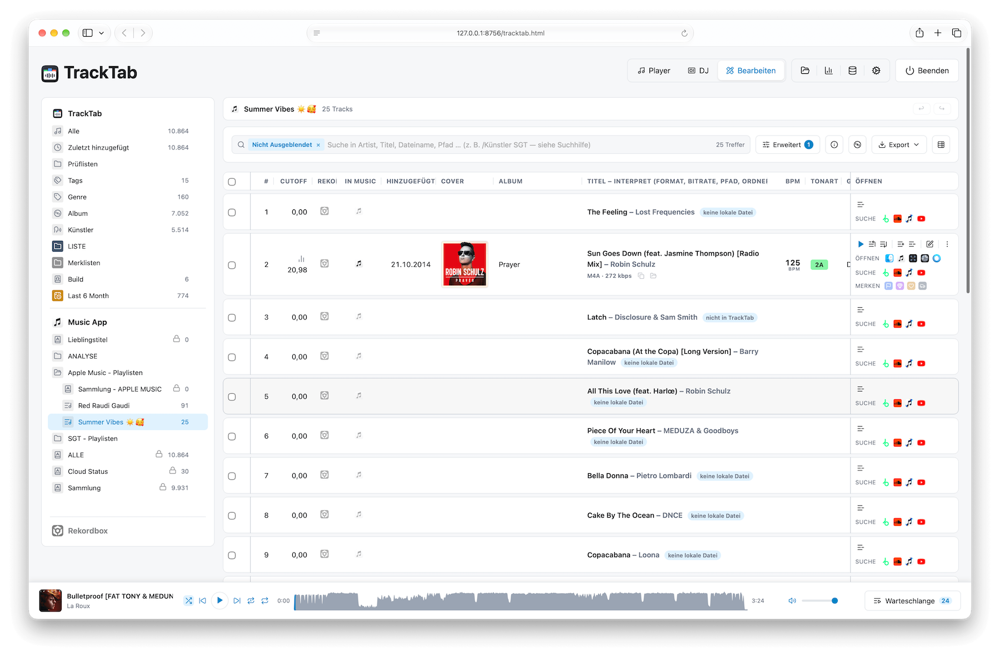

*z.B. Apple Musik Cloud Dateien werden in der Playlist angezeigt und sind mit "keine lokale Datei" markiert.*


## Suchen und filtern

Das Suchfeld über der Tabelle durchsucht standardmäßig Künstler, Titel, Album und Pfad — und zwar tippfehlertolerant (wie stark, stellst du unter „⚙ Einstellungen → Suche" ein). Es kann aber deutlich mehr. Der Button **ⓘ Suchhilfe** listet jederzeit alle Parameter mit Beispielen auf.

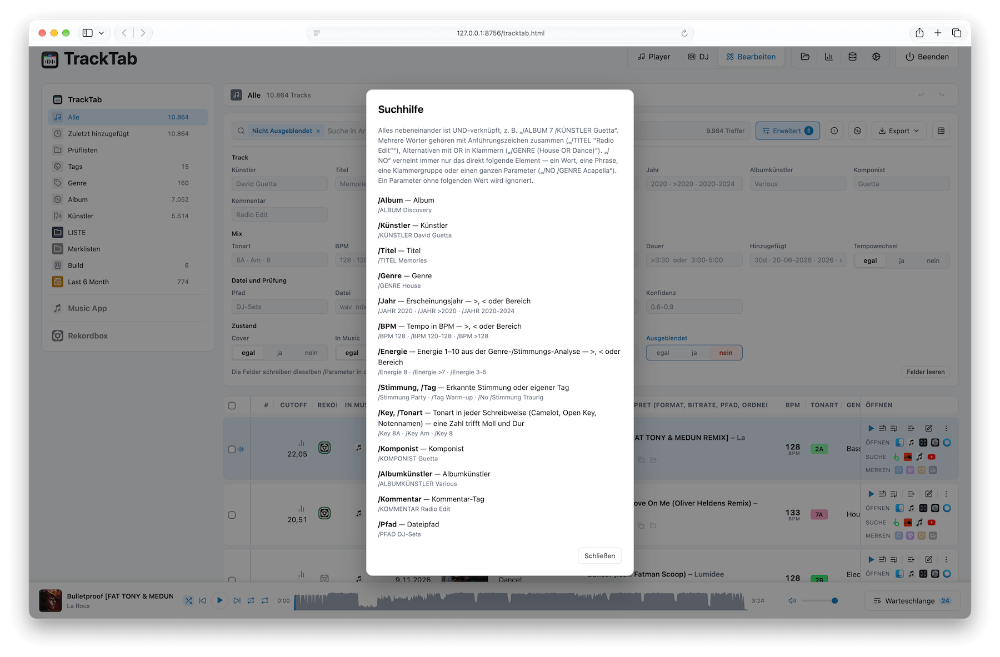

*Suche mit Parametern.*

**Alles, was nebeneinander steht, muss zutreffen (UND).**

| Du schreibst | Ergebnis |
|---|---|
| `guetta memories` | beide Wörter müssen vorkommen |
| `"radio edit"` | genau diese Wortfolge (Anführungszeichen = wortgetreu, keine Tippfehler-Toleranz) |
| `/Genre House` | nur im Genre suchen |
| `/Genre "Deep House"` | mehrwortige Werte gehören in Anführungszeichen |
| `/Genre (House OR Dance)` | eins von beidem genügt |
| `/Genre House /BPM 124-128` | beides zusammen |
| `/Album =Pop` | **exakt**: nur das Album „Pop", nicht „King of Pop" (Groß-/Kleinschreibung egal) |
| `/Album ="Pop Hits"` | exakt, mehrwortig |
| `/Album (=Pop OR =Rock)` | eines von beiden exakt |
| `/Album =` oder `/Album =""` | Feld ist **leer** — geht ebenso bei `/Genre`, `/Jahr`, `/BPM`, `/Komponist` … |
| `/Key 8A` · `/Key Am` · `/Key 8` | Tonart in **jeder** Schreibweise (Camelot, Open Key, Notennamen); eine reine Zahl trifft Moll und Dur dieser Position (`8` → 8A und 8B) |
| `/Cover` · `/No /Cover` | nur Tracks mit bzw. ohne eingebettetes Cover |
| `/Music` · `/No /Music` | nur Tracks, die in der Music.app-Bibliothek sind bzw. nicht |
| `/Rekordbox` · `/No /Rekordbox` | nur Tracks, die in Rekordbox sind bzw. nicht |
| `/No Acapella` | schließt „Acapella" aus |
| `/No /Genre (Acapella OR Instrumental)` | schließt beide Genres aus |

**Wichtig bei mehreren Wörtern:** Ein Parameter nimmt immer nur das *nächste* Element. `/Genre Deep House` sucht also im Genre nach „Deep" und zusätzlich überall nach „House" — gemeint ist meist `/Genre "Deep House"`. Beim Auswählen eines Vorschlags aus der Liste setzt TrackTab die Anführungszeichen von selbst.

Genauso bei **`/No`**: Es verneint immer nur das direkt Folgende. `/No Acapella "David Guetta"` sucht nach „David Guetta" und schließt dabei „Acapella" aus.

**Zahlen und Datumsangaben** verstehen Vergleiche und Bereiche: `/BPM >128`, `/Jahr 2020-2024`, `/Dauer >3:30`, `/Deklariert >256`, `/Add >2026`. Für „kürzlich hinzugefügt“ gibt es `/Add 30d` (in den letzten 30 Tagen).

**Ausgeblendete Tracks** erreichst du mit `/Ausgeblendet` — der Parameter braucht keinen Wert. Umgekehrt blendet `/No /Ausgeblendet` sie in jeder Liste aus. Und `/Status` grenzt auf ein Prüfergebnis ein (`/Status Fake`, `/Status verd`, `/No /Status Korrekt`); sobald du `/Status` getippt hast, erscheinen alle möglichen Werte zur Auswahl.

**Erweiterte Suche:** Der Button **Erweitert** neben der Suchhilfe klappt alle Parameter als Eingabefelder auf (Künstler, Genre, Tonart, BPM, Energie, Hinzugefügt, Cover usw.). Die Felder schreiben dieselben Parameter in die Suchleiste, und umgekehrt füllen getippte Parameter die Felder. Du kannst also beides mischen. Die Zahl am Button zeigt, wie viele Felder gerade belegt sind; **Felder leeren** nimmt alle Feld-Parameter wieder heraus, dein freier Suchtext bleibt stehen. Ausschlüsse mit `/No` (außer bei den Ja/Nein-Feldern wie Cover) schreibst du weiter direkt in die Suchleiste.

Jeder erkannte Parameter erscheint als **Chip** unter dem Suchfeld — ein Klick auf das × dort nimmt genau diesen Teil wieder aus der Suche heraus. Chips in anderer Farbe sind Standard-Suchfilter aus den Einstellungen: die gelten immer, lassen sich hier aber für die laufende Sitzung abschalten.

## Spalten anpassen

Jede Spalte lässt sich in der Breite ziehen und in der Reihenfolge verschieben (Überschrift greifen und ziehen). Über „Spalten ▾" blendest du weitere Informationen ein oder aus — z. B. Titel, Künstler, Cover, Album, Genre, Jahr, BPM oder Tonart.

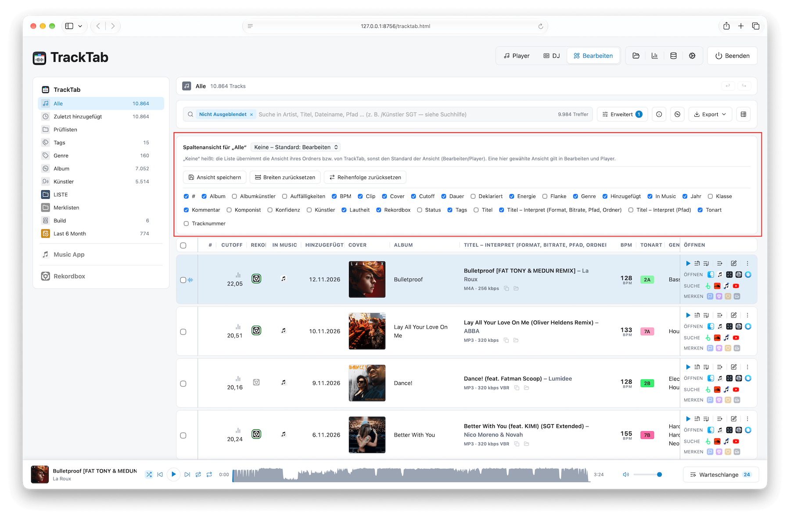

*Das Spalten-Menü.*

**Eine Ansicht speichern.** `Ansicht speichern` im Spalten-Menü legt die aktuelle Zusammenstellung — welche Spalten sichtbar sind, in welcher Reihenfolge und wie breit — unter einem Namen ab. Vergibst du einen Namen, den es schon gibt, wird diese Ansicht überschrieben; ein neuer Name legt eine neue an. Die gespeicherte Ansicht übernimmt sofort die gerade geöffnete Liste. Bis zu 20 Ansichten sind möglich.

**Eine Ansicht laden.** Das Auswahlfeld oben im Spalten-Menü bestimmt, welche gespeicherte Ansicht die gerade geöffnete Liste verwendet. Der erste Eintrag bedeutet „keine eigene" — die Liste nimmt dann die Standard-Spaltenansicht aus den Einstellungen.

**Die Standard-Spaltenansicht** legst du unter *Einstellungen → Spaltenansichten* fest: eine der gespeicherten Ansichten gilt damit für jede Liste ohne eigene Einstellung. Dort lassen sich Ansichten auch umbenennen und löschen; eine gelöschte Ansicht nimmt die Listen mit, die sie verwendet haben — die fallen auf den Standard zurück, an den Spalten selbst ändert sich nichts.

**Spaltenansicht der Einzelprüfung.** Im selben Einstellungsblock wählst du, welche gespeicherte Ansicht die Einzelprüfung verwendet. „Eigene Spalten der Einzelprüfung" (Vorgabe) heißt: die Einzelprüfung behält ihre unabhängige Spaltenkonfiguration. Ist eine Ansicht gewählt, gelten deren Reihenfolge, Sichtbarkeit und Breiten; Änderungen im Spalten-Menü der Einzelprüfung ändern dann die Ansicht selbst — und damit auch jede Liste, die sie nutzt.

Ist dort keine Standard-Spaltenansicht gesetzt, gilt weiterhin das, was du zuletzt im Spalten-Menü eingestellt hast, ohne dass eine Ansicht geladen war — getrennt für Bearbeiten und Player (siehe oben). Sobald du eine gespeicherte Ansicht lädst, wirkt sie dagegen in beiden: sie ist nur ein Satz Spalten.

**Achtung:** Solange eine gespeicherte Ansicht geladen ist, ändert jedes Häkchen, jeder Zug an einer Spaltenbreite und jedes Verschieben einer Überschrift **diese Ansicht** — und damit jede andere Liste, die sie ebenfalls verwendet.

**Je Liste einstellen.** Jede Liste im Baum links — eigene Playlisten, Smart Playlisten, die festen Prüflisten, „Alle", „Ausgeblendet", „Datei fehlt", „Duplikate" und die Merklisten — hat einen eigenen „…"-Button mit dem Eintrag „Spaltenansicht …": ein Dialog mit genau diesem einen Feld. Alternativ geht es auch über „Spalten ▾", während die betreffende Liste gerade geöffnet ist — beide Wege ändern dieselbe Zuordnung.

## Die Buttonleiste

Jede Zeile trägt dieselben Symbole, in der Buttonleiste immer sichtbar:

| Icon | Aktion |
|---|---|
|  | Abspielen (klappt zusätzlich die Wellenform auf, siehe unten) |
|  | Als nächstes abspielen |
|  | Zur Warteschlange hinzufügen |
| 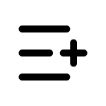 | Zu einer Playlist hinzufügen |
|  | Metadaten bearbeiten |
|  | „Weitere Optionen", nach Gruppen geordnet: **Playlisten** (aus der geöffneten eigenen, Rekordbox- oder Music-Playlist entfernen), **Rekordbox** (zu Rekordbox hinzufügen, Rekordbox laden, Rekordbox Update, Aus Rekordbox entfernen), **Analyse** (BPM & Tonart, Genre & Stimmung, Beatgrid, Phrasen, Beatgrid & Phrasen, Stems, Track neu analysieren), **Bearbeiten** (Format konvertieren, Bitrate korrigieren, Datei umbenennen, Tonart-Schreibweise angleichen), **Prüfung** (Korrigieren, Ausblenden) und **Löschen** (Papierkorb) |


**Öffnen**

| Icon | Aktion |
|---|---|
| 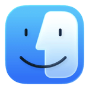 | Datei im Finder zeigen |
|  | In Music.app öffnen (nur sichtbar, wenn die Music App in den Einstellungen ausgewählt ist) |
| 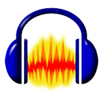 | Im externen Audio-Editor öffnen (z. B. iZotope RX, zum Gegenprüfen im Spektrogramm) Wird nur angezeigt wenn in den Einstellungen ein Editor ausgewählt ist. Das jeweilige Icon des Editors wird angezeigt. |
| 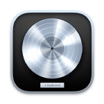 | In der eingestellten DAW öffnen (nur sichtbar, wenn eine hinterlegt ist). |
|  | In Mixed In Key öffnen (nur sichtbar, wenn eine hinterlegt ist). |

**Suche** (ein Icon je in den Einstellungen aktivierter Plattform)

| Icon | Aktion |
|---|---|
|  | Bei Beatport suchen |
|  | Bei SoundCloud suchen |
|  | Weitere, selbst konfigurierte Plattformen — Anfangsbuchstabe der Plattform in der gewählten Farbe |

**Merken**

| Icon | Aktion |
|---|---|
|  | Zu einer Merkliste hinzufügen/entfernen (Icon+Farbe je als Merkliste markierter Playlist) |

Alle Aktionen lassen sich auch auf eine Mehrfachauswahl anwenden (Checkboxen links in jeder Zeile) — die Sammelleiste zeigt dieselben Symbole für die ganze Auswahl auf einmal. Sie sind in beschriftete Gruppen geordnet: Warteschlange, Playlisten, Merken, Rekordbox, Analyse, Bearbeiten, Prüfung, Öffnen, Export und Löschen. Fährst du mit der Maus über ein Symbol, nennt ein Hinweis die Aktion, bei manchen mit einer kurzen Erklärung darunter. Rekordbox laden und Rekordbox Update gibt es hier genauso wie in der DJ-Ansicht, Beatgrid, Phrasen und beides zusammen als drei eigene Symbole. Im Player hat die Leiste nur Warteschlange, Playlisten und Merken, in der DJ-Ansicht alles außer der Warteschlange (dafür mit Auto Cue), in den Einzelprüfungen nur Analyse, Bearbeiten, Öffnen und Entfernen. Die Auswahl bleibt beim Wechsel der Ansicht bestehen.

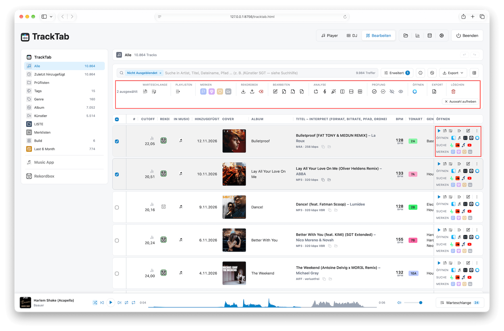

*Sammelleiste bei Mehrfachauswahl.*

Ein eigenes Symbol in der Sammelleiste (Datei mit Pfeil nach unten) exportiert die Auswahl als ZIP-Archiv. Ein Dialog fragt dabei, ob die Dateien innerhalb des Archivs nach dem Namensmuster aus den Einstellungen umbenannt werden sollen (Vorschlag vorausgefüllt, frei editierbar) — betrifft nur die Namen im ZIP, die Originaldateien in deiner Bibliothek bleiben unverändert.

## Anhören mit Wellenform

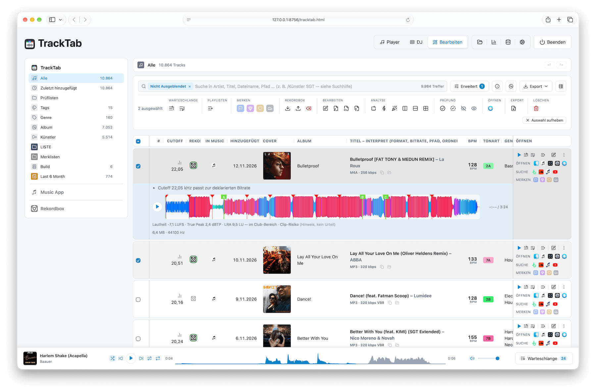

*Ausgeklappter Track mit Wellenform.*

Ein Klick auf eine Zeile in der Bearbeiten-Ansicht klappt sie auf und zeigt die Wellenform des Tracks über die ganze Breite — noch ohne zu spielen. Erst ein Klick auf den Abspielen-Button im Wellenform-Bereich (oder auf ▶ in der Öffnen-Spalte) startet die Wiedergabe über den Mediaplayer; die Wellenform zeigt danach live dessen Fortschritt (als farbige Linie), synchron zur Anzeige am unteren Bildschirmrand. 

Die Leertaste pausiert/startet die Wiedergabe, die Pfeiltasten ←/→ wechseln zum vorherigen/nächsten Track in der Warteschlange. In dieser aufgeklappten Ansicht steht außerdem ein Kopie-Symbol neben dem vollständigen Dateipfad, um ihn in die Zwischenablage zu kopieren.

Ist der Track bereits in Rekordbox analysiert, werden dessen Hot Cues und Memory Cues zusätzlich über der Wellenform eingeblendet; ein Klick auf einen Hot-Cue-Marker springt im Mediaplayer direkt dorthin, die Zifferntasten 1–8 tun bei aufgeklappter Wellenform dasselbe.

Die Wellenform erzeugt TrackTab hier immer selbst, auch für Tracks in Rekordbox. Unter ⚙ Einstellungen → Darstellung → „Waveform-Farbe in Bearbeiten und Player“ wählst du **Standard** (grau), **RGB** oder **3-Band**. Die Form bleibt dabei dieselbe wie bei Standard. Beim ersten Öffnen eines Tracks steht kurz die graue Wellenform da, bis die Farbe berechnet ist, dann wird sie weich eingeblendet.

Die Pfeiltasten ↑/↓ bewegen unabhängig davon eine Markierung zeilenweise durch die Tabelle — praktisch zum Durchblättern per Tastatur, ohne deine Checkbox-Auswahl für Sammelaktionen zu verändern. Läuft gerade ein Track, startet die Markierung bei dessen Zeile. Die Eingabetaste startet die Wiedergabe der markierten Zeile.

Welche Formate sich dabei tatsächlich hörbar abspielen lassen, hängt vom verwendeten Browser ab (AIFF und ALAC z. B. nur in Safari) — die vollständige Tabelle steht in der [README](readme.md#unterstützte-dateiformate). Analyse, Tags und Umbenennen sind davon nicht betroffen.

## Tonart

Die Spalte **Tonart** zeigt jede Tonart als farbige Bubble. Die Farben folgen dem Camelot-Rad von Mixed In Key: gleiche Tonart, gleiche Farbe — außen (Dur, kräftig) und innen (Moll, heller) je zwölf Töne. Passende Tonarten stehen auf dem Rad nebeneinander und haben damit auch ähnliche Farben.

- **Woher sie kommt:** TrackTab liest die Tonart beim Scannen aus dem Datei-Tag „Initial Key“. Angezeigt wird ausschließlich, was in der Datei steht — Rekordbox spielt dafür keine Rolle, auch nicht als Ersatz.
- **Schreibweise:** Unter ⚙ Einstellungen → Analyse → Tonart-Feld wählst du Camelot (`8A`), Open Key (`1m`) oder Notennamen (`Am`). Das gilt für die Tabelle, den Tags-Dialog, neu analysierte Tonarten, den in die Datei geschriebenen Wert und den Übertrag nach Rekordbox. Gelesen werden immer alle drei Schreibweisen; ein Wechsel der Einstellung ändert nur die Anzeige, die Dateien selbst bleiben zunächst unverändert (siehe „Tonart-Schreibweise angleichen“).
- **Gestrichelter Rahmen:** Unterscheidet sich der Wert in der Datei von der Darstellung in TrackTab (z. B. steht in der Datei `8A`, eingestellt ist Open Key), wird die Bubble mit einem gestrichelten Rahmen angezeigt. Der Hinweistext darüber nennt den Wert aus der Datei („In der Datei: 8A“). Speicherst du die Tonart im Tags-Dialog neu, wird sie in der gewählten Schreibweise geschrieben und der Rahmen verschwindet.
- **Tonart-Schreibweise angleichen:** Nach einem Wechsel der Schreibweise tragen die Dateien die Tonart noch in der alten; die Tonart-Bubble bekommt dann einen gestrichelten Rahmen. Markiere die betroffenen Tracks und klicke in der Sammelleiste auf das Notenschlüssel-Symbol „Tonart-Schreibweise angleichen“ (bzw. wähle den Eintrag im Menü ⋮ einer Zeile): Die vorhandene Tonart wird in der gewählten Schreibweise in den Datei-Tag geschrieben, der Wert selbst bleibt. Das Symbol erscheint nur, wenn mindestens ein markierter Track abweicht, und gilt auch in den Einzelprüfungen. Unter ⚙ Einstellungen → Analyse → Tonart-Feld steht, wie viele Dateien der Bibliothek abweichen; **Anzeigen** öffnet sie in der Liste [Auffälligkeiten](#auffälligkeiten-metadaten-probleme), wo du sie per Quick Fix alle auf einmal angleichen kannst. Ein Knopf für die ganze Bibliothek ist bewusst nicht vorgesehen (bei vielen tausend Dateien dauert das sehr lange und wird selten gebraucht).
- **Ändern:** im Tags-Dialog (Stift-Symbol), einzeln oder für mehrere Tracks zugleich. Tippen kannst du in jeder Schreibweise. Die Änderung steht danach in der Datei und in TrackTab.
- **Sortieren und Suchen:** Die Spalte sortiert nach der Position auf dem Rad (1A, 1B, 2A …), Tracks ohne Tonart stehen immer am Ende. Suche: `/Key 8A`, `/Key Am` oder `/Key 8`.
- **BPM und Tonart analysieren:** TrackTab kann Tempo und Tonart selbst aus dem Audio messen — ohne Mixed In Key und ohne Internet. Über das Menü ⋮ einer Zeile oder in der Sammelleiste über das Wellenform-Symbol „BPM/Tonart analysieren“ (immer sichtbar, sobald die Analyse verfügbar ist) wird die Analyse für die gewählten Tracks gestartet, in den Einzelprüfungen genauso; je Track dauert sie etwa 2–4 Sekunden. Neu hinzugefügte Dateien der Einzelprüfungen werden auf Wunsch automatisch analysiert (⚙ Einstellungen → Analyse: BPM, Tonart, Genre & Stimmung → „Einzelprüfungen: BPM & Tonart automatisch“). Dateien, die länger als die eingestellte Grenze sind (Standard 10 Minuten, z. B. DJ-Mixe), werden übersprungen. Welche Felder beschrieben werden, legst du in den drei Abschnitten dieser Einstellungsgruppe fest:
  - **Tonart-Feld** und **BPM-Feld:** „In … schreiben“ mit **Ja** (überschreibt einen vorhandenen Wert), **Ja, nur wenn leer** (ein vorhandener Wert bleibt stehen) oder **Nein**. Die BPM werden als ganze Zahl gespeichert.
  - **Kommentar-Feld:** Ein gemeinsamer Eintrag für BPM-/Tonart- und Genre-/Stimmungs-Analyse. „In Kommentar-Feld schreiben“: nichts, Tonart (`10A`), Tonart und Tempo (`10A - 126`), Tonart, Tempo und Energie (`10A - 126 - E7`), Tonart und Energie (`10A - E7`) oder nur Energie (`E7`). Jede Analyse ergänzt die Werte, die sie misst, die übrigen kommen aus der Datei bzw. der letzten Analyse — der Eintrag sieht also immer gleich aus, egal welche Analyse zuletzt lief. Bei einem vorhandenen Kommentar wählst du „Nur wenn leer“, „Überschreiben“, „Voranstellen“ oder „Anhängen“ (getrennt durch ` - `); ein früherer eigener Eintrag — vorn oder hinten — zählt dabei als leer bzw. wird ersetzt, nie doppelt geschrieben. **„Fehlendes ergänzen“** lässt vorhandene Werte unverändert stehen und fügt nur die fehlenden Teile nach dem gewählten Schema an derselben Stelle an: Steht schon `8A - 128` im Kommentar (z. B. aus Mixed In Key), wird daraus `8A - 128 - E7`; aus `8A - 128 - Lieblingsmix` wird `8A - 128 - E7 - Lieblingsmix`.
  - Die Tonart steht überall in der Schreibweise, die du im Abschnitt Tonart-Feld gewählt hast (Camelot, Open Key oder Notennamen).
  - Die Messung ist eine Einschätzung, kein Urteil: Beim Tempo kommt gelegentlich die halbe oder doppelte BPM heraus, bei der Tonart manchmal die parallele Dur-/Moll-Tonart. Die Funktion ist nur auf Macs mit Apple Silicon verfügbar; auf anderen Macs erscheinen die Knöpfe nicht, und die zugehörigen Einstellungen sind ausgegraut (mit Hinweis auf den Grund).
- **Rekordbox:** Beim Übertragen **neuer** Tracks nach Rekordbox wird die Tonart mit gesetzt. Tracks, die schon in Rekordbox stehen, bleiben unberührt — Rekordbox kann ihre Daten über „Track-ID abrufen“ jederzeit selbst aus der Datei neu einlesen.

## Beatgrid und Phrasen (Testfunktion)

TrackTab kann das Tempo, den Takt und die Abschnitte eines Tracks (Intro, Up oder Verse, Down oder Bridge, Chorus, Outro) selbst erkennen, auch ohne Rekordbox. In die Datei und nach Rekordbox wird dabei nichts geschrieben.

- **Starten:** Im Zeilenmenü **Beatgrid & Phrasen analysieren** wählen oder mehrere Tracks markieren und das Symbol in der Sammelleiste nutzen. Je Track dauert das rund 2 bis 3 Sekunden.
- **Ansehen:** Beatgrid und Abschnitte erscheinen nur in der [DJ-Ansicht](#dj-ansicht), nicht in Bearbeiten und Player.
- **Quelle:** Unter **Einstellungen → DJ-Ansicht → Beatgrid & Phrasen** wählst du, ob die Anzeige **Rekordbox, sonst TrackTab** (Vorgabe), **nur Rekordbox** oder **nur TrackTab** nutzt. Bei der Vorgabe springt die eigene Analyse ein, solange Rekordbox noch nichts hat, etwa bei einem dort gerade hinzugefügten Track. TrackTab-Werte gibt es erst nach einer Analyse.
- **Modus:** In denselben Einstellungen wählst du den Beatgrid-Modus. **Auto** ist die Vorgabe und nutzt Flex nur, wenn ein Tempowechsel gefunden wird. **Normal** nimmt ein festes Tempo, **Flex** folgt Tempowechseln und ist für DJ-Edits gedacht. Ein neuer Modus gilt erst, wenn du den Track neu analysierst.

Die Erkennung ist eine Einschätzung. Bei Clubmusik mit festem Tempo trifft sie die meisten Phrasengrenzen von Rekordbox. Bei Tracks mit Tempowechseln, bei Acapellas und vermutlich auch bei Pop oder Bandmusik ist sie deutlich schwächer und übersieht auch Tempowechsel. Ein blasses Band im DJ-Editor kennzeichnet solche Ergebnisse.

## DJ-Ansicht

Oben rechts auf **DJ** wechseln und einen Track aufklappen. Die Liste ist fest: in einer eigenen Playlist und in Listen aus Music.app oder Rekordbox „#“ (Reihenfolge der Playlist), Cover, Track und Interpret, Dauer, Tonart, BPM, Energie, Tags, Hinzugefügt und, wenn Rekordbox in den Einstellungen ausgewählt ist, Rekordbox. Unter Titel und Interpret steht klein das Dateiformat mit der Bitrate, die in der Datei angegeben ist (etwa „MP3 · 320 kbps“, bei AIFF/WAV/FLAC „verlustfrei“). Daneben kopiert das Kopier-Symbol den Pfad der Datei, das Ordner-Symbol zeigt sie im Finder. Das Logo in der Spalte Rekordbox ist farbig, wenn der Track in der Rekordbox-Sammlung liegt, sonst grau. Eine grüne Umrandung heißt: Beatgrid, Phrasen und Cues stimmen mit TrackTab überein. Ein Klick auf den Spaltenkopf sortiert in vier Stufen: in Rekordbox zuerst, grün zuerst, rot zuerst, nicht in Rekordbox zuerst; der fünfte Klick hebt die Sortierung auf. Rot heißt: TrackTab weicht ab, darunter steht worin (Beatgrid, Phrasen, Cues), zum Beispiel weil eine Bearbeitung noch nicht per **Rekordbox Update** geschrieben ist oder sich der Track in Rekordbox geändert hat. Zeigt TrackTab unter „Beatgrid & Phrasen anzeigen aus“ nur die eigene Analyse, entfällt die Umrandung bei unbearbeiteten Tracks. Hat der offene Track begonnen, zeigt die Dauer die gespielte Zeit und daneben die Restzeit, die herunterzählt, Die Spalte BPM ändert sich nur, wenn du das Tempo im Beatgrid bearbeitet hast und es vom Tag der Datei abweicht, etwa 125,50 statt 125. Der Wert bleibt in der Liste stehen, die Datei ändert sich nicht. Rot wird die Zahl, wenn das Tempo in der Datei nicht zum Beatgrid passt, etwa bei einem Tempowechsel oder einer Bearbeitung; beim Überfahren stehen beide Werte da. Geprüft wird ein Track, sobald du ihn einmal im DJ-Editor geöffnet hast, das Ergebnis bleibt danach in der Liste. Play und Cue liegen links neben den Wellenformen, der Play-Knopf schaltet zwischen Abspielen und Anhalten um. Es ist immer nur ein Track offen, der Editor hat seine eigene Wiedergabe unabhängig vom Player-Balken.

Am Ende jeder Zeile öffnet **⋮** dieselben Befehle wie in Bearbeiten, dazu „Zur Playlist hinzufügen …“ und „Tags bearbeiten“. Die Sammelleiste hat dieselben Gruppen und Aktionen wie in Bearbeiten, ohne Warteschlange und zusätzlich mit Auto Cue. Markierte Tracks bleiben beim Wechsel zwischen Bearbeiten, Player und DJ markiert.

Tracks aus einer Playlist entfernen: in einer eigenen, einer Rekordbox- oder einer Music-Playlist einen Track über **⋮** oder mehrere über die Checkbox und die Sammelleiste entfernen (**Aus „…“ entfernen**). Nur der Eintrag in der Playlist verschwindet, die Datei bleibt; in eigenen Playlisten lässt es sich mit ↩ im Kopf der Playlist oder Cmd+Z zurücknehmen. Im Player gibt es dafür ebenfalls **⋮**, solange eine Playlist offen ist.

Beide Wellenformen reichen einen Takt über Anfang und Ende hinaus. Das Beatgrid endet mit dem Track. Liegt der erste Schlag knapp vor dem Ton, steht er am Trackanfang, ein Hot Cue oder Memory Cue lässt sich also auch dorthin setzen. In Rekordbox landet ein Cue vor dem Ton am Audiobeginn, weil es dort nichts davor gibt. Play startet aus diesem Bereich am Trackanfang. Die Phrasenfarben sind fest vorgegeben, je Art und Nummer eine eigene. Sie gelten nur in TrackTab, Rekordbox zeigt seine eigenen.

Hat der Track schon Daten aus Rekordbox oder der eigenen Analyse, startest du damit, auch mit Rekordbox' Hot Cues, Memory Cues, Loops und Phrasen. Deine Änderungen speichert TrackTab sofort in der eigenen Datenbank, die Datei bleibt immer unberührt. Bearbeitete Cues erscheinen auch in den Wellenformen von Bearbeiten und Player. Unter **Info** setzt du Beatgrid, Phrasen oder Cues einzeln auf die Quelle zurück.

**Wellenformen:** Oben der ganze Track als halbe Wellenform, darunter der Zoom mit der Abspielposition in der Mitte. Die Farbe zeigt die Frequenzen: bei RGB wie in Rekordbox Rot für Bass und Blau für Höhen, bei 3-Band Blau für Tiefen, Orange für Mitten und Weiß für Höhen (auf heller Fläche dunkel).

- Klicken springt an die Stelle, Ziehen im Zoom spult.
- Zoomen geht mit den Lupen, per Pinch oder mit den Tasten **+** und **−**, bis eine halbe Sekunde das ganze Fenster füllt.
- Neben der Abspielposition steht, wie viele Takte es noch bis zum nächsten Cue sind.
- Ein Tempowechsel im Track ist in beiden Wellenformen mit einer Linie und einer kleinen Marke mit dem neuen Tempo gekennzeichnet.

**Cue-Knopf (Taste C):** Wie am Player. Steht der Track, wird die Stelle zum Cue-Punkt, und er spielt, solange du gedrückt hältst. Beim Loslassen geht er zurück. Drückst du währenddessen die Leertaste, läuft er weiter. Spielt der Track, springt C zurück zum Cue-Punkt und hält an.

**Waveform:** Unter ⚙ Einstellungen → DJ-Ansicht wählst du die Quelle (**Rekordbox, sonst TrackTab** oder **Nur TrackTab**) und die Farbe (**Standard**, **RGB** oder **3-Band**). Die Farbe gilt nur hier, für Bearbeiten und Player gibt es eine eigene Einstellung unter Darstellung. Das App-Symbol oben rechts im Zoom zeigt, woher die Waveform gerade stammt: Rekordbox oder TrackTab. Beim Überfahren steht es als Text da. Zoomst du tief hinein, siehst du die einzelnen Schwingungen des Tons. Die **Waveform-Fläche** stellst du dort ebenfalls ein: **Dunkel** (Vorgabe), **Hell** oder **UI-Farbe**, die dem hellen oder dunklen Design folgt. Auf heller Fläche nimmt die Waveform dunklere Farben, bei 3-Band werden die Höhen dunkel statt weiß.

**Beatjumps:** Der Reiter bietet Sprünge um 64, 32, 16, 8 und 4 Schläge in beide Richtungen sowie den Sprung zum vorigen und nächsten Cue. Per Tastatur hältst du einen Buchstaben und drückst ← oder →: **A** 64, **S** 32, **D** 16, **F** 8, **G** 4 und **H** 2 Schläge. Die Pfeiltasten allein springen 1 Schlag, mit Shift einen Takt. Hältst du den Buchstaben einen Moment, erscheint links über den Listen eine Anzeige mit der Sprungweite und allen Tasten.

**Cue/Loop**

- **Hot Cues A bis H:** Klick auf ein freies Feld oder Taste **1** bis **8** setzt den Cue. Ein belegtes Feld arbeitet wie der Cue-Knopf: Steht der Track, spielt er ab dem Hot Cue, solange du gedrückt hältst, und geht beim Loslassen dorthin zurück. Drückst du währenddessen die Leertaste, läuft er weiter. Spielt der Track schon, springt er hin und spielt weiter. **Shift** und die Zahl (oder Shift-Klick aufs Feld) löscht den Hot Cue. Zum Neusetzen löschst du ihn und setzt ihn wieder, oder du verschiebst ihn im Zoom an der Fahne.
- **Memory Cues:** Knopf oder Taste **M**, höchstens 10 je Track. Aus Rekordbox Geladenes bleibt auch darüber sichtbar, nur neue kommen dann nicht dazu.
- **Loops:** **In** und **Out** von Hand oder fertige Längen von 1/8 bis 64 Schlägen. Die Tastenreihe **Q W E R T Z U** startet 64, 32, 16, 8, 4, 2 und 1 Schläge, **I O P** dazu 1/2, 1/4 und 1/8 Schlag. Dieselbe Taste noch einmal beendet die Schleife. Die Schleife läuft ohne Sprung und ohne Lücke. Setzt du bei laufender Schleife einen Cue, wird daraus ein Loop-Cue.
- **Farbe:** Klick auf den Farbpunkt in der Liste rechts oder Rechtsklick auf ein belegtes Feld. Neue Hot Cues sind grün, neue Memory Cues rot, wie in Rekordbox ohne eigene Farbe. Zur Wahl stehen die Farben von Rekordbox: für Hot Cues 16, für Memory Cues acht und „keine Farbe“: Pink, Rot, Orange, Gelb, Grün, Aqua, Blau und Lila. Die Farben auf dem Bildschirm können von denen in Rekordbox leicht abweichen.
- In der Liste gibst du Cues außerdem einen Namen oder löschst sie. Im Zoom lassen sich Cues an ihrer Fahne verschieben.

**Beatgrid**

Die Knöpfe sind aufgebaut wie das GRID-Feld in Rekordbox: Du justierst das Raster nach, das Tempo folgt daraus.

- Tempo eintippen, per **TAP** (Taste **B**, nur solange der Track läuft) klopfen, halbieren oder verdoppeln.
- **Ganzes Grid** oder **ab hier:** bestimmt, wofür die Knöpfe gelten. „Ab hier“ beginnt am nächsten Schlag einen eigenen Abschnitt, davor bleibt alles stehen.
- **Verschieben:** einfache Pfeile um 1 ms, doppelte um 10 ms. Du kannst auch eine Beat-Linie im Zoom direkt ziehen.
- **Beat-Intervalle** verengen oder erweitern: fein um 0,01 BPM, grob um 0,1 BPM, der erste Schlag bleibt stehen. Mit gedrückter **Shift**-Taste dehnt auch das Ziehen einer Beat-Linie das Grid.
- **Fadenkreuz** legt den nächsten Schlag auf die Abspielposition. **1.1** tut dasselbe und macht den Schlag dort zusätzlich zum Taktanfang, das Beatgrid beginnt also genau an der Abspielposition.
- **Tempowechsel** beginnt ab diesem Schlag einen eigenen Abschnitt mit eigenem Tempo.
- Das **Metronom** tickt auf dem Grid, der Track wird dabei etwas leiser, das **Schloss** sperrt es gegen Änderungen.

Hat ein Track noch kein Grid, misst du es oder beginnst es an der Abspielposition.

**Memory Cues**

Der Reiter zeigt immer zehn Plätze, ein Klick auf einen freien setzt den Cue an der Abspielposition. Nach dem Löschen rückt der nächste nach, mit einem weiteren Klick auf dasselbe Kreuz ist auch er weg. Liegt ein Hot Cue an derselben Stelle, steht sein Buchstabe in der Zeile. Bei aktivem Loop entsteht ein Memory Loop: Vorgabe ist der Active Memory Loop (rot), ein Klick auf das Loop-Symbol wechselt zum normalen (orange) und zurück. Läuft der Track über den Beginn eines Active Memory Loop, greift dieser von selbst. Steht die Abspielposition an einem Cue (ab einem Schlag davor bis einen Takt danach), bekommt sein Farbpunkt einen dunkleren Ring und die Zeit wird fett, im Reiter Hot Cue ebenso.

**Phrasen**

Die Phrasen hängen am Beatgrid: Verschiebst oder dehnst du es, wandern sie mit und bleiben auf ihren Schlägen. Cues bleiben dabei an ihrer Stelle im Track.

Im farbigen Band unter dem Zoom, die Ränder auch im Band der Gesamtansicht:

- **Am Rand ziehen** funktioniert wie bei einer Tabellenspalte: Beim Überfahren erscheint der Griff, der Rand folgt der Maus und rastet an den Rasterlinien ein. Beim Ziehen steht die neue Länge in Takten dabei. Die Nachbarphrase wird entsprechend kleiner oder größer, alles danach bleibt auf seiner Stelle im Track. Ziehst du über sie hinaus, verschwindet sie und die nächste wird kleiner. Solange du nicht loslässt, holst du sie durch Zurückziehen wieder, danach mit **Cmd+Z**.
- **In der Mitte ziehen** verschiebt sie, ihre Nachbarn geben nach.
- Beides rastet immer auf jedem Schlag ein, auch ohne Quantisieren, mit **Shift** nur auf Takt 1, mit der **Wahltaste** gar nicht.
- **Teilen** (Taste **X**) zerlegt die Phrase am Beatgrid-Marker, der der Abspielposition am nächsten liegt. Mit Shift nimmt es den nächsten Takt 1. Klickst du den Knopf mit gedrückter Wahltaste, teilt es genau an der Abspielposition. Hat der Track noch keine Phrasen, gilt er als eine durchgehende: Teilen legt dann beide Hälften an. In der leeren Phrasenliste stehen außerdem **Phrase anlegen** (eine Phrase vom ersten Schlag bis zum Ende, danach mit X zerlegen) und **Phrasen-Analyse**. Eine Phrase anklicken, dann die Art wählen oder sie entfernen. Die Nummer vergibt TrackTab selbst: Jede Phrase wird innerhalb ihrer Art in Track-Reihenfolge durchgezählt. Nach Rekordbox geht sie, soweit es sie dort gibt: bei mittlerer Stimmung Verse 1 bis 6, bei niedriger Verse 1 und 2, bei hoher Intro, Chorus und Outro 1 und 2 sowie Up 1 bis 3. Alle anderen Phrasen haben in Rekordbox keine Nummer, eine höhere Zahl wird dort zur höchsten möglichen.

**Quantisieren (Knopf Q):** Cues und Loops rasten auf dem Schlag ein. Mit gedrückter **Wahltaste** rastet nichts ein.

**Analyse-Sperre (zwei Schild-Symbole über den Werkzeugen, auch unter Info):** Beatgrid und Phrasen lassen sich einzeln sperren. Bearbeitest du eines davon, sperrt TrackTab es von selbst. Die Analyse lässt Gesperrtes aus und nennt die Zahl der übersprungenen Tracks. Die Beatgrid-Sperre gilt auch für „BPM & Tonart analysieren“, Genre und Stimmung laufen weiter. Ein Klick aufs Schild gibt frei oder sperrt von Hand, die nächste Bearbeitung sperrt wieder. Setzt du eine Bearbeitung zurück, fällt ihre Sperre von selbst. **Rekordbox Update** sperrt den Track zusätzlich: in TrackTab beide Felder und in Rekordbox dessen Analyse-Sperre, die dort immer für alles zusammen gilt. Bei noch nicht analysierten Tracks unterbleibt das. **Rekordbox laden** hebt die Sperre in Rekordbox nicht auf, das geht dort selbst. Unter **Info** startest du Beatgrid-Analyse, Phrasen-Analyse oder beides getrennt. Die Phrasen-Analyse misst auf dem Beatgrid, das gerade gilt. Findet die Analyse kein eindeutiges Tempo (z. B. bei Übergängen von 100 auf 128 BPM), setzt du das Beatgrid von Hand und misst danach die Phrasen; das klappt dann auch mit „Beatgrid + Phrasen“, das Grid bleibt dabei, wie es ist. Auch ein in Rekordbox gesperrter Track lässt sich weiter per **Rekordbox Update** überschreiben.

Phrasen und Beatgrid bleiben aufeinander ausgerichtet: Neu gemessene Phrasen rasten auf dem bestehenden Beatgrid ein, eine neue Beatgrid-Analyse oder eine Änderung von Hand nimmt die Phrasen mit, auch gesperrte. In der DJ-Ansicht gilt das Ergebnis einer Analyse sofort, die Spalte Rekordbox zeigt es als Abweichung, bis du es überträgst.

**Rekordbox abgleichen** (Datenbank-Symbol) lädt Beatgrid, Phrasen und Cues in TrackTab, soweit dort für den Track noch nichts steht. Der erste Lauf liest jeden Track und dauert etwas. Danach überschreibt nichts mehr von selbst: Ändert sich ein Track in Rekordbox, wird die Rekordbox-Spalte rot und der Editor fragt nach. Übernommen wird nur mit **Rekordbox laden**, in die andere Richtung nur mit **Rekordbox Update**.

**Mehrere Tracks:** Markierst du in der DJ-Liste Tracks, stehen in der Leiste **Zu Rekordbox hinzufügen**, **Rekordbox laden**, **Rekordbox Update**, **BPM & Tonart**, **Genre & Stimmung** (dieselben Analysen wie in Bearbeiten), **Beatgrid-Analyse**, **Phrasen-Analyse**, **Beatgrid + Phrasen** (beides in einem Durchgang) und [**Auto Cue**](#auto-cue). Die Analysen überspringen Gesperrtes (BPM & Tonart hängt an der Beatgrid-Sperre). Laden verwirft die Bearbeitungen der markierten Tracks. Hinzufügen überspringt Tracks, die schon in Rekordbox stehen, und lässt sie dort unverändert. Laden und Update überspringen Tracks, die dort fehlen oder bei denen nichts zu übertragen ist.

**Rückgängig:** **Cmd+Z** und **Cmd+Shift+Z** gelten für alle Änderungen am offenen Track. Weitere Tastenkürzel stehen unter **Info**.

### Auto Cue

Auto Cue setzt die Cues eines Tracks selbst: Hot Cues auf Break 1, acht Takte vor dem letzten Drop und den letzten Drop, dazu Memory Cues auf Intro, Drop 1, Break 2 und Outro und dazwischen im 32-Beat-Raster. Welcher Cue wohin kommt, stellst du unter ⚙ Einstellungen → **Auto Cue** ein.

- **Ein Track:** Im DJ-Editor unter **Cue/Loop** oder **Info** auf **Auto Cue** klicken. Die bisherigen Cues des Tracks werden ersetzt, mit **Cmd+Z** holst du sie zurück.
- **Mehrere Tracks:** In der DJ-Liste markieren und in der Leiste **Auto Cue** wählen. Nach einer Rückfrage läuft ein Track nach dem anderen, je Track einige Sekunden. Auch hier ersetzen die neuen Cues die bisherigen.
- **Grundlage:** Auto Cue nimmt das Beatgrid und die Phrasen von TrackTab. Hat TrackTab für einen Track noch keine, übernimmt es die aus Rekordbox in TrackTab (siehe unten), damit du im Editor damit weiterarbeiten kannst. Gibt es auch dort nichts, misst TrackTab vorher Beatgrid und Phrasen.
- **Nach Rekordbox:** Die Cues liegen zunächst nur in TrackTab. Nach Rekordbox gehen sie erst mit **Rekordbox Update**, auch für mehrere Tracks über die Leiste.
- **Ausklang am Trackende:** Läuft am Ende nur noch der Hall oder das Delay aus, setzt Auto Cue dort keinen Cue. Erkannt wird das an der Lautstärke. Hast du die Phrasen von Hand bearbeitet, beginnt der Ausklang genau an der Grenze der ersten leisen Phrase am Ende. Ein lautes Outro bleibt Outro und kann einen Memory Cue bekommen.
- **Lieber keine Cue als eine falsche:** Ist sich Auto Cue bei einer Stelle nicht sicher genug, lässt es den Cue weg. Findet es gar nichts Sicheres oder passt das Beatgrid nicht (zu kurz, Takt springt, zu viele Tempowechsel), bleiben die bisherigen Cues stehen.

**Einstellungen → Auto Cue:**

- **Automatische Phrasen als Hinweis nutzen:** Gemessene Phrasen fließen als Gewicht ein, nie als feste Position. An 50 von Hand gecueten Tracks lag Auto Cue mit Phrasen bei Break 1 öfter richtig, ohne Phrasen etwas öfter beim letzten Drop. Insgesamt nehmen sich beide nichts.
- **Von Hand bearbeitete Phrasen** gelten immer, auch wenn der Schalter aus ist: Drops, Breaks und das Outro rasten auf die nächste Phrasengrenze ein (höchstens 4 Takte entfernt). Das gilt nur für Grenzen, die genau auf einer Takt-1 liegen. Eine mitten im Takt gesetzte Grenze zählt als nicht sauber gesetzt, dort bleibt der Cue, wo Auto Cue ihn gefunden hat.
- **Memory Cues:** höchstens 10, wie in Rekordbox. Reicht der Platz nicht, setzt Auto Cue die Zwischenpunkte weiter auseinander (64 statt 32 Beats).
- **Sicherheit je Stelle:** Sehr sicher, Sicher, Normal, Riskant oder Sehr riskant. Sicher setzt eine Stelle nur, wenn Auto Cue sich sehr sicher ist, und lässt sie sonst lieber weg. Riskant setzt öfter, auch auf Verdacht. Normal ist an den Modellen abgestimmt; ändere es nur, wenn dir zu viele oder zu wenige Cues fehlen.
- **Outro:** Auto Cue sucht das Outro nach dem letzten Drop bis kurz vor dem Ausklang. Ist der Rest nach dem Drop kurz, wird das Outro kurz oder fällt weg. Bevorzugt setzt Auto Cue es in dem Abstand zum letzten Drop, den deine eigenen Outro-Cues im Training typischerweise hatten (ohne genug Beispiele 16 Takte).
- **Slot-Belegung (Hot Cues und Memory Cues):** zwei Blöcke, je Hot Cue (A bis H) bzw. Memory Cue eine Zeile. **Rolle** legt eine erkannte Stelle direkt auf den Cue, **Regel** rechnet von einer Stelle aus (zum Beispiel 8 Takte vor Drop 2), **Automatisch** verteilt freie Memory Cues über den Abschnitt nach oder vor einer Stelle. Dazu Name und Farbe, die Farben sind die von Rekordbox. Jeder Block hat einen eigenen Knopf zum Speichern und **Zurücksetzen** (stellt den Standard wieder her); das **Speichern** unten im Dialog nimmt ungespeicherte Änderungen beider Blöcke mit. Die Slot-Belegung beschreibt zugleich, wie du selbst cuest – danach richtet sich auch das Training.

Auto Cue ist eine Einschätzung. Am besten trifft es den letzten Drop, Break 1 am seltensten. Bei Tracks ohne klaren Aufbau setzt es bewusst weniger oder keine Hot Cues.

**Modelle:** Auto Cue lernt aus deinen eigenen, von Hand gesetzten Cues, wo Break 1, der letzte Drop und die übrigen Stellen liegen. Ein fertiges Modell ist nicht dabei: Bevor Auto Cue Cues setzen kann, trainierst du ein Modell (siehe **Training** unten) oder importierst eines als ZIP-Datei. Bis dahin sind Auto Cue und seine Einstellungen gesperrt; die Slot-Belegung lässt sich trotzdem bearbeiten, denn nach ihr richtet sich das Training. Der Block **Modelle** auf der Seite **Auto Cue** listet alle deine Modelle, je mit Datum, Zahl der Tracks und wie oft es auf seiner Prüfliste richtig lag. Es gilt immer das ausgewählte (Punkt links), das erste wird automatisch ausgewählt. So kannst du zum Beispiel je ein Modell für Electro, Rock und Pop anlegen und zwischen ihnen wechseln.

- **Umbenennen:** auf den Namen eines eigenen Modells klicken, tippen, Enter.
- **Exportieren:** das Symbol rechts speichert das Modell als ZIP-Datei, etwa für einen anderen Rechner.
- **Importieren:** **Modell importieren …** lädt eine solche ZIP-Datei. Ist es dein erstes Modell, gilt es sofort, sonst fragt TrackTab, ob es gleich gelten soll.
- **Löschen:** der Papierkorb rechts. War das Modell ausgewählt, gilt danach das neueste verbliebene; war es das letzte, ist Auto Cue wieder gesperrt.
- **Slot-Belegung des Modells übernehmen:** Jedes Modell merkt sich die Slot-Belegung, mit der es gelernt hat. Weicht deine davon ab, setzt dieser Knopf sie passend zum Modell. Du kannst sie danach weiter frei ändern, ein neues Training brauchst du dafür nicht.

**Training:** Im Block **Training** lernt TrackTab ein neues Modell aus deinen eigenen, von Hand gesetzten Cues – passend dazu, wie du selbst cuest.

1. Lege zwei Playlisten an, normale oder smarte: eine zum Lernen (je mehr Tracks, desto besser, sinnvoll sind Tausende) und eine **Prüfliste** mit anderen Tracks, an denen gemessen wird (gut sind 20 bis 50). Ein Track darf nicht in beiden stehen. Die Tracks brauchen deine Hand-Cues, entweder in der DJ-Ansicht gesetzt oder aus Rekordbox geladen (**Rekordbox abgleichen**).
2. Wähle beide Playlisten aus und gib dem Modell einen Namen. Die Auswahl wird bei jedem Öffnen der Einstellungen neu aufgebaut, eben angelegte Playlisten stehen also gleich drin. Bei einer smarten Playlist zählt ihr Inhalt im Moment des Starts.
3. Was gelernt wird, kommt aus deiner gespeicherten **Slot-Belegung** – derselben, nach der Auto Cue die Cues setzt. Unter **Was gelernt wird** steht es für jede Stelle: Liegt eine Stelle als **Rolle** auf einem Hot Cue, lernt das Training aus deinen Hot Cues an dieser Stelle. Liegen Drop 1, Break 2 oder Outro auf einer Memory-Zeile, lernt es aus deinen Memory Cues. **Regeln** (zum Beispiel 8 Takte vor Drop 2) werden nicht gelernt, sondern gerechnet, das Intro liegt immer auf der ersten 1 im Beatgrid. Pflicht sind der letzte Drop (Drop 2) und Break 1, beide als Rolle auf einem Hot Cue: Aus ihnen entsteht das Grundgerüst des Modells, alle anderen Stellen sucht Auto Cue relativ zum letzten Drop. Tracks ohne diese beiden Hot Cues zählen nicht mit. Die übrigen Stellen sind freiwillig – was du nicht cuest, lernt das Modell nicht, Auto Cue sucht sie dann über den Aufbau des Tracks (das Outro per Regel). Fehlen Drop 2 oder Break 1 in der Slot-Belegung, sagt der Block, warum nicht trainiert werden kann.
4. Darunter steht sofort, wie viele Tracks zum Lernen und Prüfen taugen. Dann **Training starten**.

Der Fortschritt steht im Block und, wenn die Einstellungen zu sind, unter dem Titel. Beim ersten Lauf über einige Tausend Tracks rechnet TrackTab etwa eine Stunde; spätere Läufe rechnen nur Geändertes neu. Solange das Training läuft, geht der Mac nicht von selbst in den Ruhezustand, der Bildschirm darf trotzdem ausgehen. **Abbrechen** hält den Lauf an, bereits Berechnetes bleibt für den nächsten Lauf. Am Ende steht das neue Modell oben in der Liste, daneben der Vergleich mit dem bisherigen auf deiner Prüfliste. Gelten wird es erst, wenn du es auswählst – außer es ist dein erstes, das gilt sofort.

Das Training braucht ein aktuelles macOS. Lässt es sich auf deinem Mac nicht starten, steht das im Block. Auto Cue selbst funktioniert dann mit einem importierten Modell, das auf einem anderen Mac trainiert wurde.

**Beatgrid aus Rekordbox übernehmen:** Hat TrackTab für einen Track noch kein eigenes Beatgrid, übernimmt es das aus Rekordbox samt Phrasen als eigenes: beim Öffnen im DJ-Editor, vor Auto Cue und nach **Rekordbox abgleichen** → Laden für alle Tracks auf einmal im Hintergrund (Fortschritt unten rechts). Das ändert in Rekordbox nichts und sperrt nichts; misst du den Track später selbst, gilt deine Messung. Zeigst du unter „Beatgrid & Phrasen anzeigen aus“ nur TrackTab, steht bei solchen Tracks „aus Rekordbox übernommen“.

### Abgleich mit Rekordbox

Rechts unten stehen die Knöpfe. Der Text darüber sagt, was noch nicht in Rekordbox ist. Zum Schreiben muss **Rekordbox geschlossen sein**, auch der Hintergrunddienst „rekordboxAgent“. TrackTab sichert vorher die Datenbank und die betroffenen Analysedateien unter `backup/rekordbox/`.

- **Rekordbox laden:** übernimmt den Stand aus Rekordbox und verwirft deine Bearbeitungen, nach Rückfrage.
- **Rekordbox Update:** schreibt deine Bearbeitungen nach Rekordbox: Hot Cues, Memory Cues und Loops samt Namen und Farbe, das Beatgrid und die Phrasen.
- **Zu Rekordbox hinzufügen:** erscheint bei Tracks, die dort fehlen. Tags, Beatgrid, Phrasen, Cues und Cover werden direkt übernommen, Rekordbox muss den Track nicht erst analysieren. Die farbigen Wellenformen rechnet Rekordbox beim ersten Laden selbst nach. Nur bei wenigen MP3s mit ungewöhnlichem Dateikopf fehlen Beatgrid und Phrasen zunächst, TrackTab sagt das dann: In Rekordbox analysieren lassen und danach **Rekordbox Update** drücken.

**Änderungen in Rekordbox:** Hast du einen Teil in TrackTab bearbeitet und er wurde danach auch in Rekordbox geändert, erscheint beim Öffnen ein Hinweis. Du wählst **Aus Rekordbox übernehmen** oder **TrackTab behalten**. Unbearbeitetes zeigt ohnehin immer den aktuellen Stand aus Rekordbox.

> [!warning]
> Rekordbox hat keine offizielle Schnittstelle dafür. Die Daten werden direkt in seine Bibliothek geschrieben. Prüfe das Ergebnis deshalb zuerst an einem Track in Rekordbox selbst.

## Genre, Stimmung und Energie

TrackTab hört sich einen Track an und schätzt, welcher Stil er ist, welche Stimmung er hat und wie viel Energie er mitbringt — komplett auf deinem Mac, ohne Internet und ohne etwas hochzuladen. Grundlage sind die frei verfügbaren Musik-Modelle von Essentia (Music Technology Group, Universitat Pompeu Fabra Barcelona).

- **Starten:** Über das Menü ⋮ einer Zeile oder in der Sammelleiste über das Symbol „Genre & Stimmung analysieren“, in den Einzelprüfungen genauso. Je Track dauert das etwa eine Sekunde.
- **Ganze Bibliothek:** Im Dialog „Bibliothek scannen“ gibt es den Schalter „Genre, Stimmung & Energie“. Nach dem normalen Scan werden dann alle Tracks analysiert, die noch kein Ergebnis haben. Beim ersten Mal dauert das für eine große Bibliothek mehrere Stunden; du kannst jederzeit abbrechen, der nächste Scan macht beim Rest weiter. Der Schalter heißt dort „Genre, Stimmung, Energie, BPM & Tonart“: Er ergänzt zusätzlich fehlende BPM und Tonart (nur wo sie in der Datei leer sind, nie überschreibend). Das Ergebnis der Genre-/Stimmungsanalyse speichert TrackTab immer; in die Dateien wird nur geschrieben, was die Schreib-Optionen (BPM & Tonart, Kommentar, Stimmung) erlauben — sind sie ausgeschaltet, bleiben die Dateien unangetastet. Neu hinzugefügte Einzelprüfungen lassen sich automatisch analysieren (⚙ Einstellungen → Analyse: BPM, Tonart, Genre & Stimmung → „Einzelprüfungen: Genre & Stimmung automatisch“; läuft nach der BPM-/Tonart-Analyse). Dateien über der gemeinsamen Längengrenze (Standard 10 Minuten, z. B. DJ-Mixe) werden übersprungen.
- **Genre-Vorschläge:** Klickst du im Tags-Dialog in das Genre-Feld, zeigt die Auswahlliste oben unter „Vorschläge“ bis zu fünf Treffer mit Wahrscheinlichkeit, z. B. „Electro House 69 %“. Darunter folgen alle Genres deiner Bibliothek (markiert mit „✓ in deiner Bibliothek“) und danach die übrigen rund 380 Stile, die die Erkennung kennt; Tippen filtert die Liste. Ein Klick setzt den Stil ins Feld, gespeichert wird wie immer mit „Speichern“. Wurde der Track noch nicht analysiert, startet der Knopf „Genre-Vorschläge ermitteln“ in der Liste die Analyse direkt. Schwache Treffer blendet die Einstellung „Genre-Vorschläge ab … %“ aus.
- **Energie:** Spalte mit zehn Segmenten und einer Zahl von 1 (ruhig) bis 10 (treibend). Sie berücksichtigt Lautheit und den Charakter des Tracks, ist also eine Einschätzung zum Sortieren und Vorsortieren, keine Messgröße. Sortierbar und in der Suche als `/Energie 7` nutzbar.
- **Stimmung:** Spalte mit farbigen Schildchen. Gefüllt: die fünf Grundstimmungen Aggressiv, Fröhlich, Party, Entspannt, Traurig — jede, die zutrifft. Umrandet: die zwei stärksten DJ-Stimmungen aus Energiegeladen, Groovy, Düster, Deep, Euphorisch, Melancholisch, Beschwingt, Episch, Melodisch, Sommerlich, Romantisch. Ein Track kann mehrere haben oder keine. Tracks, die vor den DJ-Stimmungen analysiert wurden, bekommen sie beim nächsten Bibliotheks-Scan mit eingeschaltetem Schalter „Genre, Stimmung & Energie“ oder per erneuter Analyse.
- **Eigene Tags:** Im Tags-Dialog gibt es unter den Kommentaren das Feld „Eigene Tags“. Tippe einen Namen (z. B. „Warm-up“, „Peak Time“) und bestätige mit Enter oder Komma; bereits vergebene Tags werden vorgeschlagen, × entfernt einen Tag. Mit „Speichern“ werden sie übernommen. Bei mehreren markierten Tracks zeigt das Feld die Tags, die alle gemeinsam haben: Hinzufügen gibt einen Tag allen, Entfernen nimmt ihn allen weg. Eigene Tags stehen nur in TrackTab, nie in der Datei.
- **Liste „Tags“:** Im Seitenbaum neben Genre, Album und Künstler. Oben im Listenkopf stehen alle Tags der Bibliothek als Bubbles mit Trackzahl — erkannte Stimmungen ganz in ihrer Farbe, eigene Tags neutral mit gestricheltem Rand. Ein Klick filtert, mehrere gewählte Tags müssen alle zutreffen (z. B. „Party“ und „Deep“). Eigene Tags haben wie die Genre-Bubbles einen Bearbeiten-Knopf: Damit benennst du den Tag in allen Tracks um; gibt es den neuen Namen schon, werden beide zusammengeführt.
- **Suchen:** `/Energie 8`, `/Energie >7` oder `/Energie 3-5` (Energie wie in der Spalte angezeigt, also gerundet); `/Stimmung Party` oder `/Tag Warm-up` für erkannte Stimmungen und eigene Tags — nach dem Parameter erscheinen alle vergebenen Tags als Auswahl. Mit `/No` davor ausschließen.
- **In die Datei schreiben (optional):** Standardmäßig bleibt die Datei unberührt, die Ergebnisse stehen nur in TrackTab. Die Energie kann Teil des gemeinsamen Kommentar-Eintrags werden (⚙ Einstellungen → Analyse → Kommentar-Feld, z. B. `8A - 128 - E7`, so auch in Rekordbox sichtbar), die Stimmungen als Mood-Tag (Abschnitt Genre & Stimmung, z. B. „Party, Happy“). Das Genre selbst schreibt TrackTab nie ungefragt — dafür ist der Klick auf einen Vorschlag da.
- **Als „My Tag“ nach Rekordbox (optional):** Rekordbox liest den Mood-Tag aus der Datei nicht, hat dafür aber „My Tag“. Ist unter ⚙ Einstellungen → Rekordbox „Tags als ‚My Tag‘ übertragen“ eingeschaltet, setzt TrackTab beim Hinzufügen zu einer Rekordbox-Playlist (Knopf oder Drag & Drop) die erkannten Stimmungen (englisch, wie im Mood-Tag) und deine eigenen Tags als My Tags — auch bei Tracks, die schon in der Playlist stehen. Ein erneutes Hinzufügen legt nichts doppelt an. Vorher einmal in Rekordbox eine der vier My-Tag-Spalten umbenennen (Rechtsklick auf den Spaltenkopf im My-Tag-Fenster), z. B. in „TrackTab“, und denselben Namen im Feld „My-Tag-Spalte“ eintragen; neue Spalten lässt Rekordbox nicht zu. Diese Spalte gehört dann TrackTab: Tags, die für einen übertragenen Track nicht mehr zutreffen, werden dort entfernt. Die übrigen My-Tag-Spalten bleiben unberührt.
- **Gut zu wissen:** Die Modelle wurden an Discogs-Daten trainiert und kennen 400 Stile; bei Nischen-Genres oder Edits liegen sie auch mal daneben. Die Funktion ist nur auf Macs mit Apple Silicon ab macOS 14 verfügbar; sonst erscheinen die Knöpfe nicht, und die zugehörigen Einstellungen sind ausgegraut. Die Modelle stehen unter der Lizenz CC BY-NC-SA 4.0 und dürfen nur nicht-kommerziell genutzt werden.

## Stems erzeugen (Acapella & Instrumental)

TrackTab kann einen Track in **Gesang (Acapella)** und **Begleitung (Instrumental)** trennen — komplett auf deinem Mac, ohne Internet. Grundlage ist das Modell Demucs. Es gehört aus Lizenzgründen nicht zur App: Lade es einmalig unter **Einstellungen → Stems → Modell laden** (nach Bestätigung des Lizenzhinweises, rund 170 MB). Bis dahin sind die Stem-Funktionen ausgeblendet und die übrigen Stem-Einstellungen ausgegraut.

- **Starten:** Menü ⋮ einer Zeile → „Stems generieren …“. Du wählst, ob du Acapella, Instrumental oder beides möchtest, dazu die Qualität (Schnell: etwa 15 % kürzere Rechenzeit, an den Abschnittsübergängen selten leichte Artefakte; Genau: volle Überlappung), und startest mit „Stems generieren“. Der Fortschritt steht in Prozent im Dialog, eine laufende Trennung lässt sich abbrechen; mit „Minimieren“ blockiert er die Oberfläche nicht mehr, ein Fortschritts-Hinweis läuft unten mit, und bei Abschluss öffnet ein Klick auf den Hinweis die Hörprobe wieder.
- **Hörprobe zuerst:** Nach dem Trennen (auf Grafikchip und Neural Engine des Macs; ein 4-Minuten-Track braucht rund 15–25 Sekunden. Beim allerersten Mal bereitet TrackTab das Modell zusätzlich bis zu einer Minute lang vor, danach nach jedem App-Start einmalig rund 10 Sekunden) erscheint für jeden Stem eine Wellenform mit Play/Pause, Stopp und Zeitanzeige. Ein Klick (oder Ziehen) in die Wellenform springt an die Stelle und spielt dort vor; es spielt immer nur ein Stem. **Es ist noch nichts gespeichert.** Erst „Speichern“ legt die Datei an; „Herunterladen“ lädt den Stem nur als Datei herunter (mit denselben Tags, Cover und Namen wie beim Speichern, aber ohne ihn neben das Original zu legen oder irgendwo einzutragen; danach kannst du ihn trotzdem noch speichern); „Löschen“ oder Schließen wirft die Hörprobe weg.
- **Was bei „Speichern“ passiert:** Die Datei landet im Ordner des Originals. Der Name folgt dem Namensmuster aus ⚙ Einstellungen → Dateinamen. Alle Tags und das Cover stammen vom Haupttrack; nur der **Titel** bekommt „(Acapella)“ bzw. „(Instrumental)“ angehängt und das **Genre** lautet „Acapella“ bzw. „Instrumental“ (beides unter ⚙ Einstellungen → Stems änderbar). Danach wird die Datei in TrackTab aufgenommen, in die Music-Bibliothek importiert (wenn Music eingestellt ist) und — steht der Haupttrack in Rekordbox — dort angelegt.
- **Format:** Verlustfreie Originale (AIFF, WAV, FLAC, ALAC) ergeben AIFF, MP3/AAC-Originale ergeben MP3 mit 320 kbps.
- **Rekordbox:** Übernommen wird der Stem nur, wenn der Haupttrack in Rekordbox steht und Stem und Haupttrack dasselbe Format haben — also MP3 → MP3 oder WAV/AIFF/FLAC → AIFF. Aus einem AAC-Track (.m4a) entsteht ein MP3-Stem, bei dem das Beatgrid nicht passen würde; er bleibt in TrackTab und Music, Rekordbox bekommt ihn nicht (der Dialog sagt das). Unter ⚙ Einstellungen → Rekordbox → „Stems in Rekordbox übernehmen“ (ausgegraut, solange das Stem-Modell nicht geladen ist; der Link darunter führt zur Seite Stems) wählst du „Ja, mit Cues“ (Standard), „Ja, ohne Cues“ oder „Nein“. Der Stem bekommt BPM, Tonart, Dauer, Beatgrid und Cover des Haupttracks — mit Cues zusätzlich alle Hot Cues, Memory Cues und Loops — und steht in denselben Playlists. Als Wellenform zeigt Rekordbox zunächst die des Haupttracks. Analysierst du den Stem in Rekordbox neu, bekommt er seine eigene, Rekordbox setzt dabei aber auch das Beatgrid neu (bei einer Acapella meist schlechter). Läuft Rekordbox, wird der Stem vorgemerkt (Zähler am Knopf „Rekordbox abgleichen“) und erst übernommen, wenn du Rekordbox schließt und „Rekordbox abgleichen“ → „Vorgemerktes übertragen“ startest. Die Übernahme von Beatgrid und Cues ist noch nicht in Rekordbox selbst geprüft — schau dir den ersten Stem dort an.
- **Gut zu wissen:** Die Trennung ist nie perfekt — Gesangsreste im Instrumental oder Instrumentenreste in der Acapella kommen vor. Dateien über dem Limit (Standard 15 Minuten) werden nicht getrennt. Das Modell steht laut Quelle unter CC BY-NC 4.0 (nicht-kommerziell). Nur im Zeilenmenü der Bibliothek, noch nicht in der Sammelleiste und den Einzelprüfungen.

## Tags bearbeiten

Über das Stift-Symbol öffnest du einen Dialog für Titel, Interpret, Album, Albumkünstler, Komponist, Genre, Jahr, BPM, Tonart, Cover und Kommentar. Änderungen werden direkt in die Datei geschrieben, unter demselben Namen am selben Ort. Beim Tippen schlägt das Feld bereits in der Bibliothek vorhandene Werte vor, damit keine Mehrfachschreibweisen entstehen (z. B. „Rock" und „rock").

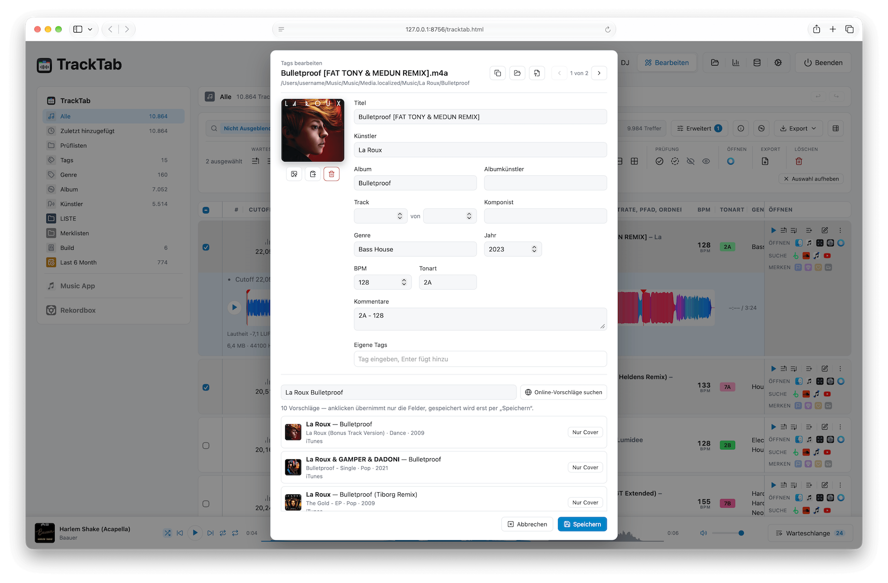

*Metadaten bearbeiten mit Online-Vorschlägen.*

Über „Online-Vorschläge suchen" lassen sich passende Metadaten (inkl. Cover) von iTunes, Deezer und MusicBrainz abrufen — ganz ohne Konto. Ein Klick auf einen Vorschlag füllt nur die Formularfelder; gespeichert wird erst durch den Klick auf „Speichern".

Sind mehrere Tracks ausgewählt, öffnet sich derselbe Dialog im Mehrfach-Modus: Nur die Felder, die du tatsächlich änderst, werden bei allen ausgewählten Dateien überschrieben.

## Auffälligkeiten (Metadaten-Probleme)

Neben der Frage „stimmt die Bitrate?" prüft TrackTab jede Datei zusätzlich auf **Metadaten-Probleme** — beschädigte oder unsauber gesetzte Tags, die zwar die Audioqualität nicht betreffen, aber z. B. beim Export als Playlist, beim Sortieren oder in anderen Programmen für Ärger sorgen können. Diese Auffälligkeiten sind eine eigene, von Korrekt/Verdächtig/Fake/Unklar **unabhängige** Kategorie: ein Track mit Verdikt „Korrekt" kann trotzdem Tag-Probleme haben, und umgekehrt.

Auslöser für diese Funktion war ein realer Fund: Ein Track hatte ein unsichtbares Zeilenumbruch-Zeichen mitten im Interpreten-Tag — dadurch wurde beim M3U8-Export aus einer Playlist-Zeile plötzlich zwei, und alle nachfolgenden Zeilen verschoben sich.

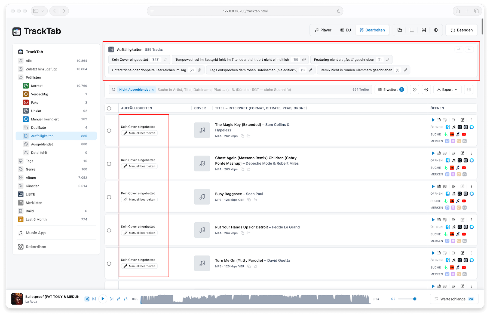
*Identifizierte Auffälligkeiten lassen sich in einer extra Spalte manuell oder je nach Problem automatisch bearbeiten.*


### Wo du sie findest

Die Liste **Auffälligkeiten** liegt in der Seitenleiste im Ordner **Prüflisten**, neben **Duplikate**. Im Kopf der Liste erscheint — genau wie bei Genre/Album/Künstler — eine Reihe **Bubbles**, eine je Fehlerart mit Anzahl betroffener Dateien:

- **Ein Klick auf eine Bubble** filtert die Tabelle auf genau diese Fehlerart.
- **Der Knopf daneben** (✨ oder ✎, siehe unten) bearbeitet **alle** Dateien mit genau diesem Fehler auf einmal.

Zusätzlich lässt sich über „Spalten ▾" eine eigene Spalte **Auffälligkeiten** einblenden, die in jeder Liste (nicht nur in „Auffälligkeiten" selbst) pro Zeile den Klartext jedes gefundenen Problems zeigt, direkt mit den beiden Aktionsknöpfen daneben.

### Zwei Arten der Korrektur

Jedes gefundene Problem gehört zu einer von zwei Gruppen:

- **✨ Quick Fix** — eindeutig sicher behebbar, TrackTab korrigiert es auf Knopfdruck ohne Rückfrage zum Inhalt (nur eine Bestätigung, wie viele Dateien betroffen sind). Ein Quick Fix behebt bei einer Datei immer **alle** ihre sicher behebbaren Probleme auf einmal, nicht nur das eine angeklickte.
- **✎ Manuell bearbeiten** — erfordert eine Entscheidung, die nur du treffen kannst (z. B. welches Jahr korrekt ist). Der Knopf öffnet direkt den bekannten Tags-Dialog — bei einer einzelnen Zeile für genau diese Datei, bei einer Bubble im Sammel-Modus für alle betroffenen Dateien auf einmal.

### Die Fehlermeldungen im Einzelnen

| Auffälligkeit | Was das bedeutet | Korrektur |
|---|---|---|
| **Steuerzeichen/Zeilenumbruch im Tag** | Ein Tag-Wert (z. B. der Interpret) enthält ein unsichtbares Steuerzeichen oder einen Zeilenumbruch — sichtbar wird das erst beim Export (siehe oben) oder in manchen Fremdprogrammen. | ✨ Quick Fix |
| **Führendes/nachgestelltes Leerzeichen im Tag** | Ein Tag-Wert beginnt oder endet mit einem Leerzeichen — unsichtbar in der Tabelle, sorgt aber z. B. beim Sortieren oder Gruppieren für scheinbar doppelte Werte. | ✨ Quick Fix |
| **Nur ID3v1 vorhanden (kein ID3v2)** | Die Datei trägt nur das sehr alte, stark begrenzte ID3v1-Format (kurze Textfelder, kein Cover möglich). Moderne Programme lesen meist nur ID3v2. | ✨ Quick Fix |
| **Alter ID3v2.2-Header** | Die Datei nutzt die veraltete ID3v2.2-Variante — wird noch gelesen, aber von manchen Programmen nur eingeschränkt unterstützt. | ✨ Quick Fix |
| **Genre als unaufgelöster Zahlencode** | Das Genre-Feld enthält nur eine Zahl wie `(17)` statt Klartext — ein Überbleibsel aus der alten, festen ID3v1-Genreliste. TrackTab löst den Code automatisch in den passenden Namen auf (z. B. `(17)` → „Rock"). | ✨ Quick Fix |
| **Widersprüchliche Mehrfach-Tags** | Dasselbe Feld (z. B. Titel) ist mehrfach mit unterschiedlichem Inhalt in der Datei gespeichert — Programme können dann den falschen davon anzeigen. TrackTab führt sie auf einen Wert zusammen. | ✨ Quick Fix |
| **Tag nicht Unicode-normalisiert (NFC)** | Der Tag-Text ist technisch korrekt, aber in einer anderen Unicode-Normalform gespeichert als üblich (betrifft z. B. Umlaute) — kann beim Suchen/Sortieren zu scheinbar doppelten, eigentlich identischen Werten führen. | ✨ Quick Fix |
| **Encoding-Artefakt (falsch interpretierte Umlaute)** | Der Text sieht kaputt aus (z. B. „Björk" statt „Björk") — ein Zeichensatz wurde beim Taggen falsch interpretiert. TrackTab zeigt einen möglichen korrigierten Wert zur Vorschau, schreibt ihn aber nie ungefragt, da ein Fehlgriff hier eine Rateaufgabe wäre. | ✎ Manuell |
| **Unausgeglichene Klammer im Titel** | Der Titel enthält eine öffnende ohne passende schließende Klammer (oder umgekehrt) — meist ein abgeschnittener Titel wie „Song (Radio Edi". | ✎ Manuell |
| **Tags entsprechen dem rohen Dateinamen (nie editiert?)** | Interpret UND Titel sind identisch mit dem unbearbeiteten Dateinamen — ein Hinweis, dass die Tags nie gesetzt wurden. | ✎ Manuell |
| **Unplausibles Jahr** | Das Jahr-Feld enthält einen Wert, der kein echtes Erscheinungsjahr sein kann (z. B. vor 1900 oder in der Zukunft). | ✎ Manuell |
| **Tracknummer nicht als Zahl erkennbar** | Das Tracknummer-Feld enthält keinen gültigen Wert im Format „3" oder „3/12". | ✎ Manuell |
| **Titel fehlt** / **Interpret fehlt** | Eines der beiden Pflichtfelder ist komplett leer. | ✎ Manuell |
| **Kein Cover eingebettet** | Die Datei hat kein Cover-Bild. Tipp: Im Tags-Dialog lässt sich über „Online-Vorschläge suchen" oft passendes Cover-Material automatisch finden. | ✎ Manuell |
| **Cover ungewöhnlich groß** | Das eingebettete Cover ist deutlich größer als üblich (> 2 MB) — bläht die Datei unnötig auf. Quick Fix verkleinert es auf die übliche Kantenlänge von ca. 1000 Pixeln und komprimiert es neu als JPEG; das Seitenverhältnis bleibt erhalten. | ✨ Quick Fix |
| **Cover-Bilddaten beschädigt** | Die eingebetteten Bilddaten lassen sich nicht als Bild öffnen. | ✎ Manuell |
| **Dateiendung passt nicht zum tatsächlichen Codec** | Die Datei heißt z. B. `.mp3`, enthält aber tatsächlich AAC-Audiodaten — kann bei manchen Programmen zu Wiedergabeproblemen führen. | ✎ Manuell |
| **Tonart-Schreibweise weicht von der Einstellung ab** | Die Datei trägt die Tonart in einer anderen Schreibweise als unter ⚙ Einstellungen → Analyse → Tonart-Feld gewählt (z. B. `8A` statt `1m`); die Tonart-Bubble hat einen gestrichelten Rahmen. Quick Fix schreibt die vorhandene Tonart in der gewählten Schreibweise in die Datei, der Wert selbst bleibt (wie „Tonart-Schreibweise angleichen“). | ✨ Quick Fix |

### Erneute Prüfung

Wie beim Qualitäts-Verdikt gilt: Eine Auffälligkeit wird bei jeder Art von Analyse neu geprüft — beim regulären Scan, bei „Track neu analysieren", bei den Einzelprüfungen und nach einer Bitrate-Korrektur. Wurde nur die **Erkennung selbst** verbessert (z. B. nach einem TrackTab-Update), ohne dass sich an den Dateien etwas geändert hat, genügt der Schalter „Auffälligkeiten neu prüfen" beim Scannen (siehe [Bibliothek scannen](#bibliothek-scannen)) — deutlich schneller als ein vollständiger Rescan, weil dabei nur die Tags neu gelesen werden, nicht die Audiodaten.

## Konverter MP3, AAC, AIFF

Ist mindestens ein Track ausgewählt (Haupttabelle oder Einzelprüfung), erscheint in der Buttonleiste ein zusätzliches Symbol für den Konverter. Ein Popup lässt dich das Zielformat wählen:

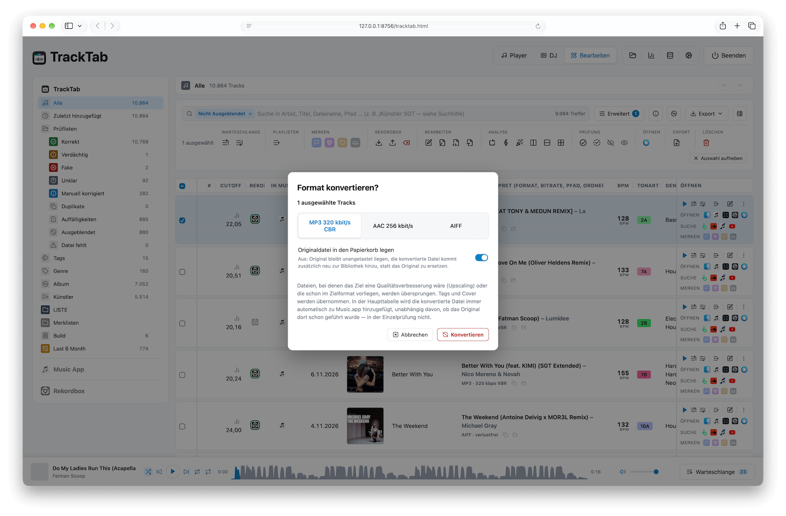

*Der Konverter mit Zielformat-Auswahl.*

- **MP3 320 kbit/s** — jeder Frame hat 320 kbit/s (wie CBR), Samplerate der Quelle (Quellen mit 88,2/96 kHz und mehr werden auf 44,1 bzw. 48 kHz gebracht, MP3 kennt nur 32/44,1/48 kHz). Mit dem mitgelieferten `lame` bleibt dabei auch der Frequenzbereich über 20 kHz erhalten, ein normales 320er-CBR schneidet dort ab. Fehlt `lame`, kodiert TrackTab über ffmpeg (Lowpass bei etwa 20 kHz). In der Spektralanalyse hat eine solche Datei keine Kante und gleicht einer MP3 ohne Lowpass.
- **AAC 256 kbit/s** — als `.m4a`, mit Apples Encoder (derselbe wie in Music.app), 256 kbit/s wie die Titel aus dem iTunes Store. Erlaubt aus verlustfreien Dateien und aus verlustbehafteten ab 256 kbit/s (eine MP3 320 also ja, eine MP3 192 nicht); eine AAC ab 256 kbit/s liegt schon im Zielformat.
- **AIFF** — verlustfrei, Samplerate und Bittiefe der Quelle bleiben erhalten.

TrackTab verhindert dabei „Hochrechnen": eine Datei, die schon verlustbehaftet ist, lässt sich nicht zu AIFF konvertieren, und eine MP3 mit weniger als 320 kbit/s nicht zu 320 kbit/s hochkodieren. Solche Tracks werden übersprungen, ebenso Dateien, die bereits genau im Zielformat vorliegen (nichts zu gewinnen). Am Ende zeigt ein Bericht, wie viele Dateien konvertiert und wie viele aus welchem Grund übersprungen wurden.

Tags, Tonart, Stimmung und Cover werden aus der Originaldatei übernommen (die Tonart in derselben Schreibweise wie im Original; fehlt sie dort, kommt sie aus TrackTabs Datenbank in der eingestellten Schreibweise). In der Haupttabelle wird die konvertierte Datei **immer automatisch in deine Music.app-Bibliothek aufgenommen** — unabhängig davon, ob das Original dort bereits geführt wurde oder nicht (Music.app hat keine Funktion zum „Ersetzen", ein bereits vorhandener Track wird beim Ersetzen deshalb entfernt und die konvertierte Datei neu importiert, siehe unten). In der Einzelprüfung passiert das **nicht** — dort hat TrackTab ohnehin keine Datenbankzeile und rührt Music.app nicht an.

Ein Schalter im Popup, „Originaldatei in den Papierkorb legen", bestimmt, was mit dem Original geschieht (standardmäßig an):

- **Aktiviert (Standard):** Das Original wandert nach erfolgreicher Konvertierung in den Papierkorb (nie Hard-Delete) — die neue Datei trägt denselben Namen mit neuer Endung, im selben Ordner, und ersetzt den Track in der Liste. War der Track bereits in Music.app, wird er dort zuerst entfernt (dabei können Playlist-Zugehörigkeiten in Music.app verloren gehen), dann die konvertierte Datei importiert. War er in Rekordbox bekannt, wird der Dateipfad dort korrigiert, sofern Rekordbox beim Konvertieren geschlossen ist.
- **Deaktiviert:** Das Original bleibt unangetastet liegen (Datei, Bibliothekseintrag und Music.app-Verknüpfung), die konvertierte Datei entsteht zusätzlich daneben und erscheint als eigener, neuer Eintrag in der Liste (bzw. in den Einzelprüfungen) — und wird ebenfalls neu in Music.app importiert. Rekordbox bleibt in diesem Fall unangetastet.

## Einzelprüfung von neuen Dateien (nicht in der Mediathek)

Der Bereich „Einzelprüfungen" ist zunächst ausgeblendet. Er erscheint, sobald du eine Datei über das Symbol „Datei öffnen" in der Kopfzeile hinzufügst oder eine Datei auf die Seite ziehst, und verschwindet wieder mit „Liste leeren".

Für eine Datei, die noch nicht in der Bibliothek liegt, gibt es zwei unterschiedliche Wege — beide landen **nicht** in der Datenbank und beeinflussen weder Statistik noch Export, unterscheiden sich aber deutlich im Funktionsumfang:

- **Drag & Drop** — ziehst du eine Audiodatei auf die Seite, wird sie sofort gemessen und angezeigt: eine reine Schnellanalyse. In der Zeile stehen dafür nur eingeschränkte Aktionen zur Verfügung (Abspielen, Löschen, Shop-Suche).
- **„Dateien öffnen"** — das Symbol „Datei öffnen" in der Kopfzeile (bzw. der Button im Bereich Einzelprüfungen) öffnet einen Dateiauswahl-Dialog. Nur auf diesem Weg erhältst du den vollen Funktionsumfang: Metadaten bearbeiten, neu messen, konvertieren, automatisch umbenennen und — über „In Music-Bibliothek importieren" — den Track anschließend in deine Music.app-Bibliothek aufnehmen (der Button erscheint nur, wenn die Music App in den Einstellungen ausgewählt ist); TrackTab übernimmt den neuen Speicherort automatisch.

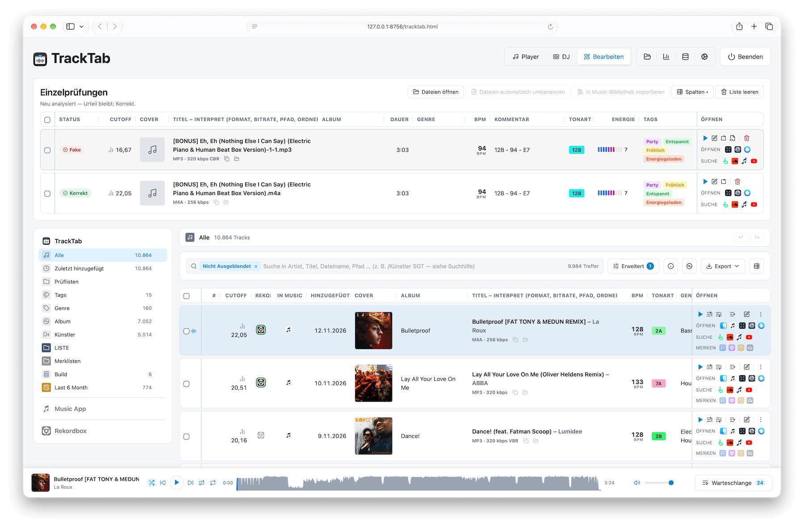

*Über „Dateien öffnen" hinzugefügt: voller Funktionsumfang.*

Der Unterschied auf einen Blick — dieselbe Datei einmal per Drag & Drop (eingeschränkte Aktionen), einmal über „Dateien öffnen" (volle Aktionsleiste):

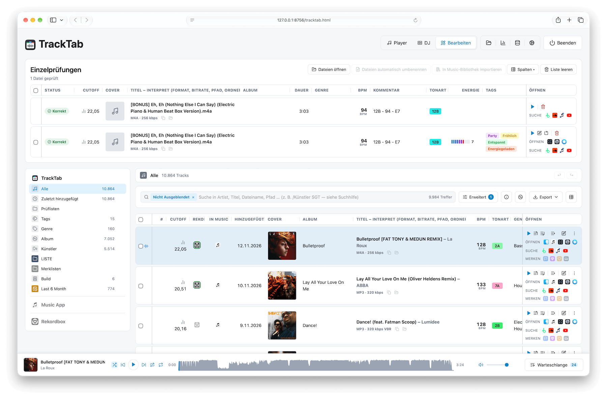

*Drag & Drop (unten) im Vergleich zu „Dateien öffnen" (oben).*

## Dateien automatisch umbenennen

Frisch gekaufte Tracks kommen je nach Shop mit sehr unterschiedlichen Dateinamen — die Metadaten in der Datei sind dagegen einheitlich. Der Button „Dateien automatisch umbenennen" in den Einzelprüfungen baut daraus einen einheitlichen Namen, für alle gerade ausgewählten Zeilen auf einmal.

Das Muster legst du in den Einstellungen unter **Dateinamen → Namensmuster** fest. Vorgabe:

```
{artist}_{title}_{bpm}_{key}_{bitrate}_{year}
```

Verfügbare Platzhalter: `{artist}`, `{title}`, `{album}`, `{albumartist}`, `{composer}`, `{genre}`, `{bpm}`, `{key}`, `{bitrate}`, `{year}`, `{samplerate}`, `{track}`.

So werden die Namen gebaut:

- **Unterstrich** trennt die Kategorien, **Bindestrich** die Wörter innerhalb einer Kategorie: `daft-punk_get-lucky_116bpm_8a_320kbps_2013.mp3`
- Alles klein geschrieben, Umlaute ausgeschrieben (ä → ae), Sonderzeichen werden zu Bindestrichen.
- Ein Platzhalter ohne Wert lässt seine Kategorie **ersatzlos entfallen** — es bleibt keine Lücke zurück. Bei verlustfreien Formaten (FLAC, WAV, AIFF, ALAC) gibt es keine aussagekräftige Bitrate, dort fällt `{bitrate}` also automatisch weg: `bicep_glue_130bpm_4a_2017.flac`
- Die Tonart `{key}` liest TrackTab aus der Datei — sie steht dort, wenn Mixed In Key den Track analysiert hat.
- Existiert der Zielname schon, wird `-2`, `-3` … angehängt; die Dateiendung bleibt erhalten, der Ordner ebenfalls (es wird nichts verschoben).

Übersprungen wird:

- **Dateien, die schon in einem deiner Bibliotheksordner liegen.** Dort sind sie über ihren Pfad verknüpft (Music.app, Rekordbox, Playlisten) — ein neuer Name würde diese Verweise zerreißen. Dafür gibt es einen eigenen Weg, der sie mitzieht: siehe [Bibliothekstracks umbenennen](#bibliothekstracks-umbenennen).
- **Dateien ohne Interpret und Titel.** Ein Name aus lauter technischen Werten (`320kbps.mp3`) sagt weniger aus als der vorhandene Dateiname.
- Dateien, die bereits genau so heißen.

### Bibliothekstracks umbenennen

Auch Tracks in der Bibliotheksliste lassen sich nach demselben Muster umbenennen: im Zeilenmenü **Datei umbenennen** oder als Sammelaktion für eine Auswahl. TrackTab zieht dabei alles nach, was am Pfad hängt:

- **Datenbank, Playlisten, Merklisten** — laufen mit.
- **Music.app** — der Track wird auf die neue Datei umgebogen (Playlisten und Wiedergabezähler bleiben). Lehnt Music.app das ab, wird die Umbenennung zurückgenommen. Dieses Umbiegen ist noch nicht an echtem Material geprüft — schau dir nach dem ersten Umbenennen an, ob der Track in Music.app weiter abspielbar ist. Nach einer späteren Tag-Änderung kann Music.app die Datei in seinem Medienordner wieder selbst umsortieren, wenn dort „Medienordner automatisch organisieren“ an ist.
- **Rekordbox** — der Pfad wird in der Sammlung korrigiert. Läuft Rekordbox, wird der neue Pfad nur vorgemerkt und beim nächsten „Rekordbox abgleichen“ (Rekordbox vorher beenden) in die Sammlung geschrieben.

Ein Fortschritts-Hinweis zeigt an, wie weit das Umbenennen ist; am Ende steht, wie viele Dateien umbenannt und wie viele aus welchem Grund übersprungen wurden. Die Zuordnung in TrackTab wird dabei sofort mitgezogen — Abspielen, Metadaten bearbeiten, neu messen und der Import funktionieren direkt weiter, ohne die Dateien erneut öffnen zu müssen.

## Statistik

Der Button „Statistik" in der Kopfzeile zeigt eine Jahres-/Monats-Auswertung: wie viele Aktionen (Korrekturen, Konvertierungen, Tag-Änderungen, Cover, Papierkorb, Umbenennungen, Rekordbox-/Music.app-Abgleich, …) in welchem Monat passiert sind, wie viel insgesamt gehört wurde, und welche Titel, Interpreten und Genres am meisten Wiedergabezeit hatten. Die meistgehörten Titel sind nach Anzahl der Wiedergaben sortiert (bei Gleichstand nach Hörzeit). Ein Jahres-Dropdown wechselt zwischen den Jahren, für die es Daten gibt; „Neu berechnen" aktualisiert die Zahlen sofort. Bei den meistgehörten Titeln legt „Playlist aus Top 50 erstellen" eine neue Playlist mit den bis zu 50 meistgehörten Titeln des gewählten Jahres an. Entsprechend legt „Playlist aus vollständig Gehörten erstellen“ bei „Am vollständigsten gehört“ eine Playlist aus den dort gelisteten Titeln an.

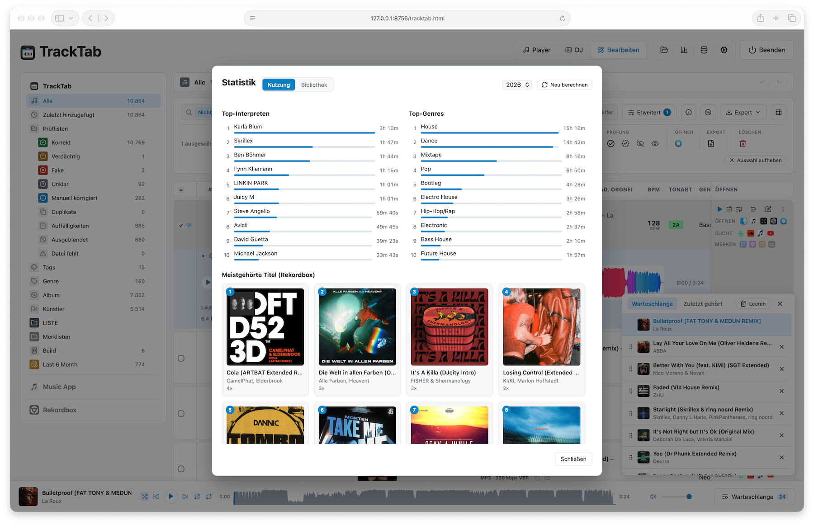

Der Reiter „Bibliothek" im Statistik-Fenster zeigt stattdessen eine Momentaufnahme des Bestands: Trackzahl, Spielzeit, Speicherbedarf und durchschnittliche Länge, Formate, Tag-Vollständigkeit (wie viele Tracks Cover, Genre, BPM, Tonart, Jahr und Albuminterpret haben), Jahrgänge, BPM- und Tonart-Verteilung sowie die Zugänge pro Monat und Jahr laut Music.app. Dazu kommen die Abdeckung (in Rekordbox, in Playlisten, in Merklisten, ausgeblendet, als korrekt bestätigt) und Pflegehinweise (Tag-Auffälligkeiten, Duplikat-Gruppen). Tracks ohne Hinzufüge-Datum aus Music.app fehlen bei den Zugängen und werden dort ausdrücklich genannt. Dieselben Zahlen gibt `./run.command stats` im Terminal aus.

Ist Rekordbox in den Einstellungen ausgewählt, wird die Historie aus Rekordbox geladen und man erhält ebenfalls eine Statistik.


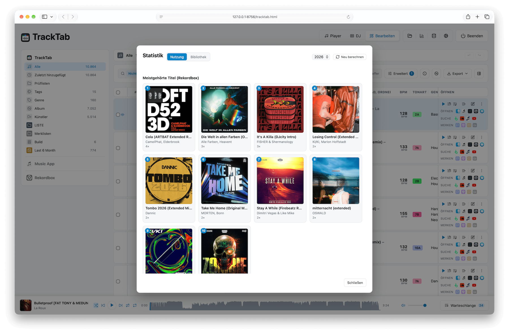


*Das Statistik-Dashboard.*

## Genre, Album, Künstler + Korrekturvorschläge

In der Seitenleiste liegt je eine Liste für Genre, Album und Künstler (dazu „Duplikate", siehe unten) — jede zeigt die komplette Bibliothek gruppiert nach dem jeweiligen Wert, mit eigener Spaltenansicht, Warteschlange und Export wie jede andere Liste. Im Kopf der Liste erscheint ein Buchstaben-Index: oben eine A–Z-Leiste (Ziffern und Sonderzeichen unter „#", Umlaute unter ihrem Grundbuchstaben; Buchstaben ohne Einträge sind grau), darunter je Buchstabe ein Abschnitt mit allen Werten als Bubbles samt Anzahl. Ein Klick auf einen Buchstaben springt direkt zum Abschnitt; ein „ausklappen"-Link darunter vergrößert den Bereich bei vielen Werten. Das Stift-Symbol an einer Bubble oder an einer Gruppenüberschrift in der Tabelle öffnet denselben Umbenennen-Dialog und benennt den Wert für ALLE betroffenen Tracks auf einmal um — geschrieben wird in die Datei-Tags selbst sowie, sofern zutreffend, in den Music.app-Import und in Rekordbox, damit alle drei Orte im Gleichschritt bleiben. Läuft Rekordbox gerade, wird die Übernahme dort übersprungen (die Meldung weist darauf hin); die Änderung an Datei und Datenbank erfolgt trotzdem. Bei Album ist zusätzlich der Künstler festgelegt, damit zwei gleichnamige Alben verschiedener Künstler nie versehentlich vermischt werden.

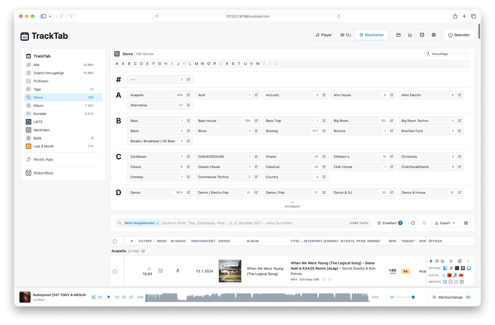
*Alle Genres werden als Bubble angezeigt, mit der Anzahl der betroffenen Tracks. Mit Klick auf eine Bubble wird dieser als Filter für die Liste angewendet.*

Der Button „Vorschläge" blendet automatisch erkannte, vermutlich zusammengehörige Werte ein (unnötiges Leerzeichen, Groß-/Kleinschreibung, möglicher Tippfehler, mögliche Variante wie Single/Remix) — jeweils mit Grund und einem Augen-Symbol, das die betroffenen Tracks vorab in der Tabelle zeigt, bevor etwas geändert wird. „Ziel auswählen" öffnet einen Dialog, in dem sich einer der beiden Werte als Ergebnis bestimmen lässt (unsichtbarer Leerraum wird dabei farblich hervorgehoben); „×" blendet einen Vorschlag dauerhaft aus.

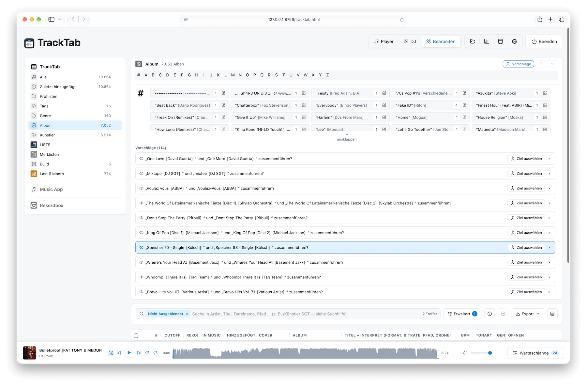
**Vorschläge werden angezeigt und können einzeln behoben werden.**

## Tracks ausblenden

Das Augen-Symbol markiert einen Track als Fehlalarm — er verschwindet aus den Kennzahlen und dem Export. Über „Ausgeblendete zeigen" holst du ihn zur Kontrolle zurück; nichts geht dabei verloren, die Datei selbst wird nie angefasst.

## Gelöschte und verschobene Dateien

Löschst du eine Datei außerhalb von TrackTab, bleibt ihr Eintrag zunächst als „Datei fehlt" stehen; ein Button räumt solche Einträge auf. Verschiebt oder benennt Music.app eine Datei nach einer Tag-Änderung eigenständig um, erkennt TrackTab das automatisch wieder und verknüpft den Eintrag neu.

## Verwaiste Ordner

Ein Button in den Einstellungen findet leere Ordner in deinen Musikordnern (z. B. Reste nach dem Löschen von Tracks in Music.app) und verschiebt sie nach Rückfrage in den Papierkorb.

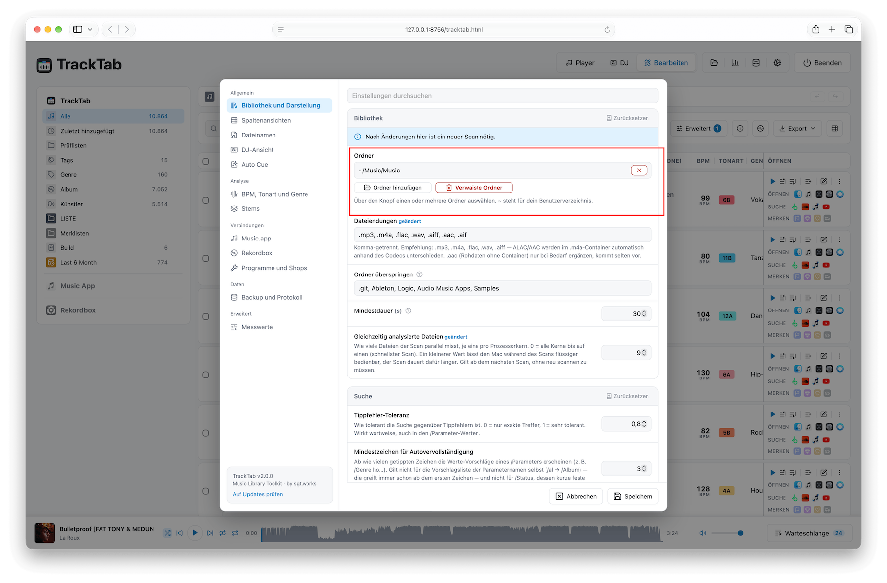
**Verweiste Ordner löschen.**

## Backup

Beim Beenden von TrackTab wird automatisch ein Backup deiner Analysedaten erstellt; ältere Backups werden nach einer konfigurierbaren Anzahl automatisch entfernt. Über die Einstellungen lässt sich jederzeit manuell ein Backup erstellen oder ein früherer Stand wiederhergestellt werden. Betroffen sind nur die Analysedaten von TrackTab selbst — deine Musikdateien fasst das Backup nicht an.

> **Trotzdem gilt:** TrackTab kann deine Musikdateien bearbeiten, umbenennen, umkodieren oder in den Papierkorb verschieben. Sichere deine Musikbibliothek regelmäßig und unabhängig von TrackTab, damit im Zweifel immer ein früherer Stand verfügbar ist.

---

## Grenzen

- Ein niedriger Cutoff-Wert kann auch von einem bandbegrenzten Master, einem Vinyl-Rip oder einer alten Aufnahme stammen — TrackTab liefert eine Prüfliste, kein Urteil.
- AAC-Dateien: Die Grenzen sind an Apples Encoder gemessen (Music.app/iTunes). Eine 128er-Quelle lässt sich dort nicht sicher von einer 160er unterscheiden, weil Apple den Tiefpass je nach Musik um gut 1 kHz verschiebt. Eine echte 256er-Datei von Apple hat oft gar keine harte Kante. Wurde eine laute Datei mit einem Werkzeug neu kodiert, das unterwegs auf 16 Bit wandelt (z. B. ffmpeg mit Apples Encoder, oft auch libfdk_aac), kann Übersteuerung die frühere Kante verdecken. Solche Fälle erkennt TrackTab meist nicht.
- 224 kbps und 256 kbps lassen sich nicht voneinander unterscheiden.
- Der Papierkorb lässt sich nicht aus TrackTab heraus leeren — das bleibt bewusst dem Finder überlassen.
- Die Wiedergabe im Player hängt vom Browser ab: AIFF und ALAC spielen zuverlässig nur in Safari (siehe [README](readme.md#unterstützte-dateiformate)).
- Tag-Änderungen aktualisieren Music.app nicht sofort — der Import zeigt dort weiter die alten Metadaten, bis Music.app sie selbst neu einliest.
- Online-Metadatenvorschläge liefern selten ein BPM.
