# Manual

*Deutsche Fassung: [manual.de.md](manual.de.md)*

This manual explains how to use TrackTab — without technical details. It is written for everyone who wants to check, tidy up and maintain their music library.

Other documents:

- **[readme.md](readme.md)** — short introduction with screenshots.
- **[quickstart.md](quickstart.md)** — the first steps in five points.
- **[installation.md](installation.md)** — setup: ready-made app, your own build or terminal.
- **[Technical functions](technical_functions.de.md)** — in-depth knowledge for further development: analysis algorithms, formulas, system architecture *(German)*.
- **[changelog.md](changelog.md)** — what changed from version to version.

---

## Table of contents

- [Operating modes](#operating-modes)
  - [1. Ready-made app (installation via a .dmg file)](#1-ready-made-app-installation-via-a-dmg-file)
  - [2. Your own app build](#2-your-own-app-build)
  - [3. Running from the terminal](#3-running-from-the-terminal)
- [Installing as your own app](#installing-as-your-own-app)
- [The web interface](#the-web-interface)
  - [Views: Edit, Player and DJ](#views-edit-player-and-dj)
- [Settings](#settings)
- [Is the bitrate correct?](#is-the-bitrate-correct)
- [Correcting the bitrate](#correcting-the-bitrate)
- [Loudness of tracks](#loudness-of-tracks)
- [Supported file formats](#supported-file-formats)
- [Scanning the library](#scanning-the-library)
- [Syncing Rekordbox](#syncing-rekordbox)
- [Syncing Music.app](#syncing-musicapp)
- [The media player](#the-media-player)
- [The sidebar](#the-sidebar)
- [Playlists and folders](#playlists-and-folders)
- [Favorite playlists](#favorite-playlists)
- [Smart playlists](#smart-playlists)
- [Playlist generator](#playlist-generator)
- [Playlists from other apps](#playlists-from-other-apps)
- [DJ view](#dj-view)
  - [Auto Cue](#auto-cue)
  - [Syncing with Rekordbox](#syncing-with-rekordbox)
- [Genre, mood and energy](#genre-mood-and-energy)
- [Creating stems (acapella & instrumental)](#creating-stems-acapella--instrumental)
- [Searching and filtering](#searching-and-filtering)
- [Customising columns](#customising-columns)
- [The button bar](#the-button-bar)
- [Listening with the waveform](#listening-with-the-waveform)
- [Key](#key)
- [Beat grid and phrases](#beat-grid-and-phrases)
- [Editing tags](#editing-tags)
- [Find & replace](#find--replace)
- [Issues (metadata problems)](#issues-metadata-problems)
- [Converter MP3, AAC, AIFF](#converter-mp3-aac-aiff)
- [Single check of new files (not in the library)](#single-check-of-new-files-not-in-the-library)
- [Renaming files automatically](#renaming-files-automatically)
- [Statistics](#statistics)
- [Genre, album, artist + correction suggestions](#genre-album-artist--correction-suggestions)
- [Hiding tracks](#hiding-tracks)
- [Deleted and moved files](#deleted-and-moved-files)
- [Orphaned folders](#orphaned-folders)
- [Backup](#backup)
- [Limits](#limits)

---

## Operating modes

There are three ways to use TrackTab. The ready-made app (installed via a .dmg file) uses the data folder `~/Library/Application Support/TrackTab/`. Your own app build automatically creates its own, separate data folder (`TrackTab-Build`) and also runs on a different port — whether you open it straight from `dist/` or start it through the shortcut that `build_app.sh` creates in Applications. That way you can have both versions open at the same time (e.g. a fixed version for your real library and one for testing new changes) without them sharing data or a port. Running from the terminal straight from the source code, on the other hand, keeps its database and settings in the project folder itself — so it also runs with its own, separate state.

### 1. Ready-made app (installation via a .dmg file)

The easiest way, no terminal at all — open the .dmg, drag the app into the Applications folder, open it once via right-click. Requirement: a Mac with an Apple Silicon processor. Step-by-step instructions: [installation.md](installation.md#1-installation-via-dmg-file-macos).

### 2. Your own app build

You build your own double-clickable app from the source code — after that you no longer need the terminal, not even to start or quit it. Step-by-step instructions: [installation.md](installation.md#2-your-own-app-build-compiling-from-source).

### 3. Running from the terminal

You start TrackTab directly with a command in the terminal. This is the quickest way to get started and also suits you if you want to run individual steps on their own (only scan, only regenerate the report, …). Requirements and all commands: [installation.md](installation.md#3-running--operating-from-the-terminal).

---

## Installing as your own app

No matter which of the three ways you start TrackTab: the interface first opens as a normal tab in your browser. You can additionally install it as a standalone app — it then runs in its own window without an address bar and tabs, with its own icon in the Dock, just like a normally installed app.

- **Chrome / Edge:** Click the install icon in the address bar (to the right of the URL) and confirm.
- **Safari (macOS Sonoma or newer):** Menu *File → Add to Dock…*.

Installing is a one-time step. After that you open TrackTab via the new Dock icon instead of the browser.

> [!important]
> The installed app still needs the local server running in the background (see [Operating modes](#operating-modes)) — if it is not running, the PWA shows the TrackTab icon with a **Start** button. That starts the app straight from this window (only if TrackTab is installed as a built app, not when running from the terminal); the page reloads automatically as soon as the server is ready. After a deliberate **Quit** via the button of the same name in the interface, you also land on exactly this screen as soon as the server has actually stopped.

---

## The web interface

No matter whether started from the terminal (`serve`) or via the built app: a small server runs in the background, exclusively on your own computer (`127.0.0.1`) — none of it is reachable over the internet. This is necessary so that hidden tracks can be saved and music files can be delivered for listening; a plain HTML file cannot do that.

### Views: Edit, Player and DJ

There are three views: Player, DJ and Edit. Column order, hidden columns and column width are saved separately for each view — changes in the Player view do not affect the Edit view and vice versa. Playback itself, however, carries across views: switching between Edit and Player interrupts neither running music nor the queue.

At the top right you switch between the views:

- **Edit** — the full interface with all lists, filters and row actions (default).

  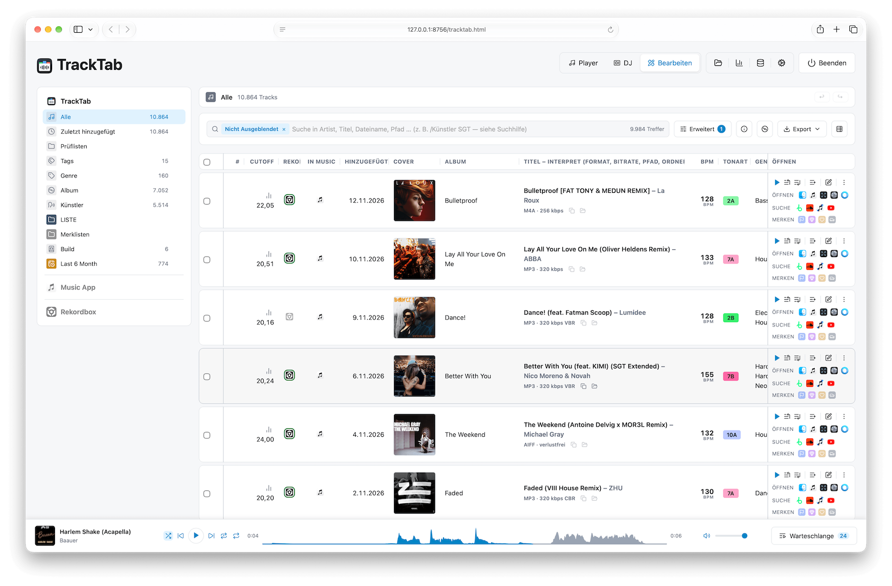

  *The Edit view.*

- **Player** — a heavily reduced view for pure listening: library management, single checks and export buttons are hidden. The sidebar with the list tree stays fully visible and usable, and the chosen list stays selected when you switch. In each row only Play, Add to queue, “Open Music” and Favorites remain visible.


> [!tip]
> While a scan is running you cannot switch to the Player view.

  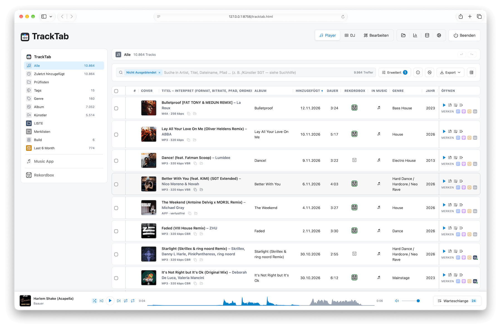

  *The reduced Player view.*

- **DJ** — shows TrackTab’s own lists and the lists from Music.app and Rekordbox, including dragging onto their playlists and removing via the bar. Titles there that TrackTab does not know are marked as in Edit with “not in TrackTab” or “no local file” and cannot be expanded or edited. An expanded track opens the editor for cues, loops, beat grid and phrases, see [DJ view](#dj-view). You cannot switch here during a scan either. The sync menu (database icon at the top right) is available here as well. You open files as in Edit via the folder icon or by drag & drop; the [single check](#single-check-of-new-files-not-in-the-library) then appears above the list with all its functions.

## Settings

Under the gear icon you adjust library paths, analysis sensitivity, class limits, external programs (audio editor, DAW, Mixed In Key, Music app, Rekordbox) and further options. On the left you choose the page; the search field above it finds every setting by name or help text. A dot in the navigation marks pages with changes not yet saved. Anything that differs from the default is labelled “changed” right at the field. Short explanations of a field are shown by the **?** after its name (hover or click it), longer ones are shown directly below the field. Most groups can be reset individually to the default with **Reset** at the top right.

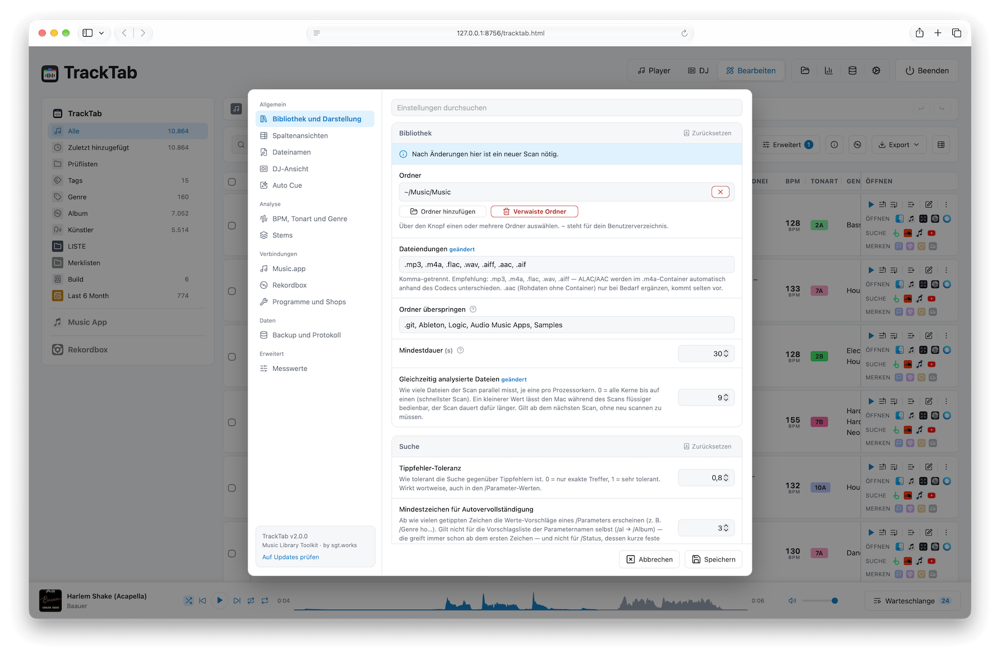

*The settings dialog.*

The pages at a glance:

| Page | What can be set there |
|---|---|
| **Library and appearance** | **Library:** music folders, file extensions, excluded folders, minimum duration, how many files the scan measures at once (smaller = your Mac stays more responsive during the scan, the scan takes longer). **Appearance:** language, colour scheme, font size, accent colour. **Search:** typo tolerance, minimum characters for autocomplete, default search filters (see [Searching and filtering](#searching-and-filtering)) |
| **Column views** | Defaults for Edit, Player, review lists and single check; edit the columns of each view, create new views, rename and delete your own (see [Customising columns](#customising-columns)) |
| **File names** | Name pattern for automatic renaming (see [Renaming files automatically](#renaming-files-automatically)) |
| **BPM, key and genre** | One shared page for both analyses: which parts are measured (BPM, key, genre suggestions, mood & energy), automation for single checks (per analysis), a shared length limit and – in the sections Key field, BPM field, Comment field and Genre & mood – what is written to which field. The Key field section also holds the key notation (Camelot, Open Key, note names), see [Key](#key) and [Genre, mood and energy](#genre-mood-and-energy) |
| **Stems** | Load or remove the separation model, title suffix and genre of the new files, length limit (see [Creating stems](#creating-stems-acapella--instrumental)) |
| **Music.app** | Choose the Music app, take covers from Music.app |
| **Rekordbox** | Rekordbox app, quality check on import with minimum cutoff, transfer moods and own tags as “My Tag” (see [Genre, mood and energy](#genre-mood-and-energy)), transfer stems to Rekordbox, open the Rekordbox backup folder. Without a selected Rekordbox installation everything except the program choice is greyed out |
| **Programs and shops** | **External programs:** audio editor, DAW, Mixed In Key. **Shops:** which platforms appear as search icons in the button bar (see [The button bar](#the-button-bar)) |
| **Backup and log** | Create and restore a database backup, open the backup folder and the folder of the change log |
| **Measurement values** | **Analysis:** cutoff and class limits per format. **Loudness:** LUFS reference range, true-peak warning threshold (see [Is the bitrate correct?](#is-the-bitrate-correct)) |

> [!tip]
> If the Music app is selected on the “Music.app” page, these two options should be enabled in Music.app itself (Settings → Files): “Keep Music Media folder organized” and “Copy files to Music Media folder when adding to library”. Only then does Music.app reliably put imported files into its own media folder, and TrackTab can automatically follow path changes made by Music.app (renaming, reorganising).
>
> 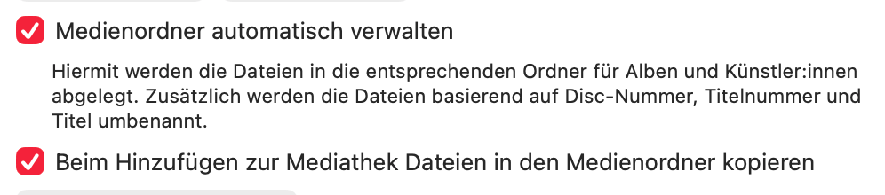

Below the “Cancel”/“Save” buttons, the running version number is shown in small type, along with a link “Check for updates” — a click compares it with the newest version published on GitHub and reports via popup whether a new version is available or the application is already up to date.

---

## Is the bitrate correct?

Every file gets a **verdict**:

| Verdict | Meaning |
|---|---|
| **OK** | Unremarkable — the quality matches the declared bitrate. |
| **SUSPICIOUS** | Something is not quite right — could be a transcode, but could also be a band-limited master or an old rip. Worth listening to. |
| **FAKE** | Very likely upscaled — the file claims a higher quality than it actually has. |
| **UNCLEAR** | Too short, too quiet or, for another reason, not reliably assessable. |

Behind this is a spectral analysis: with compressed formats (MP3, AAC), a lower bitrate leaves a recognisable limit in the high frequencies. If a file was upscaled from a lower bitrate, this limit stays visible even after re-encoding — even if the file is now declared as 320 kbps.

With lossless formats (ALAC, FLAC, WAV, AIFF) there is no declared bitrate to compare against; here all that counts is whether such a limit exists at all — because a truly lossless file should have none.

TrackTab also checks the limit piece by piece over the running time. This yields two hints in the explanation that do not change the verdict itself:

- **“Probably assembled from several sources”** — the limit jumps between passages that match different bitrates. Typical of edits, mashups and bootlegs that contain material of differing quality.
- **“Probably exported from a ~320 kbps source”** — a lossless file (e.g. AIFF) consistently shows the limit of a 320 MP3. Usually unproblematic sound-wise, but the file did not originate as truly lossless.

You can see the course of the limit in the **spectrogram**: the icon in front of the cutoff value opens a window with the track’s spectrogram (0–22 kHz). A dashed cutoff line with bitrate can be shown or hidden with a checkbox. It is calculated fresh on every click and not stored. This applies to the main table and to the single checks.

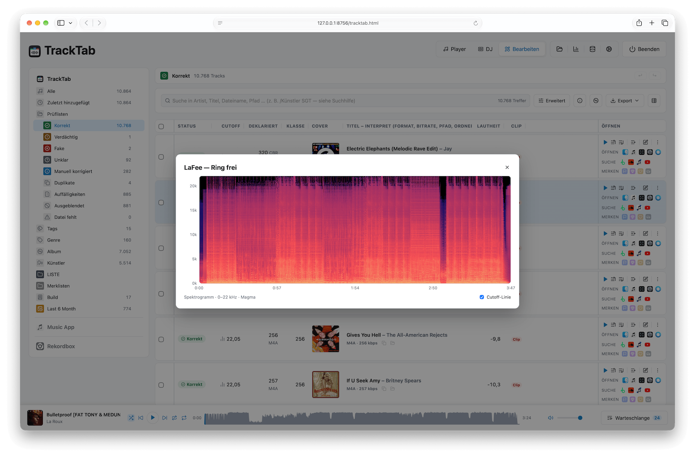

*Spectrogram: a band ending abruptly in the highs is the cutoff.*


## Correcting the bitrate

For tracks with the verdict **SUSPICIOUS** or **FAKE**, TrackTab offers to re-encode the file directly to a lower, honest bitrate — available for lossy formats (MP3, AAC), not for lossless formats.

The “Correct bitrate” button appears in three places:

- **As an icon in the row** of an affected track (main table as well as single check).
- **As a bulk action** above a selection of several rows in the main table — each track is corrected to its own measured bitrate.
- **In the single checks as a bulk action**, but only active there when exactly one affected track is selected.

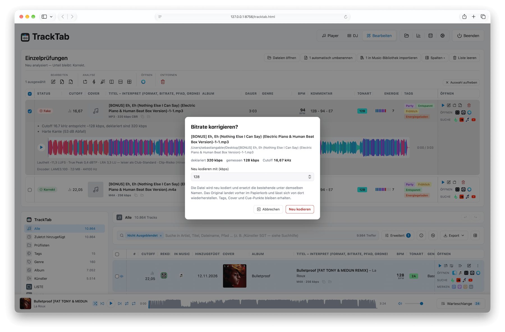

*The “Correct bitrate” dialog.*

In the dialog that opens, the measured bitrate is already entered as a suggestion in the field, but can be freely changed to any value between 32 and 320 kbps. A click on “Re-encode” re-encodes the file at this bitrate and replaces the existing file under the same name; the original goes to the Trash beforehand and can be restored from there. Tags, cover art and cue points (e.g. from Serato or Rekordbox) are kept.

## Loudness of tracks

TrackTab also measures the **loudness** of every file (according to the LUFS standard common in the music industry). There is no good/bad judgement for it, since the “right” loudness depends on the music genre and release year — only a warning if a file is technically overdriven (risk of clipping).

The thresholds can be adjusted individually in the settings. After adjusting the thresholds the library must be scanned again.

The exact thresholds, formulas and the calibration behind them are in the [Technical functions](technical_functions.de.md) *(German)*.

---

## Supported file formats

TrackTab reads, analyses and tags: **MP3, M4A/MP4 (AAC & ALAC), AAC, FLAC, WAV, AIFF/AIFC, ALAC, OGG/OGA, Opus, WMA**.

For bitrate analysis, tags, renaming, converter and Music.app/Rekordbox sync, the file format does not matter — these functions run server-side via `ffmpeg`/`ffprobe`/`mutagen` and are independent of the browser.

**The exception is listening in the built-in player** (waveform, queue): the audio file is streamed unchanged to the browser and played there via the `<audio>` element — which formats can actually be heard is decided solely by the decoder support of the browser you use, not by TrackTab:

| Format | Safari | Chrome / Edge | Firefox |
| :--- | :---: | :---: | :---: |
| MP3 | ✅ | ✅ | ✅ |
| AAC / M4A | ✅ | ✅ | ✅ |
| ALAC (`.m4a`) | ✅ | ❌ | ❌ |
| WAV | ✅ | ✅ | ✅ |
| FLAC | ✅ | ✅ | ✅ |
| AIFF/AIFC | ✅ | ❌ | ❌ |
| OGG/Opus | partly¹ | ✅ | ✅ |
| WMA | ❌ | ❌ | ❌ |

¹ Ogg Vorbis is not supported by Safari, Opus only in newer versions.

For the most reliable playback of all supported formats, **Safari** is therefore recommended — especially for libraries heavy on AIFF or ALAC. In Chrome/Firefox such tracks can be analysed and edited, but not listened to in the player (silent or failed playback attempt).

---

## Scanning the library

**Where is the button?** At the top right next to “Settings” sits a compact icon bar with three icons: **Statistics**, **Sources** (database icon) and **Open file**. It is reachable in all three views; “Open file” and “Scan library” switch from Player or DJ to Edit, because the single check and a running scan are only visible there. “Sources” opens a menu with “Scan library”, “Sync Rekordbox” and “Sync Music.app” (the last two only if the respective app is chosen in the settings). A red dot on the icon shows that a source needs attention — in the open menu the affected entry then carries a marker (currently: changes queued for Rekordbox). While a scan or sync is running, the progress appears under the “TrackTab” title.

**Scanning.** TrackTab searches your configured music folders and analyses every file that is not yet known or has changed since. The “Scan library” button opens the scan options for this:

   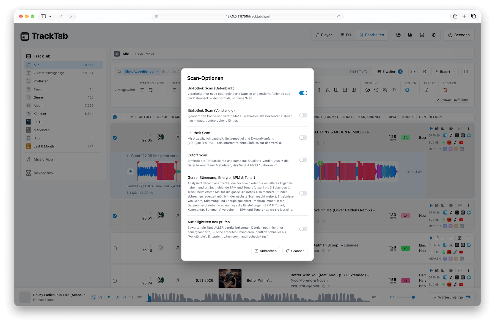

   *The scan options dialog.*

   - **Library scan (database)** — the normal, fast scan: processes only new or changed files and removes missing ones from the database.
   - **Library scan (full)** — ignores the cache and re-processes absolutely all known files. This rebuilds the cache completely, takes correspondingly longer and is normally only needed after parameter changes to the analysis.
   - **Loudness scan** (off by default) — additionally measures loudness, peak level and dynamic range (LUFS/dBTP/LRA), purely informational and without influence on the verdict.
   - **Cutoff scan** (off by default) — determines the low-pass edge and thereby the quality verdict. Switched off, a file only gets metadata; the verdict stays “unknown”.
   - What an earlier scan left out with cutoff or loudness switched off, the next scan with the switch on catches up for exactly those tracks, even if the file has not changed. A loudness measurement that had failed is tried again. Existing measurements are never lost, even if a switch is off.
   - **Genre, mood, energy, BPM & key** — afterwards analyses all tracks without a result and fills in missing BPM and key (empty fields only). Files are only written according to the settings (see [Genre, mood and energy](#genre-mood-and-energy)).
   - **Re-check issues** — re-assesses the tags of ALL already known files (not only new/changed ones) without decoding the file again — much faster than “Full”. Useful after a TrackTab update when the detection itself has improved (see [Issues (metadata problems)](#issues-metadata-problems)).

## Syncing Rekordbox

   **“Sync Rekordbox”** checks which tracks are already in Rekordbox’s collection and optionally searches your own library paths for Rekordbox entries whose file is missing (with a preview before writing).
   Genre, artist and album changes from **merging** are not written to Rekordbox immediately but queued; the number appears as a counter on the button. In the sync dialog, the option **“Transfer queued tags”** transfers them all in one run (Rekordbox must be closed for this; only one backup of the Rekordbox database is created).
   **“Transfer metadata to Rekordbox”** writes title, artist, album, genre, year, composer, comment, BPM and key from TrackTab for all tracks where they differ from Rekordbox (the red Rekordbox column with “Metadata”). The sync never touches beat grid, phrases or hot and memory cues; you transfer those by hand with **Rekordbox update** in the DJ view. Half or double tempo (e.g. 80 instead of 160) stays marked orange and is not written.
   When the dialog opens, all switches are off; with each sync you choose yourself what should run. While the sync runs, the line below the title shows which step is in progress (e.g. “Step 2 of 3: Metadata to Rekordbox”). When writing metadata and when loading beat grid, phrases and cues, the bar shows how many tracks are already done.

   > [!tip]
>For this button to be shown, “Rekordbox” must be selected as a program in the settings. Until then the other Rekordbox settings (playlist, quality check, My Tag, stems) are greyed out as well; they become available as soon as you select a Rekordbox above.

## Syncing Music.app

 **“Sync Music.app”** does the same sync for the Music.app library. Both buttons only appear if the respective program is selected in the settings.

Before the sync, a window with two switches for cleaning up the Music.app library opens. Both are off when it opens; the sync itself always runs:

- **Remove entries without a file** — entries whose file no longer exists (shown with an exclamation mark in Music.app). Only the entry is removed.
- **Remove duplicate entries** — several entries pointing to the same file. The entry in the most playlists is kept, then the one with the most plays, then the oldest. The file stays. If a duplicate entry is in a playlist the kept one is missing from, it is locked, because it would otherwise disappear from that playlist.

Checking the library takes about half a minute. A preview then lists everything found so you can untick entries; nothing changes until “Remove from Music.app”.

When you move a track to the Trash in TrackTab, TrackTab also removes it from Music.app. If it cannot find it there, for example because Music.app never picked up a title changed in TrackTab, a notice appears. “Remove entries without a file” cleans up such an entry later.

 > [!tip]
> For this button to be shown, “Music.app” must be selected as a program in the settings.

## The media player

A fixed player is docked at the bottom of the screen — it is always visible in both views, even without playback running. It shows cover, title and artist of the current track as well as:

- **Play/Pause, Previous/Next track** — also controllable via the space bar or the arrow keys ←/→. A long title that is cut off scrolls through calmly on hover.
- **Shuffle** — plays the queue in random instead of fixed order. If nothing is playing yet, a click on it immediately starts a random track from the currently filtered view. The automatically filled queue takes only one of several versions of the same song (same artist, same title core, e.g. “Replay” and “Replay (Remix)”); further versions are only added if otherwise not enough titles are left. Titles queued by hand stay untouched.
- **Repeat track** — the current track starts again after it ends instead of jumping to the next.
- **Repeat list** — after the last track of the queue it starts again from the beginning.

In the **Player view**, a click on a row or its Play button immediately starts a completely new queue from the next (up to 25) tracks of the currently shown list, beginning at this row — later changes to search/filter no longer affect an already running queue.

In the **Edit view**, a row click only expands the waveform (see “Listening with the waveform” further below) without starting playback — that only happens there with a click on the Play button in the waveform area or on the ▶ icon in the Open column. From then on the same media player runs as in the Player view, including the automatic queue.

Every row has three buttons in a row in both views:

- **Play** (▶) — starts a completely new queue as described above (in the Edit view the waveform expands as well).
- **Play next** — queues the track directly behind the one currently playing, so it is guaranteed to be next, without interrupting the running playback.
- **Add to queue** (lines-plus icon, the same as on the Queue button) — appends the track to the end of the queue.

You can also drag tracks from the table onto the **Queue** button at the bottom right; they then land at the end of the queue (with a multi-selection, the whole selection). Both add buttons can be clicked on the same track as often as you like — every click queues it again, even if it is already playing or has just been played. A queue extended by hand like this is no longer limited to 25 titles. If several rows are selected via checkbox, the same “Add” button appears in the bulk bar for all selected tracks at once, next to your favorite lists.

The “Queue” button opens a popup with two tabs:

- **Queue** — the current track (highlighted) and everything that comes next. Here tracks can be rearranged by drag & drop, removed with the ✕ or played directly with a click.

  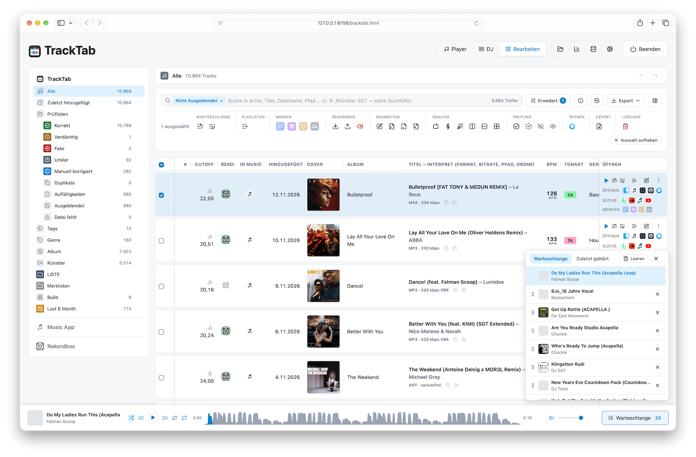

  *The queue popup.*
- **Recently played** — your listening history, newest entry first; the last 200 titles are kept, older ones drop off at the end. A click on an entry plays it again; the track that was playing moves back to the start of the queue instead of being lost. Individual entries cannot be removed here, only everything via “Clear”.

“Clear” at the top of the popup empties queue and history completely. Both survive a page reload (at the paused position, without starting to play on their own) — the **Previous track** key (also via the ← arrow key) draws on exactly this history.

To the right of the progress bar sits a volume slider with its own mute button — both are coupled (muting pulls the slider to 0 and back, the slider all the way left also mutes) and are remembered across a reload.

## The sidebar

On the left is the list tree. Its width is adjustable — grab the edge between the bar and the table and drag it. The width is saved. The tree is the same in both views (Edit and Player), and the chosen list stays selected when you switch.

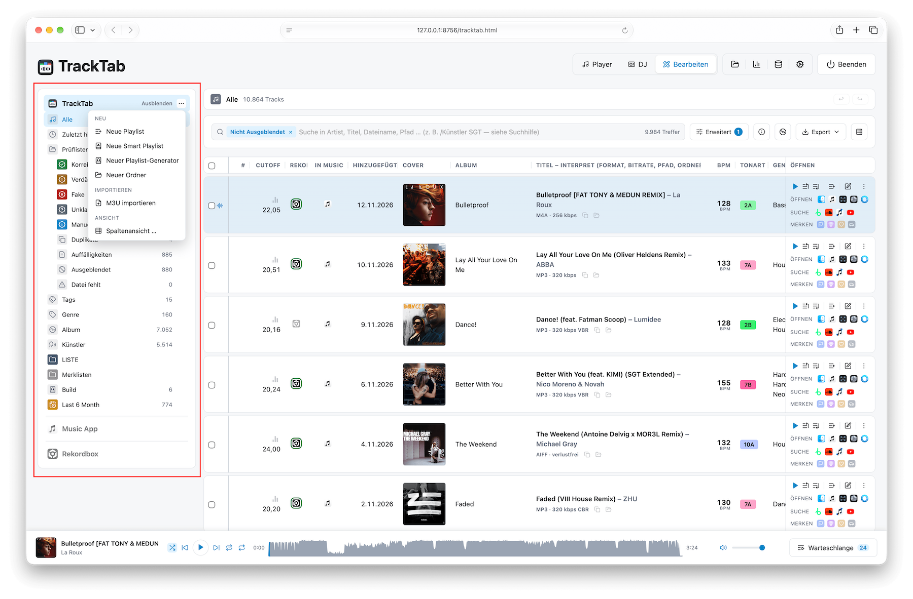

*The three root branches of the list tree: TrackTab, Music App, Rekordbox.*

There are three areas:

**📁 TrackTab** — your own database. At the very top the fixed lists:
**All**, **Recently added** (all tracks, sorted by “Added” when opened, newest first), **Hidden**, **File missing**, **Genre**, **Album**, **Artist**, **Duplicates** and your **favorite lists**. Below that the fixed folder **Review lists** with one list per status, each with a dot in its status colour: ● OK (green), ● Suspicious (orange), ● Fake (red), ● Unclear (grey), ● Manually corrected (blue) — the same colours as the status badges in the table. Also in the “Review lists” folder: **Duplicates** and **Issues** (metadata problems instead of audio quality, see [Issues (metadata problems)](#issues-metadata-problems) further below).

 TrackTab brings these lists itself. They behave as far as possible like your own: you can move them, also into a folder and back out. Name and icon stay fixed, and they cannot be deleted. For All, Genre, Album, Duplicates etc. you change the colour via “…” → **Edit**; the status lists (OK, Fake …) keep their status colour. You can rename and recolour the **Review lists** folder and put your own playlists into it. Below are the playlists, folders and smart playlists that you create yourself.

**🎵 Music App** and **🎛 Rekordbox** — the playlists of these two programs. An expanded branch loads its lists by itself (also at start), a collapsed one stays closed until you open it. You edit normal playlists and folders right here, via “…” on the entry:
- On the branch itself and on a folder: **New playlist**, **New folder**.
- On every playlist and every folder: **Rename**, **Delete** (with confirmation; a folder goes together with all playlists in it, the tracks stay in the collection or library).
- On a Rekordbox playlist additionally **Compare with TrackTab …** (see below).
- Add tracks by drag & drop onto the playlist, remove via the bar for selected tracks.
- Move playlists and folders by drag & drop in the tree: into a folder (middle of the folder) or before/after (top/bottom edge of an entry), onto the branch itself = top level. Only within the same program. Music.app sorts playlists alphabetically itself, so only the folder counts there; Music.app cannot be remote-controlled to move something back to the top level, that is only possible in Music itself.
- While a change is running, the branch is greyed out and locked, the affected playlist pulses slightly. The tree stays expanded.

Smart playlists carry a lock: their content is calculated in the respective program, TrackTab only displays them. In Rekordbox the program must be closed for every change (a backup is created automatically beforehand). Music.app cannot be remote-controlled to reorder, so you only change the order in Rekordbox playlists. If a track appears several times in a Music playlist, “Remove” takes out all of its entries.

A click on the header of an area (TrackTab, Music App, Rekordbox) shows or hides it. On hover, “Hide” or “Show” appears at the right; a hidden area is slightly dimmed.

Each branch only appears if the respective program is chosen in the settings — without it the branch is left out entirely. The two branches themselves can be moved in the tree like your own lists, but TrackTab always stays in first place.

> [!tip]
> Should an error message occur or data in the connected tools have changed, the data can be reloaded at any time. To do so, click “…” and choose “Reload”.


The **Duplicates** list shows tracks that exist twice — either as an exact copy or as the same song in different quality (e.g. once as MP3, once as FLAC). The same song means the same artist and title with at most 3 seconds difference in length, so the same song on a single and on a compilation is found too. Small differences in spelling do not count: “Rather Be (feat. Jess Glynne)” and “Rather Be feat. Jess Glynne”, “Jubel [Radio Edit]” and “Jubel (Radio Edit)”, “How Long - Throttle Remix” and “How Long (Throttle Remix)”, “Bengang” and “Bengang (Original Mix)” or “LMFAO feat. Lil Jon” and “LMFAO” count as equal. Different remixes stay different, and so does a radio edit next to an extended version (usually clearly different length). Every group is a card: at the top artist and title, below it what the copies differ in (“Differences: album, genre …” or “Exactly the same file, just in a different place”). In the rows, cells with differing values are highlighted yellow; which columns are visible is determined by the column view as everywhere.

**Keep:** The “Keep” column right after the selection checkbox (the same in all three views) marks the copies that should stay (green tick, row tinted green). The best copy is preselected: an existing file before a missing one, then the actually higher quality (lossless before lossy; a file recognised as fake or suspicious counts with its measured instead of its declared bitrate), then more metadata (cover, genre, BPM, key, year, album, album artist, composer, track number, comment), already in Rekordbox or Music.app and lastly the larger file. It is always at the top of the group. You can keep any number of copies, at least one must remain. **Rest to Trash** and **Not a duplicate** are always on the right in the group header. “Rest to Trash” moves all copies without a tick to the Trash after a confirmation. When you move a file to the Trash (here or via the trash icon of a row), the track also disappears from the Music.app library and, if Rekordbox is set up, from the Rekordbox collection. If Rekordbox is open at that moment, TrackTab queues the removal; “Sync Rekordbox” carries it out.

**Open / Not a duplicate tabs:** At the top of the list, two tabs separate the open groups from those you confirmed with **Not a duplicate**. Confirmed groups are collapsed, a click on the header expands them, **Check again** brings them back to the open ones. If a new copy is added to a confirmed group, it automatically appears among the open ones again.

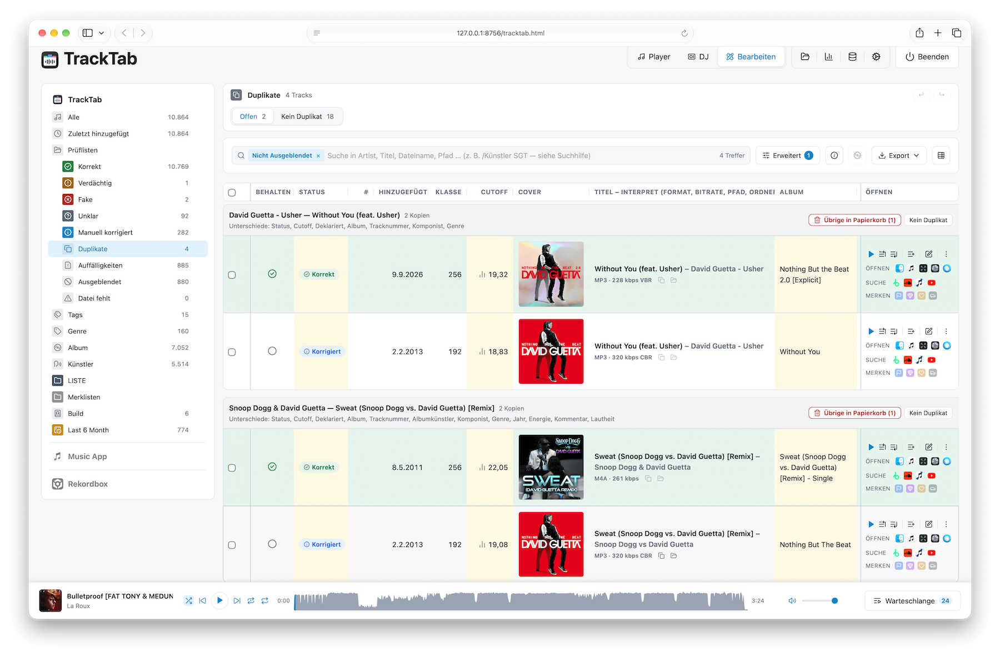

*The Duplicates list.*

## Playlists and folders

Via “…” on the **TrackTab** header you create: **New playlist**, **New smart playlist** (see below), **New playlist generator** and **New folder**; **Import M3U** is there too. This is the same structure as for Music App and Rekordbox.

When creating, you choose name, icon and colour. Without a colour, the list gets a light grey square. Folders have no icon of their own, for them you only choose the background colour.

**Right-click:** On a track in the table or a list in the tree, the same menu as via “…” opens right at the mouse. Folders may contain folders. A click on a folder expands or collapses it, the folder icon showing open or closed. Fine lines on the left show how deeply a list is nested.

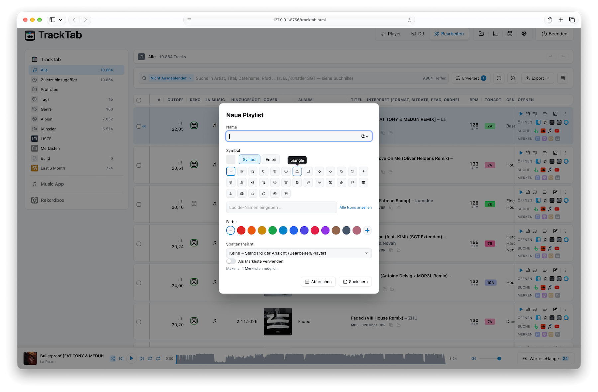

*Creating a new playlist.*

**Putting tracks in** works in three ways: drag rows from the table into the playlist (if the dragged row is part of your selection, the whole selection comes along), via “Add to playlist …” in the row menu, or via the same button in the bulk bar when several rows are selected.

**Order of tracks:** Within a playlist you drag rows into place. This also works while a column sort is active — when you drop, the view switches back to your order so you can see the result. If you then click a column header again, the view sorts like everywhere else; the order you laid down stays saved and returns as soon as you open the list again.

**Order in the tree:** Everything under TrackTab can be dragged and rearranged — the fixed views at the top, the “Review lists” folder and the lists in it just like your own. If you drop on the upper or lower half of an entry, the dragged one lands before or after it; on the middle of a folder, it lands inside.

**Undo:** Above the table is the header of the open playlist with ↩ and ↪. They undo and redo adding, removing and reordering — also via Cmd+Z and Cmd+Shift+Z. The history applies to the running session; after a scan or a reload it starts anew.

Via the **⋯** menu on every list, in three groups separated by lines: what concerns the list itself (Edit with name, icon and colour; for smart playlists Edit rules; Duplicate) — what happens with its content (To queue, Export playlist) — and Delete. Delete only removes the list — the tracks themselves stay untouched. With a folder its content disappears too, the confirmation says so.

## Favorite playlists

Up to four of your own playlists can be marked as a favorite list — for example “Buy new”, “In cart” or “To show”. This is done in the playlist’s edit dialog (right-click → “Edit”): there is a checkbox “Use as a favorite list”, in addition to the playlist’s name, icon and colour. Each row then carries a coloured icon square per marked playlist; a click adds the track, another click removes it again. A track can be in several favorite lists at the same time. Unlike hiding, favorited tracks stay visible everywhere, also in the export — favoriting is a pure label, not a filter.

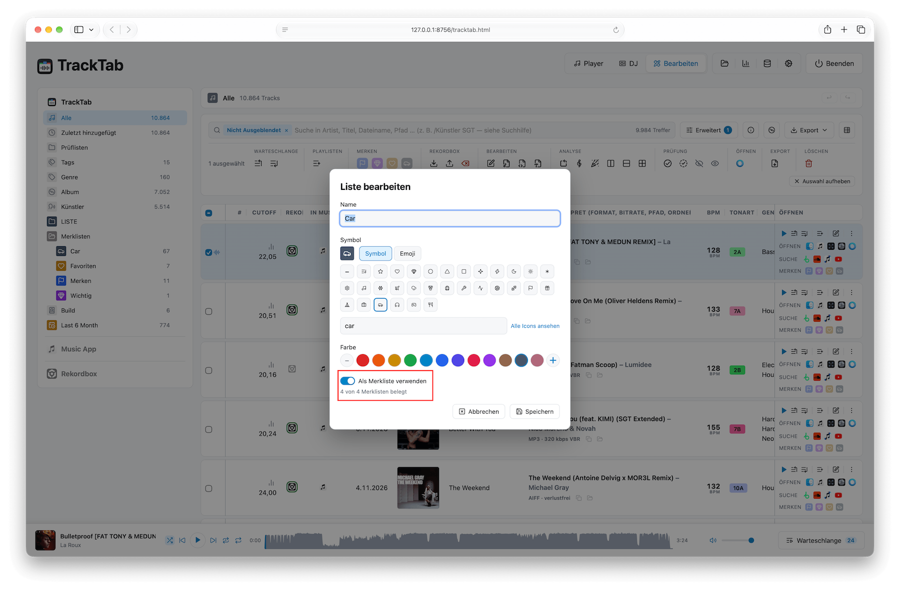
*Up to four of your own playlists can be marked as a favorite list.*

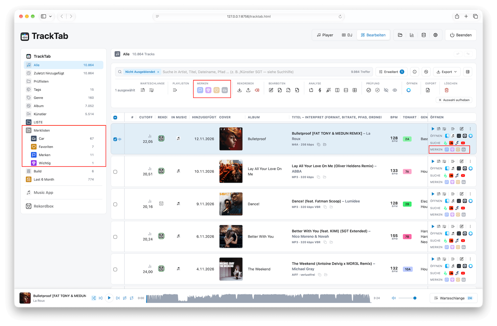
*The favorite lists are shown per track and in the multi-selection.*

## Smart playlists

A smart playlist has no fixed content but rules. In the rule editor you decide whether **all** or **any** rules must be met, and build the rows with **+** and **−**. The value field depends on the chosen field: for “Status” you get the verdicts to choose from, for “BPM” a number field, for “Key” the 24 keys in your chosen notation (the rule stays valid even after switching the notation), for “Energy” the levels 1–10 (is, is not, at least, at most — the rounded level from the Energy column is compared), for “Tags” all moods and own tags that occur in your library (has / has not), for “In Music.app”, “In Rekordbox”, “Cover”, “Hot cues” and “Tempo change” yes/no (the same rules as the `/Cover`, `/HotCues` and `/TempoChange` switches of the search), for “Playlist” all your lists in the tree (is in / is not in). With that you build e.g. “Genre is House and Playlist is not in Friday set”. Favorite lists, other smart playlists and folders (= everything in the lists below) can also be chosen. The field list is sorted alphabetically.

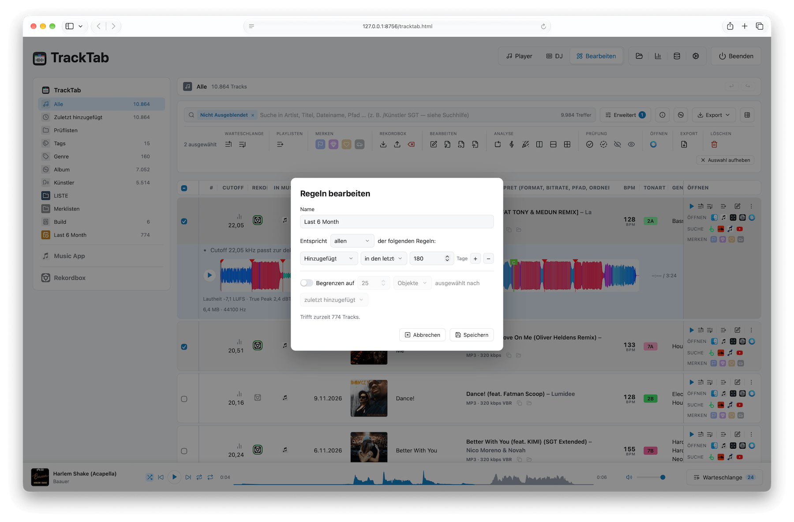

*Editing the rules of a smart playlist.*

In the footer you switch on “Limit to” and limit the list to a number of items, a playing time or a storage size — selected by most recently added or random. Below the dialog it shows continuously how many tracks the rules currently match.

It is calculated when the program starts and every time you click the list in the tree — not continuously in the background.

## Playlist generator

The playlist generator builds you a set along an **energy curve**. You create it via the curve icon at the top of the list tree (next to “New smart playlist”). It then appears like a playlist in the tree. Each generator remembers its settings and tracks, so you can create several, for example “Warm-up Friday” and “Peak”.

If you select a generator, you see instead of the table:

- **Settings** (collapsible):
  - **Track pool:** which tracks the generator chooses from. You write it like a search in the search bar, e.g. `/Genre House /BPM 120-128 /Add 30d` (see [Searching and filtering](#searching-and-filtering)). Via **Advanced** you unfold the same parameters as input fields. Hidden tracks stay out by default (`/No /Hidden`, under **Hidden** it says “no”) — with “any” they count too, with “yes” the generator only picks from them. Below it shows how many tracks are currently in the pool.
  - **Source:** the whole library or one of your own playlists. The fixed review lists (OK, Fake …) are deliberately not offered here; for that there is `/Status` in the track pool.
  - **Transitions** and **Mood** (see below).
- **Transitions:** rules relative to the previous track.
  - **BPM** (select field): ±0, ±3 or any. With **Tempo**, “½ · 2×” counts half or double tempo as matching (e.g. 87 ↔ 174 BPM), “Off” switches that off. For tracks with a tempo change, the tempo at the respective end counts: a transition track 100 → 128 fits behind a 100 and before a 128. The change is recognised from the beat grid or from the title or file name (as with `/TempoChange` in the search); the BPM column of the slot then shows “100→128”.
  - **Key** on the Camelot wheel:
    - **Strict:** same key, one step further or the A↔B switch.
    - **Loose:** additionally allows two steps and the diagonal step.
    - Example from 8A: **Strict** allows 8A, 7A, 9A and 8B. **Loose** additionally allows 6A, 10A, 7B and 9B. The explanation is also shown as a tooltip on the buttons.
- **Mood:** dials for moods such as Dark, Deep, Groovy, Melodic, Euphoric and Aggressive. You add more via **+ Dial** below the dials; a dial disappears via the × below it.
  - Dragging vertically adjusts: up “more”, down “less” or “avoid”. Double-click resets.
  - **Tendency** only weights the dials.
  - **Must match** only takes tracks in which every turned-up mood was detected (and none that was turned down).
  - **Cohesion** keeps consecutive tracks stylistically together: the further it is turned up, the more similar the style (the detected Discogs styles) must be to that of the previous track. Turned down, style plays no role.

  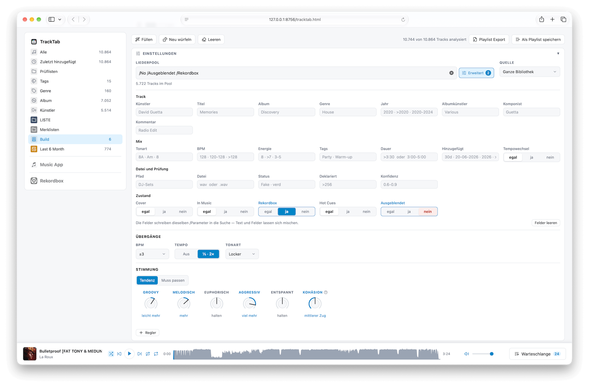

  *Generator settings: track pool, transitions and mood dials.*
- **Progression** (own panel together with the energy curve): a template (Balanced, Warm-up, Energy build, Peak time, Wave, Cool-down) or one of your **own curves**, plus the number of **slots**. You set the slot count with **−** and **+** or by typing. On the right it shows how many slots are filled. With the save icon you store the current curve under a name. It is then available in every generator under “Own curves” and adapts to the slot count there. The same name overwrites, the trash can next to it deletes a chosen own curve.
- **Energy curve:** each point is a slot, on the left is the E1–E10 scale, at the bottom the slot number. A click in the column of a slot sets its target energy exactly to the clicked level — so you can e.g. put slot 1 at E2, slot 2 at E4 and slot 3 at E6 and then let **Fill** run. If you hold the mouse button and drag across several slots, you draw the curve in one stroke. The template is then called “Own curve”. The light-blue dots show the actual energy of the inserted tracks.
- **Slots:** the tracks in their order.
  - Every filled slot shows the track’s waveform, coloured as set under ⚙ Settings → Waveform, with the hot cues and memory cues as in Edit and Player (your edits from the DJ view before Rekordbox) and below it a thin bar with TrackTab’s phrases in their fixed colours. A click in it jumps to that spot; if the slot is playing, you see the progress there.
  - A click plays, the following slots go into the queue. You reorder by dragging. A slot can also be dragged onto another playlist in the tree.
  - The **lock** locks a track: it stays in place on re-roll.
  - For each slot you can **refill**, choose from **alternatives**, take the track out or delete the slot.
  - If a transition violates your rules (e.g. after reordering), a red note such as “−34 BPM · key clash” appears in between.

  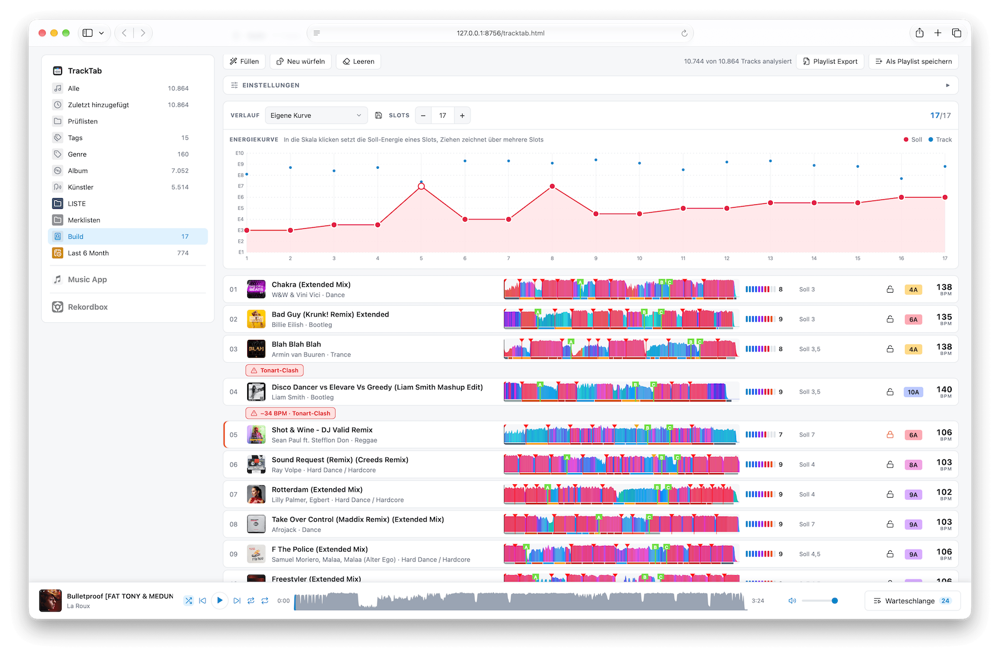

  *Generator with energy curve and filled slots, warning notes at transitions and a lock icon per slot.*

At the top, **Fill** only fills the empty slots, **Re-roll** refills all unlocked slots, and **Clear** empties them. Via **Export playlist** you export the set (M3U8). **Save as playlist** creates a normal playlist with the current assignment; it no longer changes with the generator afterwards. The “…” menu on the tree entry also holds Queue and Duplicate.

The generator only uses tracks with a genre/mood analysis, because it needs their energy and mood. At the top it shows how many tracks have been analysed. If many are still missing, you start a scan with the “Genre, mood & energy” option via “Scan library” (see [Genre, mood and energy](#genre-mood-and-energy)). If a slot cannot be filled with your rules, the generator relaxes first the key rule, then the BPM rule for that one slot and marks the transition.

## Playlists from other apps

If you expand **Music App** or **Rekordbox**, TrackTab reads their playlist tree. A click on a list shows its tracks in exactly the order that applies there.

Tracks for which TrackTab has no file still appear at their place in the list — dimmed and with a note: **no local file** (an Apple Music track from the cloud) or **not in TrackTab** (a file outside the scanned folders). That way the order stays traceable instead of gaps appearing. These rows do not count anywhere and cannot be played or edited. If Music only keeps one of your own tracks as a cloud entry (this happens e.g. when you add it to a playlist on the iPhone), TrackTab still recognises it by title, artist and file size and shows it as a normal track.

**Dragging tracks into a Rekordbox playlist via drag & drop:** Drag one or more tracks from the table onto a normal Rekordbox playlist in the tree. The prerequisite is that **Rekordbox is closed**, because TrackTab writes directly into Rekordbox’s database (a backup is created automatically beforehand). TrackTab checks this several times: if Rekordbox is running, the Rekordbox playlists are marked with a dashed red outline while dragging and accept nothing; if Rekordbox was only started after dragging, a lasting notice appears on drop and nothing is written. Folders and smart playlists are no target. Tracks already in the playlist are skipped.

What comes along: tracks Rekordbox does not know yet bring TrackTab’s beat grid, phrases and cues with them, as with the **Add to Rekordbox** button in the DJ view. If dragged tracks are already in Rekordbox, a list opens first: ticked ones get beat grid, phrases and cues from TrackTab (like **Rekordbox update**), the others are only entered into the playlist. Preticked are the tracks where TrackTab has something different from Rekordbox (red Rekordbox column). **All**, **None** and **Only differing** set the ticks at once, **Cancel** writes nothing. **Compare with TrackTab …** in the “…” menu of a Rekordbox playlist opens this list for all tracks of the playlist, without adding anything.

**Linking playlists:** Via “…” → **Link …** on one of your own playlists or smart playlists you choose one playlist each in Music.app and Rekordbox: a click on the field opens the program’s playlist tree, where you choose the playlist, “not linked” or “Create new playlist” (same name as in TrackTab). Playlists that are already linked to another list are greyed out there. After that all hold the same content: what you add or remove in one of them applies everywhere at the next sync. TrackTab determines the order (adopted in Rekordbox, Music.app does not reorder). It syncs when the list is opened, shortly after every change to it, at start and via **Sync now** in the list header; that is also where it shows when it was last synced. A chain icon in the tree shows linked lists, a dot on it means “pending” (Rekordbox was running, it is caught up at the next sync) or “problem”.
- TrackTab’s smart playlists fill the linked playlists in one direction only. Changes there are overwritten. That way you get a “smart” list with TrackTab rules in Music.app.
- If tracks are missing in the Music library, TrackTab asks whether they should be imported.
- If many tracks would be removed at once or a program suddenly returns an empty list, TrackTab asks beforehand.
- Titles TrackTab does not know (e.g. Apple Music titles without a file) stay untouched in Music and Rekordbox.

**Dragging tracks into a Music playlist:** as with Rekordbox. Tracks that are not yet in the Music library are imported by TrackTab first after a confirmation.

**Editing Rekordbox playlists:** In an open Rekordbox playlist (not a smart playlist) there are two commands in the “…” menu of a row and in the bar for selected tracks:

- **Remove from Rekordbox playlist** — only takes the entry out of this playlist. The track stays in the Rekordbox collection and in all other playlists.
- **Remove from Rekordbox** — works like Rekordbox’s own “Remove from Collection”: the track disappears from all Rekordbox playlists, cues and history are dropped. The audio file stays. TrackTab asks beforehand and shows how many playlist entries are affected. This command is also available in all other lists for tracks with a Rekordbox tick. TrackTab also clears its own state for this track: the beat grid, phrases and cues taken over from Rekordbox as well as the cover folder (ends up in the backup with the analysis). Your edits from the DJ view and TrackTab’s own analysis remain.

**Changing the order:** Drag rows within a Rekordbox playlist to a new position — the new order is adopted in Rekordbox. The **“#”** column shows the position in the playlist (also in own and Music App playlists). If you sort the table by another column, e.g. by title, that only changes the view; the numbers in “#” stay the real order. A click on “#” (or the third click on another column) restores the playlist order.

For all three actions: **Rekordbox must be closed**, as must the background service “rekordboxAgent” (menu bar icon). Before every action TrackTab creates a full backup of the Rekordbox library, for a bulk action across many tracks once for the whole action (`backup/rekordbox/`, openable via ⚙ Settings → Rekordbox → “Open Rekordbox backup folder”); when removing from the collection, the track’s Rekordbox analysis (beat grid, waveform) also moves there, so everything can be restored completely.

Some Rekordbox smart playlists use time rules that only Rekordbox itself can evaluate. They appear in the tree, but their content stays empty — TrackTab says so when opening.

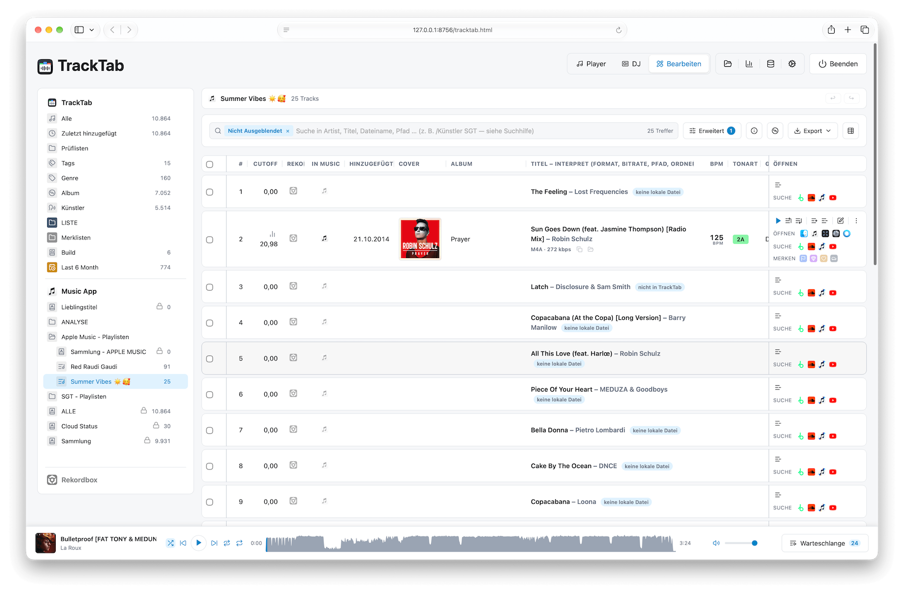

*E.g. Apple Music cloud files are shown in the playlist and marked with “no local file”.*


## Searching and filtering

By default the search field above the table searches artist, title, album and path — and does so tolerating typos (how much, you set under “⚙ Settings → Search”). But it can do a lot more. The **ⓘ Search help** button lists all parameters with examples at any time.

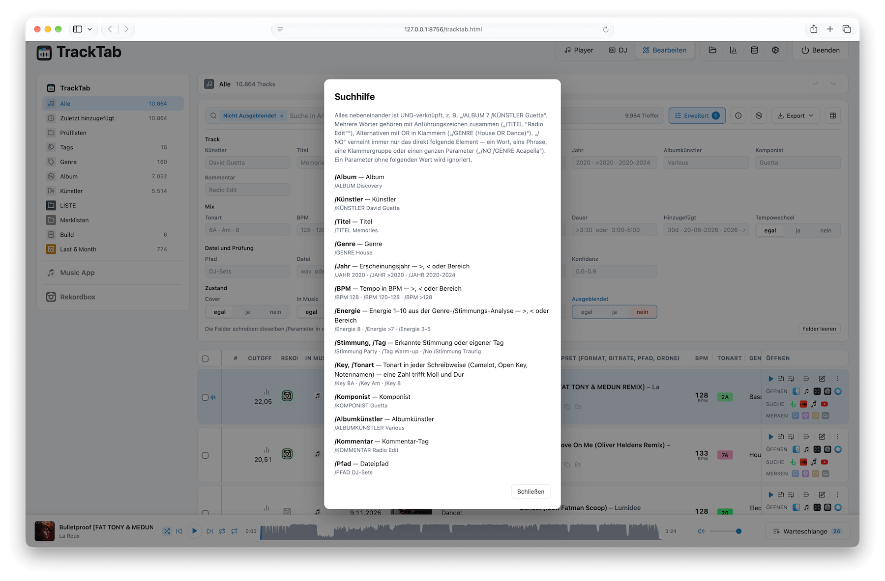

*Search with parameters.*

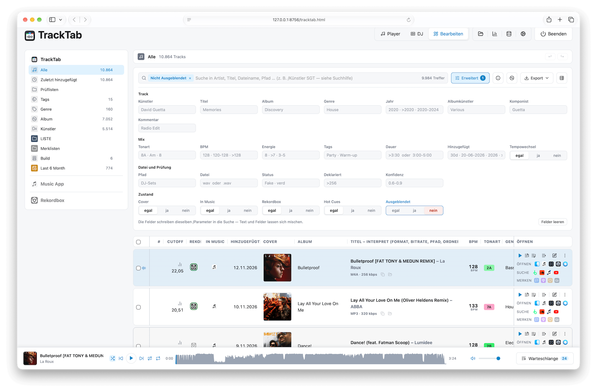

*“Advanced”: all parameters as input fields, grouped into Track, Mix, File and review, and State.*

**Everything standing side by side must match (AND).**

| You type | Result |
|---|---|
| `guetta memories` | both words must occur |
| `"radio edit"` | exactly this phrase (quotation marks = literal, no typo tolerance) |
| `/Genre House` | search in the genre only |
| `/Genre "Deep House"` | multi-word values go in quotation marks |
| `/Genre (House OR Dance)` | either one is enough |
| `/Genre House /BPM 124-128` | both together |
| `/Album =Pop` | **exact**: only the album “Pop”, not “King of Pop” (case-insensitive) |
| `/Album ="Pop Hits"` | exact, multi-word |
| `/Album (=Pop OR =Rock)` | one of the two exactly |
| `/Album =` or `/Album =""` | field is **empty** — works equally for `/Genre`, `/Year`, `/BPM`, `/Composer` … |
| `/Key 8A` · `/Key Am` · `/Key 8` | key in **any** notation (Camelot, Open Key, note names); a plain number matches minor and major of that position (`8` → 8A and 8B) |
| `/Cover` · `/No /Cover` | only tracks with or without embedded cover |
| `/Music` · `/No /Music` | only tracks that are in the Music.app library or not |
| `/Rekordbox` · `/No /Rekordbox` | only tracks that are in Rekordbox or not |
| `/HotCues` · `/No /HotCues` | only tracks with at least one hot cue or without. What counts is what TrackTab shows in the DJ view: own cues (DJ editor, Auto Cue) before those from Rekordbox; if “Show beat grid & phrases from” is set to “TrackTab only”, only the own ones count. `/Rekordbox /No /HotCues` finds tracks that still need cues |
| `/TempoChange` · `/No /TempoChange` | only tracks with a tempo change or all others. This includes a track with a tempo change in the beat grid (once it has been open in the DJ editor) and every one whose title or file name contains “Transition” (also “Trans”, “Transistion”) or a tempo sequence such as “100-128”, “(128 - 80 BPM)” or “126 To 70 BPM”. Also available as a switch in the advanced search under “Mix” and in the track pool of the playlist generator |
| `/No Acapella` | excludes “Acapella” |
| `/No /Genre (Acapella OR Instrumental)` | excludes both genres |

**Important with several words:** a parameter only ever takes the *next* element. So `/Genre Deep House` searches the genre for “Deep” and additionally everywhere for “House” — usually `/Genre "Deep House"` is what is meant. When you pick a suggestion from the list, TrackTab adds the quotation marks by itself.

The same goes for **`/No`**: it only negates what directly follows. `/No Acapella "David Guetta"` searches for “David Guetta” and excludes “Acapella” in the process.

**Numbers and dates** understand comparisons and ranges: `/BPM >128`, `/Year 2020-2024`, `/Duration >3:30`, `/Declared >256`, `/Add >2026`. For “recently added” there is `/Add 30d` (within the last 30 days).

**Hidden tracks** you reach with `/Hidden` — the parameter needs no value. Conversely `/No /Hidden` hides them in every list. And `/Status` narrows to a review result (`/Status Fake`, `/Status susp`, `/No /Status OK`); as soon as you have typed `/Status`, all possible values appear for selection.

**Search bar:** recognised parameters and default filters appear as badges right in the search field, with the number of hits next to them on the right. Filtering happens while typing. With Enter, every typed parameter becomes a badge and disappears from the field, so you can type the next one right away (free search text stays in the field). Backspace at the start of the field turns the last badge back into text, badge by badge. Shift+left arrow selects badges from right to left, Cmd+A selects all, Delete removes the selected ones; the × on a badge takes the filter out. Next to the field are **Advanced**, the search help (i), **group by album** (record icon, coloured = on) and **Export** with CSV and playlist export. When grouping by album, compilations with all their artists and multi-disc albums with all their discs appear under one shared header.

**Advanced search:** the **Advanced** button unfolds all parameters as input fields, arranged by groups: Track, Mix, File and review, State. Filled fields have a coloured outline. The fields write the same parameters into the search bar, and conversely typed parameters fill the fields. So you can mix both. The number on the button shows how many fields are currently filled; **Clear fields** takes all field parameters out again, your free search text stays. Exclusions with `/No` (except for the yes/no fields such as Cover) you keep writing directly into the search bar.

Every recognised parameter appears after Enter as a **chip** in the search field — a click on the × there takes exactly this part out of the search again. Chips in a different colour are default search filters from the settings: they always apply, but can be switched off here for the running session.

## Customising columns

Each column can be resized by dragging and moved in order (grab the heading and drag). A double-click on the edge at the right of the heading makes the column as wide as its widest currently shown entry, as in Excel. Via the column icon at the far right of the search bar you show or hide further information (in the DJ view it is locked, the column list is fixed there) — e.g. title, artist, cover, album, genre, year, BPM, key or “Last modified” (modification time of the file, also current after own tag and cover changes; hidden at first in existing views). In the review lists (OK, Suspicious, Fake, Unclear, Manually corrected) “Status” cannot be deselected. In the menu the tick is locked there and marked with a lock. You can still move the column.

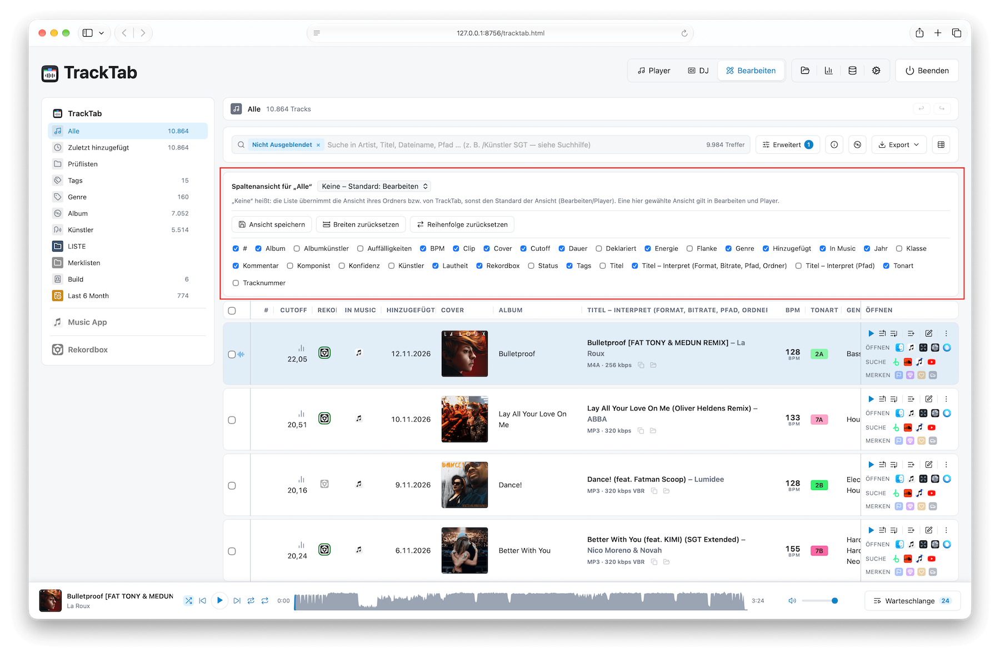

*The column menu.*

**Saving a view.** `Save view` in the column menu stores the current arrangement — which columns are visible, in which order and how wide — under a name. If you enter a name that already exists, that view is overwritten; a new name creates a new one. The saved view is immediately applied to the currently open list. Up to 20 views are possible.

**The five standard views.** “Edit” and “Player” apply in their view to every list that gets nothing else. “Review list” is assigned to the Review lists folder and thus applies to the status lists and duplicates. “Issues” (Issues, Cover, Title – Artist) applies to the Issues list, “Single check” to the single check. All five can be edited, but not deleted.

**Path.** The column “Title – Artist (Path)” shows the path starting at the library folder from the settings, preceded by “…” (e.g. “…/Music/Artist/Album/Title.mp3”). A click still copies the full path, and on hover it is in the tooltip. The column “Title – Artist (Format, Bitrate, Path, Folder)” shows title and artist in one cell, below it format and bitrate with buttons to copy the path and for the folder in Finder. The DJ view has a fixed column list and is exempt from this.

**Loading a view.** The select field at the top of the column menu determines which saved view the currently open list uses. The first entry (“None – …”) means: none of its own, the list takes what applies above it, i.e. the view of its folder or else the default of Edit or Player. Next to it it says which view that currently is and where it comes from. If a list has its own view, you reset it with this entry. A view of its own applies to this list in Edit **and** Player.

**Inheritance.** A view can also be assigned to a folder, or to the entries TrackTab, Music and Rekordbox at the very top of the tree (each via “…” → “Column view …”). It then applies to everything below it, until a list or a subfolder has a choice of its own. If nothing is assigned anywhere, the default of the view (Edit or Player) applies.

**Defaults.** At the top of the page *Settings → Column views* you choose which view applies in Edit and in the Player for lists without a choice of their own, which one the Review lists folder passes on and which one the single check uses.

**Editing in the settings.** Below that, under “Views”, you unfold a view with the arrow. The visible columns appear as small cards: dragging changes the order, the × on hover hides a column. Below are the hidden ones, a click shows them. You can also drag cards back and forth between the two areas. In views that apply in the review lists, “Status” carries a lock: moving yes, hiding no. On the right it shows how often the view is assigned (with names on hover). “New view” creates one, which starts with the columns of the Edit default. After “Save column views” or “Save” at the bottom of the dialog (both also take the defaults along), all lists that use the view adopt the change, also those that merely inherit it. Own views can also be renamed and deleted there. The trash can deletes immediately after a confirmation, without you having to save. A deleted view is gone for good. All lists and folders that used it are then set to “None” and take over again what applies above them.

**Column “Title – Artist (Format, Bitrate, Path, Folder)”.** Title and artist in one cell, below it format and bitrate with the buttons “Copy path” and “Show in Finder” — the same display as in the DJ view. It can be chosen in every view via the column icon; in the Player it is the default.

**Column view of the single check.** Under “Defaults” you choose which view the single check uses; the default is the view “Single check”. Its order, visibility and widths apply. Changes in the column menu of the single check change the chosen view itself, and thereby every list that uses it.

**Caution:** As long as a saved view is loaded, every tick, every drag on a column width and every move of a heading changes **this view** — and thereby every other list that also uses it.

**Setting per list or folder.** Every list and every folder in the tree on the left has the entry “Column view …” in its “…” menu (or via right-click). This also applies to the fixed lists, the playlists from Music and Rekordbox and the three entries at the very top. The dialog has exactly this one field. For the currently open list it also works via the column icon. Both ways change the same assignment.

## The button bar

Every row carries the same icons, always visible in the button bar:

| Icon | Action |
|---|---|
|  | Play (also expands the waveform, see below) |
|  | Play next |
|  | Add to queue |
| 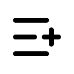 | Add to a playlist |
|  | Edit metadata |
|  | “More options”, arranged by groups: **Playlists** (remove from the open own, Rekordbox or Music playlist), **Rekordbox** (add to Rekordbox, load Rekordbox, Rekordbox update, remove from Rekordbox), **Analysis** (BPM & key, genre & mood, beat grid, phrases, beat grid & phrases, stems, re-analyse track), **Edit** (convert format, correct bitrate, rename file, align key notation), **Review** (correct, hide) and **Delete** (Trash) |


**Open**

| Icon | Action |
|---|---|
|  | Show file in Finder |
|  | Open in Music.app (only visible if the Music app is chosen in the settings) |
| 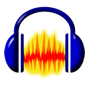 | Open in the external audio editor (e.g. iZotope RX, for cross-checking in the spectrogram). Only shown if an editor is chosen in the settings. The editor’s own icon is shown. |
| 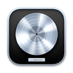 | Open in the configured DAW (only visible if one is set). |
|  | Open in Mixed In Key (only visible if one is set). |

**Search** (one icon per platform activated in the settings)

| Icon | Action |
|---|---|
|  | Search on Beatport |
|  | Search on SoundCloud |
|  | More platforms (e.g. YouTube, DJ City, Zip DJ, ones you configured yourself) — the site’s favicon serves as the icon; if it cannot be loaded, the initial letter in the chosen colour |

**Favorites**

| Icon | Action |
|---|---|
|  | Add to / remove from a favorite list (icon + colour of each playlist marked as a favorite list) |

All actions can also be applied to a multi-selection (checkboxes on the left in every row) — the bulk bar shows the same icons for the whole selection at once. They are arranged in labelled groups: Queue, Playlists, Favorites, Rekordbox, Analysis, Edit, Review, Open, Export and Delete. If you hover over an icon, a hint names the action, for some with a short explanation below it. Load Rekordbox and Rekordbox update are available here just as in the DJ view, beat grid, phrases and both together as three icons of their own. In the Player the bar only has Queue, Playlists and Favorites, in the DJ view everything except the queue (but with Auto Cue), in the single checks only Analysis, Edit, Open and Remove. The selection is kept when you switch views.

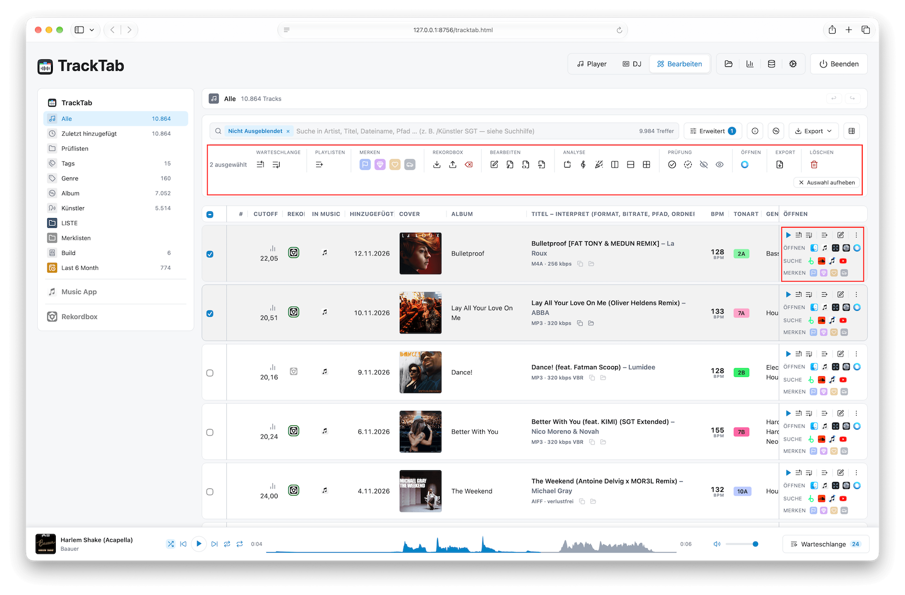

*Bulk bar with multi-selection.*

A dedicated icon in the bulk bar (file with a down arrow) exports the selection as a ZIP archive. A dialog asks whether the files inside the archive should be renamed according to the name pattern from the settings (suggestion prefilled, freely editable) — this only affects the names in the ZIP, the original files in your library stay unchanged.

## Listening with the waveform

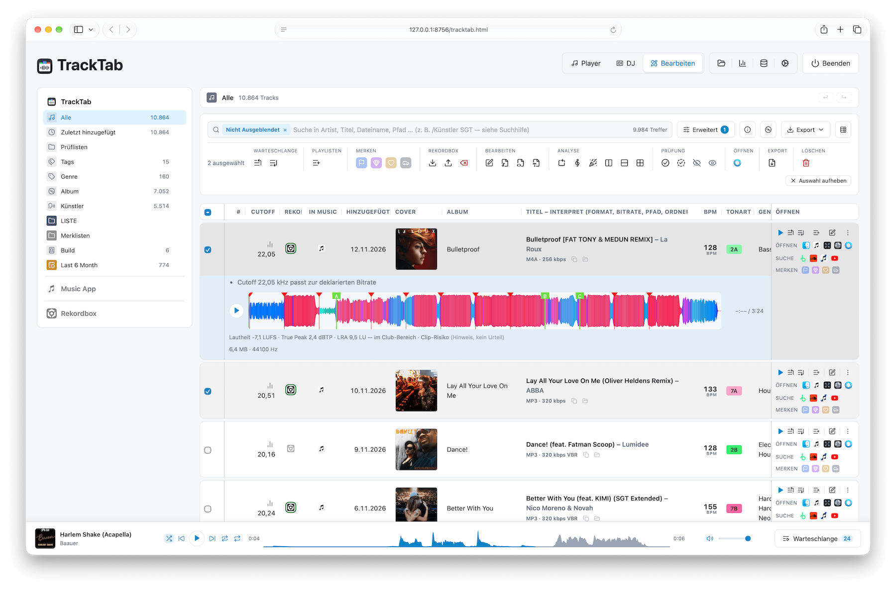

*Expanded track with waveform.*

A click on a row in the Edit view expands it and shows the track’s waveform across the full width — still without playing. Only a click on the Play button in the waveform area (or on ▶ in the Open column) starts playback via the media player; the waveform then shows its progress live (as a coloured line), in sync with the display at the bottom of the screen.

The space bar pauses/starts playback, the arrow keys ←/→ switch to the previous/next track in the queue. In this expanded view there is also a copy icon next to the full file path to copy it to the clipboard.

If the track has already been analysed in Rekordbox, its hot cues and memory cues are additionally shown above the waveform; a click on a hot-cue marker jumps there directly in the media player, the number keys 1–8 do the same while the waveform is expanded.

TrackTab always renders the waveform itself here, also for tracks in Rekordbox. Under ⚙ Settings → Appearance → “Waveform colour in Edit and Player” you choose **Standard** (grey), **RGB** or **3-band**. The shape stays the same as with Standard. When a track is opened for the first time, the grey waveform is briefly shown until the colour has been calculated, then it fades in smoothly.

Independently of that, the arrow keys ↑/↓ move a highlight row by row through the table — handy for paging through by keyboard without changing your checkbox selection for bulk actions. If a track is playing, the highlight starts at its row. The Enter key starts playback of the highlighted row.

Which formats can actually be played audibly depends on the browser used (AIFF and ALAC e.g. only in Safari) — the full table is in [Supported file formats](#supported-file-formats). Analysis, tags and renaming are not affected.

## Key

The **Key** column shows each key as a coloured bubble. The colours follow the Camelot wheel of Mixed In Key: same key, same colour — outside (major, vivid) and inside (minor, lighter) twelve tones each. Matching keys sit next to each other on the wheel and thus also have similar colours.

- **Where it comes from:** TrackTab reads the key when scanning from the file tag “Initial Key”. Only what is in the file is shown — Rekordbox plays no role for this, not even as a fallback.
- **Notation:** Under ⚙ Settings → Analysis → Key field you choose Camelot (`8A`), Open Key (`1m`) or note names (`Am`). This applies to the table, the tags dialog, newly analysed keys, the value written to the file and the transfer to Rekordbox. All three notations are always read; changing the setting only changes the display, the files themselves initially stay unchanged (see “Align key notation”).
- **Dashed outline:** If the value in the file differs from the display in TrackTab (e.g. the file says `8A`, Open Key is set), the bubble is shown with a dashed outline. The hint text on top names the value from the file (“In the file: 8A”). If you save the key again in the tags dialog, it is written in the chosen notation and the outline disappears.
- **Align key notation:** After switching the notation, the files still carry the key in the old one; the key bubble then gets a dashed outline. Select the affected tracks and click the clef icon “Align key notation” in the bulk bar (or choose the entry in the ⋮ menu of a row): the existing key is written to the file tag in the chosen notation, the value itself stays. The icon only appears if at least one selected track differs, and also applies in the single checks. Under ⚙ Settings → Analysis → Key field it says how many files of the library differ; **Show** opens them in the [Issues](#issues-metadata-problems) list, where you can align them all at once with Quick Fix. A button for the whole library is deliberately not provided (with many thousands of files it takes very long and is rarely needed).
- **Changing:** in the tags dialog (pencil icon), individually or for several tracks at once. You can type in any notation. The change is then in the file and in TrackTab.
- **Sorting and searching:** the column sorts by the position on the wheel (1A, 1B, 2A …), tracks without a key always come last. Search: `/Key 8A`, `/Key Am` or `/Key 8`.
- **Analysing BPM and key:** TrackTab can measure tempo and key itself from the audio — without Mixed In Key and without the internet. Via the ⋮ menu of a row, or in the bulk bar via the waveform icon “Analyse BPM/key” (always visible as soon as the analysis is available), the analysis is started for the chosen tracks, likewise in the single checks; it takes about 2–4 seconds per track. Newly added files of the single checks are analysed automatically on request (⚙ Settings → Analysis: BPM, key, genre & mood → “Single checks: BPM & key automatically”). Files longer than the set limit (default 10 minutes, e.g. DJ mixes) are skipped. Which fields are written you determine in the three sections of this settings group:
  - **Key field** and **BPM field:** “Write to …” with **Yes** (overwrites an existing value), **Yes, only if empty** (an existing value stays) or **No**. BPM is stored as a whole number.
  - **Comment field:** one shared entry for the BPM/key and the genre/mood analysis. “Write to comment field”: nothing, key (`10A`), key and tempo (`10A - 126`), key, tempo and energy (`10A - 126 - E7`), key and energy (`10A - E7`) or energy only (`E7`). Each analysis adds the values it measures, the rest come from the file or the last analysis — so the entry always looks the same, no matter which analysis ran last. With an existing comment you choose “Only if empty”, “Overwrite”, “Prepend” or “Append” (separated by ` - `); an earlier entry of its own — at the front or the back — counts as empty or is replaced, never written twice. **“Add missing parts”** leaves existing values unchanged and only appends the missing parts according to the chosen scheme at the same place: if `8A - 128` is already in the comment (e.g. from Mixed In Key), it becomes `8A - 128 - E7`; `8A - 128 - Favourite mix` becomes `8A - 128 - E7 - Favourite mix`.
  - The key appears everywhere in the notation you chose in the Key field section (Camelot, Open Key or note names).
  - The measurement is an estimate, not a verdict: with tempo, half or double BPM occasionally comes out, with the key sometimes the parallel major/minor key. The function is only available on Macs with Apple Silicon; on other Macs the buttons do not appear and the related settings are greyed out (with a note on the reason).
- **Rekordbox:** When transferring **new** tracks to Rekordbox, the key is set along. Tracks that are already in Rekordbox stay untouched — Rekordbox can re-read their data from the file at any time itself via “Get Track ID”.

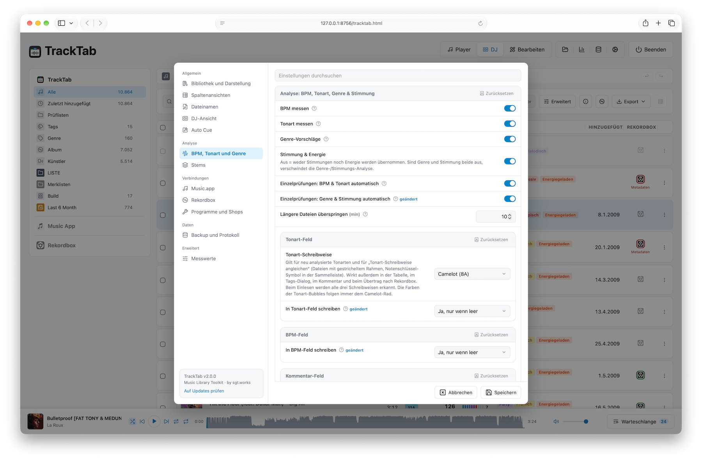

*Settings → BPM, key and genre: what is measured and where it is written.*

## Beat grid and phrases

TrackTab can detect the tempo, the bar and the sections of a track (Intro, Up or Verse, Down or Bridge, Chorus, Outro) itself, even without Rekordbox. Nothing is written to the file or to Rekordbox in the process.

- **Starting:** choose **Analyse beat grid & phrases** in the row menu, or select several tracks and use the icon in the bulk bar. It takes about 2 to 3 seconds per track.
- **Viewing:** beat grid and sections only appear in the [DJ view](#dj-view), not in Edit and Player.
- **Source:** Under **Settings → DJ view → Beat grid & phrases** you choose whether the display uses **Rekordbox, otherwise TrackTab** (default), **Rekordbox only** or **TrackTab only**. With the default, the own analysis steps in as long as Rekordbox has nothing yet, e.g. for a track just added there. TrackTab values only exist after an analysis.
- **Mode:** In the same settings you choose the beat grid mode. **Auto** is the default and only uses Flex if a tempo change is found. **Normal** takes a fixed tempo, **Flex** follows tempo changes and is meant for DJ edits. A new mode only applies once you re-analyse the track.
- **Transition tracks:** If two tempos are in the file name, such as “Tall Boys 100-128 Transition” or “(126 To 70 BPM)” (with “Transition” or “BPM” in the name), TrackTab in Flex and Auto measures the start and the end tempo separately and a ramp or a hard change in between. In the DJ editor the transition appears as a ramp, every beat pinned; you edit it like one you set yourself. If the normal Flex measurement clearly fits better, it stays with that. Names with three tempos (“150-170-150 BPM”) TrackTab measures as before. Tracks already measured only change once you re-analyse them. Where bar 1 lies, the analysis only estimates here too; if the 1 after the transition is off, you set it with 1.1.

The detection is an estimate. With club music at a fixed tempo it hits most of Rekordbox’s phrase boundaries. With tracks that have tempo changes, with acapellas and probably also with pop or band music it is much weaker and also misses tempo changes. A pale band in the DJ editor marks such results.

## DJ view

Switch to **DJ** at the top right and expand a track. The list is fixed: in an own playlist and in lists from Music.app or Rekordbox “#” (order of the playlist), cover, track and artist, duration, key, BPM, energy, tags, added and, if Rekordbox is chosen in the settings, Rekordbox. Under title and artist, the file format is shown in small type with the bitrate stated in the file (e.g. “MP3 · 320 kbps”, for AIFF/WAV/FLAC “lossless”). Next to it, the copy icon copies the file’s path, the folder icon shows it in Finder.

The logo in the Rekordbox column is coloured if the track is in the Rekordbox collection, otherwise grey.

A green outline means: metadata, beat grid, phrases and cues match TrackTab. A click on the column header sorts in steps: in Rekordbox first, green first, red first, then one step of its own per kind of deviation (e.g. “red on metadata”, “red on cues”, “red on phrases, cues” – only the kinds that occur in your library), finally not in Rekordbox first; the click after that removes the sorting. Within each step, equal deviations are grouped together.

Red means: TrackTab deviates, below it says in what (metadata, beat grid, phrases, cues), for example because an edit has not yet been written via **Rekordbox update** or the track has changed in Rekordbox. On hover, the hint names the fields individually for metadata, e.g. “Metadata (comment, BPM)”.

**Rekordbox update** writes all these fields, including BPM and key from the file. If under “Show beat grid & phrases from” TrackTab shows only the own analysis, the outline is omitted for unedited tracks. Once the open track has started, the duration shows the elapsed time and next to it the remaining time counting down,

The BPM column only changes if you have edited the tempo in the beat grid and it differs from the file’s tag, e.g. 125.50 instead of 125. The value stays in the list, the file does not change. The number turns red if the tempo in the file does not match the beat grid, e.g. with a tempo change or an edit; on hover both values are shown. A click on the head of the BPM column in the DJ view sorts ascending, then descending, then brings forward in turn: BPM differs from Rekordbox, BPM half/double relative to Rekordbox, BPM does not match the beat grid (red number); the click after that removes the sorting. In Edit and Player the column only sorts ascending and descending.

A track is checked as soon as you have opened it once in the DJ editor, the result then stays in the list. Play and Cue sit to the left of the waveforms, the Play button toggles between playing and stopping. Only one track is open at a time, the editor has its own playback independent of the player bar. If a track is playing in the player bar, switching to DJ expands it automatically (provided it is in the list). Playback stops in the process, and the editor is ready at exactly this position – continue with Play or the space bar. The same happens when you expand it in DJ itself. If you switch back to Edit or Player, the player bar stands at the position where the editor was, also paused.

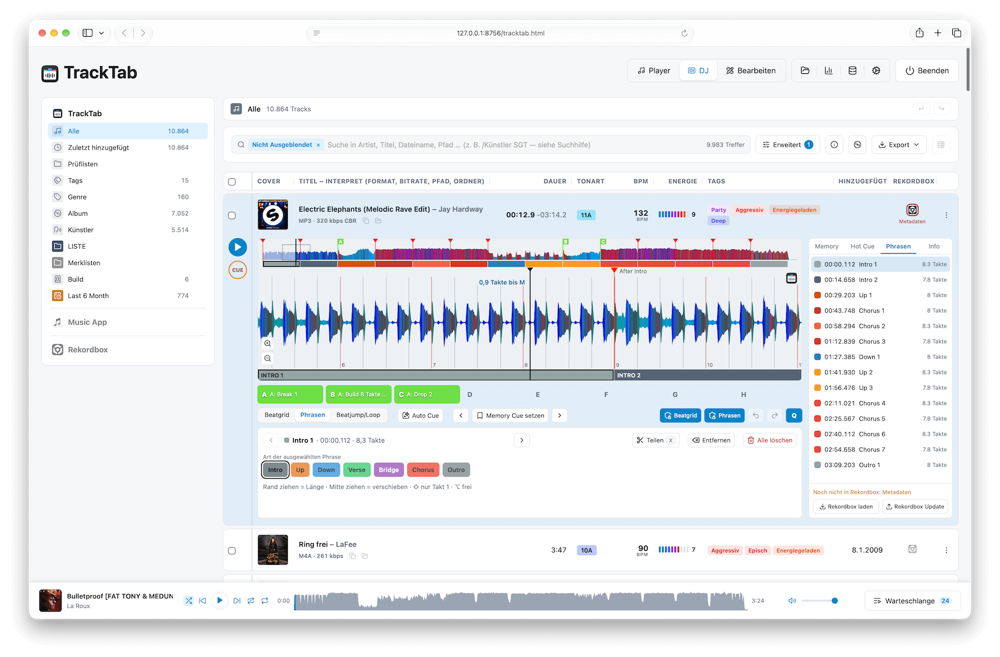

*DJ view: waveforms, hot cues A–H, phrase list on the right and tools for beat grid, phrases and beat jump/loop.*

At the end of each row, **⋮** opens the same commands as in Edit, plus “Add to playlist …” and “Edit tags”. The bulk bar has the same groups and actions as in Edit, without the queue and additionally with Auto Cue. Selected tracks stay selected when switching between Edit, Player and DJ.

Removing tracks from a playlist: in an own, a Rekordbox or a Music playlist, remove one track via **⋮** or several via the checkbox and the bulk bar (**Remove from “…”**). Only the entry in the playlist disappears, the file stays; in own playlists it can be undone with ↩ in the playlist header or Cmd+Z. In the Player there is also **⋮** for this, as long as a playlist is open.

Both waveforms extend one bar beyond the start and end. The beat grid ends with the track. If the first beat lies just before the sound, it sits at the start of the track, so a hot cue or memory cue can be set there too. In Rekordbox a cue before the sound lands at the start of the audio, because there is nothing before it. Play starts from this area at the start of the track. The phrase colours are fixed, one of its own per kind and number. They only apply in TrackTab, Rekordbox shows its own.

If the track already has data from Rekordbox or the own analysis, you start with it, including Rekordbox’s hot cues, memory cues, loops and phrases. TrackTab saves your changes immediately in its own database, the file always stays untouched. Edited cues also appear in the waveforms of Edit and Player. Under **Info** you reset beat grid, phrases or cues individually to the source.

**Waveforms:** At the top the whole track as a half waveform, below it the zoom with the playback position in the middle. The colour shows the frequencies: with RGB as in Rekordbox red for bass and blue for highs, with 3-band blue for lows, orange for mids and white for highs (dark on a light background).

- Clicking jumps to the spot, dragging in the zoom scrubs.
- Zooming works with the magnifiers, by pinch or with the keys **+** and **−**, until half a second fills the whole window.
- Next to the playback position it shows how many bars it is until the next cue.
- A tempo change in the track is marked in both waveforms with a line and a small marker with the new tempo.

**Cue button (key C):** As on the player. If the track is stopped, the spot becomes the cue point, and it plays as long as you hold it. When you release, it goes back. If you press the space bar in the meantime, it keeps playing. If the track is playing, C jumps back to the cue point and stops.

**Waveform:** Under ⚙ Settings → DJ view you choose the source (**Rekordbox, otherwise TrackTab** or **TrackTab only**) and the colour (**Standard**, **RGB** or **3-band**). The colour only applies here, Edit and Player have their own setting under Appearance. The app icon at the top right of the zoom shows where the waveform currently comes from: Rekordbox or TrackTab. On hover it is shown as text. If you zoom in deeply, you see the individual oscillations of the sound. The **waveform background** is also set there: **Dark** (default), **Light** or **UI colour**, which follows the light or dark theme. On a light background the waveform takes darker colours, with 3-band the highs become dark instead of white.

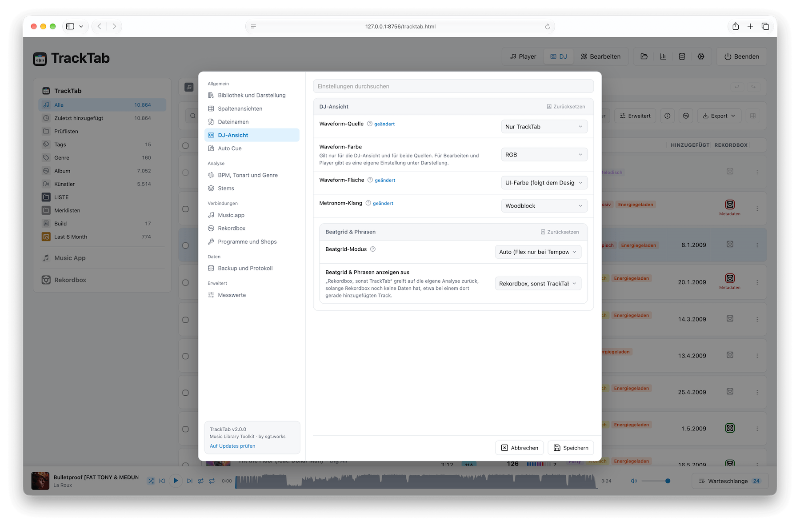

*Settings → DJ view: waveform source, colour and background, metronome sound, beat grid mode and source of the display.*

**Beat jumps:** In the first row of the Beatjump/Loop tab are jumps of 64, 32, 16, 8 and 4 beats in both directions as well as the jump to the previous and next cue. By keyboard you hold a letter and press ← or →: **A** 64, **S** 32, **D** 16, **F** 8, **G** 4 and **H** 2 beats. The arrow keys alone jump 1 beat, with Shift one bar. If you hold the letter for a moment, a display with the jump width and all keys appears on the left above the lists.

**Cues and loops**

Setting a memory cue (with the arrows to the previous and next memory cue) and Auto Cue are in the row of tabs and are reachable in every tab. The loops are in the **Beatjump/Loop** tab below the beat jumps.

- **Hot cues A to H:** click on a free field or key **1** to **8** sets the cue. An occupied field works like the Cue button: if the track is stopped, it plays from the hot cue as long as you hold it and goes back there when you release. If you press the space bar in the meantime, it keeps playing. If the track is already playing, it jumps there and keeps playing. **Shift** and the number (or Shift-click on the field) deletes the hot cue. To set it again, you delete it and set it anew, or you move it in the zoom by its flag.
- **Memory cues:** button or key **M**, at most 10 per track. The arrows left and right of the button jump to the previous or next memory cue. What was loaded from Rekordbox stays visible above that as well, only new ones are not added then.
- **Loops:** **In** and **Out** by hand or ready-made lengths from 1/8 to 64 beats. On a QWERTZ keyboard the key row **Q W E R T Z U** starts 64, 32, 16, 8, 4, 2 and 1 beats, **I O P** additionally 1/2, 1/4 and 1/8 beat. The same key again ends the loop. The loop runs without a jump and without a gap. If you set a cue while a loop is running, it becomes a loop cue.
- **Colour:** click on the colour dot in the list on the right or right-click on an occupied field. New hot cues are green, new memory cues red, as in Rekordbox without a colour of their own. The colours of Rekordbox are available: for hot cues 16, for memory cues eight and “no colour”: pink, red, orange, yellow, green, aqua, blue and purple. The colours on screen may differ slightly from those in Rekordbox.
- In the list you can also give cues a name or delete them. In the zoom, cues can be moved by their flag.

**Beat grid**

The buttons are laid out like the GRID field in Rekordbox: you readjust the grid, the tempo follows from it. The first row contains metronome, tempo with TAP, ×½ and ×2 and the tempo changes with the section display, the second Whole grid / from here, crosshair and 1.1, shift and beat intervals, the third the ramps.

- Type in the tempo, tap it with **TAP** (key **B**, only while the track is running), halve or double it.
- **Whole grid** or **from here:** determines what the buttons apply to. “From here” starts a section of its own at the next beat, before it everything stays as it is.
- **Shift:** single arrows by 1 ms, double ones by 10 ms. You can also drag a beat line in the zoom directly.
- **Beat intervals** narrow or widen: fine by 0.01 BPM, coarse by 0.1 BPM, the first beat stays put. With the **Shift** key held, dragging a beat line also stretches the grid.
- **Crosshair** puts the next beat on the playback position. **1.1** does the same and additionally makes the beat there the start of the bar, so the beat grid begins exactly at the playback position.
- **Tempo change** starts a section of its own with its own tempo from this beat. The bar count runs through in the process, as in Rekordbox’s own grids: a bar jump (a new 1 in the middle of a bar) could make the other deck jump during sync, which also aligns the position in the bar, and Auto Cue rejects such grids. If the 1 after the change is off, the 1 before it is usually already wrong – **1.1** on a correct 1 recounts the whole grid in both directions, also across tempo changes. If the playback position is already on a tempo-change marker (the button is then highlighted), a click removes it again. The arrows to the left and right of it (or **⌥←** / **⌥→**) jump to the previous or next tempo-change marker, hard changes as well as ramp start and end; if there is no marker left in one direction, the arrow is locked.
- If a track has a tempo change, both waveforms show the initial tempo at the first beat and at each marker the tempo from there on. At the ramp start the tempo before it is shown with an arrow (↗ faster, ↘ slower), at the ramp end the new one.
- **Ramp start** and **Ramp end** are for transitions in which the tempo gradually rises or falls, such as in transition edits from 100 to 128 BPM:
  1. Set the playback position to the last beat that is still right at the old tempo and click **Ramp start**. This sets a tempo change there, the ramp is now open (marker “Ramp …”, **Ramp end** lights up).
  2. Set the playback position to the first beat at the new tempo and click **Ramp end**. This sets a tempo change exactly at the playback position. If there is already a marker there, e.g. from Rekordbox, you jump exactly to it with **⌥→**, then it becomes the end. Tempo changes between start and end are dropped. The end determines the new tempo: following markers with (almost) the same tempo, e.g. from an earlier measurement, that only begin later, are dropped too.
  After that, TrackTab places the beats of the ramp on the onsets in the audio by itself (**Fit to audio**, can also be called by hand). Each beat found becomes an anchor (outlined diamond); an undo takes back end and fitting together. Your own anchors (filled diamond) stay fixed during fitting, only what lies between is fitted.
  3. Check the tempo after the ramp in the tempo field. It comes from the next section after it; if there is none, the old tempo applies until you type in the new one.

  The beats in between go smoothly from the old to the new tempo, the area gets an orange stripe at the top and the marker “Ramp · 16” (number of beats). The tools of the ramp are in the second row and are only usable as long as the playback position is in a ramp. There the tempo field shows the tempo of the beat at the playback position; tempo field, TAP, ×½/×2 and beat intervals are locked, because the tempo results from the beats:
  - **− / +** changes the number of beats in the ramp by one. Your own anchors stay in the process, the other beats are fitted anew. If the beat that would drop out with **−** carries an own anchor, you must release it first. Next to it it says on which beat in the bar the end lies: “End on 1 ✓” (green) or e.g. “End on 3”. A transition is practically always whole bars long, so the number suggested is the one that puts the end on the 1. If it does not lie on the 1 despite fitting beats, the 1 before the ramp is usually already wrong.
  - You can drag a beat in the ramp in the zoom directly onto the audible beat. It becomes your own anchor (filled diamond at the top of the line), the others redistribute. **Beat here** pins the next beat exactly to the playback position, handy when listening with a pause on the beat. Own anchors only disappear when you release them yourself.
  - **Insert beat** (diamond with +) sets an additional beat exactly at the playback position, between the two beats around it, as an own anchor. **Remove beat** (diamond with −) takes out the beat nearest the playback position. In both cases all other beats stay where they are; only the bar count after the ramp moves on or back by one beat (see “End on …”).
  - **Release anchor** releases the anchor nearest the playback position, the trash can at the end of the row dissolves the ramp and makes a fixed-tempo section of it again. The tempos before and after are named by the hint on the beat count, in the waveform they appear as markers.
  - **Ramp end** within a ramp makes it end earlier at this spot.

  A track can have several ramps, e.g. up and later back down: each begins with **Ramp start** and ends with **Ramp end**.

  With **Rekordbox update**, Rekordbox gets every beat of the ramp with its own tempo. If you play the transition with Sync, the transition track must be master, then the other deck follows the ramp. If it is synced itself, Rekordbox holds its tempo fixed and evens out the ramp. This has not yet been tried in Rekordbox itself.

  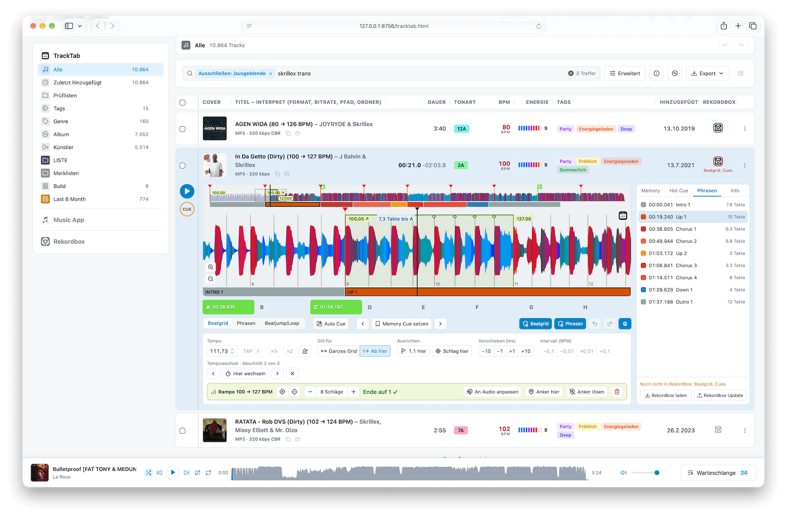

  *Transition track with a ramp from 100 to 127 BPM: anchors, “Fit to audio” and bar counter.*
- The **metronome** ticks on the grid, the track gets somewhat quieter in the process. You choose the sound (Beep, Click, Woodblock, Rimshot, Cowbell, Hi-hat) under ⚙ Settings → DJ view → **Metronome sound**; when you switch, TrackTab plays one bar as a preview. The 1 in the bar always sounds higher. Against a new measurement, the “Beat grid” analysis lock at the top right above the tools protects (every edit sets it by itself); a lock of its own against editing no longer exists.

If a track does not have a grid yet, you measure it or start it at the playback position.

**Memory cues**

The tab always shows ten places, a click on a free one sets the cue at the playback position. After deleting, the next one moves up, with another click on the same cross it is gone too. If a hot cue lies at the same spot, its letter is in the row. With an active loop a memory loop is created: the default is the Active Memory Loop (red), a click on the loop icon switches to the normal one (orange) and back. If the track runs over the start of an Active Memory Loop, it engages by itself. If the playback position is at a cue (from one beat before to one bar after), its colour dot gets a darker ring and the time turns bold, in the Hot Cue tab as well.

**Phrases**

The phrases hang on the beat grid: if you shift or stretch it, they move along and stay on their beats. Cues stay at their place in the track.

In the coloured band under the zoom, the edges also in the band of the overall view:

- **Dragging at the edge** works like with a table column: on hover the handle appears, the edge follows the mouse and snaps to the grid lines. While dragging, the new length in bars is shown. The neighbouring phrase gets smaller or larger accordingly, everything after stays at its place in the track. If you drag beyond it, it disappears and the next one gets smaller. As long as you do not let go, you bring it back by dragging back, afterwards with **Cmd+Z**.
- **Dragging in the middle** moves it, its neighbours give way.
- Both always snap to every beat, also without quantise, with **Shift** only to bar 1, with the **Option key** not at all.
- **Split** (key **X**) divides the phrase at the beat-grid marker nearest the playback position. With Shift it takes the next bar 1. If you click the button with the Option key held, it splits exactly at the playback position. If the track has no phrases yet, it counts as one continuous one: splitting then creates both halves. In the empty phrase list there are also **Create phrase** (one phrase from the first beat to the end, then split with X) and **Phrase analysis**. Click a phrase, then choose the kind or remove it. To remove, the **Delete** or **⌫** key is also enough after you have clicked the phrase with the mouse – this also works in the beat grid view. Without a click nothing happens, even if the phrase under the playback position is highlighted. TrackTab assigns the number itself: each phrase is counted through within its kind in track order. It goes to Rekordbox as far as it exists there: with medium mood Verse 1 to 6, with low Verse 1 and 2, with high Intro, Chorus and Outro 1 and 2 as well as Up 1 to 3. All other phrases have no number in Rekordbox, a higher number becomes the highest possible one there.

**Quantise (button Q):** cues and loops snap to the beat. With the **Option key** held, nothing snaps.

**Analysis lock (two shield icons above the tools, also under Info):** beat grid and phrases can be locked individually. If you edit one of them, TrackTab locks it by itself. The analysis leaves out what is locked and names the number of skipped tracks. The beat grid lock also applies to “Analyse BPM & key”, genre and mood continue to run. A click on the shield unlocks or locks by hand, the next edit locks again. If you reset an edit, its lock falls away by itself. **Rekordbox update** additionally locks the track: in TrackTab both fields and in Rekordbox its analysis lock, which always applies to everything together there. For tracks not yet analysed this does not happen. **Load Rekordbox** does not lift the lock in Rekordbox, that is done there itself. Under **Info** you start beat grid analysis, phrase analysis or both separately. The phrase analysis measures on the beat grid that currently applies. If the analysis finds no unambiguous tempo (e.g. for transitions from 100 to 128 BPM), you set the beat grid by hand and then measure the phrases; that also works with “Beat grid + phrases”, the grid staying as it is. A track locked in Rekordbox can also still be overwritten via **Rekordbox update**.

Phrases and beat grid stay aligned with each other: newly measured phrases snap to the existing beat grid, a new beat grid analysis or a change by hand takes the phrases along, locked ones too. In the DJ view the result of an analysis applies immediately, the Rekordbox column shows it as a deviation until you transfer it.

**Sync Rekordbox** (database icon) loads beat grid, phrases and cues into TrackTab, as far as nothing is there yet for the track. The first run reads every track and takes a while. After that nothing overwrites by itself any more: if a track changes in Rekordbox, the Rekordbox column turns red and the editor asks. Only **Load Rekordbox** takes over, in the other direction only **Rekordbox update**.

**Several tracks:** If you select tracks in the DJ list, the bar offers **Add to Rekordbox**, **Load Rekordbox**, **Rekordbox update**, **BPM & key**, **Genre & mood** (the same analyses as in Edit), **Beat grid analysis**, **Phrase analysis**, **Beat grid + phrases** (both in one pass) and [**Auto Cue**](#auto-cue). The analyses skip what is locked (BPM & key hangs on the beat grid lock). Loading discards the edits of the selected tracks. Adding skips tracks already in Rekordbox and leaves them unchanged there. Load and update skip tracks that are missing there or where there is nothing to transfer.

**Undo:** **Cmd+Z** and **Cmd+Shift+Z** apply to all changes on the open track. More keyboard shortcuts are under **Info**.

### Auto Cue

Auto Cue sets a track’s cues by itself: hot cues on Break 1, eight bars before the last drop and the last drop, plus memory cues on Intro, Drop 1, Break 2 and Outro and in between on the 32-beat grid. Which cue goes where you set under ⚙ Settings → **Auto Cue**.

- **One track:** In the DJ editor click **Auto Cue** in the row of tabs or under **Info**. The track’s previous cues are replaced, with **Cmd+Z** you get them back.
- **Several tracks:** Select in the DJ list and choose **Auto Cue** in the bar. After a confirmation, one track after the other runs, a few seconds per track. Here too the new cues replace the previous ones.
- **Basis:** Auto Cue takes TrackTab’s beat grid and phrases. If TrackTab has none yet for a track, it takes over those from Rekordbox into TrackTab (see below) so that you can keep working with them in the editor. If there is nothing there either, TrackTab first measures beat grid and phrases.
- **To Rekordbox:** The cues are initially only in TrackTab. They only go to Rekordbox with **Rekordbox update**, also for several tracks via the bar.
- **Fade-out at the end of the track:** If only the reverb or delay is fading out at the end, Auto Cue sets no cue there. This is recognised by the volume. If you have edited the phrases by hand, the fade-out begins exactly at the boundary of the first quiet phrase at the end. A loud outro stays an outro and can get a memory cue.
- **Better no cue than a wrong one:** If Auto Cue is not sure enough about a spot, it leaves the cue out. If it finds nothing certain at all or the beat grid does not fit (too short, bar jumps, too many tempo changes), the previous cues stay in place.

**Settings → Auto Cue:**

- **Use automatic phrases as a hint:** Measured phrases count as a weight, never as a fixed position. On 50 tracks cued by hand, Auto Cue with phrases was right more often at Break 1, without phrases somewhat more often at the last drop. Overall the two are even.
- **Phrases edited by hand** always apply, even if the switch is off: drops, breaks and the outro snap to the nearest phrase boundary (at most 4 bars away). This only applies to boundaries that lie exactly on a bar 1. A boundary set in the middle of a bar counts as not cleanly set, there the cue stays where Auto Cue found it.
- **Memory cues:** at most 10, as in Rekordbox. If there is not enough room, Auto Cue sets the intermediate points further apart (64 instead of 32 beats).
- **Confidence per spot:** Very safe, Safe, Normal, Risky or Very risky. Safe only sets a spot if Auto Cue is very sure, and otherwise rather leaves it out. Risky sets more often, also on suspicion. Normal is tuned to the models; only change it if too many or too few cues are missing.
- **Outro:** Auto Cue looks for the outro after the last drop up to shortly before the fade-out. If the rest after the drop is short, the outro becomes short or is dropped. Auto Cue preferably sets it at the distance from the last drop that your own outro cues typically had in training (16 bars without enough examples).
- **Slot assignment (hot cues and memory cues):** two blocks, one row per hot cue (A to H) or memory cue. **Role** puts a detected spot directly on the cue, **Rule** calculates from a spot (for example 8 bars before Drop 2), **Automatic** distributes free memory cues over the section after or before a spot. Plus name and colour, the colours are those of Rekordbox. Each block has its own button for saving and **Reset** (restores the default); the **Save** at the bottom of the dialog takes unsaved changes of both blocks along. The slot assignment also describes how you cue yourself – training is guided by it as well.

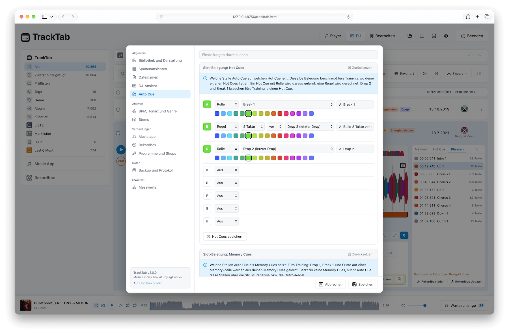

*Slot assignment of the hot cues: role or rule, name and colour per slot.*

Auto Cue is an estimate. It hits the last drop best, Break 1 least often. For tracks without a clear structure it deliberately sets fewer or no hot cues.

**Models:** Auto Cue learns from your own cues set by hand where Break 1, the last drop and the other spots lie. No ready-made model is included: before Auto Cue can set cues, you train a model (see **Training** below) or import one as a ZIP file. Until then Auto Cue and its settings are locked; the slot assignment can still be edited, because training is guided by it. The **Models** block on the **Auto Cue** page lists all your models, each with date, number of tracks and how often it was right on its review list. The selected one (dot on the left) always applies, the first one is selected automatically. That way you can, for example, create one model each for electro, rock and pop and switch between them.

- **Rename:** click on the name of an own model, type, Enter.
- **Export:** the icon on the right saves the model as a ZIP file, e.g. for another computer.
- **Import:** **Import model …** loads such a ZIP file. If it is your first model, it applies immediately, otherwise TrackTab asks whether it should apply right away.
- **Delete:** the trash can on the right. If the model was selected, the newest remaining one applies afterwards; if it was the last one, Auto Cue is locked again.
- **Adopt the model’s slot assignment:** Each model remembers the slot assignment with which it learned. If yours differs from it, this button sets it to match the model. You can keep changing it freely afterwards, you need no new training for that.

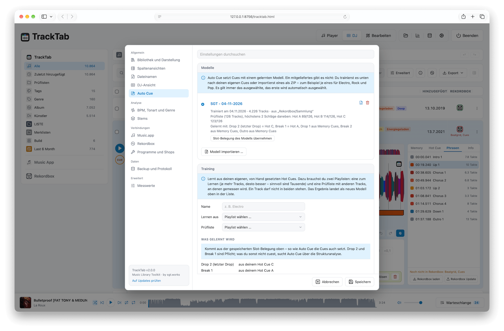

*Settings → Auto Cue: models, import and training.*

**Training:** In the **Training** block, TrackTab learns a new model from your own cues set by hand – matching how you cue yourself.

1. Create two playlists, normal or smart: one for learning (the more tracks the better, thousands make sense) and a **review list** with other tracks against which it is measured (20 to 50 are good). A track must not be in both. The tracks need your hand-set cues, either set in the DJ view or loaded from Rekordbox (**Sync Rekordbox**).
2. Choose both playlists and give the model a name. The selection is rebuilt every time you open the settings, so playlists just created are in it right away. For a smart playlist its content at the moment of the start counts.
3. What is learned comes from your saved **slot assignment** – the same one by which Auto Cue sets the cues. Under **What is learned** it says so for every spot: if a spot lies as a **role** on a hot cue, training learns from your hot cues at this spot. If Drop 1, Break 2 or Outro lie on a memory row, it learns from your memory cues. **Rules** (for example 8 bars before Drop 2) are not learned but calculated, the intro always lies on the first 1 in the beat grid. Required are the last drop (Drop 2) and Break 1, both as a role on a hot cue: the basic framework of the model comes from them, all other spots are searched by Auto Cue relative to the last drop. Tracks without these two hot cues do not count. The remaining spots are optional – what you do not cue, the model does not learn, Auto Cue then looks for them via the structure of the track (the outro by rule). If Drop 2 or Break 1 are missing in the slot assignment, the block says why training is not possible.
4. Below it says immediately how many tracks are suitable for learning and checking. Then **Start training**.

The progress is shown in the block and, when the settings are closed, under the title. On the first run over several thousand tracks TrackTab calculates about an hour; later runs only recalculate what changed. As long as training runs, the Mac does not go to sleep by itself, the screen may still switch off. **Cancel** stops the run, what has already been calculated stays for the next run. At the end the new model is at the top of the list, next to it the comparison with the previous one on your review list. It only applies once you select it – unless it is your first one, which applies immediately.

Training needs a current macOS. If it cannot be started on your Mac, the block says so. Auto Cue itself then works with an imported model that was trained on another Mac.

**Taking over the beat grid from Rekordbox:** If TrackTab does not have a beat grid of its own for a track yet, it takes the one from Rekordbox including phrases as its own: when opened in the DJ editor, before Auto Cue and after **Sync Rekordbox** → Load for all tracks at once in the background (progress at the bottom right). This changes nothing in Rekordbox and locks nothing; if you later measure the track yourself, your measurement applies. If under “Show beat grid & phrases from” you show only TrackTab, such tracks say “taken over from Rekordbox”.

### Syncing with Rekordbox

The buttons are at the bottom right. The text above them says what is not yet in Rekordbox. To write, **Rekordbox must be closed**, also the background service “rekordboxAgent”. TrackTab first backs up the database and the affected analysis files under `backup/rekordbox/`.

- **Load Rekordbox:** takes over the state from Rekordbox and discards your edits, after a confirmation.
- **Rekordbox update:** writes your edits to Rekordbox: hot cues, memory cues and loops including name and colour, the beat grid and the phrases. If title, artist, album, genre, composer, year, comment or key differ in Rekordbox from TrackTab (status “Metadata” in the Rekordbox column), they go along as well; also the BPM from the file’s tag (deviations below 0.05 do not count). If you have edited the beat grid in TrackTab, its tempo applies instead of the tag. If the tempo in Rekordbox is only half or double (80 instead of 160), the column turns orange (“BPM half/double”) and nothing is written. The key is compared regardless of notation (8A and Am are equal) and only written if it is really different in Rekordbox. Rekordbox’s own key measurement is overwritten in the process, until it re-analyses the track. Empty fields in TrackTab delete nothing in Rekordbox.
- **Add to Rekordbox:** appears for tracks that are missing there. Tags, beat grid, phrases, cues and cover are taken over directly, Rekordbox does not have to analyse the track first. The coloured waveforms Rekordbox recalculates itself on first load. Only for a few MP3s with an unusual file header are beat grid and phrases initially missing, TrackTab then says so: have it analysed in Rekordbox and then press **Rekordbox update**.

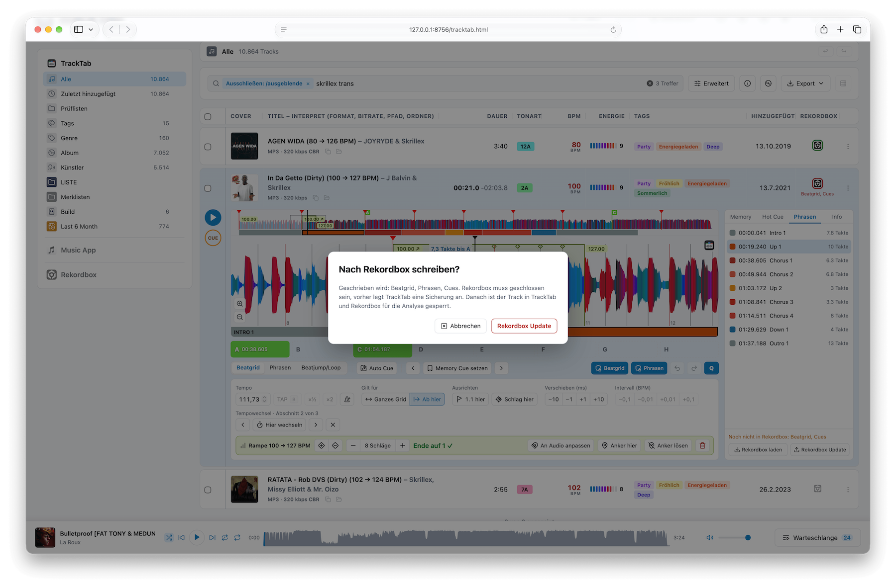

*Confirmation before “Rekordbox update”: Rekordbox must be closed, TrackTab backs up the database first.*

**Changes in Rekordbox:** If you edited a part in TrackTab and it was afterwards also changed in Rekordbox, a notice appears when opening. You choose **Take over from Rekordbox** or **Keep TrackTab**. What is unedited always shows the current state from Rekordbox anyway.

> [!warning]
> Rekordbox has no official interface for this. The data is written directly into its library. Therefore check the result first on a track in Rekordbox itself.

## Genre, mood and energy

TrackTab listens to a track and estimates which style it is, what mood it has and how much energy it brings — entirely on your Mac, without internet and without uploading anything. The basis is the freely available music models from Essentia (Music Technology Group, Universitat Pompeu Fabra Barcelona).

- **Starting:** Via the ⋮ menu of a row or, in the bulk bar, via the icon “Analyse genre & mood”, likewise in the single checks. It takes about one second per track.
- **Whole library:** In the “Scan library” dialog there is the switch “Genre, mood & energy”. After the normal scan, all tracks that do not have a result yet are then analysed. For a large library, the first time takes several hours; you can cancel at any time, the next scan continues with the rest. The switch is called “Genre, mood, energy, BPM & key” there: it additionally fills in missing BPM and key (only where they are empty in the file, never overwriting). TrackTab always stores the result of the genre/mood analysis; only what the write options (BPM & key, comment, mood) allow is written to the files — if they are off, the files stay untouched. Newly added single checks can be analysed automatically (⚙ Settings → Analysis: BPM, key, genre & mood → “Single checks: genre & mood automatically”; runs after the BPM/key analysis). Files above the shared length limit (default 10 minutes, e.g. DJ mixes) are skipped.
- **Genre suggestions:** If you click into the genre field in the tags dialog, the selection list shows at the top under “Suggestions” up to five hits with probability, e.g. “Electro House 69 %”. Below follow all genres of your library (marked “✓ in your library”) and then the remaining roughly 380 styles that the detection knows; typing filters the list. A click puts the style into the field, saving is as always with “Save”. If the track has not been analysed yet, the button “Determine genre suggestions” in the list starts the analysis directly. Weak hits are hidden by the setting “Genre suggestions from … %”.
- **Energy:** column with ten segments and a number from 1 (calm) to 10 (driving). It takes loudness and the character of the track into account, so it is an estimate for sorting and pre-sorting, not a measured quantity. Sortable and usable in the search as `/Energy 7`.
- **Mood:** column with coloured labels. Filled: the five basic moods Aggressive, Happy, Party, Relaxed, Sad — each that applies. Outlined: the two strongest DJ moods out of Energetic, Groovy, Dark, Deep, Euphoric, Melancholic, Bouncy, Epic, Melodic, Summery, Romantic. A track can have several or none. Tracks analysed before the DJ moods get them at the next library scan with the switch “Genre, mood & energy” switched on or by re-analysing.
- **Own tags:** In the tags dialog, below the comments, there is the field “Own tags”. Type a name (e.g. “Warm-up”, “Peak time”) and confirm with Enter or comma; tags already assigned are suggested, × removes a tag. With “Save” they are applied. With several selected tracks the field shows the tags they all have in common: adding gives a tag to all, removing takes it from all. Own tags only exist in TrackTab, never in the file.
- **“Tags” list:** In the sidebar next to Genre, Album and Artist. At the top of the list header all tags of the library appear as bubbles with track count — detected moods fully in their colour, own tags neutral with a dashed edge. A click filters, several chosen tags must all apply (e.g. “Party” and “Deep”). Own tags have an Edit button like the genre bubbles: with it you rename the tag in all tracks; if the new name already exists, both are merged.
- **Searching:** `/Energy 8`, `/Energy >7` or `/Energy 3-5` (energy as shown in the column, i.e. rounded); `/Mood Party` or `/Tag Warm-up` for detected moods and own tags — after the parameter, all assigned tags appear for selection. Exclude with `/No` in front.
- **Writing to the file (optional):** By default the file stays untouched, the results are only in TrackTab. Energy can become part of the shared comment entry (⚙ Settings → Analysis → Comment field, e.g. `8A - 128 - E7`, thus also visible in Rekordbox), the moods as a mood tag (Genre & mood section, e.g. “Party, Happy”). TrackTab never writes the genre itself unasked — the click on a suggestion is there for that.
- **As “My Tag” to Rekordbox (optional):** Rekordbox does not read the mood tag from the file, but has “My Tag” for this. If ⚙ Settings → Rekordbox → “Transfer tags as ‘My Tag’” is switched on, TrackTab sets the detected moods (in English, as in the mood tag) and your own tags as My Tags when adding to a Rekordbox playlist (button or drag & drop) — also for tracks that are already in the playlist. Adding again creates nothing twice. Beforehand, rename one of the four My Tag columns in Rekordbox once (right-click the column header in the My Tag window), e.g. to “TrackTab”, and enter the same name in the field “My Tag column”; Rekordbox does not allow new columns. This column then belongs to TrackTab: tags that no longer apply to a transferred track are removed there. The other My Tag columns stay untouched.
- **Good to know:** The models were trained on Discogs data and know 400 styles; with niche genres or edits they are sometimes off. The function is only available on Macs with Apple Silicon from macOS 14; otherwise the buttons do not appear and the related settings are greyed out. The models are under the CC BY-NC-SA 4.0 licence and may only be used non-commercially.

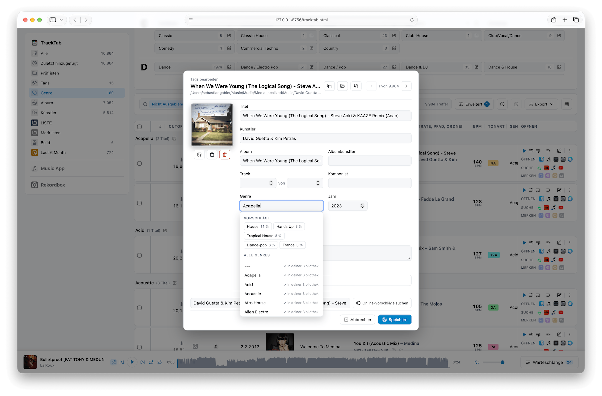

*Genre suggestions with probability at the top of the genre field of the tags dialog, below them all genres of your library.*

## Creating stems (acapella & instrumental)

TrackTab can separate a track into **vocals (acapella)** and **accompaniment (instrumental)** — entirely on your Mac, without internet. The basis is the Demucs model. For licensing reasons it is not part of the app: load it once under **Settings → Stems → Load model** (after confirming the licence notice, about 170 MB). Until then the stem functions are hidden and the other stem settings greyed out.

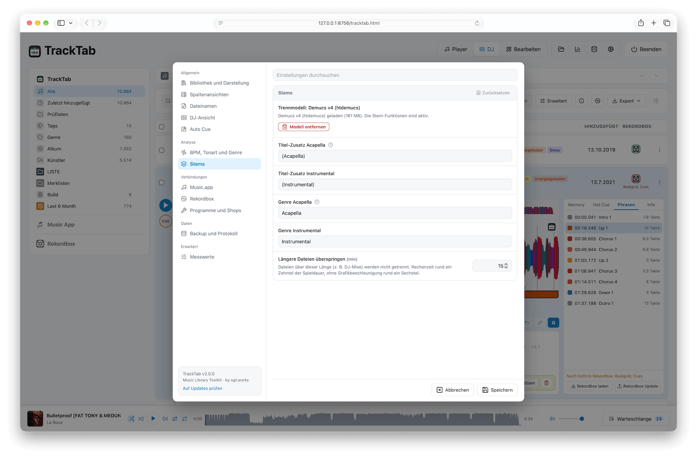

*Settings → Stems: load or remove the model, title suffix, genre and length limit.*

- **Starting:** ⋮ menu of a row → “Generate stems …”. You choose whether you want acapella, instrumental or both, plus the quality (Fast: about 15 % shorter processing time, rarely slight artefacts at the section transitions; Precise: full overlap), and start with “Generate stems”. The progress is shown in percent in the dialog, a running separation can be cancelled; with “Minimise” it no longer blocks the interface, a progress notice runs along at the bottom, and on completion a click on the notice reopens the listening preview.
- **Listening preview first:** After separating (on the graphics chip and Neural Engine of the Mac; a 4-minute track takes about 15–25 seconds. The very first time, TrackTab additionally prepares the model for up to a minute, after that once for about 10 seconds after every app start) a waveform with Play/Pause, Stop and time display appears for each stem. A click (or drag) in the waveform jumps to the spot and plays from there; only one stem plays at a time. **Nothing is saved yet.** Only “Save” creates the file; “Download” only downloads the stem as a file (with the same tags, cover and name as when saving, but without putting it next to the original or entering it anywhere; afterwards you can still save it); “Delete” or closing discards the preview.
- **What happens on “Save”:** The file lands in the original’s folder. The name follows the name pattern from ⚙ Settings → File names. All tags and the cover come from the main track; only the **title** gets “(Acapella)” or “(Instrumental)” appended and the **genre** becomes “Acapella” or “Instrumental” (both changeable under ⚙ Settings → Stems). After that the file is added to TrackTab, imported into the Music library (if Music is set) and — if the main track is in Rekordbox — created there.
- **Format:** Lossless originals (AIFF, WAV, FLAC, ALAC) yield AIFF, MP3/AAC originals yield MP3 at 320 kbps.
- **Rekordbox:** The stem is only taken over if the main track is in Rekordbox and stem and main track have the same format — i.e. MP3 → MP3 or WAV/AIFF/FLAC → AIFF. An AAC track (.m4a) yields an MP3 stem whose beat grid would not fit; it stays in TrackTab and Music, Rekordbox does not get it (the dialog says so). Under ⚙ Settings → Rekordbox → “Transfer stems to Rekordbox” (greyed out as long as the stem model is not loaded; the link below leads to the Stems page) you choose “Yes, with cues” (default), “Yes, without cues” or “No”. The stem gets BPM, key, duration, beat grid and cover of the main track — with cues additionally all hot cues, memory cues and loops — and appears in the same playlists. As a waveform Rekordbox initially shows that of the main track. If you re-analyse the stem in Rekordbox, it gets its own, but Rekordbox also re-sets the beat grid in the process (usually worse for an acapella). If Rekordbox is running, the stem is queued (counter on the “Sync Rekordbox” button) and only taken over when you close Rekordbox and start “Sync Rekordbox” → “Transfer queued items”. Taking over beat grid and cues has not yet been checked in Rekordbox itself — have a look at the first stem there.
- **Good to know:** Separation is never perfect — vocal remnants in the instrumental or instrument remnants in the acapella occur. Files above the limit (default 15 minutes) are not separated. According to its source the model is under CC BY-NC 4.0 (non-commercial). Only in the library’s row menu, not yet in the bulk bar and the single checks.

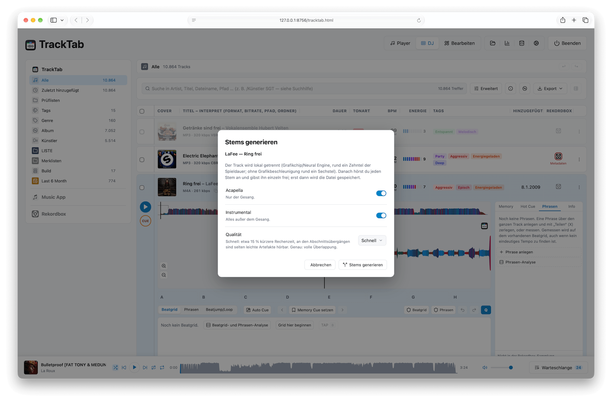

*“Generate stems” dialog: acapella, instrumental or both, plus the quality.*

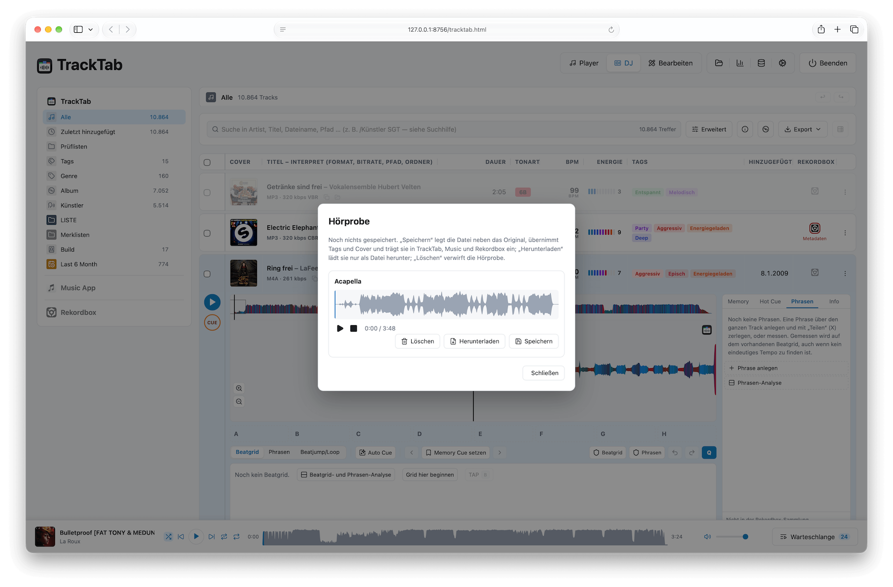

*Listening preview: only after “Save” does the file land next to the original, “Download” only downloads it as a file, “Delete” discards it.*

## Editing tags

Via the pencil icon you open a dialog for title, artist, album, album artist, composer, genre, year, BPM, key, cover and comment. Changes are written directly into the file, under the same name in the same place. While typing, the field already suggests values present in the library so that no multiple spellings arise (e.g. “Rock” and “rock”).

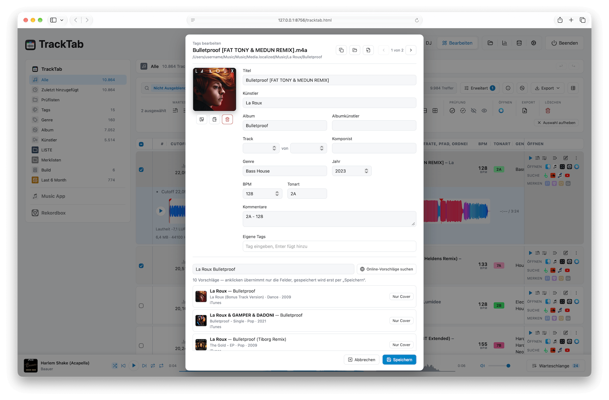

*Editing metadata with online suggestions.*

At the top are file name and folder, next to them **Copy path**, **Show in Finder** and the arrows to the previous or next track with the position (e.g. “3 of 12”). The three icons under the cover choose an image, paste it from the clipboard or delete the cover; an image can also be dragged directly onto the cover. Changed fields are outlined in colour and slightly tinted, at the bottom it says how many there are. The small arrow next to the name of a changed field resets only this field to its original value (it is in the tooltip). This helps, for instance, if an online suggestion has taken over all fields but you want to keep the old title. The same exists for the cover and the own tags. If the track has a tempo change in the beat grid, a small button with the tempo sequence (e.g. “100 → 128 BPM”) sits at the top right above the title. A click rewrites the title: existing tempo notes such as “100-128 Transition” or “(128 - 80 BPM)” are dropped together with the word “Transition”, and “(100 → 128 BPM)” is appended at the end. The tooltip shows the new title beforehand. Afterwards you can still touch up the title by hand. A second click on the (now highlighted) button brings back the title from before the click. Saving is as always only with “Save”. If the title already reads that way, the button is not there.

With the arrows to the previous or next track, your changes are kept: they are queued and are there again when you page back. The **Save** button counts how many tracks have changes (e.g. “Save (3)”) and writes them all at once. **Cancel** (or Escape) discards all queued changes, nothing is then saved.

If a file is write-protected (marked “Locked” in Finder under “Get Info”) or you lack write permission, the dialog shows a notice with a lock at the top. Fields, cover, online search and renaming are then locked and greyed out. You can still assign own tags, TrackTab does not store them in the file. In multi mode, protected files are skipped when saving; the notice says how many there are.

In the search field below the fields, artist and title are already entered; “Search online suggestions” uses them to query iTunes, Deezer and MusicBrainz — without any account. You can change the search term beforehand. A click on a suggestion only fills the form fields; it is only saved by clicking “Save”. With long hit lists only the content scrolls, “Save” stays visible at the bottom.

If several tracks are selected, the same dialog opens in multi mode: only the fields you actually change are overwritten for all selected files.

## Find & replace

The icon next to the search help (before the album toggle) opens **Find & replace**. It is disabled in the Player view. It works on the tracks currently in the list: the open list including search and filters, or only the selected ones if any are selected. The single checks don't have this button (they have [Apply rules](#replace-rules)).

- **Find:** one or more terms, separated by commas, e.g. `ft, ft., feat, FEAT.`. The **?** behind the label “Find” shows the short syntax help as a tooltip.
  - Without marks the whole word counts: “ft” matches “Artist ft X”, but not “Loft”.
  - `*nervo*` finds a part anywhere in a word, `nervo*` the start of a word, `*mix` the end of a word.
  - `"Original Mix"` in quotes is an exact phrase and may contain spaces and commas.
- **Fields:** pick any number as chips: title, artist, album, album artist, composer, genre, comment and **Own tags** (stored only in TrackTab, never in the file: Music.app and Rekordbox are left alone), or **All fields** with one click. This lets you replace in artist and album artist together, for example. TrackTab remembers the choice until you reload. The file name is not included; use [automatic renaming](#renaming-files-automatically) for that.
- **Options:** two switches, both off by default: **Match case** and **Match accents**. Off means “nervo” finds “Nervo”, “NERVO” and “Nérvo”. Further options will be added in the same place.
- **Replace with:** the new text, written exactly like this. If it ends with a punctuation mark that already follows the match, it isn't doubled (“ft” → “feat.” turns “ft. X” into “feat. X”). **Left empty**, the dialog removes the match together with one adjacent space (“Song (Original Mix) X” → “Song X”); the preview marks the spot with ∅. If a field would end up empty, it isn't changed.

The preview groups by track: a track changed in several places appears once with title and artist in the header, and one row per field below with before (match red) and after (green). The header is tinted; its check (as in the duplicates list: circle with a check, empty circle, circle with a dash for a partial selection) selects or deselects all changes of that track, the checks below single fields. Clicking the row is enough. “All” and “None” set all of them. If the search in the dialog matches a saved rule exactly, tracks for which that rule is ignored under Issues are left out (the header line gives the number). Missing and locked files are greyed out and can't be selected, nor can a change that would leave a field empty.

Before writing, TrackTab asks and names the number of files, the fields and where the change is synced to. Then the new values are in the files and in the library, Music.app is updated and Rekordbox too (TrackTab makes a backup first). If Rekordbox is running, the change is queued and applied with “Sync Rekordbox”. This can't be undone; every change is in the change log with its old and new value. If a value changed between preview and writing (e.g. in a second window), that file is skipped.

### Replace rules

“Save as rule” keeps the current search including fields and options, “Load rule …” brings a saved one back. Under ⚙ Settings → File names → **Replace rules**, each rule has its own card: find → replace with, below it the same field and option chips as in the dialog. There you can switch rules on and off, delete them or add new ones. Active rules work in three places:

- **Issues:** every active rule appears as **its own category** (bubble “Rule: ft … → feat.”, on its own line behind the label “Replace rules”; “Ignored issues” comes first) with a quick fix, one track at a time or for all tracks via the bubble. The eye ignores the issue for a track; the quick fix doesn't apply an ignored rule there. If you change a rule's find or replace text in the settings, it counts as a new rule: its ignored issues are dropped and all affected tracks show up again. Deleting a rule deletes its ignored issues as well. Switching a rule on/off, fields and options don't affect this.
- **Tags dialog:** below the affected field, “Apply suggestion” shows the value after all rules, also while you type. The tooltip names the rule.
- **Single checks:** “Apply rules” (before “Import into Music library”) shows the same preview for the selected files and can rename them automatically afterwards.

The former check “Featuring not in the chosen notation” no longer exists. Create a rule for it instead, e.g. `ft, ft., feat, featuring` → `feat.` in the artist.

## Issues (metadata problems)

Besides the question “is the bitrate right?”, TrackTab also checks every file for **metadata problems** — damaged or untidily set tags that do not affect the audio quality but can cause trouble, e.g. when exporting as a playlist, when sorting or in other programs. These issues are a category of their own, **independent** of OK/Suspicious/Fake/Unclear: a track with the verdict “OK” can still have tag problems, and vice versa.

The trigger for this function was a real find: a track had an invisible line-break character in the middle of the artist tag — as a result, one playlist line suddenly became two in the M3U8 export, and all following lines shifted.

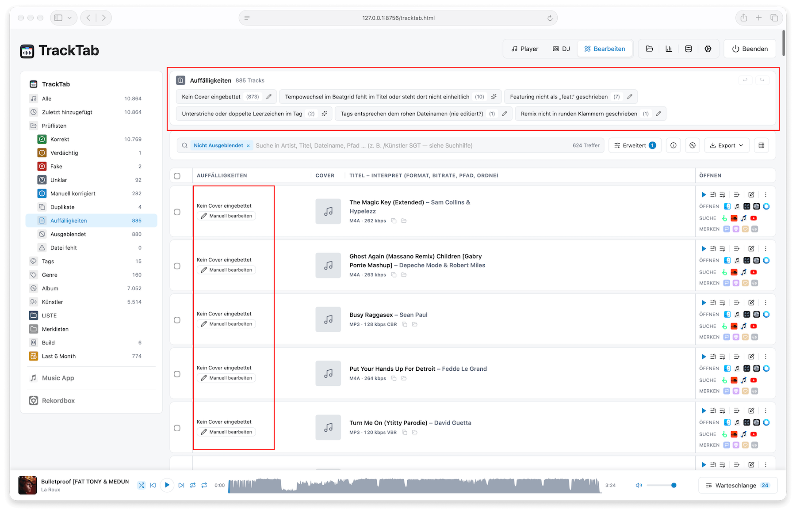
*Identified issues can be edited in an extra column, manually or, depending on the problem, automatically.*


**Same cover on different albums:** The same image file is in tracks of at least two different albums, almost always a wrongly embedded cover. Several tracks of the same album with the same cover are normal and are never reported; as in Apple Music, an album is album title plus album artist (if that is missing, the artist); compilations marked as “Compilation” count by album title only. Only the albums that deviate from the rest are reported: the album with the most tracks for this image counts as the right one (with a tie, all are reported). Tracks without an album tag count as an album of their own per file. Two issues of their own check whether all tracks of an album carry the same image: **Cover differs from the rest of the album** (different image) and **Cover missing, other tracks of the album have one** (no image at all). Each of the two filters only shows albums with its own finding, together with the album's other tracks for comparison; under “Cover differs” the tracks without a cover are left out. The image that most tracks have counts as correct; Quick Fix (sparkle icon) copies it into the other tracks. With a tie (e.g. two tracks with different images) there is no Quick Fix: choose the cover by hand in the tags dialog. For compilations, in the tags dialog (also with several tracks at the same time) you set the field “Compilation” to “Yes”, then the record counts as one album, no matter which artists the tracks have. If you click the “Cover” column heading, equal images sit next to each other; in the Issues list with the filter “Duplicate cover” this is already so without sorting of its own. This cannot be fixed automatically: with the bubble you filter the hits, select them and swap or delete the cover in the tags dialog (also for several tracks at once). For albums whose cover is deliberately shared, you hide the tracks. On the first scan after the update, TrackTab re-reads the images of all files once (about 15 seconds for roughly 11,000 files).

### Where to find them

The **Issues** list is in the sidebar in the **Review lists** folder, next to **Duplicates**. In the list header — just as with Genre/Album/Artist — a row of **bubbles** appears, one per kind of error with the number of affected files:

- **A click on a bubble** filters the table to exactly this kind of error.
- **The button next to it** (✨ or ✎, see below) edits **all** files with exactly this error at once.

In addition, via the column icon a column of its own, **Issues**, can be shown, which in every list (not only in “Issues” itself) shows per row the plain text of each problem found, directly with the two action buttons next to it.

### Two kinds of correction

Every problem found belongs to one of two groups:

- **✨ Quick Fix** — safely fixable without ambiguity, TrackTab corrects it at the push of a button. The icon of a single row does this right away and fixes all safely fixable problems of that file. For several tracks (✨ on a bubble or “Fix issues” in the bulk bar) a **preview** opens first, as in [Find & replace](#find--replace): every change per track with before and after. Use the circles to deselect single changes or whole tracks, “All”/“None” toggle everything; nothing is written until you click “Fix …”. The ✨ on a bubble fixes only that one issue, the bulk bar all issues of the selected tracks. Ignored issues are left alone. The ID3 version is raised with every tag change anyway, even if you deselect that entry.
- **✎ Edit manually** — requires a decision only you can make (e.g. which year is correct). The button directly opens the familiar tags dialog — for a single row for exactly this file, for a bubble in bulk mode for all affected files at once.

### The messages in detail

| Issue | What it means | Fix |
|---|---|---|
| **Control character/line break in tag** | A tag value (e.g. the artist) contains an invisible control character or a line break — only becomes visible on export (see above) or in some third-party programs. | ✨ Quick Fix |
| **Leading/trailing whitespace in tag** | A tag value begins or ends with a space — invisible in the table, but causes seemingly duplicate values when sorting or grouping, for example. | ✨ Quick Fix |
| **Only ID3v1 present (no ID3v2)** | The file only carries the very old, heavily limited ID3v1 format (short text fields, no cover possible). Modern programs mostly read only ID3v2. | ✨ Quick Fix |
| **Old ID3v2.2 header** | The file uses the outdated ID3v2.2 variant — still read, but only supported in a limited way by some programs. | ✨ Quick Fix |
| **Genre stored as unresolved numeric code** | The genre field contains only a number like `(17)` instead of plain text — a remnant of the old, fixed ID3v1 genre list. TrackTab resolves the code automatically into the matching name (e.g. `(17)` → “Rock”). | ✨ Quick Fix |
| **Conflicting duplicate tags** | The same field (e.g. title) is stored several times with different content in the file — programs may then show the wrong one. TrackTab merges them into one value. | ✨ Quick Fix |
| **Tag not Unicode-normalized (NFC)** | The tag text is technically correct but stored in a different Unicode normal form than usual (affects umlauts, for example) — can lead to seemingly duplicate, actually identical values when searching/sorting. | ✨ Quick Fix |
| **Encoding artifact (misinterpreted characters)** | The text looks broken (e.g. “Björk” instead of “Björk”) — a character set was misinterpreted when tagging. TrackTab shows a possible corrected value as a preview, but never writes it unasked, since a wrong guess here would be guesswork. | ✎ Manual |
| **Unbalanced bracket in title** | The title contains an opening bracket without a matching closing one (or vice versa) — mostly a truncated title such as “Song (Radio Edi”. | ✎ Manual |
| **Tags match the raw filename (never edited?)** | Artist AND title are identical to the unedited file name — a sign that the tags were never set. | ✎ Manual |
| **Implausible year** | The year field contains a value that cannot be a real release year (e.g. before 1900 or in the future). | ✎ Manual |
| **Track number not recognizable as a number** | The track number field does not contain a valid value in the format “3” or “3/12”. | ✎ Manual |
| **Title missing** / **Artist missing** | One of the two required fields is completely empty. | ✎ Manual |
| **No cover embedded** | The file has no cover image. Tip: in the tags dialog, “Search online suggestions” can often find suitable cover material automatically. | ✎ Manual |
| **Tempo change in the beat grid missing from the title or not in the standard format** | The beat grid has a tempo change (e.g. 100 → 128 BPM), and the title does not end in exactly “(100 → 128 BPM)”: the note is missing, does not match the grid or is written differently, e.g. “(128 - 80 BPM)”, “100-128 Transition”, “(DJ Rukus 100 128 Transition)” or “126 To 70 BPM”. A track is checked as soon as it has been open once in the DJ editor. Quick Fix removes the existing tempo notes together with the word “Transition” (also “Trans” and typos like “Transistion”) and appends “(100 → 128 BPM)”, e.g. “Need You (128-112 Transition)” → “Need You (128 → 112 BPM)” or “Tall Boys 100-128 Transition (Dirty)” → “Tall Boys (Dirty) (100 → 128 BPM)”. The word is dropped everywhere in the title, so “Epic Transition” becomes “Epic”; in the tags dialog this can be touched up before saving. | ✨ Quick Fix |
| **Cover unusually large** | The embedded cover is clearly larger than usual (> 2 MB) — bloats the file unnecessarily. Quick Fix shrinks it to the usual edge length of about 1000 pixels and recompresses it as JPEG; the aspect ratio is kept. | ✨ Quick Fix |
| **Cover image data corrupted** | The embedded image data cannot be opened as an image. | ✎ Manual |
| **File extension doesn't match the actual codec** | The file is called e.g. `.mp3` but actually contains AAC audio data — can cause playback problems in some programs. | ✎ Manual |
| **Key notation differs from the setting** | The file carries the key in a different notation than chosen under ⚙ Settings → Analysis → Key field (e.g. `8A` instead of `1m`); the key bubble has a dashed outline. Quick Fix writes the existing key in the chosen notation to the file, the value itself stays (like “Align key notation”). | ✨ Quick Fix |
| **Web address or promo leftover in tag** | A tag contains a web address (`http://…`, `www.…`, `name.com`), a promo word in brackets (“[Promo]”, “(Beatport)”, “[Free DL]”) or “Downloaded from …” — typical of downloads, often in the comment. Which words and domain endings apply is in the lists **Promo words in brackets** and **Domain endings** (default: promo, promo only, free dl, beatport, traxsource, junodownload, juno download, bandcamp, soundcloud, zippyshare; com, net, org, info, biz, ru, de, io, …) and can be extended. Quick Fix removes the leftover (a comment that consists only of it becomes empty). | ✨ Quick Fix |
| **Unwanted term in tag (e.g. "Official Video")** | The title contains appendages like “(Official Video)”, “[HD]”, “(Free Download)”, “(Out Now)” or “- Official Audio”. A bracket is removed if it consists only of words from the list **Terms to delete** (default: video, audio, lyric(s), hd, hq, 4k, 1080p, 720p, download, dl, visualizer, official, clip, premiere); “free”, “music”, “out” and “now” may stand alongside but are not enough on their own — so “(Free)” and “(Radio Edit)” stay untouched. The list can be extended. | ✨ Quick Fix |
| **Underscores or double spaces in tag** | A single underscore becomes a space (or hyphen), a double one becomes “ - ” (adjustable: “ - ”, “ – ”, “ | ” or space), multiple spaces become one, spaces and underscores at the edge are dropped. “Daft_Punk__Get_Lucky” thus becomes “Daft Punk - Get Lucky” (not in the comment). | ✨ Quick Fix |
| **Track number in the title** / **Artist repeated in the title** | “01 - Title” or “Artist - Title” when the artist tag is set. The cleaned title is stored as a suggestion. | ✎ Manual |
| **Remix not in the chosen notation** | “Title (X Remix)”, “Title [X Remix]” and “Title - X Remix” are recognised; what deviates from the chosen notation (round, square or hyphen at the end) is reported. A remix note is an addition that ends with a word from the list **Words that mark a remix note** (remix, mix, edit, bootleg, rework, vip, dub, version; extendable). Only the title is checked. | ✎ Manual |
| **Rule: … → …** | A field changes when an active [replace rule](#replace-rules) is applied, e.g. “ft.” instead of “feat.” in the artist. Each rule has its own category. | ✨ Quick Fix |
| **Title/album: capitalisation differs from the target** | Off by default (can be intentional). Target: every word capitalised (“Get Lucky”), only the first word capitalised, UPPER CASE or lower case. With the first two, only values written entirely in upper or entirely in lower case are reported, with the last two every deviation. | ✎ Manual |
| **Quotes/apostrophes differ from the chosen style** | “Straight” means the plain characters `'` and `"`, “typographic” the curly ones (’ ‘ “ ”). The target form is chosen; the default is straight, the check is off by default. | ✎ Manual |

Each of these rules can be switched off individually under ⚙ Settings → File names → **Title clean-up**; the word lists and the target notations are there too. After a change, run “Re-check issues”.

In the tags dialog, an **Apply suggestion** button appears under title, artist and album, which puts the completely cleaned value (all rules together) into the field. Active [replace rules](#replace-rules) provide such suggestions for all text fields.

### Re-checking

As with the quality verdict: an issue is re-checked with every kind of analysis — on the regular scan, on “Re-analyse track”, in the single checks and after a bitrate correction. If only the **detection itself** has been improved (e.g. after a TrackTab update), without anything having changed on the files, the switch “Re-check issues” when scanning is enough (see [Scanning the library](#scanning-the-library)) — much faster than a full rescan, because only the tags are re-read, not the audio data.

## Converter MP3, AAC, AIFF

If at least one track is selected (main table or single check), an additional icon for the converter appears in the button bar. A popup lets you choose the target format:

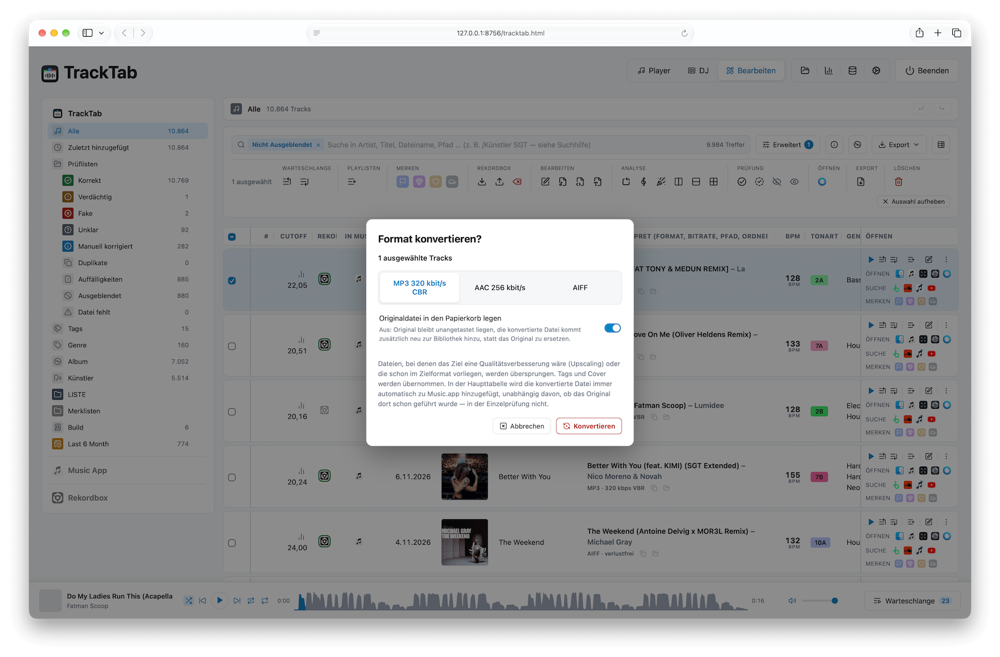


*The converter with target format selection.*

- **MP3 320 kbit/s** — every frame has 320 kbit/s (like CBR), sample rate of the source (sources with 88.2/96 kHz and more are brought to 44.1 or 48 kHz, MP3 only knows 32/44.1/48 kHz). With the bundled `lame`, the frequency range above 20 kHz is preserved as well, a normal 320 CBR cuts off there. If `lame` is missing, TrackTab encodes via ffmpeg (low-pass at about 20 kHz). In the spectral analysis, such a file has no edge and resembles an MP3 without a low-pass.
- **AAC 256 kbit/s** — as `.m4a`, with Apple’s encoder (the same as in Music.app), 256 kbit/s like the titles from the iTunes Store. Allowed from lossless files and from lossy ones from 256 kbit/s (so an MP3 320 yes, an MP3 192 no); an AAC from 256 kbit/s is already in the target format.
- **AIFF** — lossless, sample rate and bit depth of the source are preserved.

TrackTab prevents “upscaling” in the process: a file that is already lossy cannot be converted to AIFF, and an MP3 with less than 320 kbit/s cannot be re-encoded up to 320 kbit/s. Such tracks are skipped, as are files that are already exactly in the target format (nothing to gain). At the end a report shows how many files were converted and how many were skipped for which reason.

Tags, key, mood and cover are taken from the original file (the key in the same notation as in the original; if it is missing there, it comes from TrackTab’s database in the set notation). In the main table the converted file is **always automatically added to your Music.app library** — regardless of whether the original was already listed there or not (Music.app has no “replace” function, so an already existing track is removed when replacing and the converted file imported anew, see below). In the single check this does **not** happen — there TrackTab has no database row anyway and does not touch Music.app.

A switch in the popup, “Move original file to Trash”, determines what happens to the original (on by default):

- **Enabled (default):** After a successful conversion the original goes to the Trash (never hard delete) — the new file carries the same name with a new extension, in the same folder, and replaces the track in the list. If the track was already in Music.app, it is removed there first (playlist memberships in Music.app may be lost in the process), then the converted file is imported. If it was known in Rekordbox, the file path there is corrected, provided Rekordbox is closed during conversion.
- **Disabled:** The original stays untouched (file, library entry and Music.app link), the converted file is created next to it additionally and appears as a separate, new entry in the list (or in the single checks) — and is likewise newly imported into Music.app. Rekordbox stays untouched in this case.

## Single check of new files (not in the library)

The “Single checks” area is hidden at first. It appears as soon as you add a file via the “Open file” icon in the header or drag a file onto the page, and disappears again with “Clear list”.

For a file that is not yet in the library there are two different ways — both do **not** end up in the database and influence neither statistics nor export, but differ considerably in scope of functions:

- **Drag & drop** — if you drag an audio file onto the page, it is measured and shown immediately: a pure quick analysis. In the row only limited actions are available (Play, Delete, shop search).
- **“Open files”** — the “Open file” icon in the header (or the button in the Single checks area) opens a file selection dialog. Only this way do you get the full scope of functions: edit metadata, re-measure, convert, rename automatically and — via “Import into Music library” — afterwards add the track to your Music.app library (the button only appears if the Music app is chosen in the settings); TrackTab takes over the new location automatically.

If there are active [replace rules](#replace-rules), the **Apply rules** button sits before “Import into Music library”.

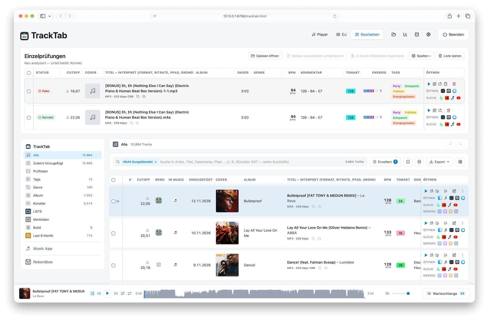

*Added via “Open files”: full scope of functions.*

The difference at a glance — the same file once via drag & drop (limited actions), once via “Open files” (full action bar):

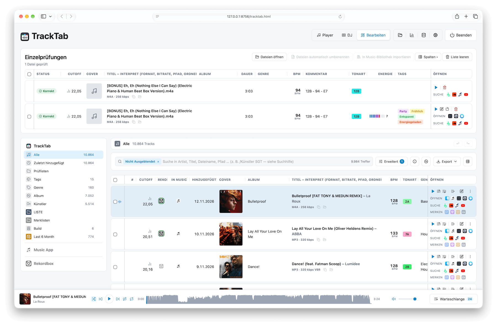

*Drag & drop (bottom) compared with “Open files” (top).*

## Renaming files automatically

Freshly bought tracks come, depending on the shop, with very different file names — the metadata in the file, however, is uniform. The “Rename files automatically” button in the single checks builds a uniform name from it, for all currently selected rows at once.

You set the pattern in the settings under **File names → Name pattern**. Default:

```
{artist}_{title}_{bpm}_{key}_{bitrate}_{year}
```

Available placeholders: `{artist}`, `{title}`, `{album}`, `{albumartist}`, `{composer}`, `{genre}`, `{bpm}`, `{key}`, `{bitrate}`, `{year}`, `{samplerate}`, `{track}`.

This is how the names are built:

- **Underscore** separates the categories, **hyphen** the words within a category: `daft-punk_get-lucky_116bpm_8a_320kbps_2013.mp3`
- Everything lower case, umlauts spelled out (ä → ae), special characters become hyphens.
- A placeholder without a value drops its category **entirely** — no gap is left behind. With lossless formats (FLAC, WAV, AIFF, ALAC) there is no meaningful bitrate, so `{bitrate}` automatically drops there: `bicep_glue_130bpm_4a_2017.flac`
- TrackTab reads the key `{key}` from the file — it is there if Mixed In Key has analysed the track.
- If the target name already exists, `-2`, `-3` … is appended; the file extension is kept, the folder as well (nothing is moved).

Skipped are:

- **Files that already lie in one of your library folders.** There they are linked via their path (Music.app, Rekordbox, playlists) — a new name would tear these references apart. There is a path of its own that carries them along: see [Renaming library tracks](#renaming-library-tracks).
- **Files without artist and title.** A name made entirely of technical values (`320kbps.mp3`) says less than the existing file name.
- Files that already have exactly that name.

### Renaming library tracks

Tracks in the library list can also be renamed by the same pattern: in the row menu **Rename file** or as a bulk action for a selection. TrackTab carries along everything that hangs on the path:

- **Database, playlists, favorite lists** — go along.
- **Music.app** — the track is re-pointed to the new file (playlists and play counts stay). If Music.app refuses, the renaming is taken back. This re-pointing has not yet been checked on real material — after the first renaming, look whether the track still plays in Music.app. After a later tag change, Music.app may re-sort the file in its media folder by itself if “Keep Music Media folder organized” is on there.
- **Rekordbox** — the path is corrected in the collection. If Rekordbox is running, the new path is only queued and written to the collection at the next “Sync Rekordbox” (quit Rekordbox first).

A progress notice shows how far the renaming is; at the end it says how many files were renamed and how many were skipped for which reason. The assignment in TrackTab is carried along immediately — playing, editing metadata, re-measuring and import keep working right away, without having to reopen the files.

## Statistics

The “Statistics” button in the header shows a year/month evaluation: how many actions (corrections, conversions, tag changes, covers, Trash, renamings, Rekordbox/Music.app sync, …) happened in which month, how much was listened to in total, and which titles, artists and genres had the most playing time. The most-played titles are sorted by number of plays (with a tie by listening time). A year dropdown switches between the years for which there is data; “Recalculate” updates the numbers immediately. For the most-played titles, “Create playlist from Top 50” creates a new playlist with up to 50 of the most-played titles of the chosen year. Correspondingly, “Create playlist from fully listened” creates a playlist from the titles listed there under “Most fully listened”.

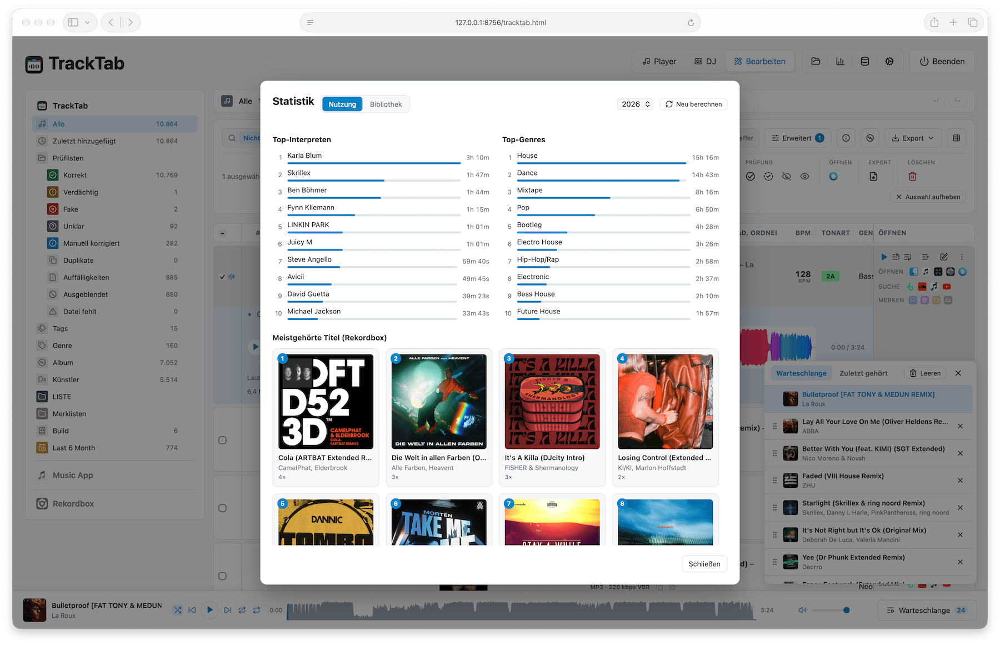

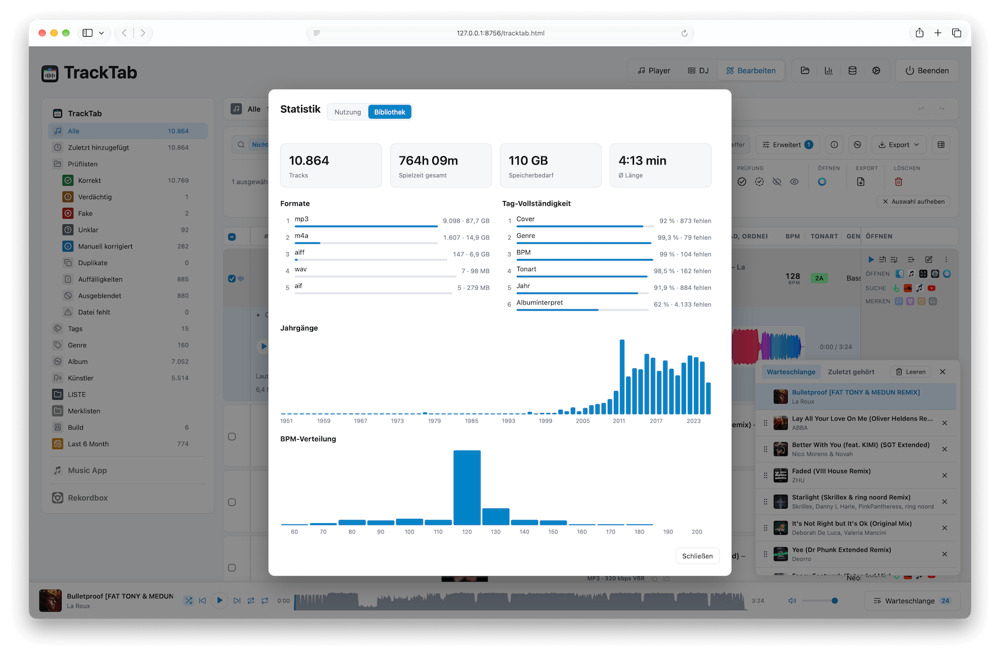

*Statistics, “Library” tab: formats, tag completeness, vintages and BPM distribution.*

The “Library” tab in the statistics window shows instead a snapshot of the holdings: track count, playing time, storage size and average length, formats, tag completeness (how many tracks have cover, genre, BPM, key, year and album artist), vintages, BPM and key distribution as well as additions per month and year according to Music.app. In addition come the coverage (in Rekordbox, in playlists, in favorite lists, hidden, confirmed as correct) and maintenance hints (tag issues, duplicate groups). Tracks without an added date from Music.app are missing from the additions and are explicitly mentioned there. The same numbers are output by `./run.command stats` in the terminal.

If Rekordbox is chosen in the settings, the history is loaded from Rekordbox and you also get statistics.


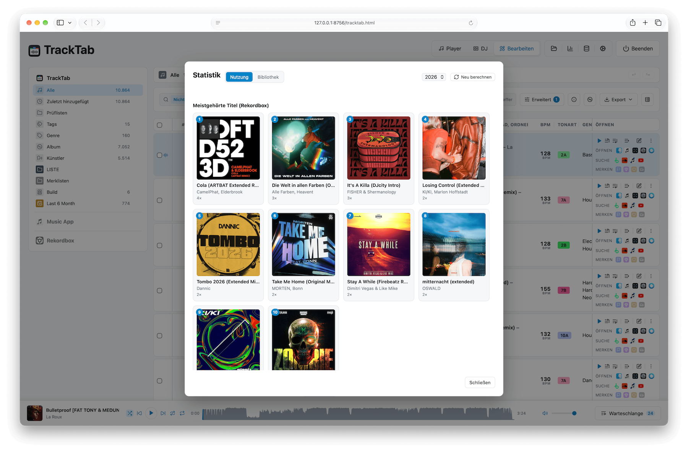


*The statistics dashboard.*

## Genre, album, artist + correction suggestions

In the sidebar there is one list each for genre, album and artist (plus “Duplicates”, see above) — each shows the complete library grouped by the respective value, with its own column view, queue and export like any other list. In the list header a letter index appears: at the top an A–Z bar (digits and special characters under “#”, umlauts under their base letter; letters without entries are grey), below it one section per letter with all values as bubbles including count. A click on a letter jumps directly to the section; an “expand” link below enlarges the area when there are many values. The pencil icon on a bubble or on a group heading in the table opens the same rename dialog and renames the value for ALL affected tracks at once — written into the file tags themselves as well as, where applicable, into the Music.app import and into Rekordbox, so that all three places stay in step. If Rekordbox is running at the moment, taking over there is skipped (the message points this out); the change to file and database happens anyway. For album the artist is also fixed, so that two albums of the same name by different artists are never mixed up by accident.

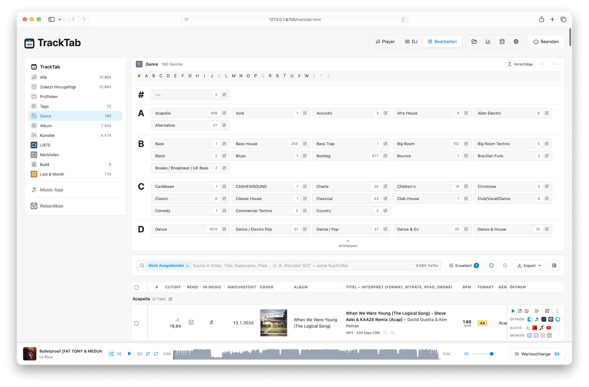
*All genres are shown as bubbles, with the number of affected tracks. With a click on a bubble it is applied as a filter for the list.*

At the top right of the list header, a toggle like Player/DJ/Edit switches between **A–Z** (all values as bubbles), **Suggestions** (with the number of open suggestions) and **Hidden**. The suggestions appear in the same place as the A–Z list: automatically detected, presumably related values (unnecessary space, upper/lower case, possible typo, possible variant like single/remix), each as a card with the reason. A click on a card first shows the affected tracks in the table below (preview, the card is highlighted, “End preview” cancels it). Below each suggestion are the two possible results as buttons (“Merge into …” with track count, invisible white space highlighted in colour): on a card without preview, the first click switches the preview on, only the next one writes the chosen value into all affected files. “Hide” moves a suggestion to “Hidden” (nothing is changed); there “Show again” brings it back.

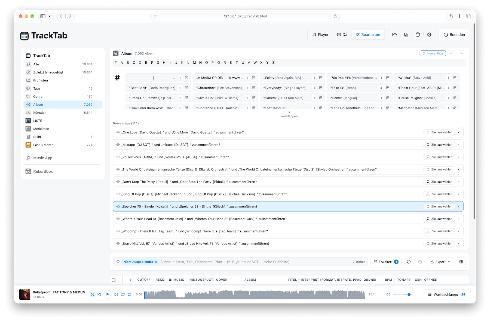
**Suggestions are shown and can be resolved individually.**

## Hiding tracks

The eye icon marks a track as a false alarm — it disappears from the key figures and the export. Via “Show hidden” you bring it back for checking; nothing is lost in the process, the file itself is never touched.

## Deleted and moved files

If you delete a file outside TrackTab, its entry first stays as “File missing”; a button cleans up such entries. If Music.app moves or renames a file by itself after a tag change, TrackTab recognises this automatically and re-links the entry.

## Orphaned folders

A button in the settings finds empty folders in your music folders (e.g. leftovers after deleting tracks in Music.app) and, after a confirmation, moves them to the Trash.

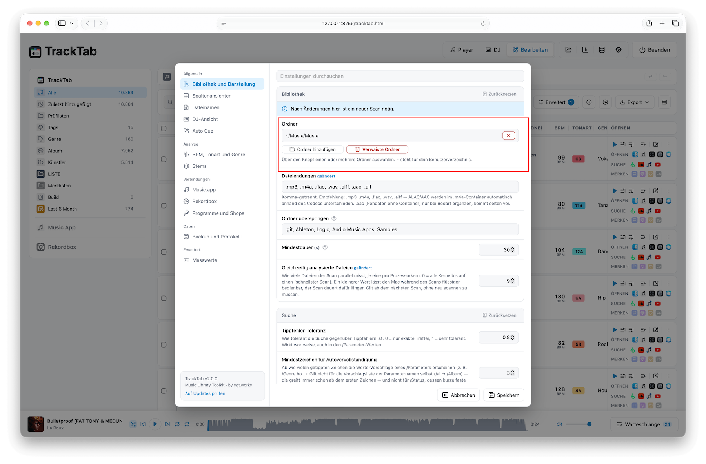
**Deleting orphaned folders.**

## Backup

When TrackTab is quit, a backup of your analysis data is created automatically. The last 10 backups and in addition one per day for 7 days are kept — so even after many sessions on the same day an older state remains. Anything beyond that is removed automatically. Via the settings, a backup can be created manually at any time or an earlier state restored. Only TrackTab’s own analysis data is affected — the backup does not touch your music files.

**If a library folder is not reachable** (external drive not connected), a scan does not clean up the tracks in it. The same applies if an unusually large number of files is missing at once. The tracks stay with the note “File missing”, the scan message names their number. If they really are deleted, you remove them via the button in the yellow notice bar.

**If you replace a file with another version** (same name, e.g. a better quality laid over it in Finder), TrackTab recognises this on the next scan from the audio content. Genre, mood, beat grid and phrases of the old file are then discarded and measured anew on the next analysis run. A pure tag change does not trigger this. Your own edits in the DJ view (cues, grid) stay — check them after a replacement.

**Error log:** TrackTab writes unexpected errors into the file `errors.log` in the log folder (⚙ Settings → Open log folder). The file helps if something does not work and you want to report the error.

> **Still, remember:** TrackTab can edit, rename, re-encode or move your music files to the Trash. Back up your music library regularly and independently of TrackTab, so that an earlier state is always available if in doubt.

---

## Limits

- A low cutoff value can also come from a band-limited master, a vinyl rip or an old recording — TrackTab delivers a review list, not a verdict.
- AAC files: the limits are measured on Apple’s encoder (Music.app/iTunes). A 128 source cannot be reliably told apart from a 160 there, because Apple shifts the low-pass by a good 1 kHz depending on the music. A genuine 256 file from Apple often has no hard edge at all. If a loud file was re-encoded with a tool that converts to 16 bit along the way (e.g. ffmpeg with Apple’s encoder, often libfdk_aac too), overdrive can mask the earlier edge. TrackTab usually does not recognise such cases.
- 224 kbps and 256 kbps cannot be told apart.
- The Trash cannot be emptied from within TrackTab — that is deliberately left to the Finder.
- Playback in the player depends on the browser: AIFF and ALAC only play reliably in Safari (see [Supported file formats](#supported-file-formats)).
- TrackTab passes tag changes on to Music.app when saving (title, artist, album, album artist, composer, genre, year, BPM as a whole number, comment, track number, compilation). Music.app has no field for key and mood. If Music.app moves the file into a new folder while doing so, TrackTab follows the new path. If TrackTab cannot find a track in Music.app, a notice appears and the old tags remain there.
- Online metadata suggestions rarely deliver a BPM.
