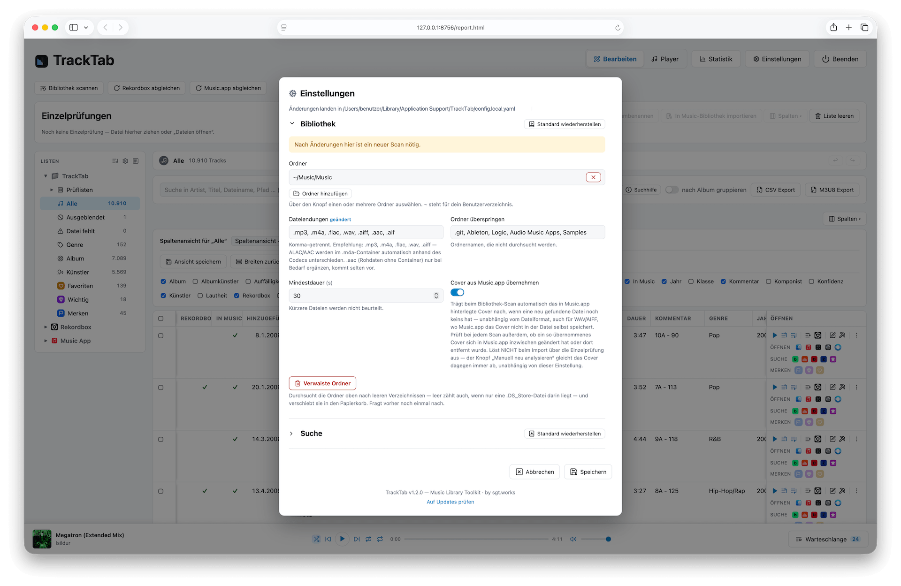
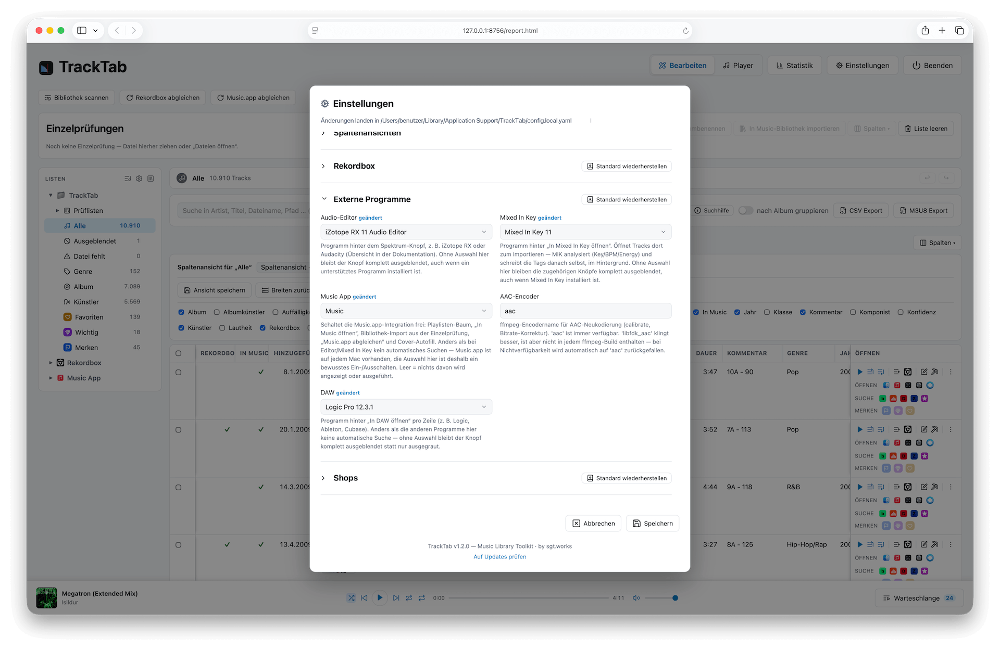
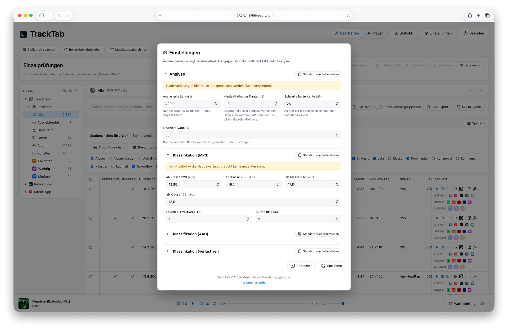
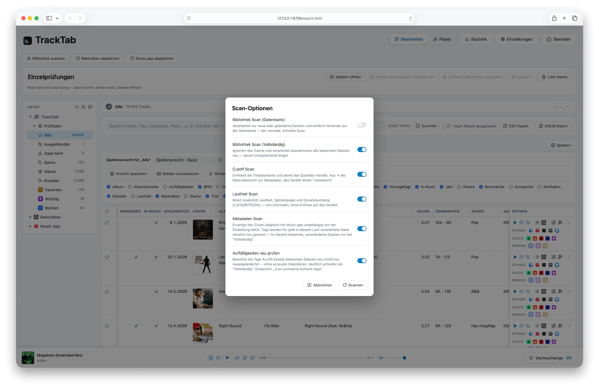

# Quick start

*Deutsche Fassung: [quickstart.de.md](quickstart.de.md)*

The five steps from download to your first checked library. Details on each step are in the [manual](manual.md) and in [installation.md](installation.md).

---

## 1. Install

Choose one of the three ways — the ready-made app is the easiest start, entirely without the terminal:

- **Ready-made app (.dmg)** — [installation.md](installation.md#1-installation-via-dmg-file-macos)
- **Own app build** — [installation.md](installation.md#2-your-own-app-build-compiling-from-source)
- **Terminal** — [installation.md](installation.md#3-running--operating-from-the-terminal)

## 2. Start & settings

On first start the library is still empty. Under the gear icon, open the [settings](manual.md#settings) and set at least:

- **Library** — your music folders (group “Library”).

- **External programs** — if you use Music.app and/or Rekordbox: choose them here so that TrackTab can sync with both and show buttons for them. If you use Music.app, additionally enable there “Keep Music Media folder organized” and “Copy files to Music Media folder when adding to library” (details in the [manual](manual.md#settings)).

## 3. Adjust verdict, loudness etc. or keep the defaults

The analysis thresholds (cutoff/class limits, LUFS reference range) are sensibly calibrated out of the box — to get started it is enough to leave them untouched. If you like, adjust them in the groups **Analysis** and **Loudness**; see [Is the bitrate correct?](manual.md#is-the-bitrate-correct) and [Loudness of tracks](manual.md#loudness-of-tracks). Changes here only take effect after another scan.

## 4. Scan the library

The “Scan library” button analyses all files in the configured music folders that are not yet known or have changed since. Details on the scan options: [Scanning the library](manual.md#scanning-the-library).

## 5. Get going

The result is a review list, not a verdict — after the scan you see the tracks per verdict (OK/Suspicious/Fake/Unclear) in the fixed **Review lists**. From here:

- Listen to conspicuous tracks and judge them — see [Is the bitrate correct?](manual.md#is-the-bitrate-correct) and [Listening with the waveform](manual.md#listening-with-the-waveform).
- [Hide](manual.md#hiding-tracks) false hits or [correct them manually](manual.md#the-button-bar).
- [Re-encode lossy tracks directly to an honest bitrate](manual.md#correcting-the-bitrate).

For everything else (playlists, editing tags, converter, statistics, …) the [manual](manual.md) is the complete reference.
