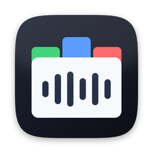
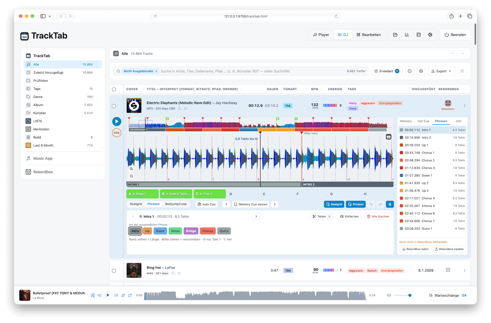
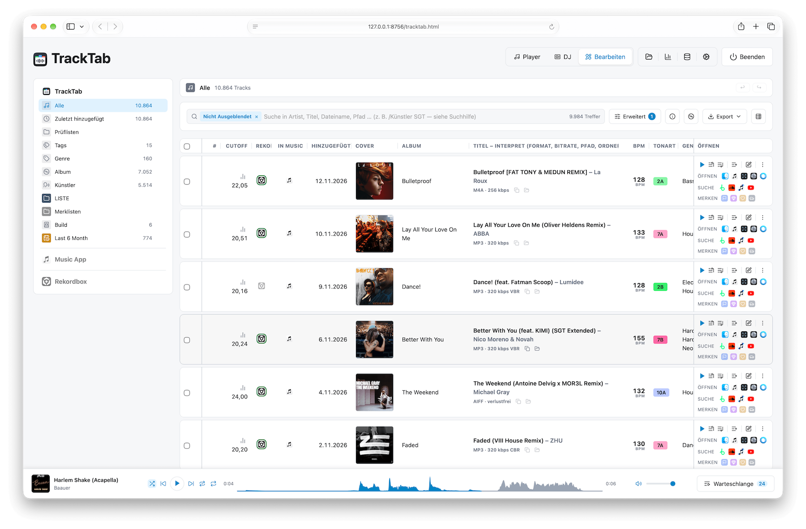
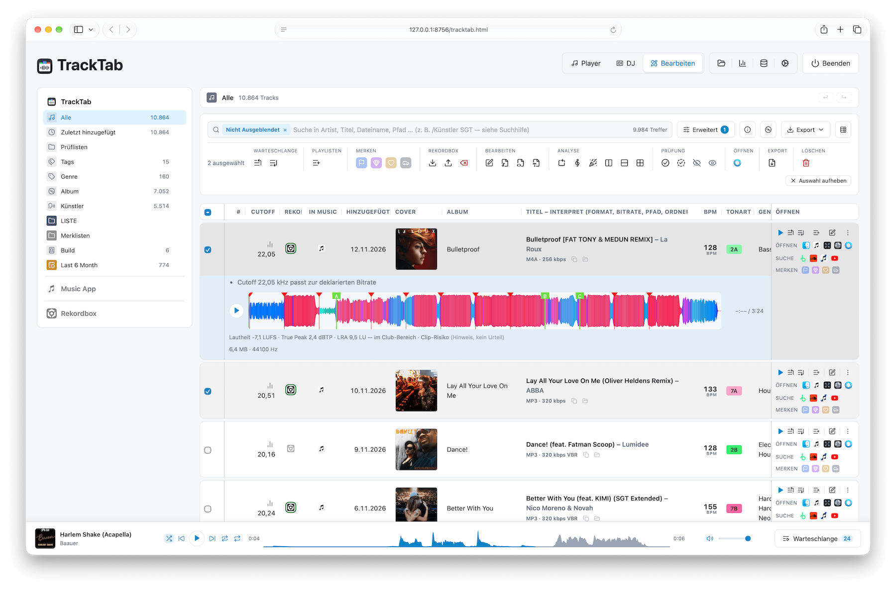
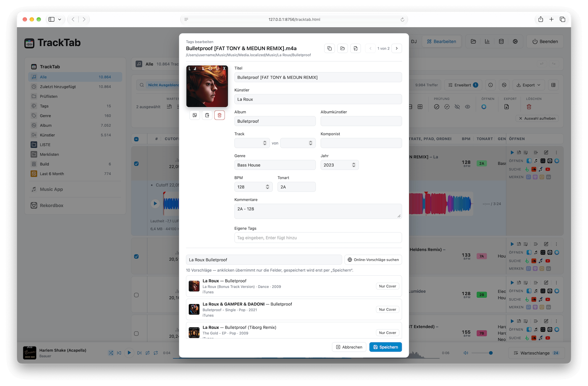
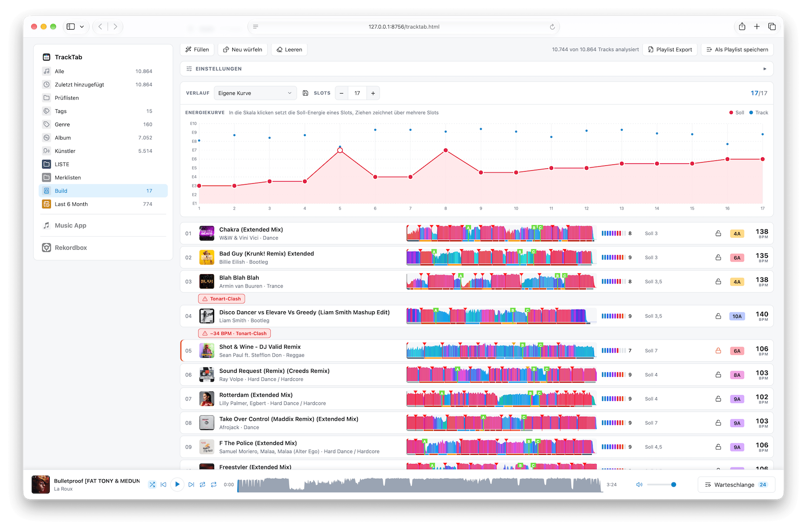

  

<h1 align="center">
  TrackTab — Music Library Toolkit by sgt.works
</h1>

  
  
  
  
  

  <a href="manual.de.md">Dokumentation</a> ·
  <a href="installation.de.md">Installation</a> ·
  <a href="changelog.de.md">Changelog</a>

  <b>Das Tool analysiert und korrigiert Bitraten, bearbeitet ID3-Tags und bietet eine Rekordbox-Anbindung inklusive Auto-Relocate sowie Hot-Cue-Anzeige.  Zudem umfasst es eine DJ-Ansicht mit Beatgrid-, Phrasen- und Cue-Editor samt Auto Cue und Rekordbox-Abgleich, eine lokale Stem-Trennung, einen Playlist-Generator, eine Duplikatsuche, einen MP3-, AAC- und AIFF-Konverter, Merk-, Play- und Smart-Playlists, Statistiken, ein Genre-, Album- und Künstler-Clean-up sowie einen Mediaplayer.</b>

> **Hinweis zur Sprache:** Die Dokumentation wird zweisprachig gepflegt. Diese Datei und das [Handbuch](manual.de.md) sind die deutschen Fassungen; [readme.md](readme.md) und [manual.md](manual.md) sind die englischen (Standard online).

## Warum TrackTab?
Apple Music, ID3-Tag-Editor, Mixed In Key und Rekordbox – die Pflege meiner Musiksammlung glich einem ständigen App-Wechsel. Das Ergebnis: Fehler, verlorene Dateipfade und keine Transparenz darüber, was eigentlich schon in Rekordbox gelandet war.

Deshalb habe ich mit Claude.ai TrackTab entwickelt. TrackTab hat zahlreichen Features um neue Tracks zu analysieren, die Qualität zu prüfen, sauber umzubenennen und die Bibliothek aktuell und ordentlich zu halten.

TrackTab ist flexibel – ob mit oder ohne Apple-Music.app, Rekordbox oder Mixed in Key - kann es jeden Unterstützen der seine Musiksammlung verwalten möchte. 

## Wie funktioniert TrackTab?
TrackTab läuft vollständig auf deinem Rechner im Browser deiner Wahl (vorzugsweise Safari) und benötigt keine Internetverbindung. Es kann sowohl mit als auch ohne die Apple Music App, Rekordbox oder Mixed In Key verwendet werden.
___

## Screenshot

*DJ-Ansicht: Phrasen, Hot und Memory Cues, Beatgrid-Werkzeuge.*

*Übersicht der Bearbeiten-Ansicht mit Prüfliste.*

*Ausgeklappter Track mit Wellenform.*

*Metadaten bearbeiten mit Online-Vorschlägen.*

*Playlist-Generator: Set entlang einer Energiekurve.*

Weitere Screenshots zu allen Funktionen im [Handbuch](manual.de.md).

---

## Funktionen

<b>DJ-Ansicht</b> — Beatgrid, Rampen, Phrasen, Cues, Rekordbox-Abgleich

Eigene Ansicht für TrackTab-, Music- und Rekordbox-Listen: Hot Cues, Memory Cues, lückenlose Loops, Beatgrid (inkl. Tempowechsel und Rampen für Transition-Tracks) und Phrasen bearbeiten, ähnlich wie in Rekordbox. Tempo, Takt und Phrasen (Intro, Up/Verse, Down/Bridge, Chorus, Outro) erkennt TrackTab auch selbst, ohne Rekordbox: mit festem Tempo, mit Tempowechseln oder automatisch, mit Rückgängig und Tastenkürzeln. Speichert in der eigenen Datenbank; Abgleich mit Rekordbox in beide Richtungen auf Knopfdruck, vor dem Schreiben mit Rückfrage und Sicherung. Waveform-Quelle, -Farbe und Metronom-Klang sind einstellbar. Die eigene Erkennung läuft nur auf Apple-Silicon-Macs ab macOS 14; vorhandene Rekordbox-Daten haben auf Wunsch Vorrang.

→ [Details im Handbuch](manual.de.md#dj-ansicht) · [Beatgrid & Phrasen](manual.de.md#beatgrid-und-phrasen) · [Screenshot](docs/031-dj-ansicht.png) · [Screenshot: Rampe](docs/030-dj-ansicht-ramp.png) · [Screenshot: Rekordbox schreiben](docs/034-rekordbox-schreiben.png) · [Screenshot: Einstellungen](docs/040-dj-ansicht-settings.png)

<b>Konverter</b> — MP3 320, AAC 256 oder AIFF, ohne „Hochrechnen“

Wandelt ausgewählte Tracks (auch mehrere gebündelt) nach MP3 320 kbit/s CBR, AAC 256 kbit/s (Apples Encoder) oder AIFF (verlustfrei, Bittiefe der Quelle bleibt erhalten). Verhindert "Hochrechnen": eine bereits verlustbehaftete Datei lässt sich nicht zu AIFF konvertieren, eine MP3 unter 320 kbit/s nicht zu 320 kbit/s hochkodieren — solche Tracks werden übersprungen und am Ende gemeldet. Tags und Cover werden übernommen, die konvertierte Datei wird in der Haupttabelle immer automatisch zu Music.app hinzugefügt (unabhängig davon, ob das Original dort schon war — in der Einzelprüfung nicht). Ein Schalter im Popup bestimmt, ob das Original danach in den Papierkorb wandert und dabei in Music.app/Rekordbox ersetzt wird (Standard), oder ob es unangetastet liegen bleibt und die konvertierte Datei stattdessen als eigener, zusätzlicher Track zur Bibliothek hinzukommt.

→ [Details im Handbuch](manual.de.md#konverter-mp3-aac-aiff) · [Screenshot](docs/011-konverter.png)

<b>Metadaten bearbeiten</b> — Tags und Cover in der Datei, mit Online-Vorschlägen

Titel, Interpret, Album, Albumkünstler, Komponist, Genre, Jahr, BPM, Tonart, Kommentar und Cover lassen sich direkt in der Audiodatei bearbeiten. Die Tonart erscheint als Spalte in den Farben des Camelot-Rads (Schreibweise wählbar: Camelot, Open Key oder Notennamen).

Über einen Klick können anhand des Dateinamens passende Online-Vorschläge von iTunes, Deezer und MusicBrainz abgerufen und übernommen werden. Alternativ ist auch eine manuelle Suche möglich.

Die Änderungen werden direkt in die Datei geschrieben und anschließend mit der Music.app-Mediathek synchronisiert.

→ [Details im Handbuch](manual.de.md#tags-bearbeiten) · [Screenshot](docs/006-metadaten-edit.png) · [Screenshot: Genre-Vorschläge](docs/027-genre-vorschlag.png)

<b>Metadaten-Mehrfachbearbeitung</b> — viele Tracks auf einmal taggen

Mehrere Tracks auf einmal taggen (analog zur Funktionsweise der Music.app).

→ [Details im Handbuch](manual.de.md#tags-bearbeiten)

<b>Auffälligkeiten (Metadaten-Probleme)</b> — kaputte Tags finden und per Quick Fix beheben

Eigene, vom Qualitäts-Verdikt unabhängige Prüfung auf beschädigte/unsaubere Tags — z. B. Steuerzeichen im Interpreten-Feld, alte ID3-Versionen, unaufgelöste Genre-Codes, fehlendes Cover oder kaputte Umlaute. Eindeutig sichere Fälle lassen sich per „Quick Fix" auf Knopfdruck beheben (einzeln, für alle Dateien mit demselben Fehler auf einmal, oder als eigene Spalte), uneindeutige Fälle springen direkt in den Tags-Dialog.

→ [Details im Handbuch](manual.de.md#auffälligkeiten-metadaten-probleme)

<b>BPM- & Tonart-Analyse</b> — Tempo und Tonart lokal messen

Misst Tempo und Tonart direkt aus dem Audio (lokal, ohne Mixed In Key) und schreibt sie nach einstellbaren Regeln in BPM-Feld, Tonart-Feld und Kommentar. Für markierte Tracks der Bibliothek und der Einzelprüfungen, auf Wunsch automatisch für neue Einzelprüfungen. Nur auf Apple-Silicon-Macs.

→ [Details im Handbuch](manual.de.md#tonart) · [Screenshot: Einstellungen](docs/041-genre-tonart-bpm-settings.png)

<b>Genre, Stimmung & Energie</b> — Stil, Stimmung und Energie lokal erkennen

Erkennt den Stil eines Tracks (400 Discogs-Stile, z. B. „Electro House 69 %“), seine Stimmung (aggressiv, fröhlich, Party, entspannt, traurig plus DJ-Stimmungen wie energiegeladen, deep, düster, melodisch) und eine Energie von 1–10 — lokal mit den [Essentia-Modellen](https://essentia.upf.edu/models.html) der MTG, ohne Upload. Genre-Vorschläge erscheinen im Tags-Dialog zum Übernehmen per Klick, Energie und Stimmung als eigene Spalten. Auf Wunsch landen Energie (im Kommentar) und Stimmung (Mood-Tag) auch in der Datei. Nur auf Apple-Silicon-Macs ab macOS 14; Modelle unter CC BY-NC-SA 4.0 (nicht-kommerziell).

→ [Details im Handbuch](manual.de.md#genre-stimmung-und-energie) · [Screenshot: Genre-Vorschläge](docs/027-genre-vorschlag.png)

<b>Auto Cue</b> — Cues automatisch setzen, gelernt aus deinen eigenen

Setzt Hot und Memory Cues eines Tracks selbst (Break 1, Build, Drop, Intro, Outro u. a.) auf Basis von Beatgrid und Phrasen. Das Modell lernt aus deinen eigenen, von Hand gesetzten Cues — du trainierst es in den Einstellungen oder importierst eines. Die Slot-Belegung (welche Stelle auf welchen Hot Cue mit welcher Farbe) legst du selbst fest.

→ [Details im Handbuch](manual.de.md#auto-cue) · [Screenshot: Modelle & Training](docs/032-dj-autocue-model.png) · [Screenshot: Slot-Belegung](docs/033-dj-autocue-setting.png)

<b>Duplikate finden</b> — doppelte Tracks per Hash oder Interpret + Titel + Dauer

Identifiziert doppelte Tracks anhand des gleichen Datei-Hashes oder der Kombination aus *Interpret + Titel + Dauer* (z. B. derselbe Song einmal als MP3 und einmal als FLAC).

→ [Details im Handbuch](manual.de.md#die-seitenleiste) · [Screenshot](docs/014-duplikate.png)

<b>Playlist-Generator</b> — Sets entlang einer Energiekurve bauen

Baut ein Set entlang einer ziehbaren Energiekurve. Dazu kommen Stimmungsregler (Düster, Deep, Groovy, Melodisch …), Übergangsregeln für BPM (±0/±3, halbes/doppeltes Tempo) und Tonart (Camelot locker/streng) sowie ein Liederpool, der wie die Suche funktioniert (z. B. `/Genre House /BPM 120-128 /Add 30d`, auch als Eingabefelder über „Erweitert“), plus Quell-Playlist. Gesperrte Slots bleiben beim Neu-Würfeln stehen. Das Ergebnis ist eine echte Playlist (M3U-Export, Ziehen auf andere Listen). Braucht die Genre-/Stimmungsanalyse.

→ [Details im Handbuch](manual.de.md#playlist-generator) · [Screenshot: Einstellungen](docs/036-playlist-builder.png) · [Screenshot: Ergebnis](docs/037-playlist-builder-output.png)

<b>Globale Suche & Kategorien</b> — tippfehlertolerante Suche mit Parametern und Filtern

Durchsucht die gesamte Bibliothek mit gezielter Eingrenzung über Kategorien und Filter. Über „Erweitert“ stehen alle Suchparameter auch als Eingabefelder bereit.

→ [Details im Handbuch](manual.de.md#suchen-und-filtern) · [Screenshot](docs/016-suchparameter.png) · [Screenshot: Erweitert](docs/016-2-erweiterte-suche.png)

<b>Smart Playlists</b> — regelbasierte Listen wie in Apple Music

Regelbasierte Listen nach dem Vorbild von Apple Music: „entspricht allen/beliebigen" Regeln über Status, Format, Cutoff, BPM, Tonart, Jahr, Lautheit, Dateigröße, Music.app- und Rekordbox-Präsenz und mehr, mit Begrenzung auf Anzahl, Spielzeit oder Speichergröße. Berechnet beim Start und beim Anklicken der Liste, mit Live-Vorschau im Regel-Editor.

→ [Details im Handbuch](manual.de.md#smart-playlists) · [Screenshot](docs/007-playlist-smart-regeln.png)

<b>Bitraten Analyse</b> — Fake-Transcodes per Cutoff-Analyse aufdecken

Spektrale Cutoff-Analyse (MP3, M4A, FLAC, WAV, AIFF). Diese deckt hochgerechnete/transcodierte Dateien auf. Ein Spektrogramm mit Cutoff-Linie zeigt die Grenze auf einen Klick. Analyseergebnisse sind filterbar nach **Fake**, **Verdächtig**, **Korrekt** 

Direktes Umkodieren auf die gemessene Bitrate oder manuelles eingeben der gewünschten Bitrate möglich

*Wichtig: Das Ergebnis ist eine Prüfliste, kein Urteil. Ein niedriger Cutoff kann auch von einem bandbegrenzten Master, einem Vinyl-Rip oder einer alten Aufnahme stammen.*

→ [Details im Handbuch](manual.de.md#ist-die-bitrate-korrekt) · [Screenshot: Prüfliste](docs/009-pruefliste-tracks.png) · [Screenshot: Bitrate korrigieren](docs/018-bitrate-korrigieren.png) · [Screenshot: Spektrogramm](docs/042-pruefliste-spectrum.png)

<b>Apple Music / iTunes</b> — zeigt, was schon in Music.app liegt

Zeigt pro Track an, ob er bereits in der Music.app-Bibliothek geführt wird.

<b>Rekordbox</b> — zeigt, was schon in Rekordbox liegt

Zeigt pro Track an, ob er bereits in der [Rekordbox](https://rekordbox.com/de/)-Bibliothek vorhanden ist. Ein eigener Abgleich („Rekordbox abgleichen") aktualisiert dieses Zeichen und findet verschobene Dateien wieder.

→ [Details im Handbuch](manual.de.md#bibliothek-scannen) · [Screenshot](docs/010-rekordbox-scan.png)

<b>Waveform zum Anhören</b> — farbige Wellenform mit Hot Cues

Stellt die Waveform der Datei an. Enthält Hot- und Memory-Cues aus Rekordbox (falls vorhanden), und zeigt die Waveform selbst farbig (RGB oder 3-Band, einstellbar) statt grau, wenn der Track in Rekordbox analysiert ist.

Zifferntasten **1–8** springen zu Hot Cue A–H. In Bearbeiten und Player werden Cues nur angezeigt; bearbeiten lassen sie sich in der DJ-Ansicht.

→ [Details im Handbuch](manual.de.md#anhören-mit-wellenform) · [Screenshot](docs/005-waveform.png)

<b>Stems (Acapella & Instrumental)</b> — Gesang und Begleitung lokal trennen

Trennt einen Track lokal in Gesang und Begleitung (Demucs, ohne Upload). Erst nach einer Hörprobe und deiner Freigabe wird gespeichert: Tags und Cover vom Haupttrack, Titel-Zusatz und Genre „Acapella“/„Instrumental“, danach Eintrag in TrackTab, Music und — mit Beatgrid des Haupttracks — Rekordbox. Nur auf Apple-Silicon-Macs. Das Modell (Gewichte nur für wissenschaftliche/nicht-kommerzielle Nutzung) ist nicht Teil der App und wird in den Einstellungen einmalig geladen.

→ [Details im Handbuch](manual.de.md#stems-erzeugen-acapella--instrumental) · [Screenshot: Einstellungen](docs/035-settings-stems.png) · [Screenshot: Dialog](docs/038-stem-generieren.png) · [Screenshot: Hörprobe](docs/039-stem-speichern.png)

<b>Dateien automatisch umbenennen</b> — einheitliche Dateinamen nach eigenem Muster

Baut aus den Metadaten einen einheitlichen Dateinamen nach frei konfigurierbarem Muster (Vorgabe `{artist}_{title}_{bpm}_{key}_{bitrate}_{year}` → `daft-punk_get-lucky_116bpm_8a_320kbps_2013.mp3`). Unterstrich trennt die Kategorien, Bindestrich die Wörter darin; ein Platzhalter ohne Wert lässt seine Kategorie ersatzlos entfallen — bei verlustfreien Formaten also die Bitrate.

Gedacht für frisch gekaufte Tracks: In den Einzelprüfungen wird nur umbenannt, was noch **nicht** in einem der Bibliotheksordner liegt. Bibliothekstracks benennst du über das Zeilenmenü oder die Sammelleiste um; TrackTab zieht dabei Music.app und Rekordbox nach. Die Zuordnung in TrackTab wird sofort mitgezogen, die Tracks bleiben also ohne Umweg weiter bearbeitbar.

→ [Details im Handbuch](manual.de.md#dateien-automatisch-umbenennen)

<b>Schnellzugriff per Icon</b> — Programme und Shops je Track mit einem Klick

Schnellaktionen lassen sich in den Einstellungen individuell festlegen. Die hinterlegten Programme werden anschließend mit ihrem jeweiligen Icon bei jedem Track angezeigt:

- In [Mixed In Key](https://mixedinkey.com/) öffnen
- Im [Audio-Editor öffnen](technical_functions.de.md#im-audio-editor-öffnen) (z. B. [iZotope RX](https://www.izotope.com/products/rx-advanced), [Audacity](https://www.audacityteam.org/) )
- In der eingestellten DAW öffnen (z. B. [Logic](https://www.apple.com/de/logic-pro/), [Abelton](https://www.ableton.com/de/) – nur sichtbar, wenn konfiguriert)
- Der ausgewählte Track wird direkt auf den hinterlegten Plattformen gesucht, jede Suchseite mit ihrem Favicon als Icon. Standardmäßig stehen Beatport, SoundCloud, DJ City und Zip DJ zur Verfügung. Weitere Plattformen können jederzeit in den Einstellungen hinzugefügt werden.

→ [Details im Handbuch](manual.de.md#die-buttonleiste)

<b>Playlisten & Ordner</b> — eigene Playlisten und verschachtelte Ordner

Seitenleiste mit Listen-Baum, in der Breite verstellbar und in beiden Ansichten gleich. Eigene Playlisten und verschachtelte Ordner, Tracks per Drag & Drop oder über einen Auswahldialog hinein, freie Reihenfolge per Ziehen, Rückgängig/Wiederherstellen je Playlist (auch Cmd+Z), Duplizieren, Warteschlange und M3U8-Export je Liste.

→ [Details im Handbuch](manual.de.md#playlisten-und-ordner) · [Screenshot](docs/015-neue-plalist.png)

<b>Status-Listen</b> — feste Listen je Prüfstatus

Für jeden Status (Korrekt, Verdächtig, Fake, Unklar, Manuell korrigiert) bringt TrackTab eine feste, schreibgeschützte Liste im Ordner „Prüflisten" mit. Innerhalb jeder beliebigen Liste lässt sich der Status zusätzlich über den Suchparameter `/Status` eingrenzen.

→ [Details im Handbuch](manual.de.md#die-seitenleiste)

<b>Fremde Playlisten lesen</b> — Music.app- und Rekordbox-Playlisten im selben Baum

Playlisten-Bäume aus Music.app und Rekordbox werden im selben Baum angezeigt (schreibgeschützt, Ordner und Smart Playlists inklusive). Tracks, zu denen TrackTab keine Datei hat — Apple-Music-Cloud-Titel oder Dateien außerhalb der gescannten Ordner — stehen an ihrer Stelle in der Liste und sind als solche gekennzeichnet.

→ [Details im Handbuch](manual.de.md#fremde-playlisten) · [Screenshot](docs/021-playlisten-baum.png)

<b>Merken</b> — farbige Merklisten zum Kennzeichnen

Bis zu 4 eigene Playlisten lassen sich als Merkliste markieren (z. B. „Neu kaufen“, „Im Warenkorb“, "Zu Bearbeiten") zum Kennzeichnen von Tracks. Ein Track kann gleichzeitig in mehreren Merklisten stehen – unabhängig von Status wie *Ausgeblendet* oder *Manuell korrigiert*.

→ [Details im Handbuch](manual.de.md#playlisten-merken)

<b>Ansichten: Bearbeiten & Player</b> — Bearbeiten, Player und Mediaplayer

Umschaltbar zwischen der vollständigen Bearbeiten-Ansicht und einer reduzierten Player-Ansicht fürs reine Anhören. Der Listen-Baum bleibt in beiden Ansichten vollständig bedienbar und behält seine Auswahl. Ein fixer Mediaplayer (Play/Pause, Vor/Zurück, Zufallswiedergabe, Titel-/Listen-Wiederholung, Warteschlange per Drag & Drop) läuft ansichtsübergreifend weiter, inklusive Wellenform-Anzeige mit Hot-Cue-Sprüngen in der Bearbeiten-Ansicht. Spalteneinstellungen werden je Ansicht getrennt gespeichert.

→ [Details im Handbuch](manual.de.md#ansichten-bearbeiten-player-und-dj) · [Screenshot: Player-Ansicht](docs/001-player-view.png) · [Screenshot: Warteschlange](docs/012-warteschlange.png)

<b>Spaltenansichten</b> — Spalten unter eigenen Namen speichern

Sichtbare Spalten, ihre Reihenfolge und ihre Breite lassen sich unter eigenen Namen speichern und einzelnen Listen zuordnen — jeder Playlist, aber auch „Alle", „Ausgeblendet", den Prüflisten oder den Merklisten. Alle übrigen Listen nutzen den Standard der jeweiligen Ansicht („Standard – Bearbeiten“ bzw. „Standard – Player“).

→ [Details im Handbuch](manual.de.md#spalten-anpassen)

<b>Deutsch & Englisch</b> — zwei Sprachen, automatisch oder fest

Die Oberfläche ist auf Deutsch und Englisch verfügbar. Die Sprache lässt sich in den Einstellungen unter „Darstellung" fest wählen oder auf „Automatisch" stellen – dann folgt TrackTab der Spracheinstellung deines Browsers. Ist diese weder Deutsch noch Englisch, wird Deutsch angezeigt.

→ [Details im Handbuch](manual.de.md#einstellungen)

<b>Playlists exportieren</b> — CSV und M3U8

Export in den Formaten **CSV** und **M3U8** aus ganzen Listen, Filterungen oder einzelnen Tracks — sowie je Playlist über deren Menü.

→ [Details im Handbuch](manual.de.md#playlisten-und-ordner)

<b>Verwaiste Ordner finden & löschen</b> — leere Verzeichnisse aufräumen

Durchsucht die konfigurierte Bibliotheksordner nach leeren Verzeichnissen (zählt auch als leer, wenn nur eine `.DS_Store`-Datei vorhanden ist) und verschiebt diese nach Rückfrage in den Papierkorb.

→ [Details im Handbuch](manual.de.md#verwaiste-ordner)

<b>Backup</b> — automatische Sicherungen

Nach jedem Beenden des Tools wird automatisch ein Backup der Bibliothek in einem separaten Ordner erstellt. Aufbewahrt werden die letzten 10 Backups und zusätzlich je eines pro Tag für 7 Tage; ältere werden automatisch entfernt.

Vor jedem Schreibvorgang in die Rekordbox-Bibliothek wird zusätzlich geprüft, ob Rekordbox geöffnet ist. Ist die Anwendung geschlossen, wird vor dem Schreibvorgang automatisch ein weiteres Backup erstellt. Auch hierbei wird die Anzahl der Backups auf 10 Dateien begrenzt.

→ [Details im Handbuch](manual.de.md#backup)

<b>Log</b> — jede Bearbeitung protokolliert

Protokolliert jede durchgeführte Bearbeitung lückenlos in einer Log-Datei pro Tag.

<b>Statistik</b> — Nutzung und Bibliothek in Zahlen

Jahres-/Monats-Auswertung aus dem Log und der tatsächlichen Hörzeit: Aktionen pro Monat, Gesamt-Wiedergabezeit sowie meistgehörte Titel, Interpreten und Genres. Aus den meistgehörten Titeln lässt sich direkt eine Playlist mit den Top 50 eines Jahres erstellen.

→ [Details im Handbuch](manual.de.md#statistik) · [Screenshot: Nutzung](docs/013-statistik.png) · [Screenshot: Bibliothek](docs/013-1-statistik-bib.png) · [Screenshot: Rekordbox](docs/020-statistik-rekordbox.png)

<b>Aufräumen</b> — Genre, Album und Künstler vereinheitlichen

Eigener Seitenleisten-Ordner mit Listen für Genre, Album und Künstler, gruppiert nach dem jeweiligen Wert, samt Bubble-Übersicht und automatischen Zusammenführungs-Vorschlägen (Leerzeichen, Groß-/Kleinschreibung, Tippfehler, Varianten). Ein Wert lässt sich für alle betroffenen Tracks auf einmal umbenennen — geschrieben wird in die Datei-Tags sowie, sofern zutreffend, in Music.app und Rekordbox, damit alle drei Orte im Gleichschritt bleiben.

→ [Details im Handbuch](manual.de.md#genre-album-künstler--korrekturvorschläge)

---

## Weiterführende Dokumentation

- **QuickStart** (So startest du in nur 5 Schritten): [quickstart.de.md](quickstart.de.md)
- **Handbuch** (reine Bedienungsanleitung ohne technische Details): [manual.de.md](manual.de.md) · Englisch: [manual.md](manual.md)
- **Installation** (fertige App, eigener Build, Terminal): [installation.de.md](installation.de.md)
- **Technische Funktionen** (Referenz für Weiterentwicklung: Algorithmen, Formeln, Architektur): [technical_functions.de.md](technical_functions.de.md)
- **Änderungshistorie**: [changelog.de.md](changelog.de.md)
- **Aktuelles Release** (Download der `.dmg`): [GitHub Releases](https://github.com/sebssch/TrackTab/releases/latest)

## Unterstützen

Dieses Projekt hat unzählige Arbeitsstunden und eine jede Menge an Tokens (Claude.ai) verschlungen.

Gefällt dir TrackTab? Dann würde ich mich über eine kleine Spende freuen: [paypal.me/SGabler](https://paypal.me/SGabler)

## Lizenz

GPL-3.0-oder-später — siehe [LICENSE](LICENSE) und [NOTICE.md](NOTICE.md). © 2026 Sebastian Gabler (sgt.works). Software und Modelle Dritter stehen unter eigenen Lizenzen ([THIRD_PARTY_LICENSES.md](THIRD_PARTY_LICENSES.md), Texte in [licenses/](licenses/)); die Modelle für Stem-Trennung (Demucs) und Genre/Stimmung (Essentia) sind nur nicht-kommerziell nutzbar.

Die Icons der Web-UI stammen aus dem [Lucide](https://lucide.dev/icons/)-Set (ISC-Lizenz), lokal
vendort in `app/webui/lucide-icons.js`.
