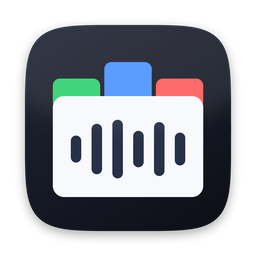
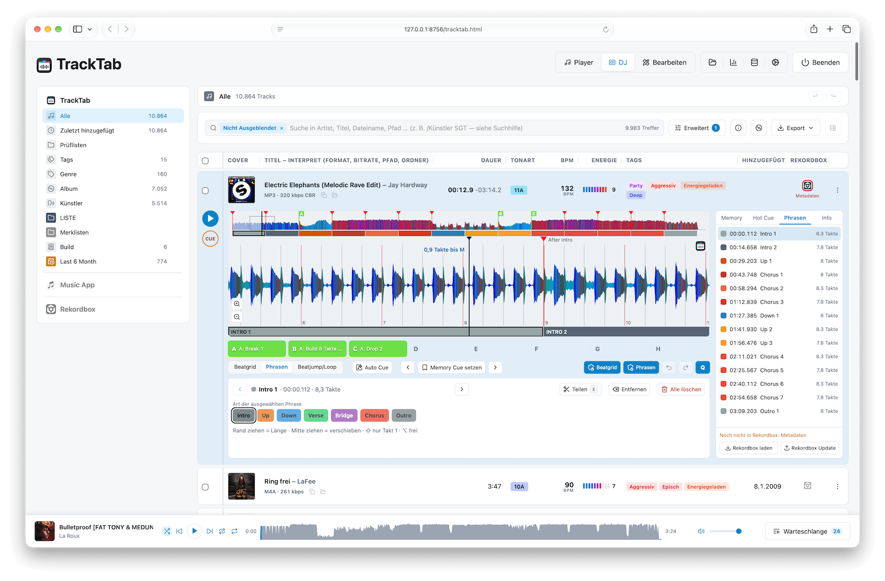
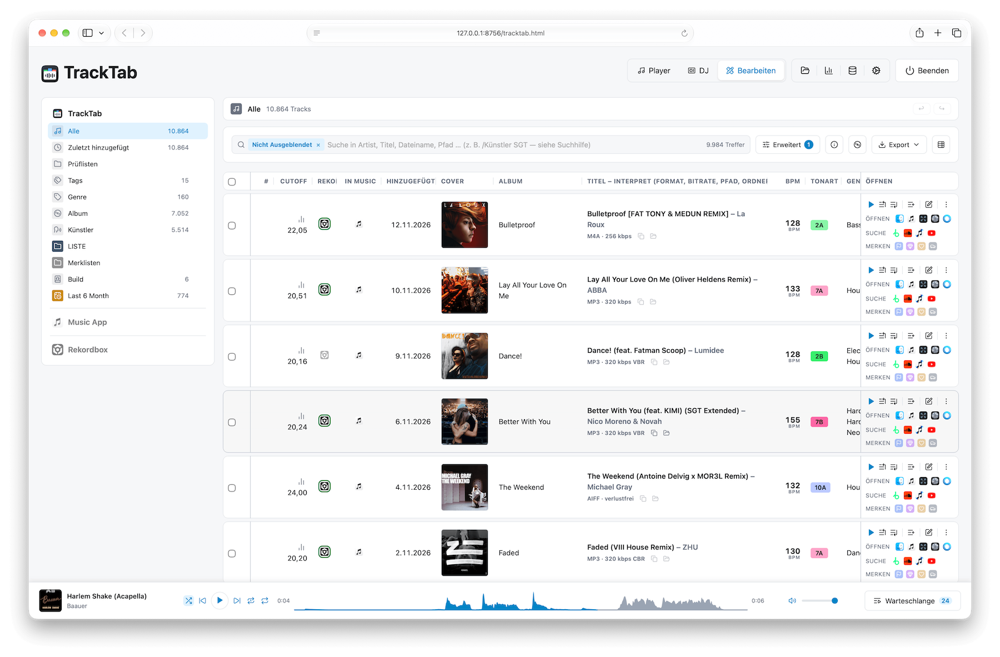
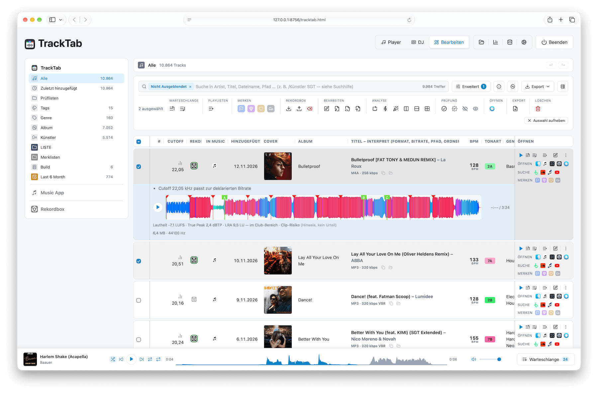
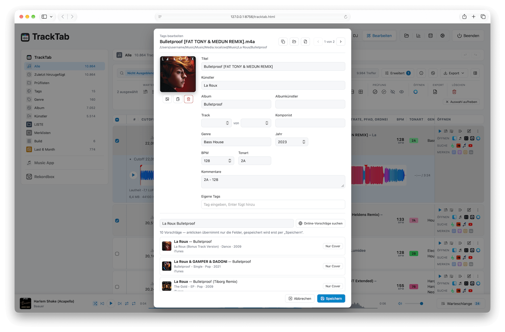
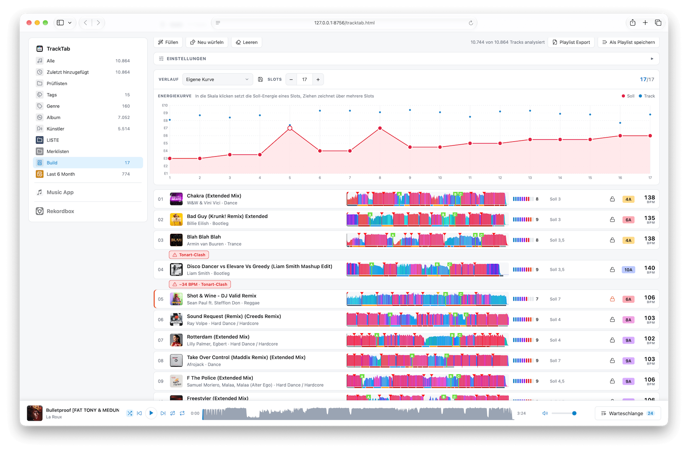

  

<h1 align="center">
  TrackTab — Music Library Toolkit by sgt.works
</h1>

  
  
  
  
  

  <a href="manual.md">Manual</a> ·
  <a href="installation.md">Installation</a> ·
  <a href="changelog.md">Changelog</a>

  <b>The tool analyses and corrects bitrates, edits ID3 tags and offers a Rekordbox integration including auto-relocate and hot-cue display. It also includes a DJ view with beat grid, phrase and cue editor plus Auto Cue and Rekordbox sync, local stem separation, a playlist generator, duplicate finder, an MP3, AAC and AIFF converter, favorite, normal and smart playlists, statistics, a genre, album and artist clean-up, and a media player.</b>

> **Language note:** The documentation is kept in two languages. This README and the [manual](manual.md) are the English versions (default); [readme.de.md](readme.de.md) and [manual.de.md](manual.de.md) are the German versions. All documents exist in both languages: `*.md` is English, `*.de.md` is German (e.g. [installation.md](installation.md) / [installation.de.md](installation.de.md), [changelog.md](changelog.md) / [changelog.de.md](changelog.de.md)). Only the [technical reference](technical_functions.de.md) is currently German only.

## Why TrackTab?
Apple Music, an ID3 tag editor, Mixed In Key and Rekordbox – maintaining my music collection felt like constantly switching between apps. The result: mistakes, lost file paths and no transparency about what had actually already made it into Rekordbox.

That is why I built TrackTab with Claude.ai. TrackTab has numerous features to analyse new tracks, check their quality, rename them cleanly and keep the library up to date and tidy.

TrackTab is flexible – with or without the Apple Music app, Rekordbox or Mixed In Key – it can support anyone who wants to manage their music collection.

## How does TrackTab work?
TrackTab runs entirely on your computer in the browser of your choice (preferably Safari) and needs no internet connection. It can be used with or without the Apple Music app, Rekordbox or Mixed In Key.
___

## Screenshots

*DJ view: phrases, hot and memory cues, beat grid tools.*

*Overview of the Edit view with review list.*

*Expanded track with waveform.*

*Editing metadata with online suggestions.*

*Playlist generator: a set along an energy curve.*

More screenshots of all functions in the [manual](manual.md).

---

## Features

<b>DJ view</b> — beat grid, ramps, phrases, cues, Rekordbox sync

A view of its own for TrackTab, Music and Rekordbox lists: edit hot cues, memory cues, gapless loops, beat grid (including tempo changes and ramps for transition tracks) and phrases, similar to Rekordbox. TrackTab also detects tempo, bars and phrases (Intro, Up/Verse, Down/Bridge, Chorus, Outro) itself, without Rekordbox: with a fixed tempo, with tempo changes or automatically, with undo and keyboard shortcuts. Saves to its own database; sync with Rekordbox in both directions at the push of a button, with confirmation and backup before writing. Waveform source, colour and metronome sound are adjustable. The own detection only runs on Apple Silicon Macs from macOS 14; existing Rekordbox data takes precedence on request.

→ [Details in the manual](manual.md#dj-view) · [Beat grid & phrases](manual.md#beat-grid-and-phrases) · [Screenshot](docs/031-dj-ansicht.png) · [Screenshot: ramp](docs/030-dj-ansicht-ramp.png) · [Screenshot: writing to Rekordbox](docs/034-rekordbox-schreiben.png) · [Screenshot: settings](docs/040-dj-ansicht-settings.png)

<b>Converter</b> — MP3 320, AAC 256 or AIFF, without “upscaling”

Converts selected tracks (also several at once) to MP3 320 kbit/s CBR, AAC 256 kbit/s (Apple’s encoder) or AIFF (lossless, bit depth of the source is kept). Prevents “upscaling”: an already lossy file cannot be converted to AIFF, an MP3 below 320 kbit/s cannot be re-encoded up to 320 kbit/s — such tracks are skipped and reported at the end. Tags and cover are carried over, the converted file is always automatically added to Music.app in the main table (regardless of whether the original was already there — not in the single check). A switch in the popup determines whether the original then goes to the Trash and is replaced in Music.app/Rekordbox (default), or stays untouched and the converted file is added to the library as a separate, additional track.

→ [Details in the manual](manual.md#converter-mp3-aac-aiff) · [Screenshot](docs/011-konverter.png)

<b>Edit metadata</b> — tags and cover in the file, with online suggestions

Title, artist, album, album artist, composer, genre, year, BPM, key, comment and cover can be edited directly in the audio file. The key appears as a column in the colours of the Camelot wheel (notation selectable: Camelot, Open Key or note names).

With one click, matching online suggestions from iTunes, Deezer and MusicBrainz can be fetched based on the file name and applied. Alternatively, a manual search is possible too.

Changes are written directly to the file and then synchronised with the Music.app library.

→ [Details in the manual](manual.md#editing-tags) · [Screenshot](docs/006-metadaten-edit.png) · [Screenshot: genre suggestions](docs/027-genre-vorschlag.png)

<b>Multi-edit metadata</b> — tag many tracks at once

Tag several tracks at once (similar to how Music.app works).

→ [Details in the manual](manual.md#editing-tags)

<b>Issues (metadata problems)</b> — find broken tags and fix them with Quick Fix

A check of its own, independent of the quality verdict, for damaged/untidy tags — e.g. control characters in the artist field, old ID3 versions, unresolved genre codes, missing cover or broken umlauts. Unambiguously safe cases can be fixed at the push of a button with “Quick Fix” (individually, for all files with the same error at once, or as a column of its own); ambiguous cases jump straight into the tags dialog.

→ [Details in the manual](manual.md#issues-metadata-problems)

<b>BPM & key analysis</b> — measure tempo and key locally

Measures tempo and key directly from the audio (locally, without Mixed In Key) and writes them according to adjustable rules into the BPM field, key field and comment. For selected tracks of the library and of the single checks, automatically for new single checks if desired. Apple Silicon Macs only.

→ [Details in the manual](manual.md#key) · [Screenshot: settings](docs/041-genre-tonart-bpm-settings.png)

<b>Genre, mood & energy</b> — detect style, mood and energy locally

Detects a track’s style (400 Discogs styles, e.g. “Electro House 69 %”), its mood (aggressive, happy, party, relaxed, sad plus DJ moods such as energetic, deep, dark, melodic) and an energy of 1–10 — locally with the [Essentia models](https://essentia.upf.edu/models.html) of the MTG, without upload. Genre suggestions appear in the tags dialog to apply with one click, energy and mood as columns of their own. If you wish, energy (in the comment) and mood (mood tag) are also written to the file. Apple Silicon Macs from macOS 14 only; models under CC BY-NC-SA 4.0 (non-commercial).

→ [Details in the manual](manual.md#genre-mood-and-energy) · [Screenshot: genre suggestions](docs/027-genre-vorschlag.png)

<b>Auto Cue</b> — set cues automatically, learned from your own

Sets a track’s hot and memory cues itself (Break 1, Build, Drop, Intro, Outro and others) based on beat grid and phrases. The model learns from your own cues set by hand — you train it in the settings or import one. The slot assignment (which spot on which hot cue with which colour) is yours to define.

→ [Details in the manual](manual.md#auto-cue) · [Screenshot: models & training](docs/032-dj-autocue-model.png) · [Screenshot: slot assignment](docs/033-dj-autocue-setting.png)

<b>Find duplicates</b> — duplicate tracks by hash or artist + title + duration

Identifies duplicate tracks by the same file hash or the combination of *artist + title + duration* (e.g. the same song once as MP3 and once as FLAC).

→ [Details in the manual](manual.md#the-sidebar) · [Screenshot](docs/014-duplikate.png)

<b>Playlist generator</b> — build sets along an energy curve

Builds a set along a draggable energy curve. In addition there are mood dials (Dark, Deep, Groovy, Melodic …), transition rules for BPM (±0/±3, half/double tempo) and key (Camelot loose/strict) and a track pool that works like the search (e.g. `/Genre House /BPM 120-128 /Add 30d`, also as input fields via “Advanced”), plus a source playlist. Locked slots stay in place on re-roll. The result is a real playlist (M3U export, drag onto other lists). Needs the genre/mood analysis.

→ [Details in the manual](manual.md#playlist-generator) · [Screenshot: settings](docs/036-playlist-builder.png) · [Screenshot: result](docs/037-playlist-builder-output.png)

<b>Global search & categories</b> — typo-tolerant search with parameters and filters

Searches the whole library with targeted narrowing via categories and filters. Via “Advanced” all search parameters are also available as input fields.

→ [Details in the manual](manual.md#searching-and-filtering) · [Screenshot](docs/016-suchparameter.png) · [Screenshot: advanced](docs/016-2-erweiterte-suche.png)

<b>Smart playlists</b> — rule-based lists like in Apple Music

Rule-based lists modelled on Apple Music: “matches all/any” rules on status, format, cutoff, BPM, key, year, loudness, file size, Music.app and Rekordbox presence and more, with a limit on number, playing time or storage size. Calculated at start and when you click the list, with a live preview in the rule editor.

→ [Details in the manual](manual.md#smart-playlists) · [Screenshot](docs/007-playlist-smart-regeln.png)

<b>Bitrate analysis</b> — expose fake transcodes via cutoff analysis

Spectral cutoff analysis (MP3, M4A, FLAC, WAV, AIFF). It exposes upscaled/transcoded files. A spectrogram with a cutoff line shows the limit with one click. Analysis results can be filtered by **Fake**, **Suspicious**, **OK**.

Direct re-encoding to the measured bitrate, or manually entering the desired bitrate, is possible.

*Important: the result is a review list, not a verdict. A low cutoff can also come from a band-limited master, a vinyl rip or an old recording.*

→ [Details in the manual](manual.md#is-the-bitrate-correct) · [Screenshot: review list](docs/009-pruefliste-tracks.png) · [Screenshot: correct bitrate](docs/018-bitrate-korrigieren.png) · [Screenshot: spectrogram](docs/042-pruefliste-spectrum.png)

<b>Apple Music / iTunes</b> — shows what is already in Music.app

Shows per track whether it is already listed in the Music.app library.

<b>Rekordbox</b> — shows what is already in Rekordbox

Shows per track whether it already exists in the [Rekordbox](https://rekordbox.com/) library. A sync of its own (“Sync Rekordbox”) updates this mark and finds moved files again.

→ [Details in the manual](manual.md#scanning-the-library) · [Screenshot](docs/010-rekordbox-scan.png)

<b>Waveform for listening</b> — coloured waveform with hot cues

Turns on the file’s waveform. Contains hot and memory cues from Rekordbox (if present), and shows the waveform itself in colour (RGB or 3-band, adjustable) instead of grey if the track is analysed in Rekordbox.

Number keys **1–8** jump to hot cue A–H. In Edit and Player, cues are only displayed; they can be edited in the DJ view.

→ [Details in the manual](manual.md#listening-with-the-waveform) · [Screenshot](docs/005-waveform.png)

<b>Stems (acapella & instrumental)</b> — separate vocals and accompaniment locally

Separates a track locally into vocals and accompaniment (Demucs, no upload). Only after a listening preview and your approval is it saved: tags and cover from the main track, title suffix and genre “Acapella”/“Instrumental”, then entry in TrackTab, Music and — with the main track’s beat grid — Rekordbox. Apple Silicon Macs only. The model (weights for scientific/non-commercial use only) is not part of the app and is loaded once in the settings.

→ [Details in the manual](manual.md#creating-stems-acapella--instrumental) · [Screenshot: settings](docs/035-settings-stems.png) · [Screenshot: dialog](docs/038-stem-generieren.png) · [Screenshot: listening preview](docs/039-stem-speichern.png)

<b>Rename files automatically</b> — uniform file names by your own pattern

Builds a uniform file name from the metadata by a freely configurable pattern (default `{artist}_{title}_{bpm}_{key}_{bitrate}_{year}` → `daft-punk_get-lucky_116bpm_8a_320kbps_2013.mp3`). Underscore separates the categories, hyphen the words within them; a placeholder without a value drops its category entirely — with lossless formats, that means the bitrate.

Intended for freshly bought tracks: in the single checks, only what does **not** yet lie in one of the library folders is renamed. Library tracks you rename via the row menu or the bulk bar; TrackTab carries Music.app and Rekordbox along. The assignment in TrackTab is carried along immediately, so the tracks stay editable without detours.

→ [Details in the manual](manual.md#renaming-files-automatically)

<b>Quick access via icon</b> — programs and shops per track with one click

Quick actions can be set individually in the settings. The stored programs are then shown with their respective icon for every track:

- Open in [Mixed In Key](https://mixedinkey.com/)
- Open in the audio editor (e.g. [iZotope RX](https://www.izotope.com/products/rx-advanced), [Audacity](https://www.audacityteam.org/))
- Open in the configured DAW (e.g. [Logic](https://www.apple.com/logic-pro/), [Ableton](https://www.ableton.com/) – only visible if configured)
- The selected track is searched directly on the stored platforms, each search page with its favicon as icon. Beatport, SoundCloud, DJ City and Zip DJ are available by default. More platforms can be added at any time in the settings.

→ [Details in the manual](manual.md#the-button-bar)

<b>Playlists & folders</b> — your own playlists and nested folders

Sidebar with list tree, adjustable in width and the same in both views. Your own playlists and nested folders, tracks in via drag & drop or a selection dialog, free order by dragging, undo/redo per playlist (also Cmd+Z), duplicate, queue and M3U8 export per list.

→ [Details in the manual](manual.md#playlists-and-folders) · [Screenshot](docs/015-neue-plalist.png)

<b>Status lists</b> — fixed lists per review status

For every status (OK, Suspicious, Fake, Unclear, Manually corrected), TrackTab brings a fixed, read-only list in the “Review lists” folder. Within any list, the status can additionally be narrowed via the `/Status` search parameter.

→ [Details in the manual](manual.md#the-sidebar)

<b>Read playlists from other apps</b> — Music.app and Rekordbox playlists in the same tree

Playlist trees from Music.app and Rekordbox are shown in the same tree (folders and smart playlists included). Tracks for which TrackTab has no file — Apple Music cloud titles or files outside the scanned folders — appear at their place in the list and are marked as such.

→ [Details in the manual](manual.md#playlists-from-other-apps) · [Screenshot](docs/021-playlisten-baum.png)

<b>Favorites</b> — coloured favorite lists for labelling

Up to 4 of your own playlists can be marked as a favorite list (e.g. “Buy new”, “In cart”, “To edit”) to label tracks. A track can be in several favorite lists at once – independent of statuses like *Hidden* or *Manually corrected*.

→ [Details in the manual](manual.md#favorite-playlists)

<b>Views: Edit & Player</b> — Edit, Player and media player

Switchable between the full Edit view and a reduced Player view for pure listening. The list tree stays fully usable in both views and keeps its selection. A fixed media player (play/pause, previous/next, shuffle, track/list repeat, queue via drag & drop) keeps running across views, including a waveform display with hot-cue jumps in the Edit view. Column settings are saved separately per view.

→ [Details in the manual](manual.md#views-edit-player-and-dj) · [Screenshot: Player view](docs/001-player-view.png) · [Screenshot: queue](docs/012-warteschlange.png)

<b>Column views</b> — save columns under your own names

Visible columns, their order and their width can be saved under your own names and assigned to individual lists — every playlist, but also “All”, “Hidden”, the review lists or the favorite lists. All other lists use the default of the respective view (“Default – Edit” or “Default – Player”).

→ [Details in the manual](manual.md#customising-columns)

<b>German & English</b> — two languages, automatic or fixed

The interface is available in German and English. The language can be fixed in the settings under “Appearance” or set to “Automatic” – then TrackTab follows your browser’s language setting. If that is neither German nor English, German is shown.

→ [Details in the manual](manual.md#settings)

<b>Export playlists</b> — CSV and M3U8

Export in **CSV** and **M3U8** formats from whole lists, filtered results or individual tracks — and per playlist via its menu.

→ [Details in the manual](manual.md#playlists-and-folders)

<b>Find & delete orphaned folders</b> — tidy up empty directories

Searches the configured library folders for empty directories (also counts as empty if only a `.DS_Store` file is present) and, after confirmation, moves them to the Trash.

→ [Details in the manual](manual.md#orphaned-folders)

<b>Backup</b> — automatic backups

Every time the tool is quit, a backup of the library is created automatically in a separate folder. The last 10 backups and in addition one per day for 7 days are kept; older ones are removed automatically.

Before every write to the Rekordbox library, it is also checked whether Rekordbox is open. If the application is closed, another backup is created automatically before writing. Here too the number of backups is limited to 10 files.

→ [Details in the manual](manual.md#backup)

<b>Log</b> — every edit logged

Logs every edit performed without gaps in one log file per day.

<b>Statistics</b> — usage and library in numbers

Year/month evaluation from the log and the actual listening time: actions per month, total playing time as well as most-played titles, artists and genres. From the most-played titles, a playlist with the top 50 of a year can be created directly.

→ [Details in the manual](manual.md#statistics) · [Screenshot: usage](docs/013-statistik.png) · [Screenshot: library](docs/013-1-statistik-bib.png) · [Screenshot: Rekordbox](docs/020-statistik-rekordbox.png)

<b>Clean-up</b> — unify genre, album and artist

A sidebar folder of its own with lists for genre, album and artist, grouped by the respective value, including a bubble overview and automatic merge suggestions (spaces, upper/lower case, typos, variants). A value can be renamed for all affected tracks at once — written into the file tags as well as, where applicable, into Music.app and Rekordbox, so that all three places stay in step.

→ [Details in the manual](manual.md#genre-album-artist--correction-suggestions)

---

## Further documentation

- **QuickStart** (get started in just 5 steps): [quickstart.md](quickstart.md) · German: [quickstart.de.md](quickstart.de.md)
- **Manual** (pure user guide without technical details): [manual.md](manual.md) · German: [manual.de.md](manual.de.md)
- **Installation** (ready-made app, own build, terminal): [installation.md](installation.md) · German: [installation.de.md](installation.de.md)
- **Technical functions** (reference for further development: algorithms, formulas, architecture; German only): [technical_functions.de.md](technical_functions.de.md)
- **Change history**: [changelog.md](changelog.md) · German: [changelog.de.md](changelog.de.md)
- **Latest release** (download of the `.dmg`): [GitHub Releases](https://github.com/sebssch/TrackTab/releases/latest)

## Support

This project has swallowed countless hours of work and a great many tokens (Claude.ai).

Do you like TrackTab? Then I would appreciate a small donation: [paypal.me/SGabler](https://paypal.me/SGabler)

## Licence

GPL-3.0-or-later — see [LICENSE](LICENSE) and [NOTICE.md](NOTICE.md). © 2026 Sebastian Gabler (sgt.works). Third-party software and models are under their own licences ([THIRD_PARTY_LICENSES.md](THIRD_PARTY_LICENSES.md), texts in [licenses/](licenses/)); the models for stem separation (Demucs) and genre/mood (Essentia) may only be used non-commercially.

The web UI icons come from the [Lucide](https://lucide.dev/icons/) set (ISC licence), vendored locally
in `app/webui/lucide-icons.js`.
